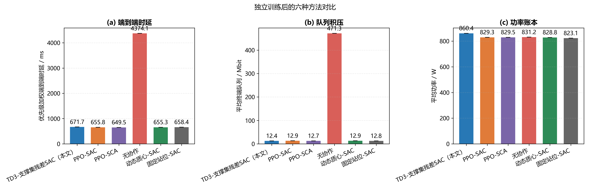
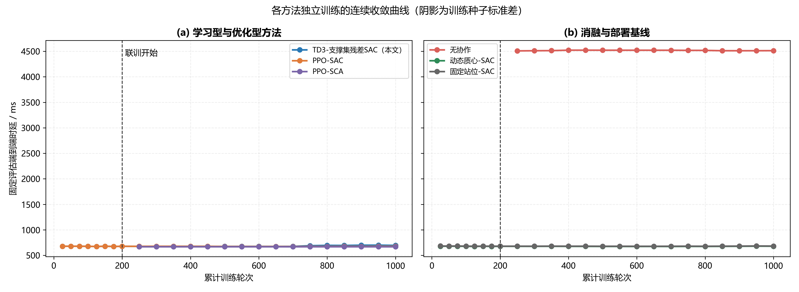
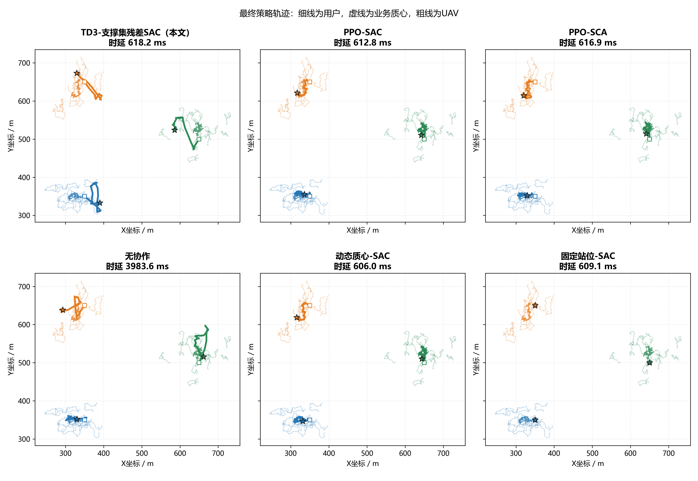
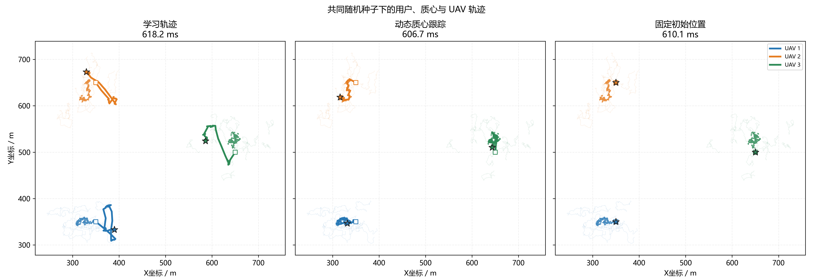
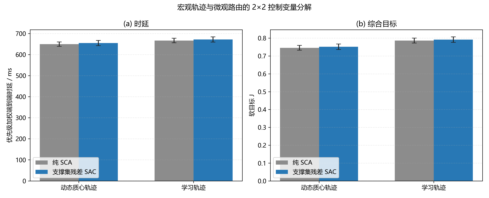
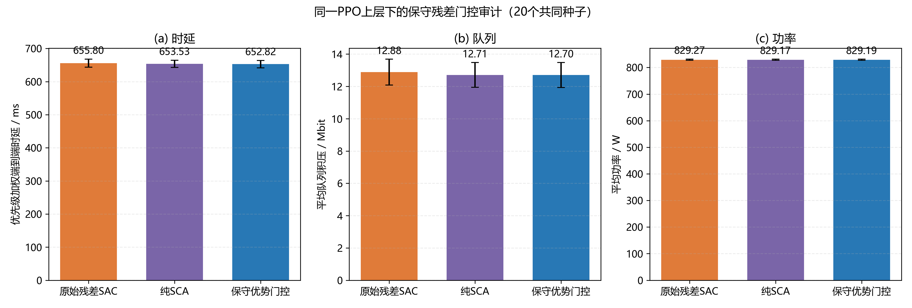

# HRL-UAV 当前结果完整分析（2026-08-20）

## 1. 先给结论

当前项目已经具备完整的双时间尺度环境、独立训练流程、共同随机数评估、轨迹记录、
队列与功率账本，代码可以正常完成“下层预训练 200 轮 + 上下层同步训练 800 轮”。
但是，当前结果只能证明**多 UAV 协作机制有必要**，还不能证明**本文的分层强化学习方法最优**。

最重要的结论有五条：

1. **协作是必要的。** 禁用 U2U 协作后，加权端到端时延从约 650 ms 恶化到
   4374 ms，低优先级时延达到 24.8 s，低优先级队列达到 471 Mbit。
2. **优先级服务规则有效。** 即使无协作，高优先级时延仍约 428 ms，高优先级队列
   仅约 0.094 Mbit；系统崩溃主要发生在低优先级业务上。这是“先高优先级、剩余算力给
   低优先级”规则的直接效果。
3. **当前下层学习增益没有成立。** 在同一 PPO 上层下，原始残差 SAC 比纯 SCA
   慢 2.275 ms；保守门控能修复约 2.981 ms，但相对纯 SCA 只快 0.705 ms，置信区间
   仍跨 0。
4. **当前 TD3 上层轨迹是有害的。** 它比动态质心多飞约 118 m，平均离业务质心多
   约 52 m，功率高约 31.6 W，协作比例却几乎不变，最终反而慢 16.849 ms。
5. **当前联合 HRL 没有证明上下层协同增益。** 六方法中 PPO-SCA 暂时最好；PPO-SAC
   与动态质心-SAC接近；TD3-SAC 排在第五。现阶段不能写“本文算法性能最优”。

本报告的主结果来自 v49 独立训练和 v50 保守门控审计。所有方法目前只完成了
**1 个训练种子**；表中的 20 个种子是同一训练模型的环境评估种子，不是 20 次独立训练。
因此，下文的置信区间只能用于该训练种子内的配对机制筛选，不能替代多训练种子统计。

## 2. 当前系统到底是什么

- 3 架 UAV、39 个地面用户、区域固定关联。
- 每个 episode 为 300 s，包含 30 个宏观周期；每个宏观周期为 10 s，其中 1 s 用于部署，
  后续为 18 个 0.5 s 资源帧。
- 地面用户采用 RPGM：组参考点移动、个体随机游走和恢复力共同决定轨迹，不再是所有用户
  沿同一方向直线平移。
- 三个区域的业务负载在 `[12.5, 5.5, 3.5] Mbps` 的排列之间切换，形成时变重载区。
- 上层输出相对动态业务质心的二维 waypoint 残差，每个宏观周期最多移动 20 m。
- 下层每个资源帧决定本地处理和 U2U 转发；U2U 的 3 MHz 是系统总带宽，按活跃链路动态分配。
- 每架 UAV 的 CPU 上限为 10 GHz，采用确定性的 `priority_demand`：先服务高优先级，
  再将剩余算力给低优先级。CPU 目前不是 RL 动作。
- 当前目标为 `0.9×时延代理 + 0.1×能耗代理`。功率是软代价和描述性指标，不再有
  280 W 聚合投影，也没有 840 W 硬预算或动态对偶。

所以，当前真正联合优化的是**宏观轨迹残差 + 微观路由残差**，不是“轨迹、路由和 CPU
频率三者都由 RL 联合优化”。论文里必须按这个口径写。

## 3. 每一层分别起了什么作用

### 3.1 用户移动与业务场景层

RPGM 已经解决了此前用户轨迹过直、所有用户像整体平移的问题。现在图中的细线呈现局部
随机弯折，同时每个区域仍保留整体移动趋势，物理上可以解释为同一热点人群中的群体移动。

这一层目前带来的主要价值是让 UAV 面对移动业务热点，而不是静态几何点。但当前数据表明，
**仅仅跟踪动态质心的收益不大但真实存在**：在相同下层控制下，动态质心相对固定站位
改善 4.259 ms，配对 95% CI 为 `[-6.021, -2.497] ms`。这说明 UAV 移动不是完全没用，
但基本跟踪只能带来约 0.65% 的时延改善。

### 3.2 CPU 与优先级服务层

CPU 不由 RL 控制，而是执行明确的优先级规则。六方法评估中：

- No-Coop 高优先级时延：427.679 ms；高优先级队列：0.094 Mbit；
- No-Coop 低优先级时延：24828.180 ms；低优先级队列：471.205 Mbit。

这说明 priority-first 确实保护了高优先级业务，但代价是资源不足时低优先级任务承担绝大部分
积压。论文中高低优先级结果必须分开画；只画一个加权平均值会遮住这一机制。

### 3.3 协作是否有用

有用，而且是当前证据最强的一层。PPO-SCA 相对 No-Coop：

- 加权端到端时延降低约 85.15%；
- 低优先级时延降低约 93.82%；
- 总队列降低约 97.31%。

因此，可以严谨地说：**在当前不均衡负载和固定 10 GHz CPU 下，U2U 转发是避免低优先级
业务长期积压的关键机制。** 但这证明的是“协作机制有用”，不是“SAC 比 SCA 好”。

### 3.4 下层 SCA、残差 SAC 与保守门控

为公平隔离下层效果，v50 固定同一个 PPO 上层，只替换微观控制器：

| 下层控制器 | 加权端到端时延/ms | 队列/Mbit | 功率/W |
|---|---:|---:|---:|
| 原始残差 SAC | 655.801 | 12.884 | 829.267 |
| 纯 SCA | 653.525 | 12.708 | 829.166 |
| 保守优势门控 | 652.820 | 12.704 | 829.195 |

具体含义如下：

- 原始残差 SAC 相对纯 SCA 慢 2.275 ms，95% CI 为 `[-0.812, 5.363] ms`；
- 门控相对原始残差 SAC 快 2.981 ms，95% CI 为 `[-5.252, -0.710] ms`；
- 门控相对纯 SCA 快 0.705 ms，95% CI 为 `[-1.826, 0.415] ms`；
- 门控仅接受 23.08% 的残差动作，约 77% 的时候回退到纯 SCA。

因此，下层当前的正确解释不是“SAC 已经优于 SCA”，而是：

> SAC 能提出少量有益修正，但也会提出大量有害修正；保守门控能识别并丢弃其中一部分风险，
> 目前已显著优于不加门控的残差 SAC，但尚未显著超过纯 SCA。

门控现在只是 checkpoint 后的零训练审计，还没有接回训练闭环，所以仍不是最终算法结果。

### 3.5 上层动态质心、固定站位与 TD3 轨迹

同一下层、同一批 20 个评估种子的控制变量结果为：

| 宏观策略 | 时延/ms | 平均路径/m | 净位移/m | 平均质心距离/m | 功率/W | 协作比例 |
|---|---:|---:|---:|---:|---:|---:|
| 动态质心跟踪 | 654.811 | 157.319 | 36.460 | 3.706 | 828.750 | 0.24313 |
| 固定初始站位 | 659.070 | 1.022 | 0.622 | 25.439 | 823.097 | 0.24308 |
| TD3 学习轨迹 | 671.660 | 275.679 | 54.014 | 55.663 | 860.379 | 0.24315 |

从这张表可以得到三个明确结论：

1. 动态质心比固定站位快 4.259 ms，说明基本的热点跟踪有小幅价值。
2. TD3 比动态质心多飞 118.36 m，路径增加 75.24%，平均质心距离增加 51.96 m，
   但协作比例只变化约 0.00002，说明这些额外移动没有转化为更多协作。
3. TD3 相对动态质心慢 16.849 ms，95% CI 为 `[14.833, 18.865] ms`，同时功率高
   31.63 W。这不是“用能耗换时延”，而是同时损失时延和能耗的无效远飞。

TD3 的总队列比动态质心低约 0.475 Mbit，但任务时延更高。原因是单一队列总量不能代表任务
经历的完整等待过程；服务位置、U2U 等待、上传等待和部署暂停共同决定端到端时延。因此不能
只根据队列略低就说 TD3 更好。

PPO-SAC 的轨迹基本停留在用户云和动态质心附近，数值上与动态质心-SAC接近：655.801 ms
对 655.255 ms。它目前证明了 PPO 比 TD3 稳健，但还没有证明 PPO 学到了超越质心的非平凡
协作轨迹。

### 3.6 联合分层训练层

v49 六方法在 1 个训练种子、20 个共同环境种子上的最终均值为：

| 排名 | 方法 | 加权时延/ms | 高优先级/ms | 低优先级/ms | 队列/Mbit | 功率/W | 软目标 J |
|---:|---|---:|---:|---:|---:|---:|---:|
| 1 | PPO-SCA | 649.457 | 461.955 | 1534.758 | 12.680 | 829.493 | 0.746550 |
| 2 | 动态质心-SAC | 655.255 | 458.970 | 1582.017 | 12.916 | 828.789 | 0.752089 |
| 3 | PPO-SAC | 655.801 | 460.082 | 1579.952 | 12.884 | 829.267 | 0.753006 |
| 4 | 固定站位-SAC | 658.362 | 463.201 | 1579.868 | 12.778 | 823.077 | 0.751263 |
| 5 | TD3-SAC | 671.660 | 481.909 | 1567.449 | 12.415 | 860.379 | 0.791721 |
| 6 | No-Coop | 4374.118 | 427.679 | 24828.180 | 471.299 | 831.157 | 4.285844 |

这张表不能被写成“PPO-SCA 已经显著最优”，因为统计单位只有一个训练种子。当前只能说：

- 在这一次独立训练中，PPO-SCA 排名第一；
- PPO-SCA、动态质心-SAC、PPO-SAC和固定站位-SAC的差距只有约 3--9 ms；
- TD3-SAC 当前明显落后；
- No-Coop 明显不可接受；
- 尚未观察到“学习上层 + 学习下层”的联合增益，反而是“PPO 上层 + SCA 下层”最好。

所以，系统是分层的、两层也确实同步更新了，但**算法结构属于 HRL**不等于**HRL 的性能贡献
已经被实验验证**。目前还缺“学习上层优于质心”和“学习下层优于 SCA”这两块证据。

## 4. 收敛情况到底怎么样

800 轮联合阶段每 50 轮评估一次，共 16 个点。下表只用于观察训练形状；它使用的评估种子
数量与最终 20 种子表不同，因此不能用这里的绝对值重新排名。

| 方法 | 首次评估/ms | 最好值/ms | 最好轮次 | 最终值/ms | 最后4点均值±标准差/ms |
|---|---:|---:|---:|---:|---:|
| TD3-SAC | 675.75 | 674.41 | 450 | 694.38 | 696.12 ± 2.67 |
| PPO-SAC | 676.25 | 672.07 | 500 | 675.64 | 674.98 ± 0.77 |
| PPO-SCA | 668.06 | 667.81 | 800 | 667.81 | 668.03 ± 0.22 |
| 动态质心-SAC | 676.27 | 673.34 | 500 | 678.42 | 677.78 ± 1.61 |
| 固定站位-SAC | 679.04 | 677.02 | 450 | 681.74 | 681.37 ± 1.73 |
| No-Coop | 4508.55 | 4508.55 | 50 | 4512.98 | 4511.97 ± 0.69 |

对“收敛”的正确解读是：

- **PPO-SCA 数值稳定**，曲线几乎不波动；
- **PPO-SAC 后期稳定**，但最终与起点接近，没有表现出明显的持续改进；
- **动态质心-SAC和固定站位-SAC稳定但改善很小**；
- **TD3-SAC 晚期退化**，最好值在 450 轮，最后比最好点慢约 20 ms。它是稳定在一个
  更差策略附近，不能称为成功收敛；
- **No-Coop 曲线虽平，但队列严重积压**。曲线平稳不等于排队系统稳定。

因此，当前可以说“训练程序能跑完，PPO 类方法数值稳定”，不能说“本文联合 HRL 已经收敛
到优于基线的最优策略”。

## 5. 时延到底由哪些部分构成

当前 v49 正式归档有总时延、高低优先级时延、队列、轨迹和功率，但还没有对 v49 六方法
统一落盘完整的逐阶段时延分解。因此，现阶段不能严谨地写“当前 PPO-SCA 具体在哪一个阶段
减少了多少毫秒”。

邻近的 v47 因果审计曾对 TD3-SAC 的 710.926 ms 做过闭合分解：

| 阶段 | 时延/ms | 占比 |
|---|---:|---:|
| U2G 上传传输 | 157.189 | 22.1% |
| U2G 上传排队 | 59.915 | 8.4% |
| 路由等待 | 49.763 | 7.0% |
| U2U 传输 | 32.653 | 4.6% |
| U2U 排队 | 89.308 | 12.6% |
| 计算执行 | 23.944 | 3.4% |
| 计算排队 | 216.213 | 30.4% |
| 部署暂停 | 81.940 | 11.5% |

这组历史数据只能用于解释机制，不能代替 v49 当前结果。它说明：位置首先改变 U2G/U2U
传输条件，随后通过队列稳定性放大到上传排队、U2U 排队和计算排队；真正占大头的往往不是
纯传输时间，而是队列等待。

论文若要回答“移动了多少米、链路速率变了多少、各阶段时延分别升降多少”，必须在最终方法
冻结后，对最终方法、动态质心和固定站位用同一批种子重新运行逐任务阶段时间戳审计。当前这项
证据仍然缺失，不能用直觉补写。

## 6. 现有图分别长什么样、能说明什么

### 图 A：六方法时延、队列和功率柱状图

图中 No-Coop 的 4374 ms 和 471 Mbit 把纵轴拉得很高，导致其余五个协作方法都挤在底部。
它能非常直观地证明“协作是必要的”，但看不清协作方法之间 3--22 ms 的差异。

论文处理：拆成两张或两个尺度。第一张只讲 No-Coop 与协作方法的数量级差；第二张放大
协作方法到约 630--690 ms，同时单独画高、低优先级时延。当前版本不适合直接作为最终主图。

### 图 B：连续收敛曲线

左图可看到 TD3 后期向上恶化，而 PPO-SCA、PPO-SAC基本稳定；右图由于 No-Coop 约
4500 ms，动态质心和固定站位约 680 ms 的曲线被压在底部，几乎看不清。

论文处理：把 No-Coop 放到单独小图或插图，主图只画协作方法并把纵轴缩到 630--720 ms；
保留 200 轮“联合训练开始”竖线，并明确 0--200 是下层预训练、200--1000 是联合阶段。

### 图 C：六方法最终轨迹

细线是用户轨迹，浅色虚线/轨迹是业务质心，粗线是 UAV。当前图的直观信息是：

- TD3 三架 UAV 出现大幅折线远飞，明显离开用户云；
- PPO-SAC、PPO-SCA和动态质心都主要停留在用户云附近，轨迹差异很小；
- 固定站位几乎不动；
- No-Coop 即使画出了移动轨迹，也无法阻止低优先级队列崩溃。

这张图目前是**诊断图而不是正面成果图**。标题中的“TD3（本文）”必须删除，因为它当前
不是最好方法。图内每个标题的时延是一个代表性环境种子的值，不是 20 种子均值，不能拿它
替代表格排名。

### 图 D：学习轨迹、动态质心和固定站位对照

这是当前最清楚的宏观层诊断图：学习轨迹明显远离用户群，动态质心紧跟用户云，固定站位
保持初始位置。它与配对数字共同证明 TD3 的额外移动是有害远飞。

论文处理：可以放在消融或机制诊断部分，但不能把它当成“本文轨迹更好”的主图。只有新方法
真的优于质心后，才能用相同样式画“本文方法 vs 动态质心 vs 固定站位”的正面轨迹图。

### 图 E：上下层贡献分解

该图将宏观轨迹和微观残差分开比较。当前结论是：

- 宏观 TD3 相对动态质心损失 16.849 ms；
- 同一 TD3 轨迹下，微观残差 SAC 相对纯 SCA 损失 5.026 ms。

也就是说，当前失败主要来自上层轨迹，其次才是下层残差。最终版本应直接在图上标注这两个
配对差和置信区间，避免读者只看柱高猜结论。

### 图 F：保守门控对比

三组柱高很接近：门控略优于 SCA，SCA略优于原始残差。该图证明门控没有破坏功率和队列，
但很难肉眼看出 0.7--3.0 ms 的差异。

论文处理：均值柱状图旁边增加“逐种子配对差”点图或森林图，标注门控接受率 23.08% 和
两个关键 CI。否则读者会认为三种方法完全一样。

## 7. 当前图还缺什么

为了形成论文中可解释的完整证据链，最终至少还缺四类图：

1. **高、低优先级分开的时延与队列图**：必须突出 No-Coop 主要导致低优先级崩溃。
2. **最终方法的阶段时延分解图**：上传传输、上传排队、U2U 传输、U2U 排队、计算执行、
   计算排队和部署暂停必须闭合到总时延。
3. **负载切换机制图**：按宏观周期画负载阶段、支援链路流量、UAV 间距离、队列和时延，
   证明 UAV 的移动确实服务于协作，而不是碰巧好看。
4. **多训练种子统计图**：至少 5 个独立训练种子，逐训练种子报告最终时延，再在训练种子层
   计算均值和 CI。20 个环境种子不能替代这一项。

CPU/任务量敏感性图现在不应该先跑。只有最终主方法在基准场景中同时超过 PPO-SCA 和动态
质心后，才值得冻结 CPU/负载网格并让每种方法、每个条件从头独立训练。

## 8. 目前论文可以写和不能写的内容

### 已经可以写

- 双时间尺度 SMDP/MDP 系统模型、RPGM 用户移动、U2G/U2U 通信、双优先级队列；
- 独立预训练与同步联训协议；
- U2U 协作对低优先级队列稳定的重要性；
- priority-first 对高优先级业务的保护作用；
- 动态质心相对固定站位的小幅跟踪收益；
- SCA 支撑集残差和保守门控的算法设计；
- 当前失败诊断：TD3 有害远飞、残差动作好坏混合、门控能降低残差风险。

### 现在不能写

- “本文 TD3-SAC 方法性能最优”；
- “学习轨迹显著优于动态质心”；
- “残差 SAC 显著优于 SCA”；
- “上下层联合学习产生了协同增益”；
- “20 个种子证明了训练稳定性”；
- “已经完成 CPU/负载鲁棒性验证”；
- “当前精确的时延改善来自某一条链路或某一个阶段”，因为 v49 阶段分解尚未补齐。

## 9. 当前最合理的下一步

当前不应继续扩大训练矩阵。最短且能保持 HRL 主线的路线是：

1. 将 PPO 作为上层主候选，暂停把失败的 TD3 标成“本文方法”。
2. 将 v50 保守门控接入训练闭环，形成“PPO 上层 + SCA 安全基线 + SAC 保守残差”的方法。
3. 先跑 1 个独立训练种子，要求最终同时优于 PPO-SCA 和动态质心-SAC，轨迹还必须表现为
   负载切换后的定向协作部署，而不是远飞。
4. 单种子通过后，再跑至少 5 个独立训练种子；然后才进入 CPU 和任务量矩阵。
5. 最终方法冻结后，补同一批共同随机种子下的距离、速率、流量和阶段时延闭合审计，再据此
   写“轨迹为什么有效”的结果分析。

一句话概括当前状态：**下层协作机制成立，优先级机制成立，训练框架成立；但学习型上层和
学习型残差下层的增益都还没有成立，所以现在的图能说明问题在哪里，还不能作为“本文算法
最好”的最终论文图。**
