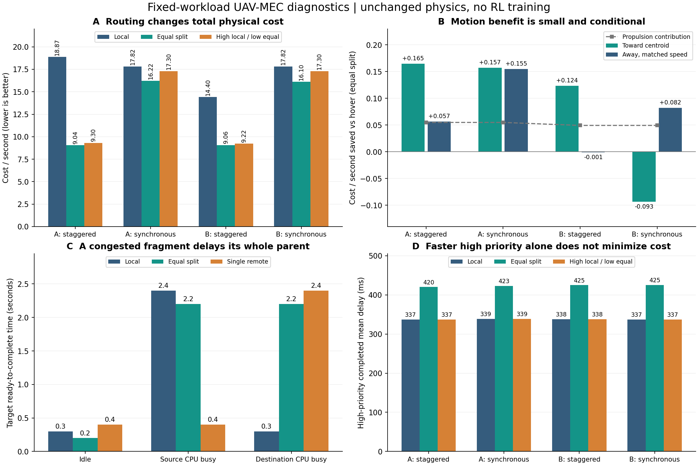

# 移动、连续分片与持续采样：实测结果和修改建议

2026-09-27，基线提交 `13c0040f3957a35929bbb18bbefbf58cbb8bf1e3`。

**结论：现有物理场景中，跨 UAV 分配计算工作的价值已被固定任务对照验证。移动能影响服务，但收益较小且依赖队列状态；简单地靠近终端、固定三等分或按优先级硬编码，都不能作为普适改法。** 本轮还直接检验并否定了“高优全部本地、低优全部三等分”这一候选规则。生产环境、网络、配置、奖励、优先级和训练日程均未改动；没有训练。

## 1. 如何验证

主对照采用两组固定布局/业务绑定：A 为 layout/load seeds `92/93`，B 为 `102/103`。每组固定 60 秒，外部任务按当前业务 profile 的 rate、busy multiplier、priority 比例及 bits/cycles，用确定性累积计数构造。没有在控制器运行期间调用随机任务生成器。

- **错峰忙**：区域 0、1、2 分别在 0–20、20–40、40–60 秒忙，其余时间 normal。
- **同步忙**：所有区域在 20–40 秒忙，其余时间 normal。

同一布局的两种时序总任务量完全相同：A 为 1,379 个任务、1.2517 Gbit、1.4845 Tcycles；B 为 1,376 个任务、1.2482 Gbit、1.47858 Tcycles。不同控制使用逐个相同的到达 tape，并校验其 SHA256。同步忙是指定的突发压力情形，不代表随机生成器中这种事件的实际发生概率。

控制对照为 3 种运动 × 2 种路由：悬停、朝固定终端算术中心移动、反向移动；全部来源 UAV 本地处理、全部父任务三等分。正反向脚本每个时刻的速度模长相同，达到预定行程后同时停止；八组配对均通过推进能量相同、无安全投影介入的检查。每次动作仍遵守现有 10 m/5 s、1 s 调整和 4 s 驻留。脚本仅使用固定几何与时钟；不会读取未来到达。

另外用三种已上传初态（空闲、来源 CPU 忙、目的 CPU 忙）比较 local/equal/single-remote。忙节点初始有 10 个高优父任务，各 1.4 Mbit/2.1 Gcycles；目标是同尺寸低优任务。它们是明确构造的 ready/CPU 初态，排除上传前史，没有免除 CPU 或转发工作。每条轨迹都完整运行 5 秒，避免提前停机导致推进能量不可比。

主对照 24×600 步，机制实验 9×50 步；看到高优转发代价后，再用全部四个场景检验一个候选规则，4×600 步。**本轮共 37 条轨迹、17,250 个物理步；加上前轮 1,451 步，合计 18,701 < 20,000。** 守恒、独立父任务 holding、成本分解、固定到达、运动配对检查全部通过。计数在实际 `micro_step` 上执行，预算在每组执行前预留；没有未记录的试跑、训练或参数搜索。

## 2. 分片的主要价值是释放闲置 CPU 容量

以下均固定悬停，cost/s 越低越好。未完成数是 60 秒截止值，不等于丢失任务。

| 场景 | Local cost/s | 三等分 cost/s | 成本下降 | 截止未完成：Local → 三等分 |
|---|---:|---:|---:|---:|
| A，错峰忙 | 18.8724 | 9.0412 | 52.09% | 89 → 5 |
| A，同步忙 | 17.8152 | 16.2173 | 8.97% | 145 → 5 |
| B，错峰忙 | 14.4047 | 9.0564 | 37.13% | 199 → 6 |
| B，同步忙 | 17.8191 | 16.1046 | 9.62% | 143 → 2 |

A 错峰忙时，Local 的三机 CPU 利用率为 99.5%、87.2%、41.4%；三等分约为 82%、82%、82%。按父任务计的 CPU-only 驻留从 7,156.4 降到 552.4 加权 task·s，上传驻留完全相同。这直接支持“协作利用闲置计算资源”的解释。

当前三个业务 profile 的解析预期 CPU 负载约为 10.517、4.158、10.050 Gcycles/s，合计 24.725，单机容量为 10、总容量为 30。两个来源负载偏高、一个偏低，与本次观察到的负载迁移收益一致。该解析均值与有限窗结果不构成队列长期稳定性证明。

同步忙与错峰忙总工作量相同，三等分的 cost/s 却从约 9 上升到约 16。说明突发的时间结构也重要：平均负载小于总容量，不保证窗口内很少排队。

## 3. 尾分片决定什么时候不该分给某个 UAV

下面是机制实验的**目标 ready→父任务完成时间**，不是包含上传前史的端到端时延：

| 受控初态 | Local | 三等分 | 全发 UAV 1 |
|---|---:|---:|---:|
| 所有 CPU 空闲 | 0.3 s | 0.2 s | 0.4 s |
| 来源 CPU 忙 | 2.4 s | 2.2 s | **0.4 s** |
| 目的 UAV 1 CPU 忙 | **0.3 s** | 2.2 s | 2.4 s |

来源繁忙时，三等分仍留在来源的正分片把父任务拖到 2.2 秒；目的繁忙时，发往该目的地的分片成为尾片。因此，**精确零分配具有真实控制价值**：不能强迫每个父任务始终使用所有 UAV，也不能通过奖励均匀分片来鼓励这种行为。现有动作空间已经支持零和不同 support，本轮不需要修改网络或动作维度。

空闲案例中，三等分的目标 CPU 能量为 10.29 J，Local 为 20.01 J，差异来自当前按实际需求调频的 κf³dt 模型；转发额外消耗约 0.048 J。这里的分片同时改善了完成时间和能耗。这个收益不能直接外推到 CPU 已经饱和时。

## 4. 移动有作用，但朝终端中心走并不保证总成本改善

| 场景，固定三等分 | 悬停 cost/s | 朝中心 cost/s | 反向、同速 cost/s | 朝中心相对悬停 |
|---|---:|---:|---:|---:|
| A，错峰忙 | 9.0412 | 8.8764 | 8.9847 | 改善 1.82% |
| A，同步忙 | 16.2173 | 16.0601 | 16.0622 | 改善 0.97% |
| B，错峰忙 | 9.0564 | 8.9328 | 9.0573 | 改善 1.36% |
| B，同步忙 | 16.1046 | 16.1979 | 16.0222 | **恶化 0.58%** |

朝中心移动在四个场景中都将已完成上传的平均时延减少约 3.3%–5.2%，但未必降低父任务驻留。例如 B 同步忙，toward 相比相同速度的 away：上传均延减少 24.25 ms，cost/s 却增加 0.175667。加权父任务阶段驻留差分为：upload −83.9、ready 0、has_transfer +244.3、cpu_only −51.9 task·s，总计 +108.5；对应 holding 成本增加 0.16275/s，CPU 成本增加 0.012824/s，推进成本差为零。

这里 `has_transfer` 意味着“父任务至少还有一个转发中的分片”，其其他分片可能同时在 CPU。上述证据说明上传改善被后续较长驻留抵消，**尚不足以把全部差额归因于某条 U2U 链路变慢**。尾片驻留是重叠子集，不再次加到阶段总和里。

还有一个必须分开的因素：当前推进公式给出每机 P(0)=194.763 W、P(10 m/s)=152.493 W。这些脚本的移动相对悬停直接节省约 0.0493–0.0549 cost/s；该部分不依赖飞向哪个方向。因此不能把总成本中的全部移动收益写成链路优化收益。本项目未计这条服务路径中的起停瞬态能耗；是否扩展该物理模型属于研究假设确认，不应通过任意运动罚项处理。

**我的判断：当前没有证据支持直接放大移动范围、调整带宽或增加距离奖励。** 上层控制的效应小于本次负载迁移效应，但存在非平凡的上传/U2U/排队耦合。也不能据这两个固定布局断言学习到的上层一定无效。

## 5. 一个直观改法被实测否定

三等分相较 Local，在悬停四组场景中增加了约 83–88 ms 的高优已完成平均时延，同时大幅减少低优积压。由此提出并检验“高优 Local、低优三等分”；其余条件与原对照完全相同。

| 场景 | 三等分 cost/s | 高优本地/低优等分 cost/s | 成本变化 | 截止未完成变化 |
|---|---:|---:|---:|---:|
| A，错峰忙 | 9.0412 | 9.2973 | +2.83% | 5 → 5 |
| A，同步忙 | 16.2173 | 17.3033 | +6.70% | 5 → 46 |
| B，错峰忙 | 9.0564 | 9.2168 | +1.77% | 6 → 49 |
| B，同步忙 | 16.1046 | 17.3039 | +7.45% | 2 → 50 |

高优均延恢复到约 337–339 ms，但低优 CPU 等待和尾分片等待上升，总成本四组全部变差。以 A 同步忙为例，低优已完成均延从 5.343 s 增至 6.539 s，低优未完成数从 4 增至 45。

因此不建议把优先级直接映射为固定本地/远端规则。当前 10:1 是软成本权重；它允许总体成本和某类平均时延之间存在取舍，不是高优任务的硬时延保障。若研究目标需要硬保障，应显式讨论约束语义，不在本轮偷偷改权重。

## 6. 建议怎样修改，按顺序推进

### 先补训练衔接的工程缺口

现有环境与 collector 的持续服务已通过验证，但保留的训练循环还不能直接使用：

| 代码位置 | 具体问题 | 建议改法 |
|---|---|---|
| `run.py:169–176` | 每窗口重新创建 adapter、随机流并 reset | 引入长期持有物理世界和随机流的 session；独立场景 reset 作为显式事件 |
| `collector.py:109–118` 与 `run.py:187–190` | collector 返回前已提交下一 upper；随后 PPO 更新使 pending upper 属于旧版本 | 拆成“到达边界/封存指标及 upper bootstrap”和“更新后提交下一上下文/补齐 lower successor”两个阶段 |
| `run.py:61–65`、`policy.py:32` | lower 阶段 value 占位 0 可能随 pending 跨入 upper 阶段 | 策略上下文显式记录 upper/lower/value 版本和模式；禁止把占位辅助值作为 PPO 数据 |
| `collector.py:15`、`ppo.py:112` | 窗口级 lower version 无法表示窗内变化；PPO 尚缺 upper 行为版本检查 | 按实际 transition/宏动作记录行为版本并校验，跨版本边界须显式处理 |
| `run.py:126–134` | checkpoint 没有物理队列、运动、到达 RNG 或 pending continuation | 独立实现 world/session state_dict 与恢复一致性测试；摘要状态也须可重建或续接 |

接口可以分为 `reach_boundary()` 和 `commit_next_context()`：前者记录物理截止、旧 value 的真实 bootstrap；调度器执行已批准更新；后者一次性提交新的上层动作、准备当前到达并补齐 lower successor。最后一条 lower transition 在补齐前必须保持 pending，不能伪造已封存状态。现有按 upper 版本隔离 replay 的契约也要延续。

这些是实现缺口，不需要先改网络或尝试一组 gamma/lambda。目标类型、各层 discount 的时间单位与值、允许何时更新/切换阶段仍应由研究者确定。本轮只静态核查这些代码，没有启动被 guard 阻止的旧训练循环；正式训练继续禁用。

### 然后验证一个能识别拥堵节点的因果基线

优先复用已有 `industrial_baselines.CVXRouting` 的 support 枚举与积压输入。它当前明确是 batch proxy：使用全链路激活速率、定频线性能量近似，不能当作实际父任务成本的精确预测。

建议保留旧基线，另加有清楚名称和记录的实验版本，逐项检验：

1. 根据当前 ready 类别批次、目的 CPU 的高低优积压、在途计算工作与有向链队列，比较各 support 的父任务尾部等待。
2. 对“既有转发链 ∪ 候选新增链”计算共享带宽和每源功率，不能只用当前 rate 或无条件使用 all-active rate。
3. 保留 exact-zero 候选，并采用与实际服务一致的能耗估计；不新增 tail reward、拥堵罚项或完成 bonus。
4. 用本轮已固定 tape 比较真实 holding、能量、高低优完成/未完成数及估计误差，而不是仅比较代理目标。该候选尚未实现或验证，不能预先称为改进。

已有因果报告提供队列顺序、remaining bits/cycles、CPU、位置、在途工作及父子关系；固定无线常量可作为公开模型输入。未来到达未知，估计值应标注为“给定当前积压的预测”，不能把离线真实完成时间注入策略。动作仍保持每 priority/source 一行，不能借基线悄悄改成逐任务动作。

### 上层保持物理规则，先改验证方法

保留当前运动时钟与幅度，复用已有 `baselines.centroid` 的因果负载权重版本作为下一项对照；本轮验证的是静态算术中心脚本，未评价该现有基线或训练策略。所有上层评价都继续拆分推进收益、上传收益、U2U/CPU 驻留与总成本。现有成本已经包含端到端父任务等待，无需再加入距离奖励。

本轮新增的阶段成本分解和配对诊断可用于后续评价；若需要常规训练日志，再把纯统计部分接入 metrics，不改变任何物理服务或 reward。

## 7. 证据、复现与本轮改动



图 A/D 使用悬停；图 B 固定三等分；图 C 排除上传前史。完成时延只在已完成任务上统计，须结合表中未完成数阅读。`has_transfer` 与 `cpu_only` 是互斥的父任务阶段，尾片统计与它们重叠。

在新输出目录复现，避免覆盖已封存证据：

```powershell
.\.venv\Scripts\python.exe -m hrl_v2.control_diagnostics --output-dir outputs/control_diagnostics_reproduction
.\.venv\Scripts\python.exe -m hrl_v2.control_diagnostics --output-dir outputs/control_diagnostics_reproduction --priority-followup
.\.venv\Scripts\python.exe -m hrl_v2.plot_control_diagnostics outputs/control_diagnostics_reproduction
```

本轮新增三个模块：`control_diagnostics.py`（固定任务配对与实际步数预算）、`control_mechanisms.py`（尾分片机制）、`plot_control_diagnostics.py`（只读取结果绘图），以及本文和证据目录。未修改现有环境、网络、采样器、学习器、基线、配置。

原始数据：[主对照](evidence/control_diagnostics/panel.json)、[机制实验](evidence/control_diagnostics/mechanisms.json)、[候选规则](evidence/control_diagnostics/priority_followup.json)、[配对检查](evidence/control_diagnostics/checks.json)、[差值汇总](evidence/control_diagnostics/analysis.json)、[预算](evidence/control_diagnostics/budget.json)、[运行结果](evidence/control_diagnostics/summary.json)、[代码指纹](evidence/control_diagnostics/provenance.json)。主对照计划与定向补充计划也分别保存。

这次证据覆盖固定 60 秒窗口、两种布局和人为规定的负载时序，用于检验机制与排除无效修改；不据此给出随机负载上的统计显著性、长期稳定性或 RL 性能结论。
