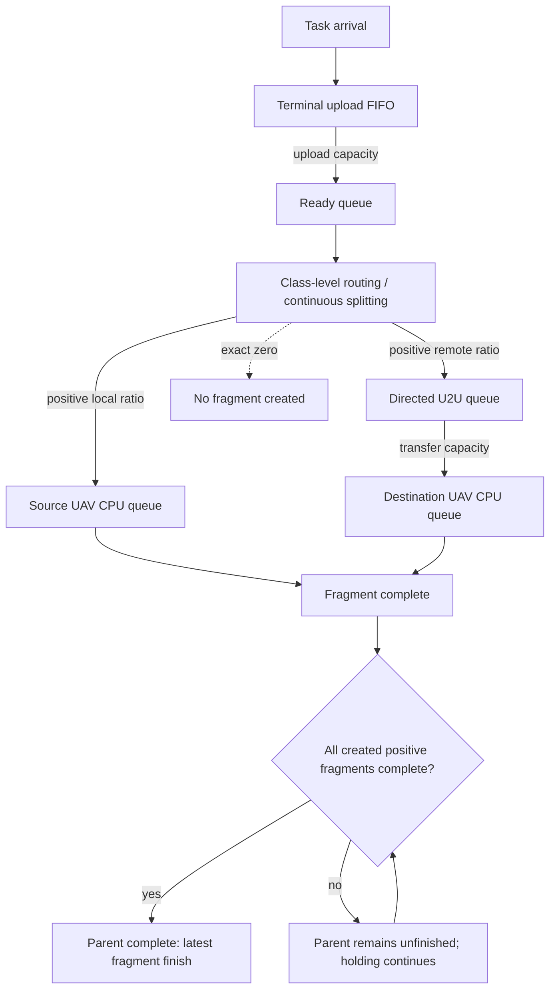

# UAV-MEC 持续服务环境与决策定义

日期：2026-09-27。范围：当前项目中的场景、MDP/POMDP、服务转移、成本、因果观测和采样边界。本文描述当前实现，不以其他项目、实验、checkpoint 或归档设计为前提。正式研究训练当前禁用，本文不宣称学习性能、长期稳定性或最优性。

## 1. 实际场景

3 架 UAV 在 1000 m × 1000 m 地图、50 m 固定高度为 39 个固定终端服务。每架 UAV 固定对应 13 个终端，source 关联在一次物理运行中不变；UAV 移动改变通信距离，不自动改变终端归属。

终端布局由 3 个区域中的热点与背景位置组成，每区域 9 个聚集终端、4 个背景终端。sensor/controller/vision 业务 profile 由场景随机化绑定；隐藏 normal/busy 活动状态调节到达率。到达在每个 0.5 s lower frame 开始按随机过程批量产生，任务当时进入所属终端的 upload FIFO。业务类型、bit/cycle 参数和高优概率以 `physical_scene.json` 为准；arrival/layout/load 使用独立种子，控制动作不改变外生任务流。

| 物理资源 | 当前实现 |
|---|---|
| CPU | 每架 10 GHz，共 3 架；每物理步按未完成需求使用容量 |
| 上传 | 总 20 MHz 固定均分给 39 个终端，每终端发射功率 0.1 W |
| U2U | 总 6 MHz 在当前活跃有向链路间分配，每个 source 的发射功率预算为 1 W |
| 物理服务步长 | 0.1 s |
| 下层控制 | 每 0.5 s 更新分片比例 |
| 上层控制 | 每 5 s 更新移动请求 |
| 运动 | 1 s 同步直线调整 + 4 s 驻留，最大目标位移 10 m、速度 10 m/s |
| 边界与安全 | 地图范围内投影，整个联合直线路径保持至少 5 m UAV 间距 |

通信速率使用当前坐标、距离信道与带宽噪声模型。CPU、上传和 U2U 都受本步容量限制。移动期间通信与计算继续服务，推进/悬停能耗始终计入。

## 2. 状态、POMDP 与决策时刻

物理潜在状态包括 UAV 位置、速度、目标和运动计时；终端位置与 source 关联；每个父任务和 fragment 的属性、剩余工作及阶段；所有 FIFO 队列；未完成计数；隐藏业务参数和活动模式。加上当前持有的分片动作与上层运动承诺，可以定义随外生到达随机变化的物理状态转移。模拟器 RNG 状态用于重复运行和恢复，不是策略输入。

控制器只得到下表中的可观察部分，因此这是 **POMDP**。完整任务/队列遥测不等于可访问隐藏工作负载状态；arrival 历史可帮助推断负载，但不能确定未来到达。

下层决策状态是在该 lower frame 到达已准备好、upper 动作已提交之后的报告；上层决策状态是在宏周期边界、下一 upper 动作提交和该边界新到达注入之前的报告。此先后顺序在每个宏边界一致，包括采样截断点。

持续服务没有本轮定义的真实 MDP 终止条件。若未来加入电量耗尽、硬截止或系统故障终止，必须显式定义并增加测试；不能把数据收集窗口当作终止。

## 3. 策略观测

`ReportV2` 是不可变、脱离模拟器的服务报告，控制器只接收报告和已经观察的 arrival 数组。

| 对象 | 当前可观察内容 |
|---|---|
| UAV | position、velocity、target、CPU 容量、各优先级计算/在途工作、近期 CPU 服务量、ready 工作、真实运动阶段与剩余时间 |
| terminal | 固定位置、source、当前上传速率、分优先级上传 bits/cycles/count/最老 age |
| parent | priority、total bits/cycles、出生时刻、age、剩余上传量、ground/ready/routed 阶段、路由时刻、存活 children、已完成 child 数 |
| fragment | source、destination、ratio、bits/cycles、剩余 transfer/compute、stage、进入时刻、parent 关系 |
| queue | 39 upload、1 ready、6 CPU、12 transfer 队列，共 58 个；完整有序 item，无 top-k 裁剪 |
| link | 当前活跃链路速率/功率、积压量，以及当前几何下假设全部链路活跃时的可计算速率 |
| arrivals | 每终端、每优先级已发生的新 bits/cycles/count 历史，使用报告的 history cursor 截取合法前缀 |

当前全链路激活速率是当前物理配置下的假设计算，不是未来网络状态。队列图表达前后顺序、前方工作量、parent/fragment 关系和当前高优积压。任务 ID 仅作关系键，不作为数值大小特征。

不输出 future arrivals、未来完成时刻、最终 tail fragment、future congestion、隐藏业务模式、隐藏生成器/RNG 状态或 seed。离线 metrics 可记录审计信息，但不反馈给策略。

报告移除了 `remaining_ticks`。graph 的两个 clock 输入改为固定尺度的 `log1p(remaining_macro_seconds)` 和 `log1p(remaining_adjustment_seconds)`；UAV 输入保留相同物理时间和 phase。parent/fragment age 从真实物理 tick × dt 与出生/进入时刻求差。没有 `tick / rollout_length` 或 rollout 倒计时，网络输入宽度保持不变。

## 4. 两层动作

上层动作是 3 × 2 的 movement request。环境裁剪分量并限制每架请求向量范数，映射到最多 10 m 目标位移，再做地图边界和联合路径安全投影。1 s 内按投影后的匀速直线移动，之后驻留；策略无法绕过速度、位移和安全限制。

下层动作是 `a[p,s,d]`，形状为 2 × 3 × 3：

\[
a_{p,s,d}\ge 0,\qquad \sum_{d=0}^{2}a_{p,s,d}=1.
\]

同一 priority + source 类别在一个 lower interval 内共享比例。ready 中的每个父任务按该类别比例创建实际 fragment；只对严格正比例创建 fragment，精确零不创建。比如 `[0.3, 0.5, 0.2]` 同时分配到三个 UAV。本轮未改成 per-task action，论文用语应是 **priority-class-level dynamic task splitting**。

当前 SAC 支持集合/Dirichlet 解码保留，物理环境也接受任意满足 simplex 的连续比例；传输资源和 CPU 资源分配仍由环境固定规则执行。

## 5. 任务状态转移与服务顺序

每物理步按以下固定顺序执行：

1. 按步首全部未完成父任务计算 holding，包括本步末才完成的任务。
2. 保存步首 ready 队列并取出待路由父任务。
3. 执行终端 upload 服务；本步新上传完成的父任务进入 ready，最早下一物理步路由。
4. 对第 2 步取出的 ready 父任务分片；本地 fragment 可在同一步进入 CPU 服务。
5. CPU 执行 strict high-priority first，优先级内部 FIFO。
6. U2U 每条有向链路执行高优先级优先、类内 FIFO；本步传输完成的 fragment 最早下一物理步获得 CPU。
7. 计入推进能耗并更新位置/运动计时，物理 tick 加一。

upload 是每终端的统一 FIFO，不因 priority 插队。ready 按队列顺序全部路由，本身不具有带宽或 CPU 服务容量。CPU 在每架 UAV 上先满足高优需求，再把剩余容量给低优；U2U 的带宽/功率在当前活跃链路上分配，不因动作产生无限容量。

父任务与 fragment 台账保留已完成记录，live 队列和 active 索引只移除实际完成工作。所有正 fragment 都完成之后，父任务 finish 为这些 fragment finish 的最大值。成本计数始终按父任务一次，不按 fragment 数量倍增。

本轮修复了绝对 epsilon 提前清除 tiny-positive 工作的问题。服务循环只在实际 remaining 为零时完成对象；极小正 fragment 也必须获得传输/CPU 服务，精确零分配仍不创建 fragment。这避免小残差被免除或长期挂起，保持 bits/cycles 守恒。数值仍采用浮点表示，测试按量级验证守恒。

## 6. 物理成本与奖励

令步首未完成高、低优父任务数量为 \(N_H(k),N_L(k)\)，\(\Delta t=0.1\) s：

\[
H_k=\Delta t\,[10N_H(k)+N_L(k)].
\]

\(H_k\) 的单位是加权 task·s。\(E_k\) 是本步实际 upload、U2U、CPU、propulsion 能耗之和，单位 J。保持当前 normalization：

\[
c_k=0.9\frac{H_k}{10\ {\rm task\cdot s}}
    +0.1\frac{E_k}{14\ {\rm J}}
    =0.09H_k+\frac{E_k}{140}.
\]

最后一式的数值系数对应上述单位。归一化 cost 为数值指标，报告 cost/s 时使用实际观察秒数。CPU 动态能耗按 \(\kappa f_{\rm total}^{3}\Delta t\) 计算，\(\kappa=10^{-28}\)；上传和 U2U 按实际服务时间乘发射功率计费；推进/悬停覆盖整个物理步。

两层优化使用同一个物理 cost：

\[
r_\ell=-\frac1{100}\sum_{k\in{\rm lower}(\ell)}c_k,\qquad
R_m=-\frac1{100}\sum_{k\in{\rm upper}(m)}c_k
    =\sum_{\ell\in{\rm upper}(m)}r_\ell.
\]

因此每窗口满足 \(-100\sum_\ell r_\ell=-100\sum_mR_m=\sum_kc_k\)。上层 reward 不是 SAC loss、Q 值或距离 reward。没有接近中心、均匀分片、更多转发、CPU 利用率或完成任务 bonus。

本轮不改变 discount、alpha 或其他学习超参数。物理奖励一致性不等于已选定 continuing-service 的折扣或长期平均成本学习算法；这一研究问题仍待确认。

## 7. 采样窗口与真实 successor

`ClockConfig` 从单一 `rollout_seconds` 和 physical/lower/upper interval 推导计数并检查整除。默认 900 s 对应 9000/1800/180 个物理步、下层步和上层步；改 60 s 得 600/120/12。物理世界本身允许越过这些 tick。

正常最后 transition 为：

\[
(o_t,a_t,r_t,o_{t+1},
\ {\tt terminated=False},\ {\tt truncated=True}).
\]

截止处理顺序：

1. 完成本窗口最后物理服务步。
2. `finish(adapter,start_snapshot)` 先冻结窗口指标，`snapshot` 记录下一窗口起点。这时未注入截止时刻的新 arrival。
3. 保存下一 upper 的 **precommit** 报告，作为当前 upper transition 的真实 successor。
4. 用该报告采样并提交下一 upper 动作，准备同一时刻下一 lower frame 的新到达。
5. 保存第 4 步后的报告，作为最后 lower transition 的真实 successor。
6. 把已提交动作、上下层报告和 metrics 起点存入 `adapter._continuation`。
7. 下一次 `collect` 消费该 continuation；不重采上层动作、不重复 prepare、不 reset、不重启 arrival RNG。

上层 successor 和下层 successor 对应各自决策时刻，所以前者是 precommit，后者含下一上层已提交动作。边界 preparation 不推进时间。未完成队列没有被清空，截止点之后才到达的任务不混入前一窗口统计。

`Episode` 只是已封存的 rollout 数据容器名称，`complete=True` 指数据齐全，不表示物理系统终止。`reset` 是另起独立物理场景的显式操作，也会清除 pending continuation，不能作为截断后继。

## 8. Bootstrap 与 GAE

SAC 仅用 `terminated` 屏蔽 successor：

\[
y_t=r_t+\gamma_L(1-\mathrm{terminated}_t)
 \left[\min_iQ_i(o_{t+1},a')-\alpha\log\pi(a'|o_{t+1})\right].
\]

人工 truncation 仍计算真实后继值。PPO 使用：

\[
\delta_t=R_t+\gamma_U(1-\mathrm{terminated}_t)V(o_{t+1})-V(o_t),
\]
\[
A_t=\delta_t+\gamma_U\lambda
(1-\mathrm{terminated}_t)(1-\mathrm{truncated}_t)A_{t+1}.
\]

截断保留 bootstrap，同时中断跨窗口 GAE trace；真正 termination 同时屏蔽 bootstrap 与 trace。测试可以注入不同的测试 gamma/lambda 验证公式；现有 1.0 数值仅保留，并未批准为 continuing research 的选择。

`run.require_research_protocol` 对 train/resume 无条件 fail-fast。恢复持久化、持续环境与上层已提交行为版本如何跨优化器更新衔接，需要另行设计；当前 collector 拒绝把已提交 upper 动作冒充为另一个 upper policy version。

## 9. 评价与删失

每个窗口至少输出 cost/s、高低优完成时延、pooled weighted completed delay、完成数、未完成数/率、最老未完成年龄、upload/ready/U2U/CPU backlog 和 energy breakdown。父任务未完成时其最终 delay 为 `None`，记录 `censored=True` 和 cutoff age。没有 deadline 模型，不使用 failed/dropped/deadline missed 解释这些任务。

相邻窗口统计区分 `carry_in` 与本窗口 `arrived`：

\[
N_{\rm carry\ in}+N_{\rm arrived}
=N_{\rm completed\ in\ window}+N_{\rm unfinished\ at\ cutoff}.
\]

完成/未完成率分母为窗口服务 population。完成时延使用出生到完成的完整生命周期；holding 只计窗口内驻留。对窗口 \([t_0,t_1]\)：

\[
\sum_kH_k=
\sum_{j\in{\rm window\ population}}w_j
[\min(T_j,t_1)-\max(b_j,t_0)],
\]

未完成任务取 \(T_j=t_1\)，实现用整数物理 tick 计时。队列积分按 physical step 步首工作量累加；cutoff backlog 是截止瞬间值，两者口径不同。

Pooled cost 使用总 cost / 总秒数，pooled delay 按高/低权重 10/1 的完成任务数加权；同时保留删失计数、能耗、队列和最老年龄。连续窗口中的同一未完成父任务可多次出现在 cutoff 统计，因此 pooled 未完成数是各 cutoff 的计数之和，不是去重后的丢失任务数。不能单独使用 completed-only delay 宣称性能提升。

## 10. 当前限制与后续研究决定

- 完成时间量化到物理步末。上传和传输服务可记录步内时长，但 CPU/parent 完成以 0.1 s 网格报告；流程级联有上述离散一步等待。
- 移动为瞬时切换速度的同步直线段，没有加速度、转弯动力学或风；安全距离对当前连续直线路径检查。
- 无任务结果回传服务，没有建模 result-downlink 的容量、延迟和能耗。
- 全队列即时遥测与控制开销未计费；CPU 模型主要计动态功率，不代表实测设备整体功耗。
- 父/fragment 台账与完整 arrival 历史随持续运行增长，当前没有有界历史截断或历史归档机制；不会为了资源节省偷偷清除在途任务。
- 已测试同进程 continuation 与内存状态副本恢复。完整环境含 hashlib 状态，不能直接依赖普通 pickle 获得持久 checkpoint；磁盘级环境、RNG、history、pending action 和 hash 恢复协议尚待设计。
- 优化目标应采用何种长期平均成本或折扣形式、gamma/lambda、alpha、训练 schedule、reset/warm-up/评价统计范围，需要研究者决定。本轮没有重新设计网络或训练方案。
- baseline 保留当前规则；未来改变物理/控制时钟后，需重审其固定历史与动作假设。
- 没有训练、没有策略优越性结论、没有证明任何随机负载下队列长期稳定。物理单元与集成测试证明的是已覆盖模型合同。

修改清单、测试映射和实测结果见 [本轮验证交付](CONTINUING_SERVICE_VALIDATION.md)。`_reference/` 及 `docs/evidence/` 中其他历史归档材料不作为本轮当前模型或性能的验证来源；本轮原始验证记录单独存放在 `docs/evidence/continuing_service/`。
