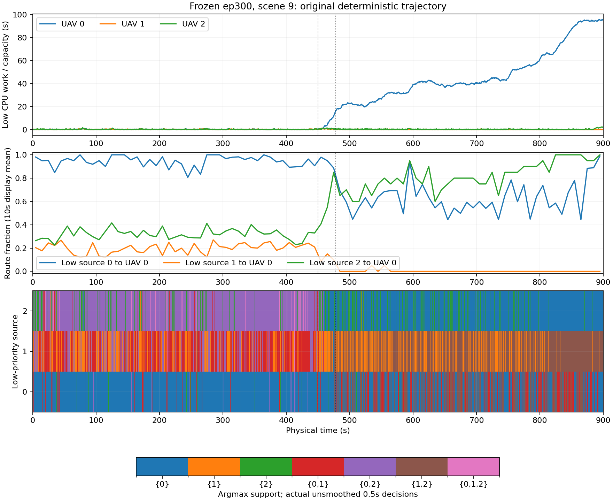

# 场景 9 冻结诊断：正常负载的收益与拥塞恢复失效

本轮已执行，未训练。原场景、源码、配置、G1、ep300 权重和全部优化器计数保持不变。训练仍暂停于 G1；没有进入第 301 轮。研究源码提交为 `4f8198ac1e0ce391b2860cfbbfa896f5412a73ce`。

**可确认的结论：SAC 在正常场景中通过更多本地计算减少转发驻留，确实有收益；场景 9 出现积压后，策略没有持续减轻拥塞 CPU 的负载。连续采取减负动作能救回队列，但只改一次动作通常不够。现有结果不支持将原因直接二分为“actor 没跟上”或“critic 排序全面错误”，更不能据此把自动温度认定为修复。**

## 1. v1 的 573 ms 确为确定性评估

已对用户指定的 `sac_only_wireless6_long_seed101` 补齐实际调用链，三个当前旧源码文件均与该实验 manifest 的 SHA256 一致：

- 旧 `experiment.py:64`：`rollout(..., train=False)` 默认不训练。
- `experiment.py:177–186`：评价调用这个 rollout，没有覆盖 train 为 True。
- `experiment.py:102`：下层调用 `choose_action(..., deterministic=not train)`。
- `agents/sac_agent.py:243–253`：确定性分支令 `pre_tanh_action=mean`，然后 `tanh(mean)`；MDP 再投影成路由比例。
- `wireless_long.py:342`：运行记录明确写 `evaluation_train=False`。

完整原文、行号和指纹见 [v1_evaluation_evidence.json] — 历史附件（未包含）：`v1_evaluation_evidence.json`。v1 的两验证场景 563.130 ms、三开发场景 573.307 ms 都不是随机 Gaussian 评价结果。

这确认了评价执行方式不同，但不能因此把 v1 的已完成时延 573 ms 与 v2 的截断时延 679 ms 当作同一面板上的实际差距。场景、部署规则和指标仍不同。本轮没有重评估 v1，也没有加载旧权重。

另一个重要区别：v1 manifest 的 replay **容量**为 100000，v2 当前为 55 × 1800 = 99000，几乎相同；v1 的 108 万与 v2 的 54 万是**累计经验生成量**。不能用后者直接推出当前池容量应该翻倍。

## 2. 原轨迹与锚点

重新记录当前冻结 ep300 的全部 20 个确定性悬停场景，每场景 900 秒；逐帧保存路由、七类 support 概率、选中浓度、CPU 工作量、潜在速率及 110 维观测。20 个场景的成本、holding、未完成数、完整父任务账本、到达事件哈希均复现上轮结果。

积压阈值在运行前确定为：从 30 秒起，在下层决策边界上首次出现最大低优 CPU 剩余 cycles / nominal cpu_hz 达到 1、5、15 秒；另外固定保存 450 秒状态。这个量是**名义 CPU 工作量秒数**，不是包括高优抢占的实际等待时间。

| 锚点 | 物理时刻 | 最大低优 CPU 工作量 | 最终 replay 中达到同等或更高工作量的状态比例 |
|---|---:|---:|---:|
| 低积压参照 | 52.5 s | 1.036 s | 21.281% |
| 固定时刻，快速增长前 | 450.0 s | 0.629 s | 37.482% |
| 中度拥塞 | 465.5 s | 5.757 s | 4.972% |
| 重度拥塞 | 477.5 s | 15.428 s | 0.698% |

覆盖比例来自最终保留的 99000 条 replay 状态，不代表全部训练历史，也没有检验这些相似积压状态里是否包含有效恢复动作。四个锚点的 110 个特征均在保留训练样本的逐维 min/max 范围内；这也不保证联合状态分布充分覆盖。

原确定性轨迹在 450 秒前，三个 CPU 的低优工作量最大约 1.67 秒；之后 UAV0 快速增长，最终约 95.7 秒。600–900 秒内，低优 source2 平均路由的 **85.5%** 发往 UAV0，source0 约 **62.8%**。最终 replay 的最大低优 CPU 工作量约 **34.0 秒**，因此后段的积压幅度超过了这个保留样本范围。不能反过来断言最初的拥塞触发也是越界造成的。

图中路由曲线仅按 10 秒窗口作显示平均，执行没有平滑；底部显示真实 0.5 秒决策的 argmax support。

## 3. 分支设计：不能拿连续策略效果直接判单步 Q

每个分支从同一份完整物理快照出发，保留队列、父任务、在途分片、EMA、环境随机流和已准备的到达。快照点的上层动作和 arrivals 不重复提交，不调用 reset。所有分支维持 UAV 悬停。

五种候选动作/规则：

1. SAC：现有 argmax support + 条件均值。
2. equal：六行都三等分。
3. avoid_low：高优行沿用当前确定性 SAC；低优三行避开低优 CPU 积压最大的目的地，在另外两处等分。
4. inverse：六行都按 `1/(CPU_total_cycles/cpu_hz + 0.5s)` 归一化分配。
5. equal_low：高优沿用当前确定性 SAC，低优三等分。

执行三种明确分开的对照：

- **一次动作 + 随机 SAC 接续**：只强制当前 0.5 秒动作，后面继续冻结的原随机 actor。四个锚点、五动作、四组配对随机起点，共 80 条 60 秒分支。对应训练 soft Q 的策略接续方式。
- **连续规则**：每 0.5 秒按候选规则重新计算，持续 60 秒。四个锚点、五策略，共 20 条分支；原确定性 SAC 为各自对照。
- **一次动作 + 确定性 SAC 接续**：为排除上面两组接续策略不同的混淆，补做 465.5 和 477.5 秒两处，每处五动作，共 10 条分支。

30 秒结果从同一 60 秒分支的中点读取，没有另跑或重置。环境到达的逐父任务身份、出生、优先级、bits/cycles 在每一组各分支中配对一致。

随机接续保留原 `sample()` 和 CPU float64 Dirichlet 后端，只给各配对分支同一帧的 support/ratio 生成器设置相同起点，避免前一帧条件 Gamma 消耗量不同让之后所有帧失配。这不是声称不同分布参数下抽到了完全相同的动作或 Gamma 数值；原始四组结果全部保存。

## 4. 真实救场效果

下表为 60 秒窗口内的原始加权 holding 相对原确定性 SAC 的变化，**负数表示改善**，不包含学习奖励或熵；单位不同的窗口之间不直接比较绝对 holding。

| 起点 | 三等分，持续 | 避开拥塞 CPU，持续 | 积压反比，持续 | 仅低优三等分，持续 |
|---|---:|---:|---:|---:|
| 52.5 s | +8.56% | +6.96% | +8.76% | +4.42% |
| 450.0 s | −16.02% | −10.53% | −18.01% | +5.86% |
| 465.5 s | +11.09% | **−26.57%** | **−28.25%** | +48.55% |
| 477.5 s | +52.64% | **−38.24%** | **−25.73%** | +78.65% |

在 477.5 秒处，继续原确定性 SAC 的 60 秒 holding 为 12405.4 task·s，末尾未完成 200 个；持续 avoid_low 为 7661.2 task·s、未完成 **8 个**，inverse 为 9213.5 task·s、未完成 **7 个**。

三等分从空场景开始表现好，不意味着拥塞之后立刻切换三等分能恢复：它仍会把每个新低优任务的一片发到已经堵塞的 CPU，父任务必须等最慢分片。此处持续避开拥塞节点的物理效果已经得到配对验证。正常状态又是原 SAC 更好，说明需要的是根据状态采取并保持恢复行为，不能用一个固定规则全程替换。

尤其要看干预时长：

| 起点 | 一次 avoid_low，后续确定性 SAC | 持续 avoid_low | 一次 inverse，后续确定性 SAC | 持续 inverse |
|---|---:|---:|---:|---:|
| 465.5 s | −2.07% | −26.57% | +2.36% | −28.25% |
| 477.5 s | **+2.99%** | **−38.24%** | **+4.26%** | **−25.73%** |

这里两边接续方式已经控制住。仅修正一次坏动作并不等同于改变之后的恢复策略；后者才有大的效果。477.5 秒的 inverse 在前 30 秒 holding 仍比 SAC 多 1129.0 task·s，60 秒时才少 3191.9 task·s；avoid_low 在 30 秒时已经少 457.1 task·s。不能只看终点未完成数量而忽略过渡成本。

全部原始 holding、物理成本、能耗、未完成量及 30/60 秒配对差值见 [tables.md](tables.md)、[summary.json] — 历史附件（未包含）：`summary.json` 和 `branches/`。

## 5. critic 排序：发现局部不一致，但不支持简单二分

critic 同时读 Q1、Q2，并采用 `min(Q1,Q2)`，数值越大越好。450、465.5、477.5 秒处均将原 SAC 的当前动作排第一；52.5 秒则将 equal_low 和 avoid_low 排在 SAC 前面。

两个关键例子：

- **465.5 秒，avoid_low**：critic 的 Q 差为 **−0.002630**，认为略差于 SAC。但一次替换后继续随机 SAC，四组 60 秒 holding 有 3 组改善；有限窗口 soft return（含后续熵，排除当前动作熵）有 **4/4 改善**。这是局部排序不一致的证据。加入同一 critic 的尾部估值后为 3/4 改善；不能用自举值当作独立真值来证明自己。
- **477.5 秒，avoid_low**：Q 差 **−0.075784**。一次替换后继续随机 SAC，四组 holding **0/4 改善**，有限 soft return 也 0/4 改善；另一个确定性接续交叉对照同样变差。这一处的有限窗口结果与 critic 偏好原单步动作一致，却不妨碍**连续换策略**显著变好。

因此，不能拿第二种连续规则的改善推导原 critic 一定排错。Q 学的是“当前动作后继续当前随机策略”，不是“当前动作后永久改用 avoid_low”。反过来，也不能因为一个锚点方向一致就宣布 critic 全部正确。仅有四组随机接续，不报告可靠尾延迟、显著性或普遍正确性结论。

报告还分别保存了物理折扣回报、后续熵项、有限 soft return，以及使用在线/target critic 的尾部估值。60 秒对应 120 个路由帧，`gamma^120≈0.2994`，剩余尾部权重仍明显，有限窗口无法完整验证无限时域 soft Q。各候选动作处的 `Q−alpha*ell` 和逐行条件均值 Q 探针也已记录，但它们不是随机 actor 的完整期望目标，不能仅凭一个点值认定 actor 优化滞后。

## 6. support 切换不是失败场景独有

- 16 个获胜场景：低优行每相邻决策的平均 argmax 切换率 **54.92%**。
- 4 个落后场景：对应平均 **61.96%**。
- 场景 9 三条低优行：**39.91% / 59.92% / 33.57%**；0 次精确概率并列。
- 场景 9 的 2400 次低优 support 切换中，任一端第一、第二概率差 <0.05 的有 **417 次（17.38%）**；两端都 <0.05 只有 **11 次（0.46%）**。

频繁切换真实存在，但多数并不是两个几乎相等概率之间的数值抖动，获胜场景同样大量切换；这不能单独支持“加迟滞/平滑就能修复”。没有运行平滑或固定 support 的因果消融，本轮也没有改变解码规则。

所有场景的概率间隔、A→B→A 返回、停留长度和完整 support 转移矩阵分别在 `trace_summary_*.json`、[switch_detail.json] — 历史附件（未包含）：`switch_detail.json`、`trace_*.npz`。

## 7. 16 个获胜场景靠什么赢

按**实际分配的 cycles** 加权，而不是对空闲时刻的动作简单平均：获胜场景的高优本地比例约 **92.02%**、低优约 **69.81%**。这与“所有任务都尽量平均分片”明显不同。

下面对 16 个获胜场景分别计算加权阶段驻留，再作场景算术平均，单位为 ms：

| 阶段 | SAC | 三等分 | SAC−三等分 |
|---|---:|---:|---:|
| upload | 256.556 | 256.556 | 0 |
| ready | 49.525 | 49.525 | 0 |
| U2U | **20.566** | 107.711 | **−87.145** |
| CPU | 210.611 | 156.906 | +53.704 |
| 合计 | **537.258** | 570.699 | **−33.441** |

直接观察到的收益是：**较少转发，节省的 U2U 驻留超过增加的 CPU 驻留**，同时高低优路由明显不同。upload 和 ready 完全一致。这里的阶段指标含排队，并沿父任务最后完成分支拆分，不是纯发送时长；不能把上述表扩大为已经证明了某一个网络特征的因果作用。

积压反比规则从头运行不胜三等分，并不意味着积压信息无用：本轮同一规则在已拥塞状态能够明显救场。正常状态的效率与异常状态的恢复，需要分开判断。

## 8. 对 v2_2_2 的含义

本轮支持把问题收窄为**已学到正常负载下的路由效率，但拥塞后的持续恢复行为不足**。这并不是“没有下层信号”，也不是可由一次确定性解码更换解决的全部问题。

现在不应直接把唯一改动指定为自动温度、提高 actor 学习率或增加 actor 更新次数：重度拥塞锚点的 actor 与 critic 对当前动作的偏好是一致的，单步替代并没有稳定收益；存在的局部 Q 排序不一致又不能被忽略。前面的 actor/critic 二分法没有覆盖“当前接续策略无法恢复”的情况。

若安排下一项单因素研究，更贴近现有证据的方向是**拥塞后的恢复轨迹覆盖**，尤其要区分“见过大积压”与“见过持续减负后队列恢复”。本轮只审计了积压幅度覆盖，未证明当前训练缺失哪类完整恢复轨迹，也未验证一种新的采样方案有效；因此不把简单扩大 replay、调温度或引入脚本恢复数据直接实施为已证实修复。是否改变采集方式属于下一版本的研究决定。

新版本的确定性主评估、随机压力评估和逐场景失控检查可作为预注册评价协议单独记录；原 G1 仍然失败。本轮没有选容忍阈值、改训练日程、改场景、改 checkpoint 保存频率或开始 v2_2_2。

## 9. 执行、误差与文件

- 完整轨迹：20 × 9000 = **180000 物理步**。
- 110 条 60 秒分支：**66000 物理步**。
- 首次快照工具异常前的重复前缀：**525 物理步**。
- 实际总计：**246525 物理步，0 学习更新，0 replay 写入**。
- 分支独立父任务驻留积分最大误差：**6.37e−11 task·s**；物理成本恒等式最大误差：**1.07e−10**。
- 20 条原轨迹与上轮父任务账本一致；各分支组到达配对一致；补充对照的 SAC 控制组与原持续 SAC 控制结果完全一致；模型参数、计数、源码、配置、场景与原 checkpoint 哈希均未变。

工具曾发生两次异常，均已修复并保留证据：首次是 SHA256 对象不能直接 pickle，诊断工具改为记录完全相同的 hash 输入字节并恢复哈希；它不参与物理决策或抽样，随后完整场景的事件哈希与原结果一致。第二次是 Windows NumPy 索引转 torch 时为 int32，诊断工具显式使用 int64；发生于 Q 审计，未推进额外物理步。前 8 个、随后全部 20 个已完成轨迹均复用，未从头重跑。`failure_attempt1.json`、`failure_attempt2.json` 及对应脚本和日志保留；它们是已解决的诊断工具错误，不是训练异常。

主要执行进程累计约 13.8 分钟，另有脚本准备、两次工具修复及结果整理时间。`results.json` 的 `wall_seconds` 只指复用缓存后的最后主进程，不能当作整个诊断耗时。

- [summary.json] — 历史附件（未包含）：`summary.json`：全部数值摘要、配对原始差值、实际步数和误差。
- [tables.md](tables.md)：每个锚点、干预方式和候选动作的对照表。
- [results.json] — 历史附件（未包含）：`results.json`、[continuation_control_results.json] — 历史附件（未包含）：`continuation_control_results.json`：完整结果。
- [contract.json] — 历史附件（未包含）：`contract.json`、[continuation_control_contract.json] — 历史附件（未包含）：`continuation_control_contract.json`：事先确定的规则和身份。
- [diagnose.py] — 历史附件（未包含）：`diagnose.py`、[check_deterministic_continuation.py] — 历史附件（未包含）：`check_deterministic_continuation.py`：冻结诊断工具。
- [summarize.py] — 历史附件（未包含）：`summarize.py`、[plot_trace.py] — 历史附件（未包含）：`plot_trace.py`：只读数据汇总和制图。
- `anchor_*.pkl.gz`：仅诊断用途的完整分支快照，不是训练恢复 checkpoint。

全部新文件仅在 `outputs/diagnosis_scene9_20260928/`；没有研究代码提交。原训练目录仍为 `outputs/lite_v2_2_1/seed_4101_20260928_003614_657543`，合法 ep300 checkpoint 原封保留。监控和训练均未自动恢复。
