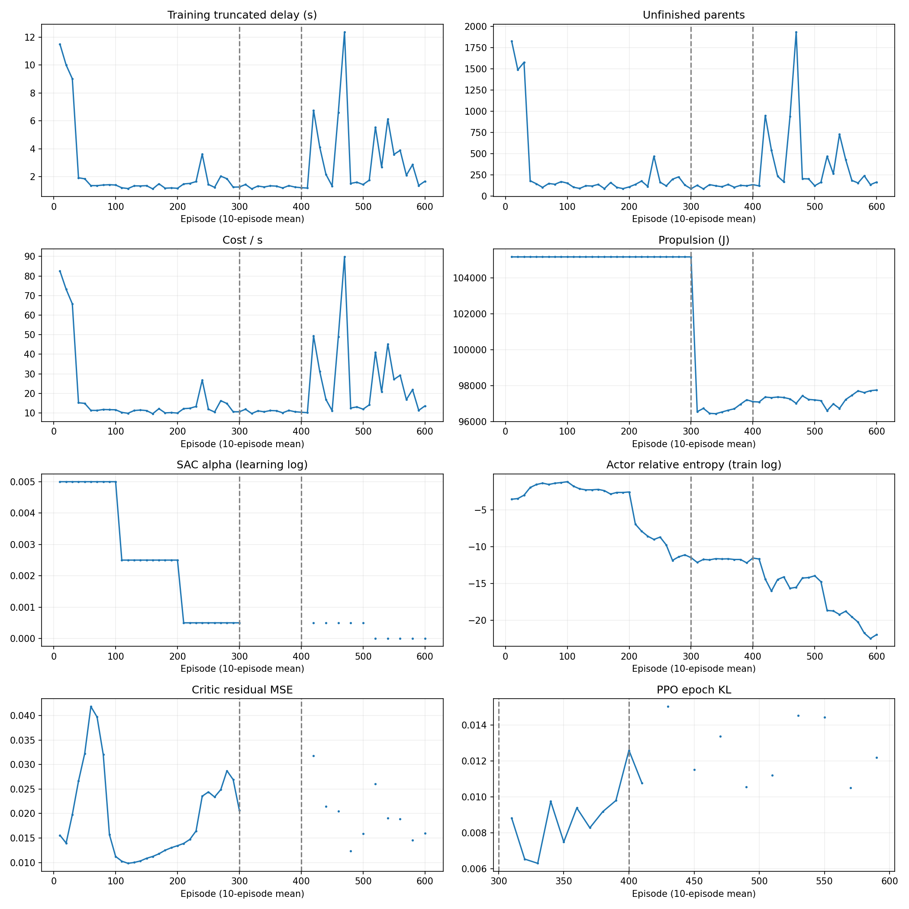

# v2.4.0 seed 4101 只读结果分析

| 项目 | 结果 |
|---|---|
| Proposed状态 | training_complete_performance_not_yet_accepted |
| 最终轮次 | 600 |
| 开发最佳轮次 | 400 |
| G1 | True |
| 600轮移动/悬停场景均值(s) | [1.605844533500361,1.4021069748692296] |
| 600轮改善/胜场 | [-0.1453081414491455,3] |
| Proposed进程wall_seconds | 33095.405235 |
| 采样时间 | 2026-09-30T10:30:31.702960+08:00 |

仅读取既有JSON及选择规则源码；无训练、无评估、无checkpoint加载。表格六位小数；summary.json保留原精度。D=确定性(stream 0)，S=随机(stream 1、2)，H=hover，M=moving。缺失不补造。

## 1. 队列与耗时

queue_status.json.wall_seconds：缺失。队列状态及当前任务：{"status":"training","current":"NC","updated_at":"2026-09-30T10:15:04.210736+08:00","pid":92972,"child_pid":95804}。Proposed.process.json.exit_code=0。

| 阶段 | 轮数 | work秒 | checkpoint秒 | eval秒 | snapshot秒 | wall秒 |
|---|---|---|---|---|---|---|
| [1, 300] | 300 | 10317.340382 | 730.858192 | 968.097399 | 0.400138 | 12125.701104 |
| [301, 400] | 100 | 1598.754845 | 265.149490 | 1959.161450 | 0.178816 | 3860.273217 |
| [401, 600] | 200 | 5796.379222 | 119.401026 | 11080.769215 | 0.351777 | 17069.545020 |

上述为日志字段求和；eval包括评价路径自身工作，不另把内部存档重复计入checkpoint。进程墙钟与逐轮wall统计范围不同，不将差额猜成某项开销。

| 阶段 | 积压轮数(unfinished≥500) | work秒 | checkpoint秒 | eval秒 | wall秒 |
|---|---|---|---|---|---|
| [1, 300] | 28 | 1795.389004 | 14.613926 | 0.000008 | 1820.218210 |
| [301, 400] | 0 | 0 | 0 | 0 | 0 |
| [401, 600] | 32 | 1939.047323 | 29.318761 | 2641.303434 | 4621.322481 |

积压轮编号：[4,5,6,7,8,9,10,11,12,13,14,15,16,17,19,20,21,22,23,24,25,26,27,28,29,36,233,273,415,416,417,419,420,422,424,428,431,438,453,457,460,465,468,469,470,490,515,516,517,520,523,527,538,539,540,542,543,549,555,578]。

## 2. Gate与最佳轮次

| G1对比 | candidate均值s | reference均值s | wins |
|---|---|---|---|
| equal | 1.263159 | 1.309345 | 17 |
| local | 1.263159 | 5.704879 | 20 |

G1 unfinished report_only原文：

```json
{
  "rule": "report_only_not_a_pass_condition",
  "per_episode": {
    "candidate": {
      "total": 2701.0,
      "by_priority": [
        265.0,
        2436.0
      ]
    },
    "hover_equal": {
      "total": 2474.0,
      "by_priority": [
        270.0,
        2204.0
      ]
    },
    "hover_local": {
      "total": 13545.0,
      "by_priority": [
        253.0,
        13292.0
      ]
    }
  },
  "candidate_within_equal": false
}
```

| 轮次 | moving s | hover s | wins/20 | 改善比例 | moving未完成 | hover未完成 | 弱信号 |
|---|---|---|---|---|---|---|---|
| 400 | 1.287655 | 1.263159 | 7 | -0.019393 | 2900 | 2701 | True |
| 440 | 1.695096 | 1.768025 | 11 | 0.041249 | 5477 | 5716 | True |
| 480 | 1.608533 | 1.480799 | 2 | -0.086260 | 4586 | 4311 | True |
| 520 | 3.230748 | 3.179720 | 5 | -0.016048 | 5549 | 5978 | True |
| 560 | 2.942672 | 2.737530 | 7 | -0.074937 | 4938 | 3373 | True |
| 600 | 1.605845 | 1.402107 | 3 | -0.145308 | 3323 | 2597 | True |

diagnosis_required.json（递归仅移除pairs，其他值原样）：

```json
{
  "episode": 600,
  "gate": {
    "gate": "G2",
    "weak_upper_signal": true,
    "paired": {
      "scenarios": 20,
      "wins": 3,
      "candidate_mean_s": 1.605844533500361,
      "reference_mean_s": 1.4021069748692296,
      "relative_improvement": -0.1453081414491455,
      "candidate_unfinished": 3323,
      "reference_unfinished": 2597
    },
    "action": "continue_to_600"
  },
  "stage_delay_s": {
    "moving": {
      "upload": 1.145275495125934,
      "ready": 0.04980933244262676,
      "u2u": 0.17001463624378052,
      "cpu": 0.2430967615174972
    },
    "hover": {
      "upload": 0.9056313267609162,
      "ready": 0.049963833027600046,
      "u2u": 0.18588093671959738,
      "cpu": 0.2632114168396495
    }
  },
  "candidate_training_authorized": false
}
```

result.json.development_best_episode=400。选择规则见src/hrl_v2/run.py:344–345：排除300，在其余节点的主评估moving.cost_per_s中选最小，平局取较早轮次；不是按G2胜场或随机面板选择。

| 节点 | 确定性moving.cost_per_s |
|---|---|
| 400 | 10.697889 |
| 440 | 13.600743 |
| 480 | 12.980880 |
| 520 | 24.423451 |
| 560 | 22.381633 |
| 600 | 12.957389 |

注意：G1文件中的per_episode.total仍是20个场景归一化后的合计，不是每个窗口均值；candidate 2701/20=135.05，equal 2474/20=123.7，local 13545/20=677.25。第4节统一按单episode报告。

## 3. 各节点评估明细

以下时延为summary.by_mode的池化值；stage为加权驻留时延分解。priority的mean_delay_ms只含已完成任务。energy_j是该面板全部窗口原始焦耳总和，不是每窗口；未乘推进权重。

| 节点/面板/模式 | 窗口 | 截断s | 已完成加权s | cost/s | upload s | ready s | u2u s | cpu s |
|---|---|---|---|---|---|---|---|---|
| 300/D/H | 20 | 1.265482 | 1.219133 | 10.530073 | 0.905631 | 0.049964 | 0.060452 | 0.249435 |
| 300/S/H | 40 | 1.275076 | 1.229054 | 10.609266 | 0.905631 | 0.049964 | 0.066151 | 0.253330 |
| 400/D/M | 20 | 1.289599 | 1.230843 | 10.697889 | 0.929280 | 0.049819 | 0.060855 | 0.249645 |
| 400/D/H | 20 | 1.265482 | 1.219133 | 10.530073 | 0.905631 | 0.049964 | 0.060452 | 0.249435 |
| 400/S/M | 40 | 1.352431 | 1.283518 | 11.148958 | 0.979585 | 0.049728 | 0.067560 | 0.255559 |
| 400/S/H | 40 | 1.275076 | 1.229054 | 10.609266 | 0.905631 | 0.049964 | 0.066151 | 0.253330 |
| 440/D/M | 20 | 1.701134 | 1.607782 | 13.600743 | 0.917256 | 0.049751 | 0.076713 | 0.657414 |
| 440/D/H | 20 | 1.775875 | 1.668961 | 14.124806 | 0.905631 | 0.049964 | 0.068430 | 0.751850 |
| 440/S/M | 40 | 1.561947 | 1.475102 | 12.629716 | 0.967432 | 0.049688 | 0.072921 | 0.471907 |
| 440/S/H | 40 | 1.635353 | 1.549493 | 13.147744 | 0.905631 | 0.049964 | 0.062799 | 0.616960 |
| 480/D/M | 20 | 1.612813 | 1.536929 | 12.980880 | 1.018931 | 0.049698 | 0.040468 | 0.503717 |
| 480/D/H | 20 | 1.485555 | 1.412758 | 12.088466 | 0.905631 | 0.049964 | 0.038044 | 0.491916 |
| 480/S/M | 40 | 1.656450 | 1.568340 | 13.290898 | 1.083145 | 0.049531 | 0.044401 | 0.479374 |
| 480/S/H | 40 | 1.449821 | 1.383642 | 11.844297 | 0.905631 | 0.049964 | 0.039212 | 0.455014 |
| 520/D/M | 20 | 3.240546 | 3.139306 | 24.423451 | 1.085892 | 0.049723 | 0.099510 | 2.005421 |
| 520/D/H | 20 | 3.191741 | 3.101065 | 24.079338 | 0.905631 | 0.049964 | 0.083036 | 2.153110 |
| 520/S/M | 40 | 3.304415 | 3.187486 | 24.873267 | 1.152322 | 0.049465 | 0.123489 | 1.979139 |
| 520/S/H | 40 | 3.264214 | 3.168202 | 24.590474 | 0.905631 | 0.049964 | 0.083187 | 2.225432 |
| 560/D/M | 20 | 2.949035 | 2.855248 | 22.381633 | 0.862728 | 0.049848 | 0.093398 | 1.943060 |
| 560/D/H | 20 | 2.744215 | 2.681876 | 20.945472 | 0.905631 | 0.049964 | 0.090873 | 1.697747 |
| 560/S/M | 40 | 2.894556 | 2.802180 | 22.001375 | 0.912038 | 0.049739 | 0.099391 | 1.833388 |
| 560/S/H | 40 | 2.638632 | 2.582684 | 20.206662 | 0.905631 | 0.049964 | 0.091308 | 1.591729 |
| 600/D/M | 20 | 1.608196 | 1.532300 | 12.957389 | 1.145275 | 0.049809 | 0.170015 | 0.243097 |
| 600/D/H | 20 | 1.404688 | 1.360240 | 11.534195 | 0.905631 | 0.049964 | 0.185881 | 0.263211 |
| 600/S/M | 40 | 1.660260 | 1.576035 | 13.322194 | 1.192366 | 0.049787 | 0.171926 | 0.246182 |
| 600/S/H | 40 | 1.403973 | 1.359661 | 11.531050 | 0.905631 | 0.049964 | 0.185903 | 0.262475 |

| 节点/面板/模式 | 高优均值ms | 高优未完成 | 低优均值ms | 低优未完成 | upload J | cpu J | u2u J | propulsion J |
|---|---|---|---|---|---|---|---|---|
| 300/D/H | 861.654485 | 265 | 2516.305649 | 2436 | 17187.075171 | 4086432.501856 | 23084.583490 | 2103445.206015 |
| 300/S/H | 865.637132 | 530 | 2547.645958 | 4812 | 34374.150342 | 8232201.968811 | 46357.587099 | 4206890.412030 |
| 400/D/M | 868.743050 | 281 | 2545.391343 | 2619 | 17180.321698 | 4082377.998486 | 23236.905424 | 2093781.644087 |
| 400/D/H | 861.654485 | 265 | 2516.305649 | 2436 | 17187.075171 | 4086432.501856 | 23084.583490 | 2103445.206015 |
| 400/S/M | 900.360122 | 612 | 2674.685903 | 5451 | 34676.483109 | 8214605.273305 | 46983.280224 | 3885659.229700 |
| 400/S/H | 865.637132 | 530 | 2547.645958 | 4812 | 34374.150342 | 8232201.968811 | 46357.587099 | 4206890.412030 |
| 440/D/M | 878.201985 | 270 | 4279.553761 | 5207 | 17232.101945 | 4118706.454584 | 18044.893511 | 2090038.694893 |
| 440/D/H | 873.274519 | 268 | 4585.214815 | 5448 | 17187.075171 | 4116793.954931 | 17692.330405 | 2103445.206015 |
| 440/S/M | 908.242630 | 586 | 3546.181131 | 9152 | 34733.470835 | 8270606.327965 | 37192.356088 | 3894993.435666 |
| 440/S/H | 874.799723 | 536 | 4015.111916 | 9151 | 34374.150342 | 8282186.203709 | 36762.700944 | 4206890.412030 |
| 480/D/M | 928.564657 | 289 | 3757.670743 | 4297 | 17835.833984 | 4121615.300897 | 15744.508237 | 2089255.749375 |
| 480/D/H | 848.941929 | 263 | 3469.666261 | 4048 | 17187.075171 | 4126203.278897 | 15265.150360 | 2103445.206015 |
| 480/S/M | 964.139657 | 645 | 3773.791875 | 8754 | 35889.987639 | 8261185.087962 | 32474.537287 | 3897429.585860 |
| 480/S/H | 850.154246 | 527 | 3328.066114 | 7530 | 34374.150342 | 8286216.130980 | 31050.368113 | 4206890.412030 |
| 520/D/M | 1002.941069 | 337 | 10958.171289 | 5212 | 17944.231518 | 4142930.765591 | 19345.359489 | 2085101.723868 |
| 520/D/H | 890.082479 | 266 | 11211.793655 | 5712 | 17187.075171 | 4141177.891214 | 18438.596617 | 2103445.206015 |
| 520/S/M | 1036.735038 | 739 | 11054.685328 | 10273 | 36086.957007 | 8293041.026046 | 38940.096013 | 3879603.509213 |
| 520/S/H | 890.623747 | 534 | 11529.206222 | 11857 | 34374.150342 | 8292794.944650 | 37063.278663 | 4206890.412030 |
| 560/D/M | 868.742825 | 237 | 10119.882314 | 4701 | 16813.594405 | 4157572.466889 | 20118.394482 | 2081859.943427 |
| 560/D/H | 891.931647 | 266 | 9191.384253 | 3107 | 17187.075171 | 4163194.982634 | 20126.152662 | 2103445.206015 |
| 560/S/M | 897.014878 | 527 | 9761.408631 | 8862 | 33870.885487 | 8327653.731332 | 40743.244462 | 3914970.761485 |
| 560/S/H | 892.042306 | 534 | 8727.041547 | 5825 | 34374.150342 | 8340230.695989 | 40349.323288 | 4206890.412030 |
| 600/D/M | 1043.777991 | 356 | 3306.634642 | 2967 | 18510.907746 | 4133073.248347 | 26157.865030 | 2082407.997850 |
| 600/D/H | 895.095144 | 263 | 3047.562217 | 2334 | 17187.075171 | 4149963.766965 | 26064.641020 | 2103445.206015 |
| 600/S/M | 1071.229952 | 754 | 3410.099453 | 6245 | 37152.959861 | 8263107.478417 | 52082.754465 | 3913974.465541 |
| 600/S/H | 894.655852 | 527 | 3046.268395 | 4596 | 34374.150342 | 8309337.990232 | 52159.557439 | 4206890.412030 |

terminal_mobility未保留在summary.by_mode中，但逐窗口文件存在。下面是逐窗口等权均值；位移是终端位移，不是UAV位移；距离只在终点测量。

| 节点/面板/模式 | 终端位移m | 反弹终端数均值 | 终点终端至关联UAV距离m |
|---|---|---|---|
| 300/D/H | 414.675891 | 4.600000 | 413.191659 |
| 300/S/H | 414.675891 | 4.600000 | 413.191659 |
| 400/D/M | 414.675891 | 4.600000 | 424.401515 |
| 400/D/H | 414.675891 | 4.600000 | 413.191659 |
| 400/S/M | 414.675891 | 4.600000 | 430.514145 |
| 400/S/H | 414.675891 | 4.600000 | 413.191659 |
| 440/D/M | 414.675891 | 4.600000 | 409.335640 |
| 440/D/H | 414.675891 | 4.600000 | 413.191659 |
| 440/S/M | 414.675891 | 4.600000 | 415.636096 |
| 440/S/H | 414.675891 | 4.600000 | 413.191659 |
| 480/D/M | 414.675891 | 4.600000 | 435.158193 |
| 480/D/H | 414.675891 | 4.600000 | 413.191659 |
| 480/S/M | 414.675891 | 4.600000 | 439.952974 |
| 480/S/H | 414.675891 | 4.600000 | 413.191659 |
| 520/D/M | 414.675891 | 4.600000 | 449.840100 |
| 520/D/H | 414.675891 | 4.600000 | 413.191659 |
| 520/S/M | 414.675891 | 4.600000 | 453.467519 |
| 520/S/H | 414.675891 | 4.600000 | 413.191659 |
| 560/D/M | 414.675891 | 4.600000 | 394.385233 |
| 560/D/H | 414.675891 | 4.600000 | 413.191659 |
| 560/S/M | 414.675891 | 4.600000 | 399.742822 |
| 560/S/H | 414.675891 | 4.600000 | 413.191659 |
| 600/D/M | 414.675891 | 4.600000 | 481.011142 |
| 600/D/H | 414.675891 | 4.600000 | 413.191659 |
| 600/S/M | 414.675891 | 4.600000 | 482.778723 |
| 600/S/H | 414.675891 | 4.600000 | 413.191659 |

| 节点/面板 | hover窗口数 | 相同场景+stream | 相同event_sha256 | 相同manifest |
|---|---|---|---|---|
| 300/D | 20 | 缺失 | 缺失 | 缺失 |
| 300/S | 40 | 缺失 | 缺失 | 缺失 |
| 400/D | 20 | True | True | True |
| 400/S | 40 | True | True | True |
| 440/D | 20 | True | True | True |
| 440/S | 40 | True | True | True |
| 480/D | 20 | True | True | True |
| 480/S | 40 | True | True | True |
| 520/D | 20 | True | True | True |
| 520/S | 40 | True | True | True |
| 560/D | 20 | True | True | True |
| 560/S | 40 | True | True | True |
| 600/D | 20 | True | True | True |
| 600/S | 40 | True | True | True |

300只有hover，无moving，配对列为缺失。

### 1.265与1.402的口径

| 节点 | 池化hover截断s | 场景等权hover截断s |
|---|---|---|
| 300 | 1.265482 | 1.263159 |
| 600 | 1.404688 | 1.402107 |

两者均为确定性hover、stream 0、同一20个dev场景；checkpoint不同。1.265是300池化结果，G2的1.402是600场景等权结果；即便统一场景等权口径，600也较300退化，不能归因于评估集或随机/确定性切换。两个identity原文：

300：
```json
{
  "checkpoint": "e58fb89854cbd7253bd3ea7defa3bc00bec04ce387235450f5c64b46173c3e2f",
  "manifest": "b42622c9677fafbb01b217e0c171f773a95ef27531d94e64a149bfaa424cd76f",
  "policy": "deterministic",
  "rollout_seconds": 900,
  "reward_scale": 100.0
}
```

600：
```json
{
  "checkpoint": "288920d1e9dbe168d762d7a95b030ecb815a86ee18880feea1848b2358bfdc06",
  "manifest": "b42622c9677fafbb01b217e0c171f773a95ef27531d94e64a149bfaa424cd76f",
  "policy": "deterministic",
  "rollout_seconds": 900,
  "reward_scale": 100.0
}
```

两者manifest均对应development_manifest.json，下列种子表对两者及REF完全相同；声明policy_streams=[1,2]，确定性执行实际使用0。schema=hrl_v2_gate_dev_manifest_1_0，split=dev。

| scenario | layout_seed | load_seed | arrival_seed |
|---|---|---|---|
| 1 | 87885029894098414 | 5003802579833308043 | 6308964065156795418 |
| 2 | 3278423163589210509 | 5015606077954117032 | 7564162928910633516 |
| 3 | 3650269536342431051 | 626844514224909465 | 7722399666041529861 |
| 4 | 3485505519301378738 | 1488705592927147123 | 3204121884200734920 |
| 5 | 1975133031921717262 | 5057360259325310372 | 7346665512868199118 |
| 6 | 5240233583011130085 | 3603967260048074925 | 4866332842729668212 |
| 7 | 3532702904927641211 | 1634608629125572441 | 2032480104734866694 |
| 8 | 7367753768081373222 | 2289063723011428479 | 7045189198430855865 |
| 9 | 1004084809644657026 | 8499560657901666956 | 5191447330600563147 |
| 10 | 2833623559850888013 | 8772565678693466586 | 2191603709642793976 |
| 11 | 3626008169709809850 | 2714835096872619648 | 7692068399980713802 |
| 12 | 8306962400881054797 | 9100462725159486808 | 25861976275728864 |
| 13 | 8475359320403893032 | 3496305967004684561 | 4024336093583089947 |
| 14 | 6109009700420535206 | 5999388474959230177 | 7173300880734667517 |
| 15 | 4488464685477154186 | 9059480018949920663 | 7985460929375761425 |
| 16 | 8953383575132207486 | 1947109867285624576 | 6014976658117299679 |
| 17 | 5424549318028929332 | 3504735239097486133 | 970846472173568738 |
| 18 | 5602251663487442796 | 5148499973577934477 | 877808534173528321 |
| 19 | 3835369188595945549 | 6938559189002977425 | 5761384297246022440 |
| 20 | 1512273217296507295 | 1114695599034820565 | 1353282515325930345 |

## 4. 与冻结基线配对

RUN契约与REF源码/config/scene identity完整相等：True；manifest完整相等：True。逐窗口外生event_sha256也逐场景核对。D与REF的stream标签不同，但基线使用两条等价策略流；先按场景聚合，绝不把stream算成独立场景。

| 基线 | 场景均值s | 未完成/episode |
|---|---|---|
| hover_local | 5.704879 | 677.250000 |
| hover_equal | 1.309345 | 123.700000 |
| hover_cvx | 1.253016 | 123.950000 |
| hover_greedy | 1.267881 | 126.800000 |

下表每个基线单元为“胜场/20”；候选均值与每episode未完成同列给出。若不满足场景/身份/事件配对，显示不可比。

| 节点/面板/模式 | 候选场景均值s | 候选未完成/episode | local胜场 | equal胜场 | cvx胜场 | greedy胜场 |
|---|---|---|---|---|---|---|
| 300/D/H | 1.263159 | 135.050000 | 20 | 17 | 9 | 11 |
| 300/S/H | 1.272797 | 133.550000 | 20 | 15 | 6 | 9 |
| 400/D/M | 1.287655 | 145.000000 | 20 | 7 | 7 | 7 |
| 400/D/H | 1.263159 | 135.050000 | 20 | 17 | 9 | 11 |
| 400/S/M | 1.350210 | 151.575000 | 20 | 10 | 8 | 8 |
| 400/S/H | 1.272797 | 133.550000 | 20 | 15 | 6 | 9 |
| 440/D/M | 1.695096 | 273.850000 | 20 | 6 | 5 | 6 |
| 440/D/H | 1.768025 | 285.800000 | 20 | 11 | 2 | 6 |
| 440/S/M | 1.557438 | 243.450000 | 20 | 4 | 3 | 3 |
| 440/S/H | 1.628957 | 242.175000 | 20 | 9 | 2 | 3 |
| 480/D/M | 1.608533 | 229.300000 | 20 | 1 | 0 | 0 |
| 480/D/H | 1.480799 | 215.550000 | 20 | 10 | 6 | 9 |
| 480/S/M | 1.652102 | 234.975000 | 20 | 1 | 1 | 1 |
| 480/S/H | 1.445347 | 201.425000 | 20 | 9 | 6 | 8 |
| 520/D/M | 3.230748 | 277.450000 | 19 | 1 | 0 | 1 |
| 520/D/H | 3.179720 | 298.900000 | 19 | 7 | 0 | 2 |
| 520/S/M | 3.293255 | 275.300000 | 19 | 3 | 0 | 1 |
| 520/S/H | 3.251464 | 309.775000 | 19 | 7 | 0 | 1 |
| 560/D/M | 2.942672 | 246.900000 | 18 | 2 | 1 | 1 |
| 560/D/H | 2.737530 | 168.650000 | 19 | 7 | 7 | 7 |
| 560/S/M | 2.887913 | 234.725000 | 18 | 1 | 1 | 1 |
| 560/S/H | 2.632312 | 158.975000 | 19 | 7 | 5 | 7 |
| 600/D/M | 1.605845 | 166.150000 | 20 | 0 | 0 | 0 |
| 600/D/H | 1.402107 | 129.850000 | 20 | 3 | 0 | 0 |
| 600/S/M | 1.657658 | 174.975000 | 20 | 0 | 0 | 0 |
| 600/S/H | 1.401411 | 128.075000 | 20 | 2 | 0 | 0 |

## 5. 学习曲线



learning.jsonl中有alpha、critics[].residual_mse（critic残差平方均值，未另存名为loss的字段）、PPO各epoch的kl/accepted。SAC熵、PPO value loss、优势均值/方差、actor attempted/accepted计数、rollbacks在learning.jsonl中缺失。熵替代展示train_metrics.actor_relative_entropy，不能冒称来自learning日志；PPO计数从episode JSON的累计ppo计数相减获得，不从accepted epoch数猜算。

每10轮均值：alpha与critic按已记录学习事件/fit平均，KL按已记录epoch平均；PPO A/B/R为该10轮尝试步数/接受步数/回滚次数，属于增量总数。无事件的alpha、critic、KL写缺失。

| 轮次 | 截断s | 未完成 | cost/s | propulsion J | alpha | 相对熵(train) | critic MSE | PPO KL | PPO A/B/R |
|---|---|---|---|---|---|---|---|---|---|
| 1-10 | 11.486219 | 1829.700000 | 82.529607 | 105172.260301 | 0.005000 | -3.556126 | 0.015568 | 缺失 | 0/0/0 |
| 11-20 | 9.997594 | 1489.300000 | 73.219465 | 105172.260301 | 0.005000 | -3.458979 | 0.013964 | 缺失 | 0/0/0 |
| 21-30 | 9.015946 | 1578.700000 | 65.749122 | 105172.260301 | 0.005000 | -3.002100 | 0.019779 | 缺失 | 0/0/0 |
| 31-40 | 1.931639 | 179.400000 | 15.189108 | 105172.260301 | 0.005000 | -1.959896 | 0.026634 | 缺失 | 0/0/0 |
| 41-50 | 1.856513 | 143.500000 | 14.883643 | 105172.260301 | 0.005000 | -1.554859 | 0.032236 | 缺失 | 0/0/0 |
| 51-60 | 1.372680 | 101.100000 | 11.298776 | 105172.260301 | 0.005000 | -1.365215 | 0.041871 | 缺失 | 0/0/0 |
| 61-70 | 1.368655 | 146.900000 | 11.260004 | 105172.260301 | 0.005000 | -1.543886 | 0.039732 | 缺失 | 0/0/0 |
| 71-80 | 1.413976 | 138 | 11.731616 | 105172.260301 | 0.005000 | -1.378014 | 0.032055 | 缺失 | 0/0/0 |
| 81-90 | 1.435226 | 168.700000 | 11.648955 | 105172.260301 | 0.005000 | -1.288967 | 0.015683 | 缺失 | 0/0/0 |
| 91-100 | 1.412111 | 151.400000 | 11.596054 | 105172.260301 | 0.005000 | -1.171301 | 0.011228 | 缺失 | 0/0/0 |
| 101-110 | 1.215857 | 103.200000 | 10.247051 | 105172.260301 | 0.002500 | -1.778819 | 0.010267 | 缺失 | 0/0/0 |
| 111-120 | 1.160789 | 88.700000 | 9.825738 | 105172.260301 | 0.002500 | -2.144557 | 0.009828 | 缺失 | 0/0/0 |
| 121-130 | 1.352159 | 120.400000 | 11.212052 | 105172.260301 | 0.002500 | -2.276233 | 0.010006 | 缺失 | 0/0/0 |
| 131-140 | 1.348096 | 117.100000 | 11.459249 | 105172.260301 | 0.002500 | -2.272406 | 0.010311 | 缺失 | 0/0/0 |
| 141-150 | 1.365319 | 136.200000 | 11.185779 | 105172.260301 | 0.002500 | -2.214245 | 0.010853 | 缺失 | 0/0/0 |
| 151-160 | 1.137513 | 86.500000 | 9.595780 | 105172.260301 | 0.002500 | -2.387700 | 0.011231 | 缺失 | 0/0/0 |
| 161-170 | 1.499391 | 158.200000 | 12.154125 | 105172.260301 | 0.002500 | -2.852982 | 0.011773 | 缺失 | 0/0/0 |
| 171-180 | 1.187933 | 101.800000 | 10.019794 | 105172.260301 | 0.002500 | -2.626115 | 0.012494 | 缺失 | 0/0/0 |
| 181-190 | 1.205638 | 86.700000 | 10.149008 | 105172.260301 | 0.002500 | -2.633815 | 0.013018 | 缺失 | 0/0/0 |
| 191-200 | 1.178578 | 106.900000 | 9.926295 | 105172.260301 | 0.002500 | -2.567843 | 0.013432 | 缺失 | 0/0/0 |
| 201-210 | 1.489261 | 136.200000 | 12.172970 | 105172.260301 | 0.000500 | -6.941753 | 0.013887 | 缺失 | 0/0/0 |
| 211-220 | 1.527660 | 175.500000 | 12.370250 | 105172.260301 | 0.000500 | -7.891763 | 0.014715 | 缺失 | 0/0/0 |
| 221-230 | 1.659196 | 113.100000 | 13.295704 | 105172.260301 | 0.000500 | -8.568711 | 0.016433 | 缺失 | 0/0/0 |
| 231-240 | 3.617801 | 469.200000 | 26.767367 | 105172.260301 | 0.000500 | -9.023539 | 0.023546 | 缺失 | 0/0/0 |
| 241-250 | 1.451726 | 162.300000 | 11.865707 | 105172.260301 | 0.000500 | -8.695139 | 0.024419 | 缺失 | 0/0/0 |
| 251-260 | 1.246087 | 118.700000 | 10.450599 | 105172.260301 | 0.000500 | -9.772390 | 0.023379 | 缺失 | 0/0/0 |
| 261-270 | 2.046630 | 197.700000 | 16.235921 | 105172.260301 | 0.000500 | -11.857393 | 0.024894 | 缺失 | 0/0/0 |
| 271-280 | 1.861964 | 225.600000 | 14.782332 | 105172.260301 | 0.000500 | -11.382589 | 0.028747 | 缺失 | 0/0/0 |
| 281-290 | 1.262307 | 128.900000 | 10.579432 | 105172.260301 | 0.000500 | -11.113085 | 0.026937 | 缺失 | 0/0/0 |
| 291-300 | 1.272845 | 85.100000 | 10.579178 | 105172.260301 | 0.000500 | -11.488992 | 0.020696 | 缺失 | 0/0/0 |
| 301-310 | 1.449643 | 125.900000 | 11.865205 | 96544.479958 | 缺失 | -12.139592 | 缺失 | 0.008819 | 72/72/0 |
| 311-320 | 1.136762 | 83.500000 | 9.672944 | 96726.938658 | 缺失 | -11.732136 | 缺失 | 0.006531 | 72/72/0 |
| 321-330 | 1.341224 | 133.600000 | 11.045265 | 96448.773130 | 缺失 | -11.791910 | 缺失 | 0.006294 | 72/72/0 |
| 331-340 | 1.272130 | 119.500000 | 10.571595 | 96430.711058 | 缺失 | -11.625805 | 缺失 | 0.009743 | 72/72/0 |
| 341-350 | 1.353260 | 108.600000 | 11.203901 | 96525.614721 | 缺失 | -11.671013 | 缺失 | 0.007486 | 72/72/0 |
| 351-360 | 1.332772 | 135.700000 | 11.098205 | 96623.270215 | 缺失 | -11.648226 | 缺失 | 0.009380 | 72/72/0 |
| 361-370 | 1.200883 | 102.700000 | 10.050175 | 96704.188426 | 缺失 | -11.742612 | 缺失 | 0.008272 | 72/72/0 |
| 371-380 | 1.366662 | 125 | 11.268811 | 96959.689902 | 缺失 | -11.739510 | 缺失 | 0.009179 | 72/72/0 |
| 381-390 | 1.264749 | 119.800000 | 10.587030 | 97204.082107 | 缺失 | -12.195298 | 缺失 | 0.009791 | 72/72/0 |
| 391-400 | 1.221074 | 133.700000 | 10.343819 | 97101.974487 | 缺失 | -11.548180 | 缺失 | 0.012586 | 72/66/1 |
| 401-410 | 1.195725 | 118.900000 | 10.102037 | 97081.823459 | 缺失 | -11.673442 | 缺失 | 0.010754 | 72/72/0 |
| 411-420 | 6.748858 | 949.800000 | 49.308458 | 97357.150503 | 0.000500 | -14.398467 | 0.031786 | 缺失 | 0/0/0 |
| 421-430 | 4.119600 | 538.700000 | 31.121775 | 97324.758791 | 缺失 | -16.029631 | 缺失 | 0.015029 | 66/54/2 |
| 431-440 | 2.173092 | 232.400000 | 16.856874 | 97360.387407 | 0.000500 | -14.455544 | 0.021457 | 缺失 | 0/0/0 |
| 441-450 | 1.344780 | 166.100000 | 11.132138 | 97331.309147 | 缺失 | -14.113137 | 缺失 | 0.011520 | 72/72/0 |
| 451-460 | 6.582641 | 937.100000 | 48.916347 | 97254.812408 | 0.000500 | -15.660385 | 0.020518 | 缺失 | 0/0/0 |
| 461-470 | 12.353714 | 1935.400000 | 89.757576 | 97006.365843 | 缺失 | -15.517003 | 缺失 | 0.013365 | 48/42/1 |
| 471-480 | 1.528609 | 203.400000 | 12.490080 | 97427.613295 | 0.000500 | -14.261553 | 0.012360 | 缺失 | 0/0/0 |
| 481-490 | 1.612954 | 201.600000 | 13.052982 | 97225.539885 | 缺失 | -14.200659 | 缺失 | 0.010555 | 72/72/0 |
| 491-500 | 1.448129 | 120.500000 | 11.903228 | 97198.317136 | 0.000500 | -13.956108 | 0.015872 | 缺失 | 0/0/0 |
| 501-510 | 1.758223 | 162 | 14.091102 | 97156.212904 | 缺失 | -14.758190 | 缺失 | 0.011200 | 72/72/0 |
| 511-520 | 5.543997 | 469.400000 | 40.969444 | 96600.786867 | 0.000000 | -18.668894 | 0.026074 | 缺失 | 0/0/0 |
| 521-530 | 2.686423 | 262.100000 | 20.723627 | 96975.528653 | 缺失 | -18.731917 | 缺失 | 0.014519 | 66/60/1 |
| 531-540 | 6.123264 | 727.200000 | 45.159025 | 96722.916404 | 0.000000 | -19.217471 | 0.019050 | 缺失 | 0/0/0 |
| 541-550 | 3.604900 | 429.500000 | 27.134395 | 97219.469917 | 缺失 | -18.768476 | 缺失 | 0.014436 | 72/72/0 |
| 551-560 | 3.889448 | 183.400000 | 29.238083 | 97455.025549 | 0.000000 | -19.533753 | 0.018870 | 缺失 | 0/0/0 |
| 561-570 | 2.113161 | 153.600000 | 16.805462 | 97701.602071 | 缺失 | -20.251533 | 缺失 | 0.010510 | 72/72/0 |
| 571-580 | 2.867608 | 238.100000 | 21.859587 | 97607.496586 | 0.000000 | -21.736966 | 0.014549 | 缺失 | 0/0/0 |
| 581-590 | 1.376840 | 133.300000 | 11.300330 | 97714.179434 | 缺失 | -22.479093 | 缺失 | 0.012177 | 72/72/0 |
| 591-600 | 1.683218 | 164 | 13.568433 | 97747.667992 | 0.000000 | -21.953014 | 0.015955 | 缺失 | 0/0/0 |

301–400阶段需结合上表首尾10轮看训练波动：场景随轮次变化，不能当作配对因果证据。固定SAC的开发评价从300 hover到400 moving反而更慢（见G2），未证明PPO收益。401–600阶段确定性hover在440–560显著变差、600回落但仍差于300；固定场景hover也退化，说明问题不限于移动执行。仅凭日志不能断言熵、critic或动作塌缩是根因。

重点观察：301–310至391–400训练截断时延为1.449643→1.221074 s、cost/s为11.865205→10.343819，但未完成数125.9→133.7，且区间波动而非单调改善。300/400确定性hover指标完全相同，符合SAC固定。交替阶段411–420截断均值跃至6.748858 s，461–470达12.353714 s；这些不同训练场景不能直接做因果对照。固定开发集520轮hover的CPU段为2.153110 s（300轮0.249435 s），低优已完成时延11211.793655 ms（300轮2516.305649 ms），支持低优计算排队恶化这一现象。600轮moving上传段1.145275 s高于hover 0.905631 s，而CPU段0.243097 s略低于hover 0.263211 s；最终终端距离481.011142 m对413.191659 m。上传/几何退化与移动效果不佳一致，但没有轨迹，不能由此确认具体动作根因。

## 6. 上层动作行为

已检查全部episode JSON的顶层和metrics字段，以及全部节点逐窗口评价。UAV逐宏步位移、速度、目标点、逐宏步终端距离：未记录，不能计算时间平均位移/距离。存在terminal_mobility.final_mean_terminal_to_serving_uav_m，仅可比较最终时刻的距离，已在第3节列出；mean_displacement_m描述终端运动，不可误当UAV运动。未重跑评价。

## 7. NC当前进度

读取时刻：2026-09-30T10:30:31.702960+08:00，不等待结束。

```json
{
  "status": "running",
  "checkpoint_type": "independent_upper_baseline_v1",
  "baseline_type": "NC",
  "internal_name": "moving_local",
  "lower_override": "local",
  "completed_episode": 51,
  "last_checkpoint_episode": 50,
  "ppo": {
    "batches": 10,
    "actor_steps_attempted": 360,
    "actor_steps_accepted": 360,
    "value_steps": 360,
    "rollbacks": 0
  },
  "budget": {
    "episodes": 200,
    "ppo_batches": 40,
    "physical_steps": 1800000,
    "upper_transitions": 36000,
    "sac_forwards": 0,
    "sac_updates": 0,
    "sac_replay_writes": 0
  }
}
```

## 附录：实际文件结构

每项格式为“顶层key: 第二层keys”；标量用[]，列表展示直接元素对象的key并集。相同结构的文件合并列出，但覆盖episode-0600目录所有文件。summary.json.structures保留逐文件映射。

### 结构组1（1项）

- gates/episode-0300.json

- `action`: []
- `equal`: scenarios, wins, candidate_mean_s, reference_mean_s, relative_improvement, candidate_unfinished, reference_unfinished, pairs
- `gate`: []
- `local`: scenarios, wins, candidate_mean_s, reference_mean_s, relative_improvement, candidate_unfinished, reference_unfinished, pairs
- `passed`: []
- `required_wins`: []
- `unfinished`: rule, per_episode, candidate_within_equal

### 结构组2（2项）

- train_metrics.jsonl:first
- train_metrics.jsonl:last

- `actor_relative_entropy`: []
- `alpha`: []
- `arrived_parents`: []
- `attempt_id`: []
- `checkpoint_seconds`: []
- `cost_per_s`: []
- `critic_residual_mse`: []
- `energy_j`: upload, u2u, cpu, propulsion
- `entropy_samples`: []
- `entropy_scope`: []
- `evaluation_seconds`: []
- `global_episode`: []
- `holding_task_s`: []
- `layer`: []
- `oldest_unfinished_age_s`: []
- `physical_steps`: []
- `priority`: arrived, carry_in, completed, completed_p95_s, completion_rate, delay_sum_s, mean_delay_ms, oldest_unfinished_age_s, priority, residence_sum_s, served_population, stage_residence_sum_s, truncated_delay_s, unfinished, unfinished_rate
- `resources`: cuda_allocated_bytes, cuda_peak_allocated_bytes, cuda_reserved_bytes, cuda_peak_reserved_bytes, ram_bytes, ram_peak_bytes
- `reward_learning_macro_sum`: []
- `reward_physical`: []
- `sac_delta`: triggers, skipped, events, critic_fits, actor_updates, target_updates
- `seconds`: []
- `snapshot_seconds`: []
- `stage`: []
- `stage_delay_s`: upload, ready, u2u, cpu
- `truncated_delay_s`: []
- `unfinished_parents`: []
- `wall_seconds`: []
- `weighted_completed_delay_s`: []
- `work_seconds`: []

### 结构组3（1项）

- learning.jsonl:first

- `alpha`: []
- `attempt_id`: []
- `event`: []
- `global_episode`: []
- `physical_tick`: []
- `skipped`: []

### 结构组4（1项）

- learning.jsonl:last

- `actor`: objective, surrogate, gradient_norm
- `alpha`: []
- `attempt_id`: []
- `critics`: gradient_norm, residual_mean, residual_mse, target_mean, target_variance
- `event`: []
- `global_episode`: []
- `physical_tick`: []
- `skipped`: []

### 结构组5（120项）

- evaluations/episode-0600/deterministic_hover_{01,02,03,04,05,06,07,08,09,10,11,12,13,14,15,16,17,18,19,20}_0.json
- evaluations/episode-0600/deterministic_moving_{01,02,03,04,05,06,07,08,09,10,11,12,13,14,15,16,17,18,19,20}_0.json
- evaluations/episode-0600/stochastic_hover_{01,02,03,04,05,06,07,08,09,10,11,12,13,14,15,16,17,18,19,20}_1.json
- evaluations/episode-0600/stochastic_hover_{01,02,03,04,05,06,07,08,09,10,11,12,13,14,15,16,17,18,19,20}_2.json
- evaluations/episode-0600/stochastic_moving_{01,02,03,04,05,06,07,08,09,10,11,12,13,14,15,16,17,18,19,20}_1.json
- evaluations/episode-0600/stochastic_moving_{01,02,03,04,05,06,07,08,09,10,11,12,13,14,15,16,17,18,19,20}_2.json

- `identity`: checkpoint, manifest, policy, rollout_seconds, reward_scale, scenario, stream, mode, master
- `metrics`: seconds, physical_steps, cost_sum, mean_cost_per_s, holding_task_s, energy_j, average_power_w, priority, weighted_delay_ms, unfinished_parents, oldest_unfinished_age_s, upload_pending_bits, ground_pending_cycles, ready_cycles, transfer_pending_bits, transfer_future_cycles, cpu_pending_cycles, event_sha256, conservation, terminated, canonical_event_sha256, realization_sha256, unfinished_parent_time_s_by_priority, unfinished_parent_time_s, average_unfinished_parents, arrivals_by_region, expected_workload, terminal_mobility, truncated, window_start_s, window_end_s, queue_integrals_physical_grid, assigned_cycles, delay_scope, rate_denominator, conservation_scope, cost_per_s, objective_energy_j, cost_identity_error, holding_identity_error, parents, pooled_delay_ms, completed_parents, arrived_parents, carry_in_parents, served_population, truncated_delay_s, weighted_completed_delay_s, stage_delay_s, stage_delay_definition, truncated_delay_denominator, unfinished_rate, cutoff_backlog, max_report_bytes, split, policy, mode, training_seed, learning_updates, replay_writes

### 结构组6（2项）

- evaluations\episode-0600\summary_deterministic.json
- evaluations\episode-0600\summary_stochastic.json

- `by_mode`: moving, hover
- `identity`: checkpoint, manifest, policy, rollout_seconds, reward_scale
- `learning_updates`: []
- `per_scenario`: moving, hover
- `replay_writes`: []

