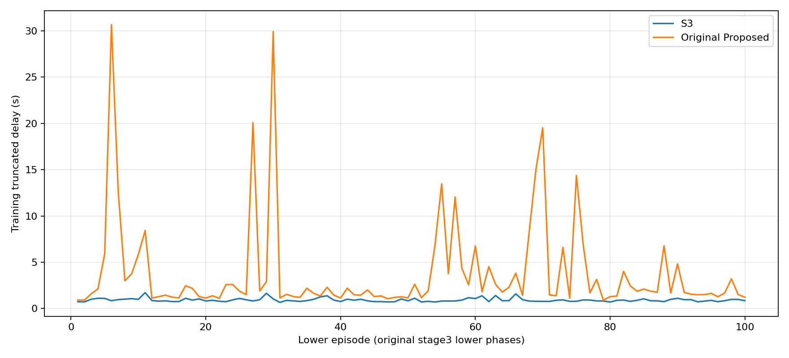
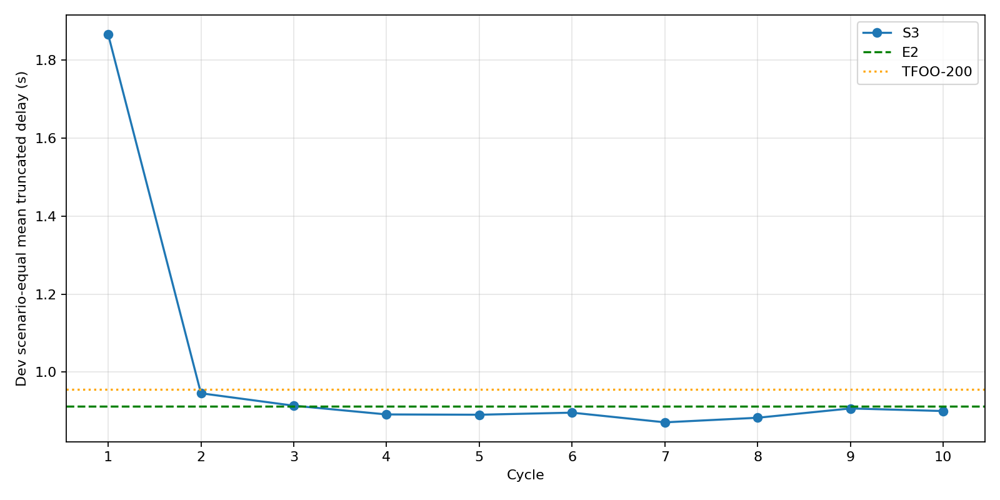

# v2.4.0 seed 4101 第三阶段修复试验

全部规定步骤完成。VERDICT=STAGE3_HELPS。

## 检查结果

| 检查 | 结果 |
|---|---|
| 预检 | passed |
| LOOP_EQUIV | PASS；591–593 共270行学习日志逐位相等 |
| 冻结上层 actor/value、counts、version | PASS |
| SAC计数 | PASS |
| 经验池清空次数增量 | 1 |
| E2_01_1完整metrics回放 | PASS |
| E2/E3及E2/TFOO-200复算 | PASS |
| dev评估窗口 | 400 |

唯一协议差异：上层冻结为 SACDET-200，因此经验池只在第一块开头因上层版本变化清空一次；其余规则与原第三阶段下层块相同。

解释器：D:\HRL_UAV_V2\.venv\Scripts\python.exe；Python=3.9.25 (main, Nov  3 2025, 22:44:01) [MSC v.1929 64 bit (AMD64)]；torch=2.7.0.dev20250227+cu128；CUDA=12.8；设备=NVIDIA GeForce RTX 5060；torch线程数=10。

## 预注册判据与主比较

主判据只用 S3-c10，在 dev 20 个场景上与 E2 配对比较。每场景取 stream 1、2 的平均，配对和胜场定义与 hrl_v2.gates.paired 相同。

STAGE3_HELPS 当且仅当：S3-c10 场景等权均值 < E2 场景等权均值 0.912816585 s，且胜场 ≥ 11/20；否则 STAGE3_NOT_HELPFUL。S3-c1 到 S3-c9 只作报告曲线，不参与判定，也不得据此挑选模型。

VERDICT=STAGE3_HELPS；均值条件=True；胜场条件=True。

| 候选 | 参考 | 候选场景均值s | 参考场景均值s | 相对差% | 胜场/20 |
|---|---|---|---|---|---|
| S3-c10 | E2 | 0.900347893 | 0.912816585 | -1.365957988 | 12 |

相对差=(candidate/reference−1)×100%。负值表示候选时延较低。

### 逐场景主配对

| 场景 | S3-c10 s | E2 s | 胜 |
|---|---|---|---|
| 1 | 0.700177343 | 0.737902447 | True |
| 2 | 1.188072611 | 1.182263985 | False |
| 3 | 0.774828963 | 0.809672596 | True |
| 4 | 0.759919150 | 0.818127018 | True |
| 5 | 0.736668819 | 0.762986384 | True |
| 6 | 0.808539599 | 0.746741413 | False |
| 7 | 0.941775692 | 0.997751577 | True |
| 8 | 0.833798217 | 0.891063019 | True |
| 9 | 0.870999656 | 0.854607499 | False |
| 10 | 0.905352579 | 0.926079081 | True |
| 11 | 1.001236216 | 0.984568114 | False |
| 12 | 1.121973366 | 1.130141055 | True |
| 13 | 1.521925267 | 1.683835571 | True |
| 14 | 1.054684028 | 1.003637393 | False |
| 15 | 0.724731431 | 0.675944859 | False |
| 16 | 0.819326236 | 0.864894263 | True |
| 17 | 0.714432101 | 0.745153131 | True |
| 18 | 0.886497940 | 0.813807059 | False |
| 19 | 0.611338497 | 0.660859748 | True |
| 20 | 1.030680159 | 0.966295480 | False |

## dev曲线（中间节点不参与判定）

| 块 | 场景等权均值s | E2均值s | 相对差% | 胜场/20 |
|---|---|---|---|---|
| S3-c1 | 1.865350854 | 0.912816585 | 104.351113382 | 0 |
| S3-c2 | 0.945850295 | 0.912816585 | 3.618877107 | 5 |
| S3-c3 | 0.914073229 | 0.912816585 | 0.137666652 | 12 |
| S3-c4 | 0.891649672 | 0.912816585 | -2.318857086 | 16 |
| S3-c5 | 0.890875075 | 0.912816585 | -2.403715018 | 14 |
| S3-c6 | 0.896196013 | 0.912816585 | -1.820800760 | 13 |
| S3-c7 | 0.871427864 | 0.912816585 | -4.534177110 | 20 |
| S3-c8 | 0.883153443 | 0.912816585 | -3.249627834 | 16 |
| S3-c9 | 0.907009485 | 0.912816585 | -0.636173718 | 14 |
| S3-c10 | 0.900347893 | 0.912816585 | -1.365957988 | 12 |

## 报告用的最终配对

| 候选 | 参考 | 候选均值s | 参考均值s | 相对差% | 胜场/20 |
|---|---|---|---|---|---|
| S3-c10 | TFOO-200 | 0.900347893 | 0.955819329 | -5.803548248 | 13 |
| S3-c10 | CA-hover | 0.900347893 | 1.309344638 | -31.236752525 | 20 |
| S3-c10 | E3 | 0.900347893 | 1.263159069 | -28.722524689 | 20 |
| S3-c10 | E5 | 0.900347893 | 0.956472554 | -5.867879845 | 18 |

## 各组评估指标

下表截断时延与四段时延为40窗口池化值；主比较与dev曲线为20场景等权值。高、低优先级未完成数按40窗口归一。最终距离为窗口最终UAV到关联终端距离的均值。

| 组 | 截断s | upload s | ready s | u2u s | cpu s | cost/s | 高优未完成/窗口 | 低优未完成/窗口 | 最终距离m |
|---|---|---|---|---|---|---|---|---|---|
| S3-c1 | 1.871130935 | 0.679095241 | 0.050418929 | 0.398566346 | 0.743050418 | 14.807325027 | 9.950000000 | 178.700000000 | 334.658232589 |
| S3-c2 | 0.948495087 | 0.578519934 | 0.049863914 | 0.056727119 | 0.263384119 | 8.325232840 | 7.050000000 | 77.200000000 | 323.694281912 |
| S3-c3 | 0.915846368 | 0.536121966 | 0.050075401 | 0.033491584 | 0.296157417 | 8.091064349 | 5.750000000 | 58.650000000 | 308.461992565 |
| S3-c4 | 0.893384076 | 0.564309013 | 0.049956342 | 0.045861631 | 0.233257091 | 7.920698867 | 6.300000000 | 56.550000000 | 315.578050032 |
| S3-c5 | 0.892561357 | 0.561479131 | 0.049917634 | 0.047723053 | 0.233441539 | 7.905088019 | 6.300000000 | 55.750000000 | 315.904153216 |
| S3-c6 | 0.897689381 | 0.514636246 | 0.049974014 | 0.051273624 | 0.281805497 | 7.960056582 | 5.100000000 | 50.100000000 | 299.139817432 |
| S3-c7 | 0.873120780 | 0.556507160 | 0.050009314 | 0.027951951 | 0.238652355 | 7.787784058 | 5.900000000 | 56.000000000 | 313.334148911 |
| S3-c8 | 0.884555986 | 0.534387869 | 0.049972849 | 0.026551186 | 0.273644083 | 7.876112744 | 5.750000000 | 47.150000000 | 309.136018832 |
| S3-c9 | 0.908805025 | 0.527791196 | 0.050000795 | 0.026702745 | 0.304310288 | 8.043240254 | 5.300000000 | 52.400000000 | 299.949865987 |
| S3-c10 | 0.901922929 | 0.538080054 | 0.050122749 | 0.038549204 | 0.275170922 | 7.986311731 | 5.850000000 | 50.250000000 | 304.829690055 |

配对JSON的 candidate_unfinished_per_episode/reference_unfinished_per_episode 原样采用 gates.unfinished_per_episode，表示20场景各自每窗口未完成数之和，不是原始40窗口未完成总数；上表另明确除以40。

## 训练曲线

每块10个下层轮次的截断时延均值。P取原训练中完全相同的global轮次。逐轮完整数据见 training_curves.csv。

| 块 | global轮次 | S3均值s | P原训练均值s |
|---|---|---|---|
| 1 | 411,412,413,414,415,416,417,418,419,420 | 0.955501658 | 6.748857532 |
| 2 | 431,432,433,434,435,436,437,438,439,440 | 0.959105403 | 2.173091703 |
| 3 | 451,452,453,454,455,456,457,458,459,460 | 0.985826051 | 6.582641423 |
| 4 | 471,472,473,474,475,476,477,478,479,480 | 0.930180748 | 1.528609234 |
| 5 | 491,492,493,494,495,496,497,498,499,500 | 0.855164821 | 1.448128862 |
| 6 | 511,512,513,514,515,516,517,518,519,520 | 0.890254811 | 5.543996960 |
| 7 | 531,532,533,534,535,536,537,538,539,540 | 1.013743607 | 6.123263690 |
| 8 | 551,552,553,554,555,556,557,558,559,560 | 0.833722843 | 3.889448181 |
| 9 | 571,572,573,574,575,576,577,578,579,580 | 0.904817173 | 2.867607978 |
| 10 | 591,592,593,594,595,596,597,598,599,600 | 0.875050469 | 1.683217958 |

## 参数哈希、计数与复算

| 网络 | 初始SHA256 | 最终SHA256 |
|---|---|---|
| ppo_actor | 20897b714f144e9b5c36a46406d1bb3e174b03b95d97b38ebc48a5992b987607 | 20897b714f144e9b5c36a46406d1bb3e174b03b95d97b38ebc48a5992b987607 |
| ppo_value | 3898004095e791bad49476e159594edbdab1f458798c18f30b4456fddc283c1a | 3898004095e791bad49476e159594edbdab1f458798c18f30b4456fddc283c1a |

| SAC计数 | 实测增量 | 预注册增量 |
|---|---|---|
| triggers | 9000 | 9000 |
| skipped | 90 | 90 |
| events | 8910 | 8910 |
| critic_fits | 17820 | 17820 |
| actor_updates | 3600 | 3600 |
| target_updates | 8910 | 8910 |

上层初始/最终counts：`{"batches": 40, "actor_steps_attempted": 1440, "actor_steps_accepted": 1440, "value_steps": 1440, "rollbacks": 0}` / `{"batches": 40, "actor_steps_attempted": 1440, "actor_steps_accepted": 1440, "value_steps": 1440, "rollbacks": 0}`。

上层初始/最终version：40 / 40；发生跳过的global轮次：[411]。

| 复算 | 相对差% | 胜场 | 与R2完整配对对象相同 |
|---|---|---|---|
| E3 | -27.735420899 | 20 | True |
| TFOO-200 | -4.499045329 | 13 | True |

## 耗时

| 阶段 | 墙钟秒 |
|---|---|
| loop_equiv_seconds | 79.708569200 |
| formal_training_seconds | 3312.896197100 |
| evaluation_seconds | 1372.041871800 |
| total_wall_seconds_before_report_write | 4793.267083700 |

### LOOP_EQUIV逐轮

| global | work秒 | wall秒 |
|---|---|---|
| 591 | 15.329078700 | 15.690535600 |
| 592 | 30.946524700 | 31.326967200 |
| 593 | 32.076809900 | 32.447182000 |

### 正式训练逐轮

| 下层轮次 | global | work秒 | wall秒 |
|---|---|---|---|
| 1 | 411 | 14.260654200 | 14.639441700 |
| 2 | 412 | 27.695856100 | 28.055708200 |
| 3 | 413 | 31.855825200 | 32.239714600 |
| 4 | 414 | 31.301326300 | 31.694415200 |
| 5 | 415 | 31.541251500 | 31.933406600 |
| 6 | 416 | 31.227285700 | 31.603957400 |
| 7 | 417 | 31.470166700 | 31.854629100 |
| 8 | 418 | 32.456332400 | 32.841046400 |
| 9 | 419 | 33.099885200 | 33.479824800 |
| 10 | 420 | 32.188152700 | 32.618411200 |
| 11 | 431 | 29.489454800 | 29.853957900 |
| 12 | 432 | 27.236981500 | 27.620770200 |
| 13 | 433 | 31.249390700 | 31.616613500 |
| 14 | 434 | 31.127208900 | 31.500938700 |
| 15 | 435 | 31.575898900 | 31.929312900 |
| 16 | 436 | 32.560894900 | 32.930768100 |
| 17 | 437 | 32.121342300 | 32.493123500 |
| 18 | 438 | 31.386347000 | 31.766706400 |
| 19 | 439 | 31.961464600 | 32.332371200 |
| 20 | 440 | 32.026124900 | 32.444458400 |
| 21 | 451 | 27.738332500 | 28.104901600 |
| 22 | 452 | 27.702707100 | 28.054846300 |
| 23 | 453 | 31.774691000 | 32.137319700 |
| 24 | 454 | 32.363897600 | 32.785730600 |
| 25 | 455 | 32.201267200 | 32.609900700 |
| 26 | 456 | 31.861459100 | 32.225472200 |
| 27 | 457 | 31.481042000 | 31.867517100 |
| 28 | 458 | 31.690131500 | 32.072480000 |
| 29 | 459 | 33.851861000 | 34.241199400 |
| 30 | 460 | 33.419285100 | 33.848988100 |
| 31 | 471 | 27.501924000 | 27.883250200 |
| 32 | 472 | 27.865688700 | 28.218386000 |
| 33 | 473 | 31.117557700 | 31.506612500 |
| 34 | 474 | 31.290262800 | 31.649983500 |
| 35 | 475 | 31.367963500 | 31.746885800 |
| 36 | 476 | 32.344672900 | 32.729255600 |
| 37 | 477 | 32.880841200 | 33.264556200 |
| 38 | 478 | 31.821353800 | 32.179418600 |
| 39 | 479 | 31.174190700 | 31.550921300 |
| 40 | 480 | 31.461835500 | 31.890233700 |
| 41 | 491 | 28.734744700 | 29.149932600 |
| 42 | 492 | 27.582929900 | 27.950095900 |
| 43 | 493 | 32.755406800 | 33.141212200 |
| 44 | 494 | 32.163128100 | 32.531138100 |
| 45 | 495 | 30.760013500 | 31.134885600 |
| 46 | 496 | 31.416203300 | 31.784930000 |
| 47 | 497 | 31.666039800 | 32.025178200 |
| 48 | 498 | 30.580985400 | 30.947688100 |
| 49 | 499 | 32.217501500 | 32.603729900 |
| 50 | 500 | 32.202831000 | 32.627159900 |
| 51 | 511 | 28.443121300 | 28.829775700 |
| 52 | 512 | 26.757305600 | 27.122790000 |
| 53 | 513 | 31.612447700 | 31.990139800 |
| 54 | 514 | 31.695848800 | 32.097207200 |
| 55 | 515 | 30.901853800 | 31.280166400 |
| 56 | 516 | 31.839748800 | 32.225362700 |
| 57 | 517 | 32.419700100 | 32.794587900 |
| 58 | 518 | 33.217562500 | 33.576772200 |
| 59 | 519 | 33.484066100 | 33.869006200 |
| 60 | 520 | 32.276706700 | 32.725126500 |
| 61 | 531 | 33.091016400 | 33.511836700 |
| 62 | 532 | 31.887819600 | 32.295736200 |
| 63 | 533 | 37.010417500 | 37.398987200 |
| 64 | 534 | 35.355225700 | 35.770054700 |
| 65 | 535 | 40.207108400 | 40.662230300 |
| 66 | 536 | 44.721955600 | 45.295154400 |
| 67 | 537 | 50.192429300 | 50.746417600 |
| 68 | 538 | 42.857304600 | 43.232305000 |
| 69 | 539 | 35.367930400 | 35.798209900 |
| 70 | 540 | 38.196455600 | 38.744803100 |
| 71 | 551 | 33.692262800 | 34.118118300 |
| 72 | 552 | 34.010133400 | 34.407048600 |
| 73 | 553 | 37.390601900 | 37.810576700 |
| 74 | 554 | 39.222924700 | 39.675814500 |
| 75 | 555 | 41.121570400 | 41.502579200 |
| 76 | 556 | 37.403817900 | 37.813632100 |
| 77 | 557 | 37.110711400 | 37.502293000 |
| 78 | 558 | 36.621596900 | 37.075206400 |
| 79 | 559 | 45.205857800 | 45.661283100 |
| 80 | 560 | 42.404347800 | 42.862461400 |
| 81 | 571 | 33.338372600 | 33.797995800 |
| 82 | 572 | 29.013344300 | 29.422892000 |
| 83 | 573 | 32.140396000 | 32.540145200 |
| 84 | 574 | 32.738153600 | 33.120550600 |
| 85 | 575 | 33.463538600 | 33.829625300 |
| 86 | 576 | 32.617230400 | 32.991020000 |
| 87 | 577 | 32.856355600 | 33.216183900 |
| 88 | 578 | 32.684690600 | 33.048645800 |
| 89 | 579 | 32.349179200 | 32.711379700 |
| 90 | 580 | 33.215252400 | 33.653020100 |
| 91 | 591 | 27.622906000 | 28.000428200 |
| 92 | 592 | 28.827744500 | 29.198221100 |
| 93 | 593 | 34.162214100 | 34.523558600 |
| 94 | 594 | 31.048302300 | 31.431024100 |
| 95 | 595 | 32.281982400 | 32.665259900 |
| 96 | 596 | 32.397198800 | 32.769508600 |
| 97 | 597 | 31.798795700 | 32.179854700 |
| 98 | 598 | 32.659333000 | 33.044208600 |
| 99 | 599 | 32.054470100 | 32.423149500 |
| 100 | 600 | 32.716453100 | 33.141401200 |

## 脚本实现错误与修正

本次未发生脚本实现错误，未使用一次修正机会。

## 最终工作树状态

| 工作树 | status | branch | HEAD |
|---|---|---|---|
| D:\HRL_UAV_V2 | 空 | codex/v2-lite-paper-caliber | a9953dc36d9d65f99bcc35044cdfc250ca11bb49 |
| D:\HRL_UAV_V2_speedup | 空 | codex/v2-lite-speedup | 25d59ff9f7c3e27c060c63d462235a30ce28930a |

## 事实与推断

本报告仅列实测与检查结果

