# 方案 C 诊断结果（只评估）

结束时间：2026-10-10T17:54:03.977786+08:00。评估与报告耗时：5.664 小时。本报告包含 33 组，每组 20 个 dev 场景 × 两条流。

全部搭配均仅作诊断，不参与方法或选模型。正的延迟变化百分比表示延迟高于参照，负值表示低于参照；胜场按逐场景延迟严格小于 TFOO 计。没有使用测试场景 21–40。

## 全部分组数值

|组|seed|平均延迟/s|相对TFOO/%|胜场/20|相对原流程/%|两流一致|锚点|
|---|---|---|---|---|---|---|---|
|A1|4103|1.128627790102|45.1832|0|44.6926|是|通过|
|A2|4103|5.891831726574|657.9068|0|655.3461|是|通过|
|A3|4103|5.560027531776|615.2246|0|612.8081|是|无|
|A4|4103|1.262216406942|62.3676|0|61.8190|是|无|
|A5|4103|1.062195995223|36.6376|0|36.1759|是|无|
|A6|4103|1.165400994040|49.9135|0|49.4070|是|无|
|B-4104-220|4104|1.188390276453|55.8798|0|54.9310|是|无|
|B-4104-240|4104|1.145840210312|50.2986|0|49.3838|是|无|
|B-4104-260|4104|1.091061134938|43.1133|0|42.2422|是|无|
|B-4104-280|4104|1.006958477323|32.0816|0|31.2777|是|无|
|B-4104-300|4104|0.912507563683|19.6926|1|18.9641|是|无|
|B-4104-320|4104|0.842803077704|10.5495|2|9.8767|是|无|
|B-4104-340|4104|0.818770487331|7.3972|3|6.7435|是|无|
|B-4104-360|4104|0.840087625911|10.1934|2|9.5226|是|无|
|B-4104-380|4104|0.858847152269|12.6540|6|11.9683|是|无|
|B-4104-400|4104|0.837858607349|9.9010|5|9.2320|是|通过|
|B-4103-220|4103|1.211066655103|55.7878|0|55.2615|是|无|
|B-4103-240|4103|1.193584349056|53.5390|0|53.0202|是|无|
|B-4103-260|4103|1.121765454279|44.3004|0|43.8129|是|无|
|B-4103-280|4103|1.172508262853|50.8278|0|50.3182|是|无|
|B-4103-300|4103|1.082993366908|39.3129|0|38.8422|是|无|
|B-4103-360|4103|1.057981402586|36.0954|0|35.6356|是|无|
|B-4103-380|4103|1.047383041170|34.7321|0|34.2769|是|无|
|B-4103-400|4103|1.057522677551|36.0364|0|35.5768|是|通过|
|K-TFOO-4103|4103|0.777382062196|0.0000|0|-0.3379|是|通过|
|K-v1-4103|4103|0.780017445356|0.3390|12|0.0000|是|通过|
|K-SD-4103|4103|0.824925236737|6.1158|6|5.7573|是|通过|
|K-JC-4103|4103|1.023799596965|31.6984|1|31.2534|是|通过|
|K-TFOO-4104|4104|0.762375885110|0.0000|0|-0.6087|是|通过|
|K-v1-4104|4104|0.767044685586|0.6124|10|0.0000|是|通过|
|K-SD-4104|4104|0.893591794720|17.2114|0|16.4980|是|通过|
|K-JC-4104|4104|0.802632630120|5.2804|12|4.6396|是|通过|
|K-PU-4104|4104|0.757050910429|-0.6985|9|-1.3029|是|通过|

## Q1：4103 的 2×3 交叉搭配

|上层|L320|L340|cvx|
|---|---|---|---|
|U320|1.128627790102|5.560027531776|1.062195995223|
|U340|1.262216406942|5.891831726574|1.165400994040|

数值单位为秒。交叉搭配反映固定存档组合表现，不给出先后因果判断。

|组|计算任务份额 UAV0,1,2|分配周期份额 UAV0,1,2|CPU队列均值 UAV0,1,2|各优先级队列最大值之和 UAV0,1,2|
|---|---|---|---|---|
|A1|0.3135,0.3667,0.3198|0.3084,0.3979,0.2937|7.174,6.170,2.744|181,37,89|
|A2|0.3885,0.3324,0.2791|0.4322,0.3302,0.2376|349.649,4.902,1.238|3244,32,40|
|A3|0.3866,0.3363,0.2770|0.4278,0.3349,0.2373|330.298,5.254,1.202|3179,38,38|
|A4|0.3142,0.3670,0.3189|0.3103,0.3975,0.2923|6.948,6.080,2.675|172,41,84|
|A5|0.3339,0.3345,0.3315|0.3329,0.3382,0.3289|5.103,5.224,4.924|100,91,92|
|A6|0.3337,0.3354,0.3310|0.3319,0.3397,0.3284|4.978,5.199,4.811|88,90,84|
|K-JC-4103|0.3191,0.3285,0.3524|0.3150,0.3547,0.3303|3.641,4.356,3.005|123,57,40|
|K-TFOO-4103|0.3323,0.3340,0.3336|0.3317,0.3372,0.3311|5.787,5.921,5.695|118,132,126|

计算任务份额以分配给各无人机的父任务计算比例计数；CPU 队列单位为任务分片。逐优先级最大值之和不代表同一时刻的联合最大值，完整分优先级数值在 JSON 中。

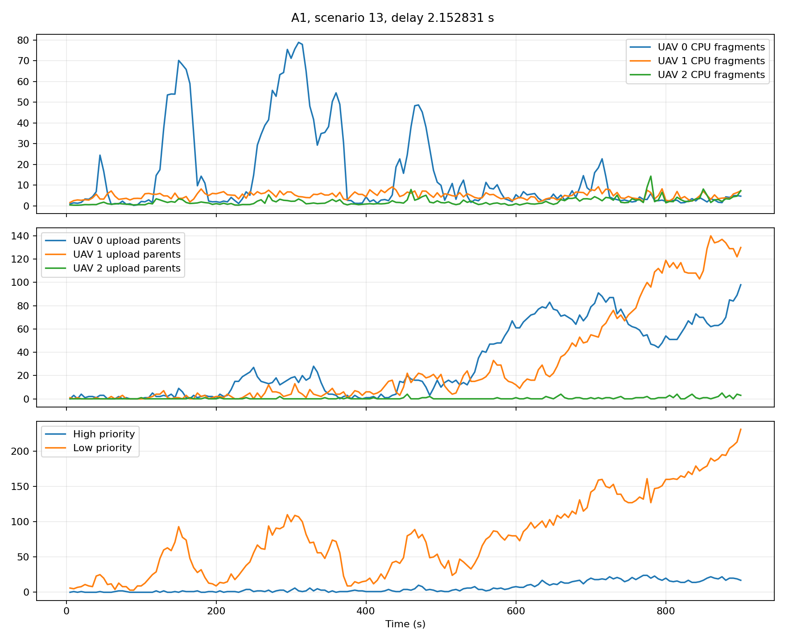
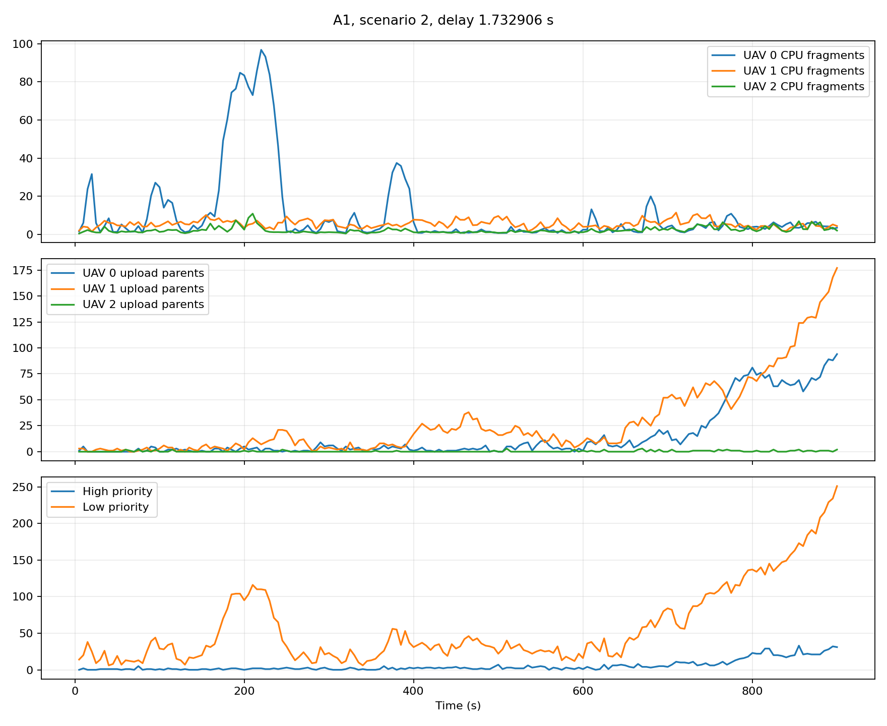
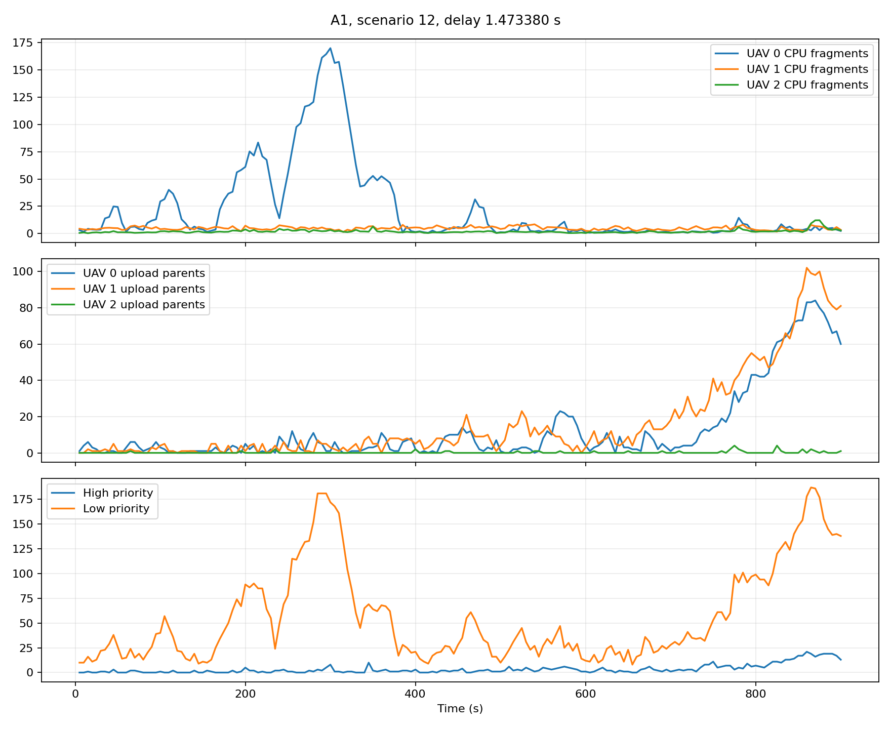
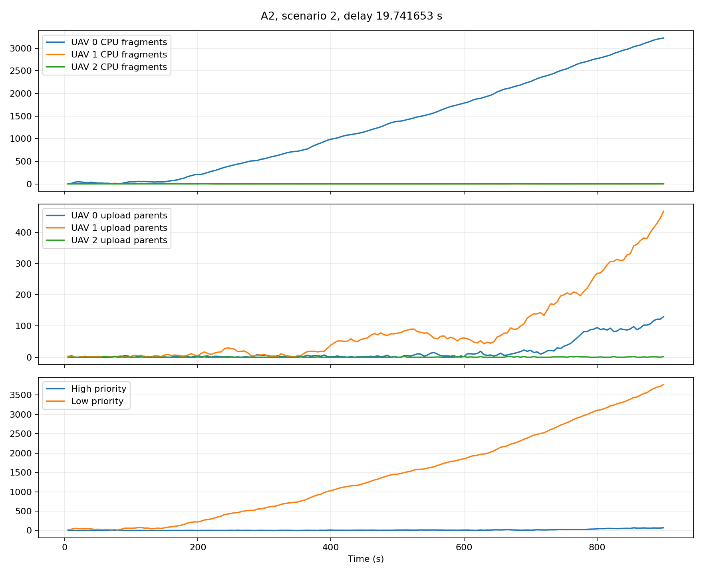
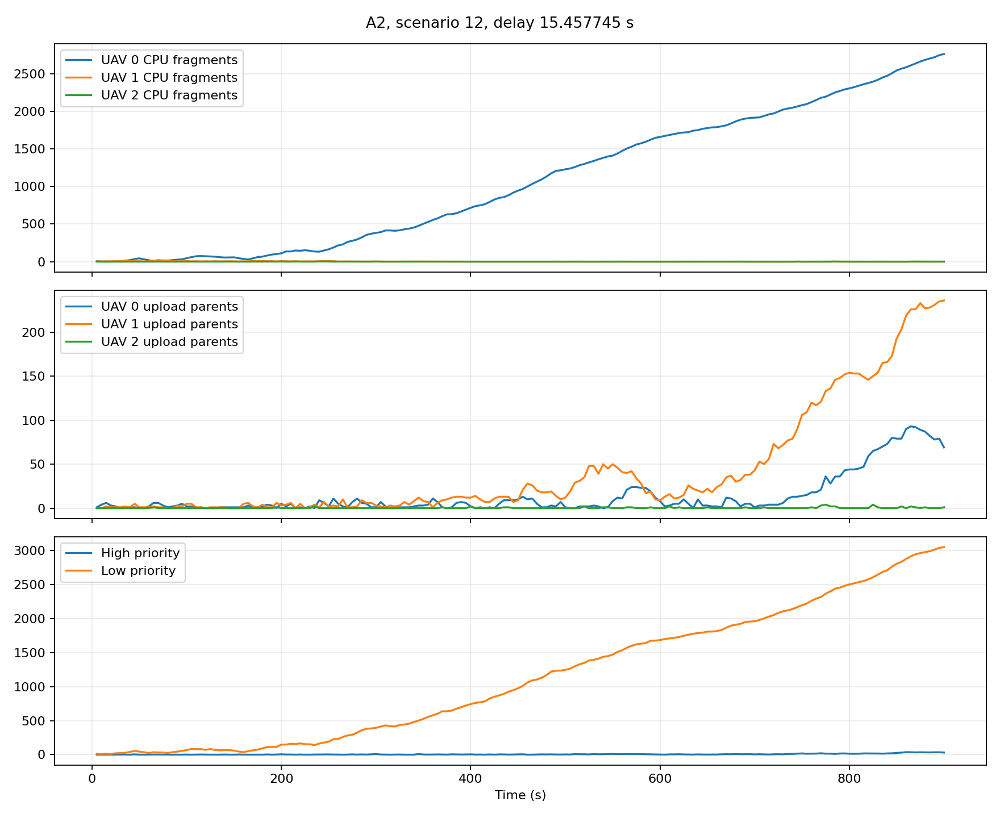
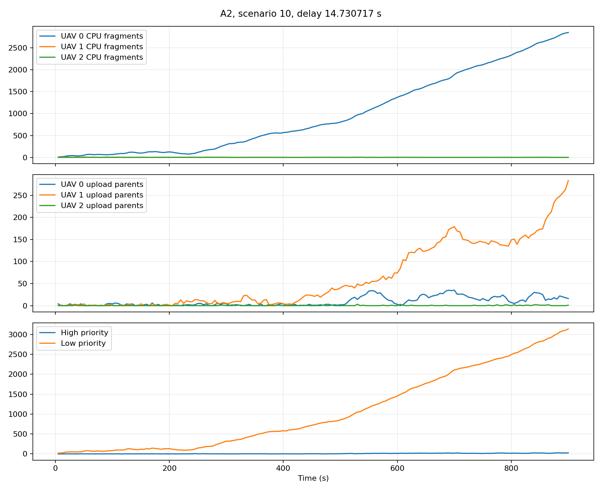

## Q2：各存档上层 + cvx

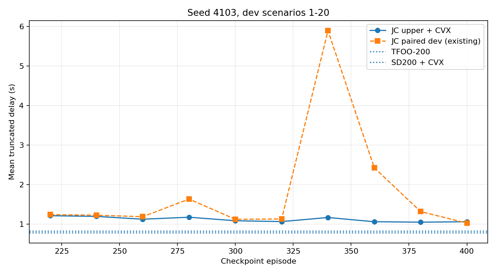
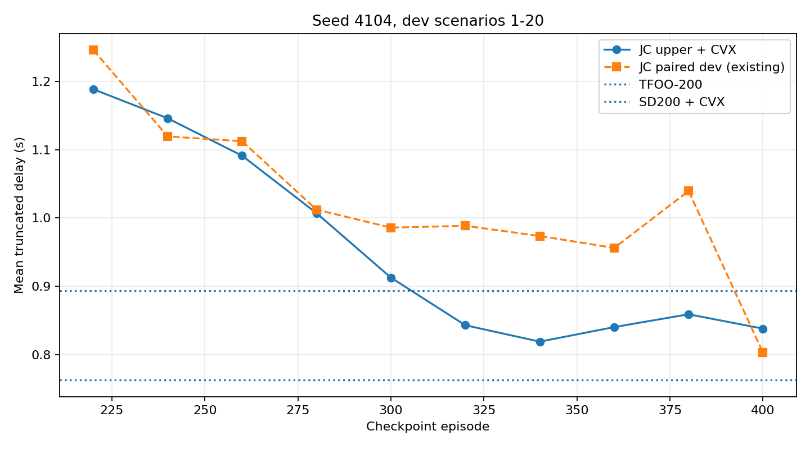

JC 整对曲线来自旧报告；上层 + cvx 曲线来自本次诊断，TFOO 与 SD200 参考线来自核验后的旧结果。

## Q3：位置、移动及上传距离

|组|每5s位移均值/m|离起点均值/m|位移≥19.5m比例|用户到最近UAV/m|上传任务距离 高/低 m|
|---|---|---|---|---|---|
|A1|0.8947|62.5586|0.000000|158.6564|205.2608/222.5001|
|A2|1.0893|76.9459|0.000000|166.7338|246.6921/289.8243|
|A3|1.1043|80.0776|0.000000|159.3110|237.0924/278.2879|
|A4|0.9574|63.1100|0.000000|170.6147|222.0055/243.8640|
|A5|0.8407|52.6283|0.000000|157.4659|204.7075/218.9435|
|A6|0.8706|50.4552|0.000000|166.6982|218.3794/236.0321|
|B-4104-220|0.2524|11.4279|0.000000|179.9858|228.1636/243.6910|
|B-4104-240|0.4326|24.7953|0.000000|185.7329|224.3142/237.2458|
|B-4104-260|0.6057|37.7565|0.000000|184.1038|215.9804/227.6916|
|B-4104-280|0.7413|51.8899|0.000000|175.8381|201.6819/210.7020|
|B-4104-300|0.9455|70.6340|0.000000|167.1104|183.6277/188.6596|
|B-4104-320|0.9595|72.7421|0.000000|155.8391|170.1822/172.6049|
|B-4104-340|1.1167|89.6716|0.000000|148.1806|160.4715/161.9784|
|B-4104-360|1.1796|92.0249|0.000000|152.5708|165.0857/167.6432|
|B-4104-380|1.0868|82.1858|0.000000|147.1369|164.6357/169.2047|
|B-4104-400|1.1267|86.0858|0.000000|143.6567|161.0369/164.5674|
|B-4103-220|0.4009|31.2058|0.000000|171.8716|225.2628/244.5102|
|B-4103-240|0.4677|27.8185|0.000000|171.8742|223.6464/241.6283|
|B-4103-260|0.6297|44.3434|0.000000|158.9249|212.0175/228.6138|
|B-4103-280|0.6979|48.7912|0.000000|162.6113|223.4578/240.6595|
|B-4103-300|0.7322|45.0692|0.000000|161.4419|210.4178/224.4239|
|B-4103-360|1.0952|70.6430|0.000000|151.7853|198.8434/214.2423|
|B-4103-380|1.1373|74.1075|0.000000|157.3351|193.9657/209.1429|
|B-4103-400|1.2210|84.2509|0.000000|156.3183|193.4361/209.0929|
|K-TFOO-4103|1.2784|99.1630|0.000000|134.6821|145.3817/147.5348|
|K-v1-4103|1.1946|89.2011|0.000000|142.9763|157.6746/162.8977|
|K-SD-4103|1.1826|87.8773|0.000000|142.2972|157.3157/162.2938|
|K-JC-4103|1.2290|86.6705|0.000000|155.4331|192.0840/208.3067|
|K-TFOO-4104|1.4778|117.4325|0.000000|133.4476|143.2428/145.3751|
|K-v1-4104|1.3465|98.7303|0.000000|143.7485|167.9555/172.5036|
|K-SD-4104|1.2983|90.7669|0.000000|146.5305|177.7100/184.3695|
|K-JC-4104|1.1100|82.6233|0.000000|143.3448|164.2041/170.1383|
|K-PU-4104|1.2483|108.4896|0.000000|129.0502|140.2233/141.5593|

上传目标直接读取 parent.arrival.source。上传距离先在每个 5 秒窗口内对每个等待/上传任务的物理步距离取平均，再对任务等权平均，高低优先级分开；跨窗口任务在各窗口分别计数。新到达任务的距离另存 birth_task_distance_mean_m。每个用户到最近无人机的距离按物理步平均。

## Q4：已有 PPO 日志

每份日志 40 次更新；完整逐更新、逐 epoch 数值在 ppo_logs.json。未记录项均为空值并标为“未记录”，没有补训。

### JC-4103

|范围|接受epoch中位数|尝试epoch中位数|平均KL中位数|执行actor步数中位数|保留actor步数中位数|回合回报中位数|KL停止次数|
|---|---|---|---|---|---|---|---|
|all|6.000000|6.000000|0.00968991|36.000000|36.000000|-92.922415|1|
|first10|6.000000|6.000000|0.00797954|36.000000|36.000000|-93.581194|0|
|last10|6.000000|6.000000|0.01098624|36.000000|36.000000|-91.350129|0|

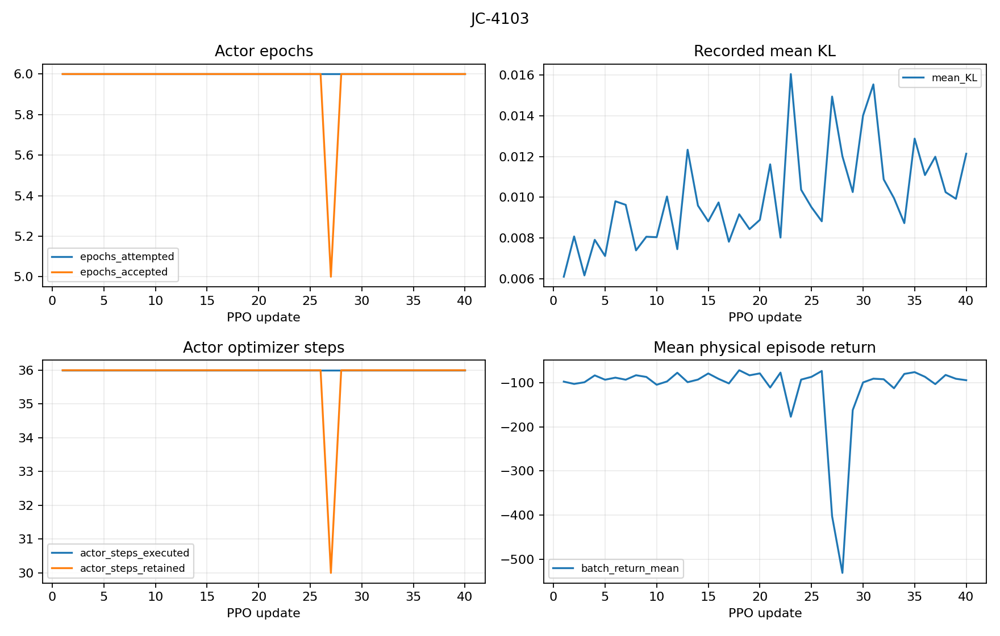

### TFOO-4103

|范围|接受epoch中位数|尝试epoch中位数|平均KL中位数|执行actor步数中位数|保留actor步数中位数|回合回报中位数|KL停止次数|
|---|---|---|---|---|---|---|---|
|all|6.000000|6.000000|0.00870398|未记录|未记录|-75.982794|0|
|first10|6.000000|6.000000|0.00739676|未记录|未记录|-89.994102|0|
|last10|6.000000|6.000000|0.00891187|未记录|未记录|-67.347437|0|

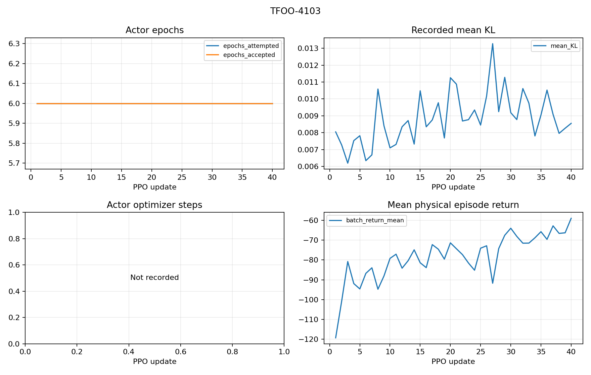

### JC-4104

|范围|接受epoch中位数|尝试epoch中位数|平均KL中位数|执行actor步数中位数|保留actor步数中位数|回合回报中位数|KL停止次数|
|---|---|---|---|---|---|---|---|
|all|6.000000|6.000000|0.00848502|36.000000|36.000000|-81.282349|0|
|first10|6.000000|6.000000|0.00744542|36.000000|36.000000|-92.356603|0|
|last10|6.000000|6.000000|0.00910351|36.000000|36.000000|-68.260812|0|

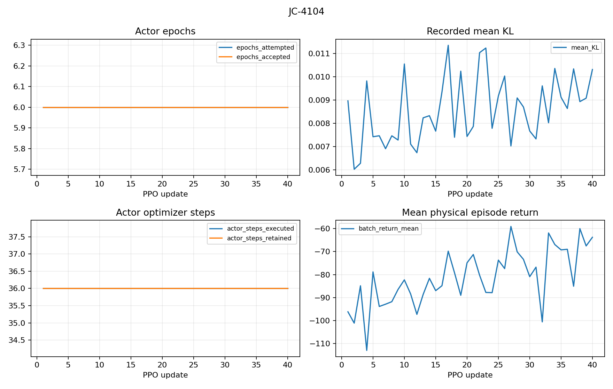

### TFOO-4104

|范围|接受epoch中位数|尝试epoch中位数|平均KL中位数|执行actor步数中位数|保留actor步数中位数|回合回报中位数|KL停止次数|
|---|---|---|---|---|---|---|---|
|all|6.000000|6.000000|0.00860891|未记录|未记录|-73.478638|0|
|first10|6.000000|6.000000|0.00665825|未记录|未记录|-80.796877|0|
|last10|6.000000|6.000000|0.00986168|未记录|未记录|-62.622672|0|

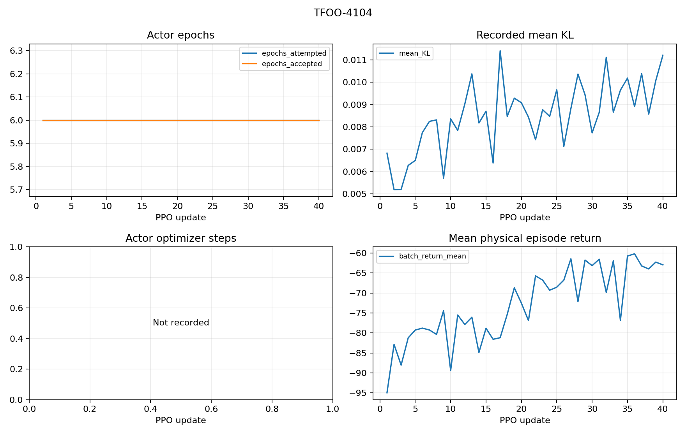

### PU-4104

|范围|接受epoch中位数|尝试epoch中位数|平均KL中位数|执行actor步数中位数|保留actor步数中位数|回合回报中位数|KL停止次数|
|---|---|---|---|---|---|---|---|
|all|6.000000|6.000000|0.00873087|未记录|未记录|-117.676082|0|
|first10|6.000000|6.000000|0.00742543|未记录|未记录|-123.670764|0|
|last10|6.000000|6.000000|0.00954137|未记录|未记录|-110.297310|0|

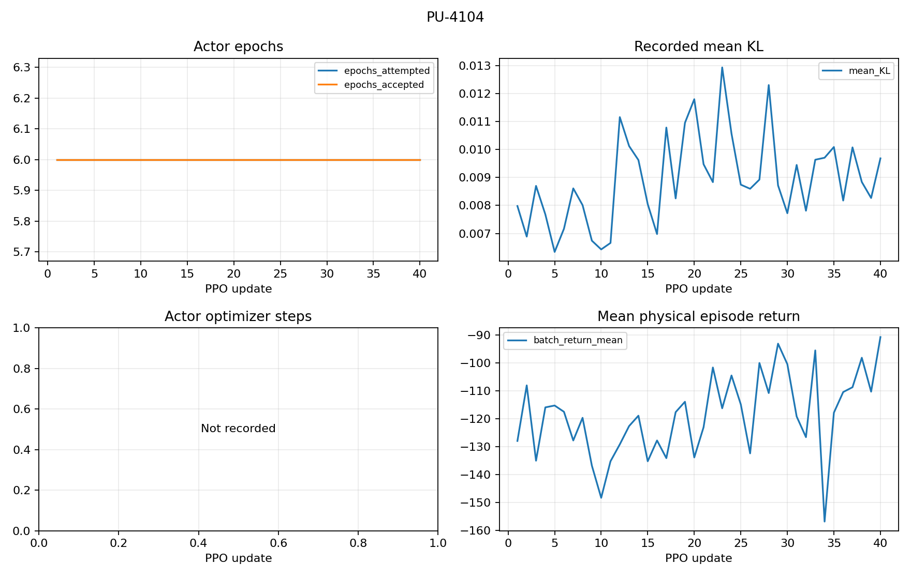

clip 比例、PPO 策略 std/熵、value loss、explained variance、优势均值和标准差：未记录。平均 KL 为已记录 epoch 的算术平均，包含触发回退的 epoch。

## 统计检验

|组|Wilcoxon 双侧 p|配对t双侧 p|符号检验双侧 p|
|---|---|---|---|
|A1|0.00000191|0.00004309|0.00000191|
|A2|0.00000191|0.00209045|0.00000191|
|A3|0.00000191|0.00272022|0.00000191|
|A4|0.00000191|0.00000844|0.00000191|
|A5|0.00000191|0.00000219|0.00000191|
|A6|0.00000191|0.00000061|0.00000191|
|B-4104-220|0.00000191|0.00000017|0.00000191|
|B-4104-240|0.00000191|0.00000001|0.00000191|
|B-4104-260|0.00000191|0.00000001|0.00000191|
|B-4104-280|0.00000191|0.00000004|0.00000191|
|B-4104-300|0.00000381|0.00001085|0.00004005|
|B-4104-320|0.00048256|0.00103533|0.00040245|
|B-4104-340|0.00315285|0.03873228|0.00257683|
|B-4104-360|0.00058556|0.01016083|0.00040245|
|B-4104-380|0.02664185|0.03437631|0.11531830|
|B-4104-400|0.01923370|0.04275461|0.04138947|
|B-4103-220|0.00000191|0.00000016|0.00000191|
|B-4103-240|0.00000191|0.00000014|0.00000191|
|B-4103-260|0.00000191|0.00000030|0.00000191|
|B-4103-280|0.00000191|0.00000000|0.00000191|
|B-4103-300|0.00000191|0.00000003|0.00000191|
|B-4103-360|0.00000191|0.00006001|0.00000191|
|B-4103-380|0.00000191|0.00007788|0.00000191|
|B-4103-400|0.00000191|0.00001959|0.00000191|
|K-TFOO-4103|1.00000000|1.00000000|1.00000000|
|K-v1-4103|0.12309265|0.92544613|0.50344467|
|K-SD-4103|0.01361656|0.07428764|0.11531830|
|K-JC-4103|0.00000381|0.00016769|0.00004005|
|K-TFOO-4104|1.00000000|1.00000000|1.00000000|
|K-v1-4104|0.98543549|0.74982023|1.00000000|
|K-SD-4104|0.00000191|0.00000080|0.00000191|
|K-JC-4104|0.67422295|0.43407675|0.50344467|
|K-PU-4104|0.95632935|0.77741387|0.82380295|

上述检验均以本报告实际运行场景对应的同 seed TFOO-200 为参照，仅列原始 p 值，未作多重比较校正；原流程参照检验也保存在 report.json。

## 积压、分段驻留及 cost

|组|未完成 高/低（每900s截止）|upload/s|ready/s|u2u/s|cpu/s|cost/s|
|---|---|---|---|---|---|---|
|A1|10.100/90.150|0.739907|0.050109|0.034616|0.303997|9.634205|
|A2|18.200/1180.150|1.148323|0.049913|0.060023|4.633573|43.145879|
|A3|18.000/1129.900|1.058530|0.050002|0.057936|4.393559|40.800282|
|A4|12.650/109.500|0.876242|0.049885|0.039029|0.297061|10.568644|
|A5|9.500/76.700|0.706773|0.050242|0.098731|0.206450|9.103412|
|A6|11.400/92.800|0.809622|0.049863|0.099853|0.206063|9.825258|
|B-4104-220|12.100/98.900|0.835200|0.049991|0.098909|0.204290|9.983650|
|B-4104-240|10.750/89.750|0.790454|0.049794|0.099635|0.205957|9.684804|
|B-4104-260|9.700/79.300|0.737086|0.049667|0.098172|0.206136|9.299488|
|B-4104-280|8.650/70.600|0.646006|0.049955|0.098077|0.212920|8.711312|
|B-4104-300|7.100/54.950|0.549822|0.049781|0.098341|0.214564|8.049899|
|B-4104-320|5.850/43.050|0.478555|0.049522|0.098028|0.216697|7.561171|
|B-4104-340|4.350/37.950|0.446299|0.049798|0.099157|0.223517|7.396067|
|B-4104-360|5.150/40.000|0.471109|0.049640|0.099459|0.219879|7.544422|
|B-4104-380|5.600/44.600|0.490634|0.049609|0.101380|0.217225|7.677387|
|B-4104-400|5.050/41.050|0.469498|0.049623|0.099547|0.219191|7.529707|
|B-4103-220|13.800/104.650|0.858590|0.049711|0.097923|0.204843|10.143348|
|B-4103-240|12.600/98.200|0.842062|0.049741|0.098918|0.202863|10.020186|
|B-4103-260|11.000/84.800|0.765753|0.049818|0.098880|0.207314|9.518276|
|B-4103-280|11.650/90.750|0.821006|0.049860|0.097321|0.204322|9.871933|
|B-4103-300|9.550/77.500|0.730499|0.049758|0.097269|0.205468|9.245003|
|B-4103-360|9.800/73.500|0.694222|0.050066|0.100853|0.212840|9.074717|
|B-4103-380|8.950/73.400|0.685437|0.050211|0.100588|0.211146|9.001049|
|B-4103-400|9.100/73.800|0.690014|0.050251|0.101844|0.215413|9.071598|
|K-TFOO-4103|3.850/32.550|0.402872|0.050056|0.099770|0.224685|7.106023|
|K-v1-4103|4.700/37.050|0.461196|0.050127|0.033493|0.235202|7.162772|
|K-SD-4103|4.700/35.850|0.457187|0.050218|0.097669|0.219851|7.437560|
|K-JC-4103|9.300/74.750|0.693840|0.050407|0.052868|0.226685|8.879009|
|K-TFOO-4104|3.750/31.000|0.389735|0.049855|0.097887|0.224898|6.999293|
|K-v1-4104|4.200/40.500|0.478791|0.049993|0.012210|0.226051|7.083404|
|K-SD-4104|5.700/48.500|0.523326|0.049859|0.101832|0.218575|7.922865|
|K-JC-4104|5.550/49.600|0.501873|0.049767|0.014750|0.236243|7.335343|
|K-PU-4104|3.400/33.550|0.379887|0.050230|0.101117|0.225816|6.964449|

本表分段延迟为逐场景等权均值；汇总池化数值另存 JSON。每 5 秒的未完成任务、分段驻留、成本、队列、位置和分流在窗口文件 observations.samples_5s 中。

## 核对、偏差与停止记录

- 检查点：27 个，核对结果见 readonly_checks_final.json；冒烟报告不代表正式评估完成。
- 源码身份、MAIN/WT Git HEAD 与状态、已冻结输入：核对通过。
- 两条随机流：本报告 33 组逐场景完整指标及附加观测一致。
- 已存锚点：逐场景、逐条流完整指标一致。
- 上次目录原样保留，清单和 SHA 核对结果另存；本次没有复用旧组。
- 用户随后允许桌面/浏览器 GPU 进程，排除其他训练或评估进程。
- 实现修正与故意注入的自检错误：见 implementation_corrections.json、preflight.json 和 errors/。
- JC 种子报告实际命名为 4103report.json / 4104report.json，使用从现有文件解析的路径。
- 执行顺序为锚点优先，33 组定义不变。

|压缩批次|文件数|原大小/MB|压缩后/MB|压缩后/原|耗时/s|
|---|---|---|---|---|---|
|batch_001.zip|40|3241.29|197.45|0.0609|44.13|
|batch_002.zip|40|3228.67|199.25|0.0617|43.38|
|batch_003.zip|40|3361.37|190.45|0.0567|46.60|
|batch_004.zip|40|3360.13|192.90|0.0574|42.88|
|batch_005.zip|40|3373.58|190.05|0.0563|42.36|
|batch_006.zip|40|3347.68|191.73|0.0573|43.76|
|batch_007.zip|40|3351.05|190.04|0.0567|42.94|
|batch_008.zip|40|3331.00|194.17|0.0583|65.98|
|batch_009.zip|40|3374.00|189.55|0.0562|42.61|
|batch_010.zip|40|3320.33|191.20|0.0576|42.45|
|batch_011.zip|40|3350.38|191.36|0.0571|49.08|
|batch_012.zip|40|3318.05|191.61|0.0577|61.86|
|batch_013.zip|40|3350.42|189.68|0.0566|63.42|
|batch_014.zip|160|1151.38|154.32|0.1340|30.70|
|batch_015.zip|160|1163.64|155.35|0.1335|32.52|
|batch_016.zip|160|1162.92|153.80|0.1323|31.47|
|batch_017.zip|160|1163.00|155.01|0.1333|31.05|
|batch_018.zip|160|1162.76|155.23|0.1335|32.61|

每批先写 SHA 清单，再压缩、解压流校验 SHA，最后删除 XD 内对应原始文件。路径映射见 archive_index.json。
