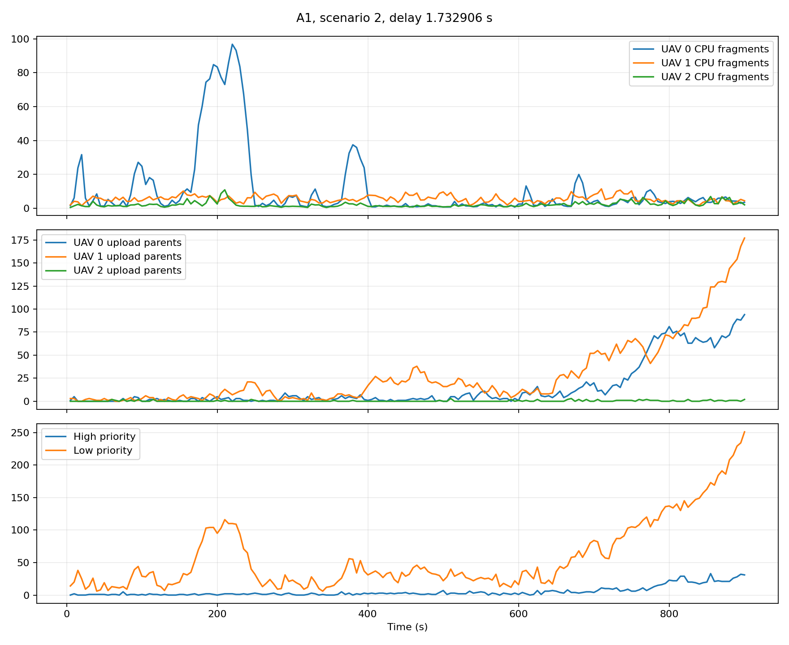
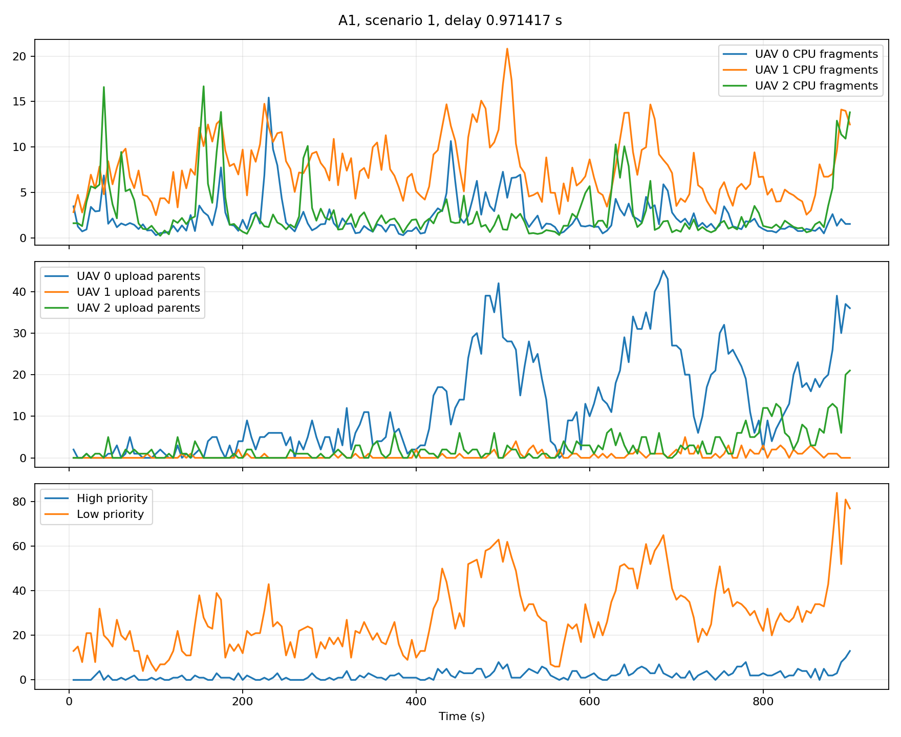
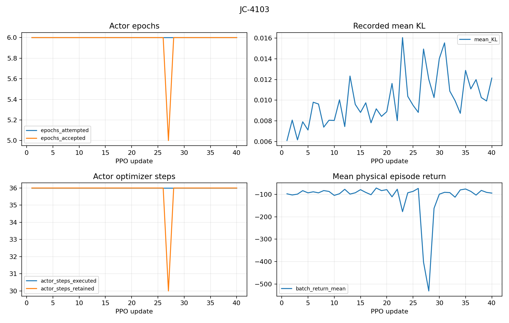
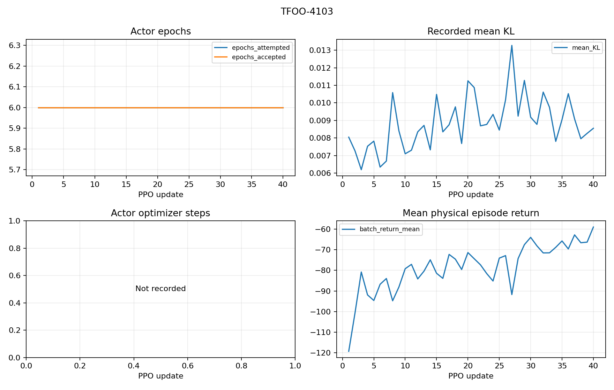
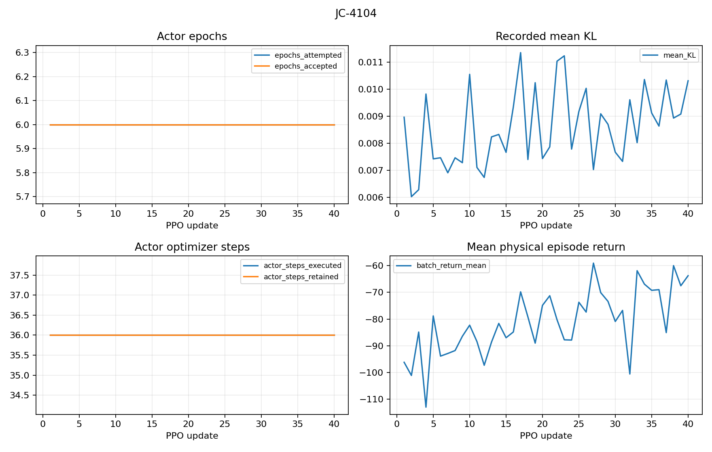
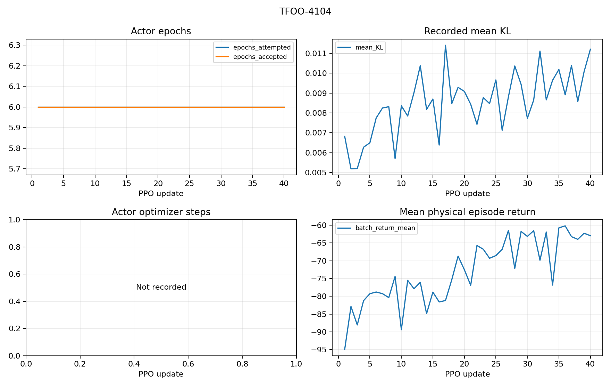
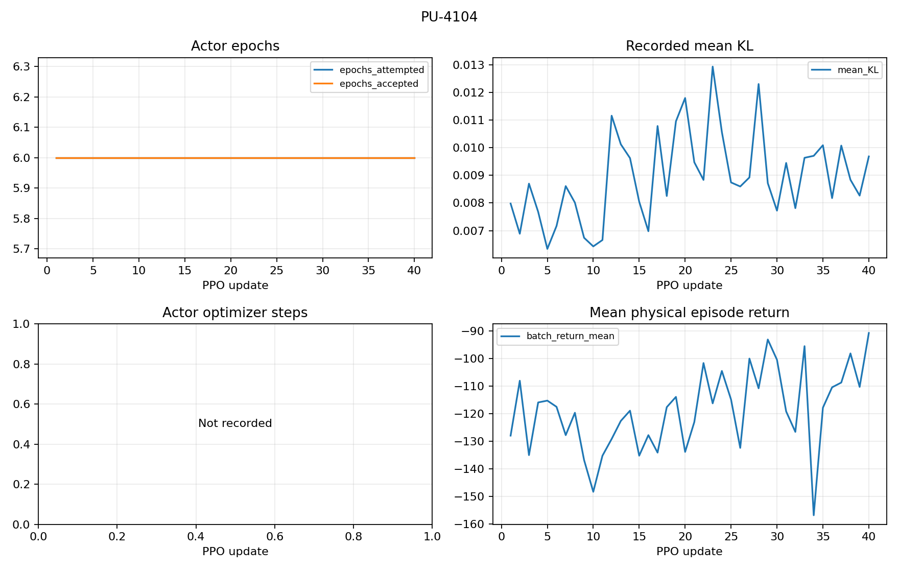

# 方案 C 诊断结果（只评估）

这是启动前 A1 场景 1–2 的冒烟报告，缺少的组未运行，不是 33 组正式结果。
结束时间：2026-10-10T12:13:30.619445+08:00。评估与报告耗时：0.020 小时。本报告包含 1 组，每组 2 个 dev 场景 × 两条流。

全部搭配均仅作诊断，不参与方法或选模型。正的延迟变化百分比表示延迟高于参照，负值表示低于参照；胜场按逐场景延迟严格小于 TFOO 计。没有使用测试场景 21–40。

## 全部分组数值

|组|seed|平均延迟/s|相对TFOO/%|胜场/20|相对原流程/%|两流一致|锚点|
|---|---|---|---|---|---|---|---|
|A1|4103|1.352161521330|65.8216|0|77.2366|是|通过|

## Q1：4103 的 2×3 交叉搭配

|上层|L320|L340|cvx|
|---|---|---|---|
|U320|1.352161521330|未记录|未记录|
|U340|未记录|未记录|未记录|

数值单位为秒。交叉搭配反映固定存档组合表现，不给出先后因果判断。

|组|计算任务份额 UAV0,1,2|分配周期份额 UAV0,1,2|CPU队列均值 UAV0,1,2|各优先级队列最大值之和 UAV0,1,2|
|---|---|---|---|---|
|A1|0.3155,0.3811,0.3034|0.3046,0.3960,0.2993|6.650,6.557,2.483|107,29,27|

计算任务份额以分配给各无人机的父任务计算比例计数；CPU 队列单位为任务分片。逐优先级最大值之和不代表同一时刻的联合最大值，完整分优先级数值在 JSON 中。

## Q2：各存档上层 + cvx

JC 整对曲线来自旧报告；上层 + cvx 曲线来自本次诊断，TFOO 与 SD200 参考线来自核验后的旧结果。

## Q3：位置、移动及上传距离

|组|每5s位移均值/m|离起点均值/m|位移≥19.5m比例|用户到最近UAV/m|上传任务距离 高/低 m|
|---|---|---|---|---|---|
|A1|0.9898|71.4859|0.000000|150.3583|231.0141/245.8326|

上传目标直接读取 parent.arrival.source。上传距离先在每个 5 秒窗口内对每个等待/上传任务的物理步距离取平均，再对任务等权平均，高低优先级分开；跨窗口任务在各窗口分别计数。新到达任务的距离另存 birth_task_distance_mean_m。每个用户到最近无人机的距离按物理步平均。

## Q4：已有 PPO 日志

每份日志 40 次更新；完整逐更新、逐 epoch 数值在 ppo_logs.json。未记录项均为空值并标为“未记录”，没有补训。

### JC-4103

|范围|接受epoch中位数|尝试epoch中位数|平均KL中位数|执行actor步数中位数|保留actor步数中位数|回合回报中位数|KL停止次数|
|---|---|---|---|---|---|---|---|
|all|6.000000|6.000000|0.00968991|36.000000|36.000000|-92.922415|1|
|first10|6.000000|6.000000|0.00797954|36.000000|36.000000|-93.581194|0|
|last10|6.000000|6.000000|0.01098624|36.000000|36.000000|-91.350129|0|

### TFOO-4103

|范围|接受epoch中位数|尝试epoch中位数|平均KL中位数|执行actor步数中位数|保留actor步数中位数|回合回报中位数|KL停止次数|
|---|---|---|---|---|---|---|---|
|all|6.000000|6.000000|0.00870398|未记录|未记录|-75.982794|0|
|first10|6.000000|6.000000|0.00739676|未记录|未记录|-89.994102|0|
|last10|6.000000|6.000000|0.00891187|未记录|未记录|-67.347437|0|

### JC-4104

|范围|接受epoch中位数|尝试epoch中位数|平均KL中位数|执行actor步数中位数|保留actor步数中位数|回合回报中位数|KL停止次数|
|---|---|---|---|---|---|---|---|
|all|6.000000|6.000000|0.00848502|36.000000|36.000000|-81.282349|0|
|first10|6.000000|6.000000|0.00744542|36.000000|36.000000|-92.356603|0|
|last10|6.000000|6.000000|0.00910351|36.000000|36.000000|-68.260812|0|

### TFOO-4104

|范围|接受epoch中位数|尝试epoch中位数|平均KL中位数|执行actor步数中位数|保留actor步数中位数|回合回报中位数|KL停止次数|
|---|---|---|---|---|---|---|---|
|all|6.000000|6.000000|0.00860891|未记录|未记录|-73.478638|0|
|first10|6.000000|6.000000|0.00665825|未记录|未记录|-80.796877|0|
|last10|6.000000|6.000000|0.00986168|未记录|未记录|-62.622672|0|

### PU-4104

|范围|接受epoch中位数|尝试epoch中位数|平均KL中位数|执行actor步数中位数|保留actor步数中位数|回合回报中位数|KL停止次数|
|---|---|---|---|---|---|---|---|
|all|6.000000|6.000000|0.00873087|未记录|未记录|-117.676082|0|
|first10|6.000000|6.000000|0.00742543|未记录|未记录|-123.670764|0|
|last10|6.000000|6.000000|0.00954137|未记录|未记录|-110.297310|0|

clip 比例、PPO 策略 std/熵、value loss、explained variance、优势均值和标准差：未记录。平均 KL 为已记录 epoch 的算术平均，包含触发回退的 epoch。

## 统计检验

|组|Wilcoxon 双侧 p|配对t双侧 p|符号检验双侧 p|
|---|---|---|---|
|A1|0.50000000|0.28571704|0.50000000|

上述检验均以本报告实际运行场景对应的同 seed TFOO-200 为参照，仅列原始 p 值，未作多重比较校正；原流程参照检验也保存在 report.json。

## 积压、分段驻留及 cost

|组|未完成 高/低（每900s截止）|upload/s|ready/s|u2u/s|cpu/s|cost/s|
|---|---|---|---|---|---|---|
|A1|22.000/164.000|0.967389|0.049269|0.040210|0.295294|11.154619|

本表分段延迟为逐场景等权均值；汇总池化数值另存 JSON。每 5 秒的未完成任务、分段驻留、成本、队列、位置和分流在窗口文件 observations.samples_5s 中。

## 核对、偏差与停止记录

- 检查点：27 个，核对结果见 readonly_checks_final.json；冒烟报告不代表正式评估完成。
- 源码身份、MAIN/WT Git HEAD 与状态、已冻结输入：核对通过。
- 两条随机流：本报告 1 组逐场景完整指标及附加观测一致。
- 已存锚点：逐场景、逐条流完整指标一致。
- 上次目录原样保留，清单和 SHA 核对结果另存；本次没有复用旧组。
- 用户随后允许桌面/浏览器 GPU 进程，排除其他训练或评估进程。
- 实现修正与故意注入的自检错误：见 implementation_corrections.json、preflight.json 和 errors/。
- JC 种子报告实际命名为 4103report.json / 4104report.json，使用从现有文件解析的路径。
- 执行顺序为锚点优先，33 组定义不变。

逐窗口文件未超过 1 GiB，无压缩。
