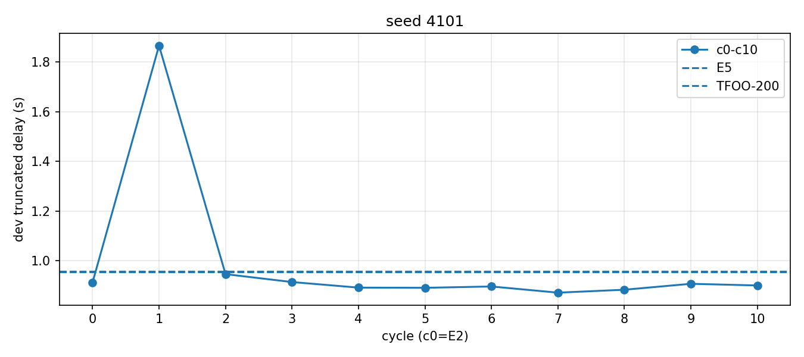
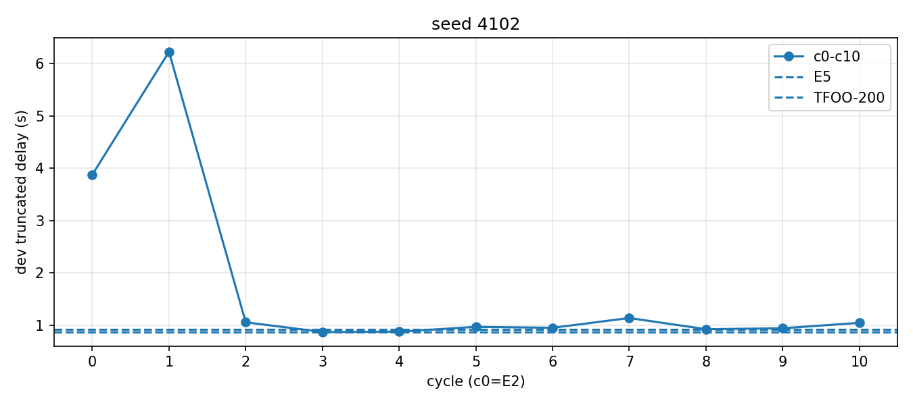
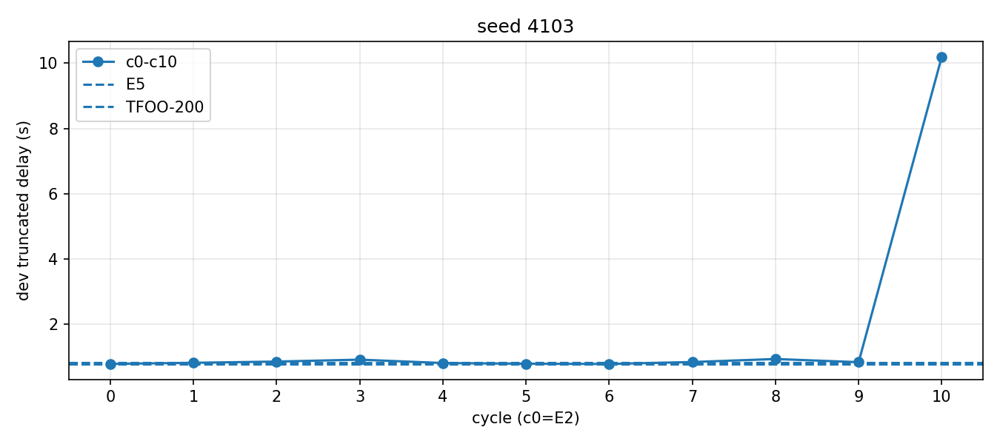
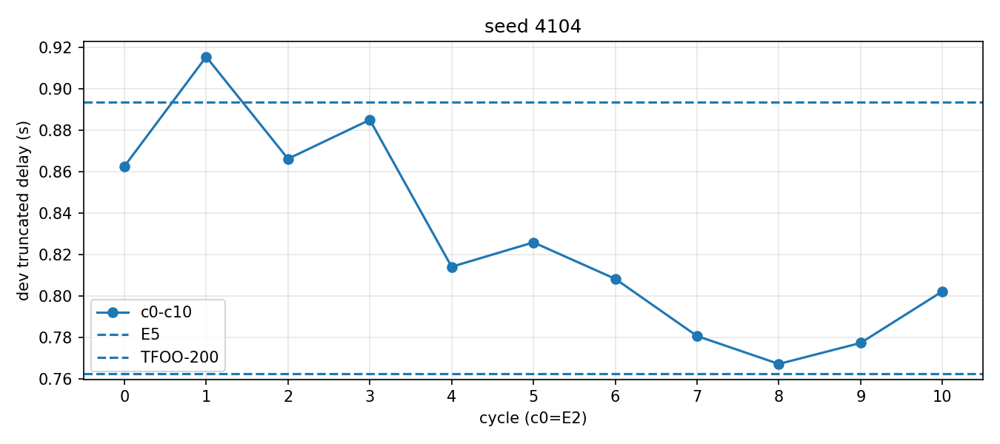
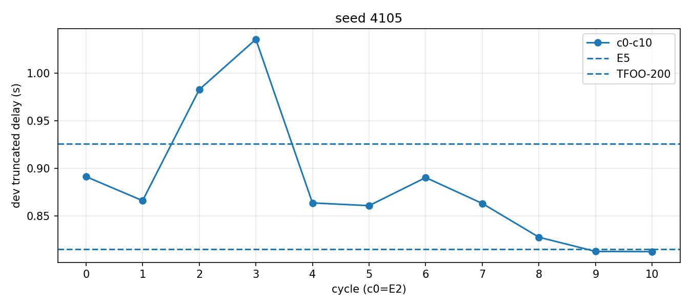

# v2.4.0 多 seed dev 诊断

输出目录：D:\HRL_UAV_V2\outputs\scene_optimality_20260928\v2_4_0_multiseed_diag_20261004

本任务仅评估 dev，未训练、未更新参数、未执行任何 test 窗口。C* 为事后在同一 dev 上选择，所列 C* dev 值偏乐观；所有交叉比较为 dev，非确认性。

## 1 检查结果

| 检查 | 结果 | 关键数值 |
|---|---|---|
| preflight | PASS | {"identity_chains": 20, "checkpoints": 65, "frozen_upper_network_checks": 110, "SAC_network_match_checks": 25} |
| replay | PASS | {"windows": 5} |
| fresh_manifest | PASS | {"scenarios": 20, "external_seeds": 60, "unique_external_seeds": 60, "policy_streams": [1, 2, 3, 4], "formula_1_20_equal": true, "no_environments_constructed": true, "no_windows_executed": true, "json_digest": "cf4334499c067753510d6de65086ce9111d513a0fb8cb6c9e578a5f7890f9c8d", "sha256": "1623dcbabe7cb121a9176f240f2d5b679bdd8b6e1ffe390c77b2a1f1d60cc395"} |
| logs | PASS | {"stage_CSVs": 20, "multiple_attempt_episodes": 0} |
| reuse_4101 | PASS | {"groups": 14, "windows": 560} |
| dev_windows | PASS | {"new_windows": 2600, "reused_windows": 560, "stream_comparisons": 1580, "actor_hash_unchanged_new_windows": 2600} |
| final_git_identity_checkpoint_sha | PASS | {"trees": 2, "checkpoint_files": 65} |
| no_training_no_test | PASS | {"parameter_updates": 0, "test_windows": 0, "fresh_test_environments": 0} |

| 运行环境 | 值 |
|---|---|
| 解释器 | D:\HRL_UAV_V2\.venv\Scripts\python.exe |
| sys.prefix | D:\HRL_UAV_V2\.venv |
| torch | 2.7.0.dev20250227+cu128 |
| CUDA | 12.8 |
| 设备 | cuda:0 |
| torch 线程 | 10 |
| 协议 SHA256 | 6797ca6538e663389845bf90c63743540feabf8beeab225df9bdd5aed194106a |

| 回放组 | 完整 metrics 逐位一致 | actor 哈希不变 | 墙钟秒 |
|---|---|---|---|
| S3-c10 | PASS | True | 13.7919742 |
| TFOO-200 | PASS | True | 15.0129493 |
| E2 | PASS | True | 13.690502 |
| E5 | PASS | True | 14.9652519 |
| X1 | PASS | True | 13.9619477 |

| 4101 复用组 | per_scenario 全字段逐位一致 | 均值差秒 |
|---|---|---|
| S3-c1 | True | 0 |
| S3-c2 | True | 0 |
| S3-c3 | True | 0 |
| S3-c4 | True | 0 |
| S3-c5 | True | 0 |
| S3-c6 | True | 0 |
| S3-c7 | True | 0 |
| S3-c8 | True | 0 |
| S3-c9 | True | 0 |
| S3-c10 | True | 0 |
| E2 | True | 0 |
| E5 | True | 0 |
| TFOO-200 | True | 0 |
| X1 | True | 0 |

## 2 Q1：c0–c10 dev 表现

截断时延为 20 场景等权均值；每场景 PooledMetrics 合并 stream 1、2。训练块均值按该块 10 个下层轮等权计算。

| seed | 块 | dev 截断时延秒 | 该块训练均值秒 |
|---|---|---|---|
| 4101 | 0 | 0.912816584529 |  |
| 4101 | 1 | 1.86535085362 | 0.955501657659 |
| 4101 | 2 | 0.945850294935 | 0.959105403226 |
| 4101 | 3 | 0.914073228559 | 0.985826050739 |
| 4101 | 4 | 0.891649672479 | 0.930180747569 |
| 4101 | 5 | 0.890875075202 | 0.855164821416 |
| 4101 | 6 | 0.896196013223 | 0.890254811093 |
| 4101 | 7 | 0.871427863902 | 1.01374360743 |
| 4101 | 8 | 0.883153442725 | 0.833722843365 |
| 4101 | 9 | 0.907009485326 | 0.904817172524 |
| 4101 | 10 | 0.900347893478 | 0.875050469137 |
| 4102 | 0 | 3.8790104989 |  |
| 4102 | 1 | 6.22890276447 | 4.56082029978 |
| 4102 | 2 | 1.05771148814 | 1.26761803515 |
| 4102 | 3 | 0.872118940572 | 1.03033677336 |
| 4102 | 4 | 0.878274201847 | 0.978222131249 |
| 4102 | 5 | 0.97030496532 | 0.901785418122 |
| 4102 | 6 | 0.9528097285 | 0.934152615595 |
| 4102 | 7 | 1.13915740534 | 0.982359285039 |
| 4102 | 8 | 0.92535022821 | 1.02550098401 |
| 4102 | 9 | 0.943260541049 | 1.0662655416 |
| 4102 | 10 | 1.04726364569 | 0.854430896866 |
| 4103 | 0 | 0.782324410402 |  |
| 4103 | 1 | 0.814839819246 | 0.853804119075 |
| 4103 | 2 | 0.853252154288 | 0.892961956792 |
| 4103 | 3 | 0.912073148193 | 0.781359243555 |
| 4103 | 4 | 0.807720486141 | 0.81881136419 |
| 4103 | 5 | 0.786702417863 | 0.762200594036 |
| 4103 | 6 | 0.780017445356 | 0.849378871591 |
| 4103 | 7 | 0.839255673315 | 0.837844324423 |
| 4103 | 8 | 0.931628797752 | 0.8105614348 |
| 4103 | 9 | 0.834407411456 | 0.83939208235 |
| 4103 | 10 | 10.195859481 | 2.17654327924 |
| 4104 | 0 | 0.862502470595 |  |
| 4104 | 1 | 0.915398757146 | 1.06368293104 |
| 4104 | 2 | 0.866118090694 | 0.947428265302 |
| 4104 | 3 | 0.88495918674 | 0.873358009578 |
| 4104 | 4 | 0.813980288411 | 0.800569367487 |
| 4104 | 5 | 0.825755718156 | 0.983593325623 |
| 4104 | 6 | 0.808159865308 | 0.888086707359 |
| 4104 | 7 | 0.780551643192 | 0.804664172675 |
| 4104 | 8 | 0.767044685586 | 0.723824028491 |
| 4104 | 9 | 0.777198355507 | 0.831373197448 |
| 4104 | 10 | 0.80211532547 | 0.73974512041 |
| 4105 | 0 | 0.891169911143 |  |
| 4105 | 1 | 0.865863004066 | 0.896705206667 |
| 4105 | 2 | 0.982774731331 | 0.959647467708 |
| 4105 | 3 | 1.0357323773 | 0.971439167441 |
| 4105 | 4 | 0.863465712787 | 1.06380012746 |
| 4105 | 5 | 0.860615783765 | 0.799556733411 |
| 4105 | 6 | 0.890183666181 | 0.973508829601 |
| 4105 | 7 | 0.862910613493 | 0.912600703186 |
| 4105 | 8 | 0.827375389213 | 0.949239917677 |
| 4105 | 9 | 0.812440739791 | 0.836257692801 |
| 4105 | 10 | 0.812190744932 | 0.793409629541 |

| seed | E5（SD200+cvx）秒 | TFOO-200 秒 | C* | C* 秒 | 事后排名（好→差） |
|---|---|---|---|---|---|
| 4101 | 0.956472553673 | 0.955819329428 | 7 | 0.871427863902 | c7,c8,c5,c4,c6,c10,c9,c0,c3,c2,c1 |
| 4102 | 0.923601908609 | 0.872795984799 | 3 | 0.872118940572 | c3,c4,c8,c9,c6,c5,c10,c2,c7,c0,c1 |
| 4103 | 0.824925236737 | 0.777382062196 | 6 | 0.780017445356 | c6,c0,c5,c4,c1,c9,c7,c2,c3,c8,c10 |
| 4104 | 0.89359179472 | 0.76237588511 | 8 | 0.767044685586 | c8,c9,c7,c10,c6,c4,c5,c0,c2,c3,c1 |
| 4105 | 0.925792479828 | 0.814987443159 | 10 | 0.812190744932 | c10,c9,c8,c5,c7,c4,c1,c6,c0,c2,c3 |

以下四段时延与 cost/s 为 40 窗口池化值，未完成数除以 40 窗口；它们与场景等权截断时延采用各自明确口径。

| seed | 组 | dev 截断s | 高优未完成/窗口 | 低优未完成/窗口 | cost/s | upload s | ready s | u2u s | cpu s |
|---|---|---|---|---|---|---|---|---|---|
| 4101 | S3-c1 | 1.86535085362 | 9.95 | 178.7 | 14.8073250274 | 0.679095241396 | 0.0504189292785 | 0.398566345751 | 0.743050418158 |
| 4101 | S3-c2 | 0.945850294935 | 7.05 | 77.2 | 8.3252328397 | 0.578519934121 | 0.0498639141864 | 0.056727119479 | 0.263384118821 |
| 4101 | S3-c3 | 0.914073228559 | 5.75 | 58.65 | 8.09106434876 | 0.536121966068 | 0.0500754011168 | 0.0334915841598 | 0.296157416504 |
| 4101 | S3-c4 | 0.891649672479 | 6.3 | 56.55 | 7.92069886731 | 0.564309012986 | 0.0499563415447 | 0.0458616305459 | 0.233257091032 |
| 4101 | S3-c5 | 0.890875075202 | 6.3 | 55.75 | 7.9050880191 | 0.561479130796 | 0.049917633854 | 0.047723053223 | 0.233441539027 |
| 4101 | S3-c6 | 0.896196013223 | 5.1 | 50.1 | 7.96005658173 | 0.514636245741 | 0.0499740144368 | 0.0512736237232 | 0.281805497419 |
| 4101 | S3-c7 | 0.871427863902 | 5.9 | 56 | 7.78778405781 | 0.556507159911 | 0.0500093144057 | 0.0279519509771 | 0.23865235504 |
| 4101 | S3-c8 | 0.883153442725 | 5.75 | 47.15 | 7.87611274368 | 0.53438786911 | 0.0499728488066 | 0.0265511855642 | 0.273644082999 |
| 4101 | S3-c9 | 0.907009485326 | 5.3 | 52.4 | 8.0432402541 | 0.527791196377 | 0.0500007952623 | 0.0267027447228 | 0.304310288368 |
| 4101 | S3-c10 | 0.900347893478 | 5.85 | 50.25 | 7.98631173133 | 0.538080054373 | 0.0501227487238 | 0.0385492036915 | 0.275170922283 |
| 4101 | E2 | 0.912816584529 | 6.3 | 60.05 | 8.07869601662 | 0.557990658209 | 0.0500136443906 | 0.0654090602336 | 0.241313930344 |
| 4101 | E5 | 0.956472553673 | 7.25 | 61.9 | 8.36485261129 | 0.591724009873 | 0.0501011923722 | 0.100600043282 | 0.215930156072 |
| 4101 | TFOO-200 | 0.955819329428 | 6.95 | 54.5 | 8.36325911637 | 0.59464243853 | 0.0497628999977 | 0.0997972567009 | 0.21357433304 |
| 4101 | X1 | 0.968782601323 | 6.65 | 62.8 | 8.47355921016 | 0.610300718358 | 0.0499028649589 | 0.0691643672957 | 0.24160003474 |
| 4101 | X2 | 1.01427846472 | 7.5 | 64.25 | 8.7903344988 | 0.646834127519 | 0.0499518074494 | 0.0410768032621 | 0.278490772617 |
| 4101 | X3 | 0.956894549656 | 7.15 | 64.05 | 8.39041627655 | 0.640075607433 | 0.0499388579599 | 0.0304035218106 | 0.238502290828 |
| 4102 | S3-c1 | 6.22890276447 | 7.4 | 1130.25 | 45.6908599811 | 0.60659922875 | 0.05007421501 | 0.124999715248 | 5.49352645202 |
| 4102 | S3-c2 | 1.05771148814 | 7.65 | 75.55 | 9.10394284928 | 0.608268606115 | 0.0498785707129 | 0.0403238482501 | 0.359522528141 |
| 4102 | S3-c3 | 0.872118940572 | 5.3 | 48.8 | 7.82833372739 | 0.490141941509 | 0.0500582532609 | 0.0392092584208 | 0.293337875125 |
| 4102 | S3-c4 | 0.878274201847 | 6.05 | 52.2 | 7.84767087762 | 0.540618105294 | 0.0499972576368 | 0.026507760911 | 0.261844821646 |
| 4102 | S3-c5 | 0.97030496532 | 6.35 | 57.85 | 8.49367073202 | 0.560289353932 | 0.0500758260453 | 0.0325292653688 | 0.328620477073 |
| 4102 | S3-c6 | 0.9528097285 | 5.65 | 53.7 | 8.37278100165 | 0.506838439056 | 0.0500998239014 | 0.058843537415 | 0.337966672646 |
| 4102 | S3-c7 | 1.13915740534 | 5.45 | 85.95 | 9.68871480676 | 0.508132026894 | 0.0499873866312 | 0.0483568395964 | 0.53480535789 |
| 4102 | S3-c8 | 0.92535022821 | 6.1 | 56.15 | 8.1795564221 | 0.538576915617 | 0.0500130075855 | 0.0296040810631 | 0.308259796175 |
| 4102 | S3-c9 | 0.943260541049 | 6.75 | 57.8 | 8.30725951836 | 0.563220924456 | 0.0499612341336 | 0.0469935190485 | 0.284102020884 |
| 4102 | S3-c10 | 1.04726364569 | 6.35 | 55.4 | 9.05178425439 | 0.547787577084 | 0.0499982639163 | 0.0439103686682 | 0.408613600317 |
| 4102 | E2 | 3.8790104989 | 4.1 | 481.3 | 28.8555138423 | 0.474061647161 | 0.0501228236135 | 0.0480592027518 | 3.30073957168 |
| 4102 | E5 | 0.923601908609 | 7.3 | 53.95 | 8.12386756301 | 0.564943709821 | 0.0499668923433 | 0.097669377504 | 0.211492370075 |
| 4102 | TFOO-200 | 0.872795984799 | 5.45 | 46.5 | 7.7636027667 | 0.514376997898 | 0.0499131300409 | 0.0969266023697 | 0.211465247464 |
| 4102 | X1 | 3.74587211779 | 4.25 | 440.4 | 27.9336181996 | 0.426755100855 | 0.0501553703237 | 0.0586796627399 | 3.20531752676 |
| 4102 | X2 | 1.19089837262 | 6.2 | 69.45 | 10.0766288594 | 0.555502019654 | 0.0497866047954 | 0.0438050816811 | 0.547222174764 |
| 4102 | X3 | 0.878036237961 | 5.25 | 50.2 | 7.86451706219 | 0.49719304353 | 0.0499580856539 | 0.0403851410803 | 0.290543249531 |
| 4103 | S3-c1 | 0.814839819246 | 4.75 | 40.25 | 7.42057462732 | 0.457923611755 | 0.0499868651189 | 0.0441729810384 | 0.263725465071 |
| 4103 | S3-c2 | 0.853252154288 | 4.7 | 48.7 | 7.68296081178 | 0.468845085616 | 0.0501675801448 | 0.0395975887215 | 0.296491643958 |
| 4103 | S3-c3 | 0.912073148193 | 4.8 | 54.1 | 8.11173889112 | 0.459246460111 | 0.0501549061286 | 0.035286303722 | 0.371844665032 |
| 4103 | S3-c4 | 0.807720486141 | 4.8 | 42.95 | 7.36019107318 | 0.465470638836 | 0.0499873275232 | 0.026629492316 | 0.26644641113 |
| 4103 | S3-c5 | 0.786702417863 | 4.7 | 38 | 7.20970241725 | 0.461748122308 | 0.0502098169995 | 0.0492167901066 | 0.22646668546 |
| 4103 | S3-c6 | 0.780017445356 | 4.7 | 37.05 | 7.16277191281 | 0.461705148809 | 0.0501282115759 | 0.0335068895704 | 0.235563580811 |
| 4103 | S3-c7 | 0.839255673315 | 4.35 | 53.4 | 7.58161830684 | 0.452224814882 | 0.0502280373351 | 0.0521315809706 | 0.286255812497 |
| 4103 | S3-c8 | 0.931628797752 | 5.45 | 45.85 | 8.2318035957 | 0.490232141892 | 0.0501460939563 | 0.0514198437851 | 0.341256339287 |
| 4103 | S3-c9 | 0.834407411456 | 4.65 | 46.55 | 7.54011384303 | 0.472631536656 | 0.0500481631014 | 0.0652754404399 | 0.247335933117 |
| 4103 | S3-c10 | 10.195859481 | 7.55 | 1631.3 | 73.2807068712 | 0.643438509304 | 0.0501792768647 | 0.261933521839 | 9.26375265887 |
| 4103 | E2 | 0.782324410402 | 4.45 | 36.85 | 7.1808490088 | 0.458407286931 | 0.0499391449866 | 0.0379923714986 | 0.236899565184 |
| 4103 | E5 | 0.824925236737 | 4.7 | 35.85 | 7.43756021582 | 0.457752987766 | 0.0502179276828 | 0.0976763539237 | 0.220063257618 |
| 4103 | TFOO-200 | 0.777382062196 | 3.85 | 32.55 | 7.10602252048 | 0.40330130731 | 0.050059120159 | 0.0997653644966 | 0.224884889075 |
| 4103 | X1 | 0.719285207055 | 3.3 | 30.75 | 6.73960688025 | 0.391682782836 | 0.050127612314 | 0.0396677800463 | 0.238523362463 |
| 4103 | X2 | 10.093838724 | 6.15 | 1624.8 | 72.5782092261 | 0.514960347099 | 0.050181544735 | 0.216483072928 | 9.33663047471 |
| 4103 | X3 | 0.71572105361 | 3.4 | 31.2 | 6.71205364336 | 0.396470812195 | 0.0502246428808 | 0.0339703231648 | 0.235846268185 |
| 4104 | S3-c1 | 0.915398757146 | 5.7 | 51.15 | 8.12801891936 | 0.527448178522 | 0.0498356734866 | 0.0455604343035 | 0.29401373358 |
| 4104 | S3-c2 | 0.866118090694 | 5.75 | 50.8 | 7.77890810946 | 0.532786685363 | 0.0499277398797 | 0.0417351494805 | 0.243109504162 |
| 4104 | S3-c3 | 0.88495918674 | 5.3 | 52.55 | 7.91498255847 | 0.522481911301 | 0.0500781215027 | 0.0288538311934 | 0.285266584658 |
| 4104 | S3-c4 | 0.813980288411 | 4.7 | 47.4 | 7.41752197277 | 0.477059303396 | 0.0500705690632 | 0.0258808797692 | 0.262719365687 |
| 4104 | S3-c5 | 0.825755718156 | 5.5 | 48.4 | 7.49572260134 | 0.521812113315 | 0.0498607039912 | 0.0118229669432 | 0.243493278433 |
| 4104 | S3-c6 | 0.808159865308 | 4.6 | 46.35 | 7.37379288839 | 0.479244318074 | 0.0499341301996 | 0.0204212618492 | 0.260425547364 |
| 4104 | S3-c7 | 0.780551643192 | 4.75 | 45.85 | 7.17895356245 | 0.485939672322 | 0.0497938341404 | 0.0150757582229 | 0.231029477509 |
| 4104 | S3-c8 | 0.767044685586 | 4.2 | 40.5 | 7.08340362952 | 0.479700378812 | 0.0499864226557 | 0.0122063852749 | 0.226285440924 |
| 4104 | S3-c9 | 0.777198355507 | 4.55 | 43.65 | 7.15449828027 | 0.492397584009 | 0.0499791825198 | 0.0114406164307 | 0.22452211525 |
| 4104 | S3-c10 | 0.80211532547 | 4.55 | 43.8 | 7.3332557537 | 0.498791455353 | 0.0498732009662 | 0.0112384426353 | 0.243374821674 |
| 4104 | E2 | 0.862502470595 | 5.25 | 48.95 | 7.75429326172 | 0.497323470257 | 0.0499045419185 | 0.0512278498674 | 0.265438460859 |
| 4104 | E5 | 0.89359179472 | 5.7 | 48.5 | 7.92286485623 | 0.524508158927 | 0.0498539969859 | 0.101821486234 | 0.21879710863 |
| 4104 | TFOO-200 | 0.76237588511 | 3.75 | 31 | 6.99929273992 | 0.390195338417 | 0.0498523717513 | 0.09787397169 | 0.225071330332 |
| 4104 | X1 | 0.795844365472 | 4.25 | 37.9 | 7.28708207037 | 0.422432819368 | 0.0502327851744 | 0.0486791074739 | 0.275557401697 |
| 4104 | X2 | 0.72095347972 | 3.7 | 37.35 | 6.76571237846 | 0.411932242182 | 0.050084356002 | 0.0106752035264 | 0.249308836134 |
| 4104 | X3 | 0.693156282432 | 3.45 | 32.55 | 6.56597682464 | 0.401810952708 | 0.0497976103492 | 0.0123189334336 | 0.230119054738 |
| 4105 | S3-c1 | 0.865863004066 | 5.15 | 65.45 | 7.77647268342 | 0.535676020667 | 0.0497703847683 | 0.0276397206015 | 0.254492671912 |
| 4105 | S3-c2 | 0.982774731331 | 6.7 | 91 | 8.59776931287 | 0.585880677201 | 0.0499398921315 | 0.0394771386998 | 0.309588946504 |
| 4105 | S3-c3 | 1.0357323773 | 6.05 | 92.8 | 8.97306011491 | 0.550038513463 | 0.0498246632853 | 0.0461554232409 | 0.392521776396 |
| 4105 | S3-c4 | 0.863465712787 | 5.05 | 66.1 | 7.75755300699 | 0.530011304827 | 0.0498313270775 | 0.023214677248 | 0.262236426592 |
| 4105 | S3-c5 | 0.860615783765 | 5.1 | 53.55 | 7.7311476992 | 0.518081089823 | 0.0497408149954 | 0.0378503515261 | 0.256495616246 |
| 4105 | S3-c6 | 0.890183666181 | 6 | 60.2 | 7.9433189363 | 0.552018346637 | 0.0499668007075 | 0.0368046004505 | 0.25325869988 |
| 4105 | S3-c7 | 0.862910613493 | 6.25 | 54.8 | 7.74594768098 | 0.541221865351 | 0.0499536044185 | 0.0363272140166 | 0.237080453781 |
| 4105 | S3-c8 | 0.827375389213 | 5.2 | 48.85 | 7.50445449739 | 0.512568778387 | 0.0498483944262 | 0.0307378916405 | 0.235671003437 |
| 4105 | S3-c9 | 0.812440739791 | 4.75 | 46.85 | 7.3989420541 | 0.498289231462 | 0.0498128264392 | 0.0268698940438 | 0.238920235319 |
| 4105 | S3-c10 | 0.812190744932 | 4.6 | 53 | 7.39520001118 | 0.480368360804 | 0.0497510498735 | 0.0202442885903 | 0.263282747172 |
| 4105 | E2 | 0.891169911143 | 5.45 | 61.45 | 7.9550369484 | 0.522289337923 | 0.0497928813187 | 0.054294342266 | 0.266698131743 |
| 4105 | E5 | 0.925792479828 | 6.55 | 54.8 | 8.14940114165 | 0.554394079613 | 0.0498359799282 | 0.103260123639 | 0.219770461554 |
| 4105 | TFOO-200 | 0.814987443159 | 4.25 | 36 | 7.37002031777 | 0.447277787565 | 0.0500859800433 | 0.100076669429 | 0.218488366464 |
| 4105 | X1 | 0.837700016261 | 4.45 | 51.5 | 7.58119843369 | 0.477139381365 | 0.049766533785 | 0.0497613067831 | 0.262945885763 |
| 4105 | X2 | 0.809904745462 | 4.2 | 47.55 | 7.37945420718 | 0.475891190348 | 0.0498984976494 | 0.0191292716333 | 0.266388535322 |
| 4105 | X3 | 0.809904745462 | 4.2 | 47.55 | 7.37945420718 | 0.475891190348 | 0.0498984976494 | 0.0191292716333 | 0.266388535322 |

| seed | CVX组 | solver_calls | fallback_calls |
|---|---|---|---|
| 4101 | E5 | 72000 | 0 |
| 4101 | TFOO-200 | 72000 | 0 |
| 4102 | E5 | 72000 | 0 |
| 4102 | TFOO-200 | 72000 | 0 |
| 4103 | E5 | 72000 | 0 |
| 4103 | TFOO-200 | 72000 | 0 |
| 4104 | E5 | 72000 | 0 |
| 4104 | TFOO-200 | 72000 | 0 |
| 4105 | E5 | 72000 | 0 |
| 4105 | TFOO-200 | 72000 | 0 |











## 3 Q2：已有训练日志

每轮事件/fit 的数值先按轮取均值和最大值；跨轮/跨块统计再等权取均值。critic 两个网络分量在 CSV 中分别保留；下表 critic 残差列来自 train_metrics.critic_residual_mse。缺失不填零。完整字段名和 attempt 选择记录见各阶段 metadata.json。

### a) 4103 c9/c10 与事后阈值

| 事后定义 | c1–c9逐轮均值s | 两倍阈值s | 第一个超过阈值的global | 该轮时延s |
|---|---|---|---|---|
| 第一个时延超过 c1–c9 逐轮时延均值两倍的轮次 | 0.827368221201 | 1.6547364424 | 596 | 11.8905802208 |

| global | 时延s | 未完成 | 最老年龄s | cost/s | 相对熵 | critic残差 | target_mean | actor梯度 | 事件行 | 跳过 | actor更新 |
|---|---|---|---|---|---|---|---|---|---|---|---|
| 571 | 0.983497401324 | 63 | 19 | 9.07748004943 | -13.0307678504 | 0.00558525617007 | -4.06518085493 | 缺失 | 90 | 0 | 0 |
| 572 | 0.64350109786 | 26 | 3.5 | 6.14314951724 | -11.9966352035 | 0.00523915775775 | -4.05698232933 | 缺失 | 90 | 0 | 0 |
| 573 | 0.688453641748 | 21 | 2 | 6.23951987742 | -11.7359865492 | 0.00526258600775 | -4.05315808007 | 0.0308564005627 | 90 | 0 | 45 |
| 574 | 0.764486299427 | 33 | 6.5 | 7.01136468309 | -12.1087455034 | 0.00535925195565 | -4.04730126353 | 0.0300628197276 | 90 | 0 | 45 |
| 575 | 0.695047797024 | 20 | 2.5 | 6.43906578774 | -12.3217224017 | 0.00544823366802 | -4.01992580588 | 0.0299964719762 | 90 | 0 | 45 |
| 576 | 0.8193767434 | 43 | 11 | 7.43815471205 | -12.3688459519 | 0.00560751229504 | -4.0340709894 | 0.0313066888187 | 90 | 0 | 45 |
| 577 | 0.729165486833 | 20 | 5 | 7.15120069845 | -12.4553254571 | 0.00532313673384 | -4.03226694219 | 0.0289340936061 | 90 | 0 | 45 |
| 578 | 0.929250950928 | 95 | 25 | 8.58478535758 | -12.8700284191 | 0.00543262412618 | -4.03286974092 | 0.0261133712613 | 90 | 0 | 45 |
| 579 | 0.787621588807 | 51 | 10.5 | 7.24474059149 | -12.6573982577 | 0.00564027330138 | -4.05559408133 | 0.0290487664855 | 90 | 0 | 45 |
| 580 | 1.35351981615 | 57 | 75.5 | 11.3131606444 | -14.1247629584 | 0.00598646236105 | -4.04756514478 | 0.0260430802488 | 90 | 0 | 45 |
| 591 | 0.790120669841 | 57 | 9 | 7.50260889486 | -13.2114355156 | 0.00558421459949 | -4.06053875219 | 缺失 | 90 | 0 | 0 |
| 592 | 0.956559663052 | 63 | 16.5 | 8.37452753853 | -13.1670251242 | 0.00564817180604 | -4.07407486351 | 缺失 | 90 | 0 | 0 |
| 593 | 0.820946896809 | 20 | 4 | 7.34135114395 | -12.9155666508 | 0.00572892294224 | -4.08745700787 | 0.0322045754434 | 90 | 0 | 45 |
| 594 | 0.869377298633 | 51 | 15.5 | 7.8558857554 | -13.6487616684 | 0.00574251596892 | -4.06436875639 | 0.0283052941163 | 90 | 0 | 45 |
| 595 | 0.857435170178 | 56 | 18.5 | 7.54092928597 | -12.8115253858 | 0.00595808903946 | -4.06523838625 | 0.027653259577 | 90 | 0 | 45 |
| 596 | 11.8905802208 | 1727 | 178.5 | 87.5548125932 | -18.068888144 | 0.00595161924615 | -4.06503129866 | 0.0298139139389 | 90 | 0 | 45 |
| 597 | 1.06546146392 | 50 | 14.5 | 9.09146125709 | -14.3981633326 | 0.0166764592063 | -4.17581485506 | 0.0403938241303 | 90 | 0 | 45 |
| 598 | 0.752713189841 | 68 | 18.5 | 6.60940917773 | -13.3308549808 | 0.00962354548329 | -4.17511136039 | 0.0359774892115 | 90 | 0 | 45 |
| 599 | 0.686913125906 | 39 | 4.5 | 6.62074152035 | -12.8264972964 | 0.00888610178248 | -4.16414426365 | 0.0335363923055 | 90 | 0 | 45 |
| 600 | 3.07532509343 | 88 | 15.5 | 23.7893451288 | -14.0396468192 | 0.00935455693667 | -4.13530299262 | 0.0297072617751 | 90 | 0 | 45 |

| 事后阈值前5轮 | 时延s | 未完成 | 相对熵 | critic残差 | target_mean | actor梯度 |
|---|---|---|---|---|---|---|
| 591 | 0.790120669841 | 57 | -13.2114355156 | 0.00558421459949 | -4.06053875219 | 缺失 |
| 592 | 0.956559663052 | 63 | -13.1670251242 | 0.00564817180604 | -4.07407486351 | 缺失 |
| 593 | 0.820946896809 | 20 | -12.9155666508 | 0.00572892294224 | -4.08745700787 | 0.0322045754434 |
| 594 | 0.869377298633 | 51 | -13.6487616684 | 0.00574251596892 | -4.06436875639 | 0.0283052941163 |
| 595 | 0.857435170178 | 56 | -12.8115253858 | 0.00595808903946 | -4.06523838625 | 0.027653259577 |

此前 5 轮的全部请求字段（能耗、分段时延、优先级与 critic 两个分量的均值/最大值）原样保留于 logs_analysis/summary.json.onset4103.preceding_five 和 seed_4103/stage3.csv。

### b) 第三阶段每块均值

| seed | 块 | global范围 | 时延s | 相对熵 | critic残差 | target_mean | actor梯度 | alpha |
|---|---|---|---|---|---|---|---|---|
| 4101 | 1 | 411–420 | 0.955501657659 | -11.7721458282 | 0.0076019029004 | -3.95895022788 | 0.0553316956852 | 0.0005 |
| 4101 | 2 | 431–440 | 0.959105403226 | -11.8658645964 | 0.00788149828267 | -4.11253452754 | 0.0541612192781 | 0.0005 |
| 4101 | 3 | 451–460 | 0.985826050739 | -11.6757226099 | 0.00771332869473 | -4.10174281346 | 0.0509841859548 | 0.0005 |
| 4101 | 4 | 471–480 | 0.930180747569 | -12.0058365357 | 0.00779444324833 | -4.15340989289 | 0.0480921444017 | 0.0005 |
| 4101 | 5 | 491–500 | 0.855164821416 | -11.4575514578 | 0.0079263098366 | -4.18683279846 | 0.0455297211392 | 0.0005 |
| 4101 | 6 | 511–520 | 0.890254811093 | -12.4808169468 | 0.00740950907058 | -4.15806718754 | 0.0371724847963 | 0 |
| 4101 | 7 | 531–540 | 1.01374360743 | -12.8528729706 | 0.007814259924 | -4.17434977646 | 0.0402229906319 | 0 |
| 4101 | 8 | 551–560 | 0.833722843365 | -12.8826113239 | 0.00802028450517 | -4.1843108824 | 0.0367506087189 | 0 |
| 4101 | 9 | 571–580 | 0.904817172524 | -13.009558327 | 0.00752038248797 | -4.16359694342 | 0.0340973547944 | 0 |
| 4101 | 10 | 591–600 | 0.875050469137 | -13.6431699531 | 0.00755805334268 | -4.16518116628 | 0.0371574612645 | 0 |
| 4102 | 1 | 411–420 | 4.56082029978 | -12.7653000053 | 0.0318119624182 | -7.11334884213 | 0.109423730993 | 0.0005 |
| 4102 | 2 | 431–440 | 1.26761803515 | -12.5677700288 | 0.025752214222 | -6.14504421388 | 0.0903540526155 | 0.0005 |
| 4102 | 3 | 451–460 | 1.03033677336 | -11.7393520292 | 0.0209889537973 | -5.54959681526 | 0.0676410190709 | 0.0005 |
| 4102 | 4 | 471–480 | 0.978222131249 | -11.366072333 | 0.0213363002547 | -5.36879109194 | 0.0635852340402 | 0.0005 |
| 4102 | 5 | 491–500 | 0.901785418122 | -11.2766732062 | 0.0199553681444 | -5.1825428343 | 0.0595972377186 | 0.0005 |
| 4102 | 6 | 511–520 | 0.934152615595 | -13.5332583464 | 0.0200075991507 | -4.97355663809 | 0.060185001744 | 0 |
| 4102 | 7 | 531–540 | 0.982359285039 | -14.6091619391 | 0.0129413483461 | -4.57673370864 | 0.0435704761547 | 0 |
| 4102 | 8 | 551–560 | 1.02550098401 | -13.0548783228 | 0.00822280653764 | -4.39265453791 | 0.0367866796027 | 0 |
| 4102 | 9 | 571–580 | 1.0662655416 | -13.3941140537 | 0.00822792332406 | -4.38522945292 | 0.0453910173434 | 0 |
| 4102 | 10 | 591–600 | 0.854430896866 | -15.4902673405 | 0.00779140920211 | -4.37638781093 | 0.0402673779444 | 0 |
| 4103 | 1 | 411–420 | 0.853804119075 | -10.5905409682 | 0.00665077424341 | -4.13084885118 | 0.0413451212096 | 0.0005 |
| 4103 | 2 | 431–440 | 0.892961956792 | -10.8811482704 | 0.00538293079907 | -4.08835587363 | 0.0334151025189 | 0.0005 |
| 4103 | 3 | 451–460 | 0.781359243555 | -10.6334906361 | 0.00542771197298 | -4.13125723236 | 0.0373621266853 | 0.0005 |
| 4103 | 4 | 471–480 | 0.81881136419 | -10.9711951926 | 0.00516234765583 | -4.09842341242 | 0.033776258967 | 0.0005 |
| 4103 | 5 | 491–500 | 0.762200594036 | -10.313679334 | 0.00518226734139 | -4.1021461125 | 0.0343206322571 | 0.0005 |
| 4103 | 6 | 511–520 | 0.849378871591 | -11.4226225888 | 0.00507184769776 | -4.0840198349 | 0.0329801053067 | 0 |
| 4103 | 7 | 531–540 | 0.837844324423 | -12.0692660442 | 0.00552159364931 | -4.08702056914 | 0.0321807468491 | 0 |
| 4103 | 8 | 551–560 | 0.8105614348 | -12.3658489548 | 0.00540682746503 | -4.05363382341 | 0.0309478552702 | 0 |
| 4103 | 9 | 571–580 | 0.83939208235 | -12.5670218552 | 0.00548844943767 | -4.04449152324 | 0.0290452115859 | 0 |
| 4103 | 10 | 591–600 | 2.17654327924 | -13.8418364918 | 0.0079154197011 | -4.10670825366 | 0.0321990013123 | 0 |
| 4104 | 1 | 411–420 | 1.06368293104 | -11.3576890699 | 0.00858311448902 | -4.53857701157 | 0.056792788161 | 0.0005 |
| 4104 | 2 | 431–440 | 0.947428265302 | -11.6064568248 | 0.00745016372234 | -4.56421111334 | 0.0545592089339 | 0.0005 |
| 4104 | 3 | 451–460 | 0.873358009578 | -11.3239950328 | 0.00764741331662 | -4.53160042752 | 0.0501519849213 | 0.0005 |
| 4104 | 4 | 471–480 | 0.800569367487 | -11.5236798402 | 0.00732600093918 | -4.50461027304 | 0.0455414831897 | 0.0005 |
| 4104 | 5 | 491–500 | 0.983593325623 | -11.7521786827 | 0.00702737101098 | -4.50036213575 | 0.04591843186 | 0.0005 |
| 4104 | 6 | 511–520 | 0.888086707359 | -11.9622830659 | 0.00715586551135 | -4.54544461145 | 0.0404682836314 | 0 |
| 4104 | 7 | 531–540 | 0.804664172675 | -12.5700430339 | 0.00732577797015 | -4.49999812628 | 0.0372973942793 | 0 |
| 4104 | 8 | 551–560 | 0.723824028491 | -11.6917253507 | 0.00696208571207 | -4.4491994856 | 0.0324320222613 | 0 |
| 4104 | 9 | 571–580 | 0.831373197448 | -12.1096612679 | 0.00685653303448 | -4.42933412607 | 0.0338952119436 | 0 |
| 4104 | 10 | 591–600 | 0.73974512041 | -12.0829972857 | 0.00695650168732 | -4.42795103144 | 0.0321540560936 | 0 |
| 4105 | 1 | 411–420 | 0.896705206667 | -10.0620069498 | 0.00799005091493 | -3.96580253334 | 0.0463878338277 | 0.0005 |
| 4105 | 2 | 431–440 | 0.959647467708 | -10.3762710013 | 0.00913238643555 | -4.14960824437 | 0.0521390235 | 0.0005 |
| 4105 | 3 | 451–460 | 0.971439167441 | -10.6611973857 | 0.00886343172286 | -4.26836986287 | 0.0509035874779 | 0.0005 |
| 4105 | 4 | 471–480 | 1.06380012746 | -11.2036849349 | 0.00853255653509 | -4.35138838134 | 0.0487037391505 | 0.0005 |
| 4105 | 5 | 491–500 | 0.799556733411 | -11.0999482731 | 0.00846248692692 | -4.4034735141 | 0.0440255621862 | 0.0005 |
| 4105 | 6 | 511–520 | 0.973508829601 | -11.7858830255 | 0.00823929615967 | -4.3491000645 | 0.0451758353402 | 0 |
| 4105 | 7 | 531–540 | 0.912600703186 | -12.4311360722 | 0.00822146472986 | -4.37629686693 | 0.040204339358 | 0 |
| 4105 | 8 | 551–560 | 0.949239917677 | -12.5223221272 | 0.00799552660852 | -4.36767137877 | 0.0438598992406 | 0 |
| 4105 | 9 | 571–580 | 0.836257692801 | -12.5538521409 | 0.00767620145694 | -4.30063422855 | 0.0385403402046 | 0 |
| 4105 | 10 | 591–600 | 0.793409629541 | -12.9848347045 | 0.00740487973901 | -4.21657061511 | 0.0322527313269 | 0 |

| seed | 块范围 | 时延s | 相对熵 | critic残差 | target_mean | actor梯度 | 记录的alpha |
|---|---|---|---|---|---|---|---|
| 4101 | c1-c5 | 0.937155736122 | -11.7554242056 | 0.00778720258626 | -4.10562759948 | 0.0508197932918 | [0.0005] |
| 4101 | c6-c10 | 0.90351778071 | -12.9738059043 | 0.00766449786608 | -4.16910119122 | 0.0370801800412 | [0.0] |
| 4102 | c1-c5 | 1.74775653153 | -11.9430335205 | 0.0238088984887 | -5.84652834965 | 0.0781202548877 | [0.0005] |
| 4102 | c6-c10 | 0.972541864622 | -14.0163360005 | 0.0114382173121 | -4.5409124297 | 0.0452401105578 | [0.0] |
| 4103 | c1-c5 | 0.82182745553 | -10.6780108803 | 0.00553897032415 | -4.10978501979 | 0.0360438483276 | [0.0005] |
| 4103 | c6-c10 | 1.10274399848 | -12.453319187 | 0.00588082759017 | -4.07517480087 | 0.0314705840648 | [0.0] |
| 4104 | c1-c5 | 0.933726379805 | -11.5127998901 | 0.00758688816923 | -4.52765372654 | 0.0505927794132 | [0.0005] |
| 4104 | c6-c10 | 0.797538645277 | -12.0833420008 | 0.00705135278308 | -4.47038547617 | 0.0352493936418 | [0.0] |
| 4105 | c1-c5 | 0.938229740537 | -10.6806217089 | 0.00860855253956 | -4.23307393524 | 0.0484319492285 | [0.0005] |
| 4105 | c6-c10 | 0.893003354561 | -12.4556056141 | 0.0079074737388 | -4.32205463077 | 0.0400066290941 | [0.0] |

### c) 第一阶段每25轮比较

截断时延s；各 seed 同期训练轮，未视为同一外生场景。

| 轮次 | 4101 | 4102 | 4103 | 4104 | 4105 |
|---|---|---|---|---|---|
| 1–25 | 10.4958443563 | 12.8937662792 | 7.1106188765 | 18.2432629021 | 9.5268809381 |
| 26–50 | 3.21932025368 | 3.78904699925 | 1.93226801093 | 5.36032457005 | 5.18648459321 |
| 51–75 | 1.37069878442 | 1.4608403369 | 1.49617546953 | 5.12931039663 | 1.429969126 |
| 76–100 | 1.43036061787 | 1.42236593382 | 1.28971522406 | 6.83880855946 | 1.31378897779 |
| 101–125 | 1.23400678678 | 1.36219215667 | 1.32620035286 | 7.11703038006 | 1.23107604787 |
| 126–150 | 1.34288147423 | 1.23798641373 | 1.3771984876 | 1.51963620802 | 1.25271478643 |
| 151–175 | 1.32095099487 | 1.3818276975 | 1.38926795137 | 1.77685684694 | 1.77123818493 |
| 176–200 | 1.16266987343 | 1.28535250231 | 1.21910753516 | 1.42309431611 | 6.15302706597 |
| 201–225 | 1.63637762959 | 2.4733726708 | 1.4939175931 | 1.23889285664 | 1.62966769595 |
| 226–250 | 2.26188001748 | 1.17140114774 | 1.23961713636 | 1.28833099702 | 1.46455915364 |
| 251–275 | 1.80256867199 | 1.37811693472 | 1.24864435346 | 1.31505298571 | 1.2181455145 |
| 276–300 | 1.27336474594 | 1.31321491974 | 1.19888598091 | 1.3380921421 | 1.2377482082 |

相对熵；各 seed 同期训练轮，未视为同一外生场景。

| 轮次 | 4101 | 4102 | 4103 | 4104 | 4105 |
|---|---|---|---|---|---|
| 1–25 | -3.43444469735 | -5.12141295108 | -2.51116721587 | -6.88261101553 | -3.69197825295 |
| 26–50 | -1.97833936625 | -3.25394058386 | -1.72118088844 | -5.66828725792 | -2.64327529372 |
| 51–75 | -1.4536544874 | -2.12392118269 | -1.54292137547 | -5.68711687872 | -1.77848171093 |
| 76–100 | -1.24529884279 | -1.75136183138 | -1.19695152049 | -5.40677326038 | -1.43775363768 |
| 101–125 | -2.03832565249 | -2.49930714384 | -2.26473677584 | -7.61848207315 | -2.05842281735 |
| 126–150 | -2.23617871362 | -2.87470132987 | -2.68922671493 | -7.00284949064 | -2.18983078528 |
| 151–175 | -2.67477605777 | -3.12651590111 | -2.89078790992 | -7.47555629402 | -2.92483550089 |
| 176–200 | -2.55260559996 | -3.23400112737 | -2.61164674656 | -7.02571847529 | -4.44100528562 |
| 201–225 | -7.74897029802 | -8.23914370135 | -7.31003765879 | -9.05009752769 | -7.48014747608 |
| 226–250 | -8.69939164809 | -8.98111872213 | -8.72951470753 | -10.1365824494 | -8.6817416463 |
| 251–275 | -11.0582230817 | -10.4110005029 | -8.82803312615 | -10.459019725 | -9.38528428144 |
| 276–300 | -11.1875566435 | -10.8910460949 | -9.79437285044 | -11.1257212131 | -9.84443385365 |

critic残差；各 seed 同期训练轮，未视为同一外生场景。

| 轮次 | 4101 | 4102 | 4103 | 4104 | 4105 |
|---|---|---|---|---|---|
| 1–25 | 0.0154394825135 | 0.0319322639862 | 0.0123760235994 | 0.0319187747695 | 0.0164105079312 |
| 26–50 | 0.0278278916598 | 0.0550316223273 | 0.0169454856509 | 0.066831685336 | 0.0272226034714 |
| 51–75 | 0.0400070259122 | 0.0468029288754 | 0.0194400067148 | 0.076441466999 | 0.0420441621127 |
| 76–100 | 0.0162200158746 | 0.0154724200805 | 0.0103104482763 | 0.0330627148824 | 0.0272711243174 |
| 101–125 | 0.010010513363 | 0.0110229019408 | 0.00994341544581 | 0.0490946866954 | 0.0101269870246 |
| 126–150 | 0.0104956291755 | 0.0113069822285 | 0.0109865844543 | 0.0602131518522 | 0.0106451743856 |
| 151–175 | 0.0117124245192 | 0.0121982253067 | 0.0125917671695 | 0.0478764215404 | 0.0131567974781 |
| 176–200 | 0.0130667409279 | 0.0137098317607 | 0.0138296304178 | 0.0194379841151 | 0.0686103837207 |
| 201–225 | 0.0147356474843 | 0.0167733975696 | 0.0150074762985 | 0.0168072812345 | 0.0912773139005 |
| 226–250 | 0.0224645438028 | 0.0195346866619 | 0.0164914504057 | 0.0157532862952 | 0.0637133080499 |
| 251–275 | 0.0247051993846 | 0.022189700111 | 0.01660460578 | 0.0157925514052 | 0.0263035264031 |
| 276–300 | 0.0251558397646 | 0.0165165849436 | 0.0144385322737 | 0.0165581961365 | 0.018579638215 |

| seed | G1 passed | candidate均值s | equal均值s | equal胜场 | local均值s | local胜场 |
|---|---|---|---|---|---|---|
| 4101 | True | 1.26315906891 | 1.30934463764 | 17 | 5.70487867749 | 20 |
| 4102 | False | 4.04971356387 | 1.30934463764 | 6 | 5.70487867749 | 13 |
| 4103 | True | 1.23359558661 | 1.30934463764 | 19 | 5.70487867749 | 20 |
| 4104 | True | 1.2540270696 | 1.30934463764 | 20 | 5.70487867749 | 20 |
| 4105 | False | 1.31227000221 | 1.30934463764 | 15 | 5.70487867749 | 20 |

4102 diagnosis_required.json 原文（文件不存在时写缺失；不删 pairs）：
```json
{
  "episode": 300,
  "gate": {
    "gate": "G1",
    "passed": false,
    "required_wins": 12,
    "equal": {
      "scenarios": 20,
      "wins": 6,
      "candidate_mean_s": 4.049713563872141,
      "reference_mean_s": 1.3093446376449154,
      "relative_improvement": -2.092931721289405,
      "candidate_unfinished": 9647,
      "reference_unfinished": 4948,
      "pairs": [
        {
          "scenario": "1",
          "candidate_s": 1.0769280678230053,
          "reference_s": 1.1150467869140859,
          "win": true
        },
        {
          "scenario": "2",
          "candidate_s": 1.957219882774707,
          "reference_s": 1.6444104592272226,
          "win": false
        },
        {
          "scenario": "3",
          "candidate_s": 1.1756442989942328,
          "reference_s": 1.286137873636988,
          "win": true
        },
        {
          "scenario": "4",
          "candidate_s": 1.2641245036139759,
          "reference_s": 1.2751635574093663,
          "win": true
        },
        {
          "scenario": "5",
          "candidate_s": 10.430198368448849,
          "reference_s": 1.0521553494923395,
          "win": false
        },
        {
          "scenario": "6",
          "candidate_s": 10.87548096836394,
          "reference_s": 1.1384760408483925,
          "win": false
        },
        {
          "scenario": "7",
          "candidate_s": 6.807377636626808,
          "reference_s": 1.7929975688930762,
          "win": false
        },
        {
          "scenario": "8",
          "candidate_s": 1.1935089145548354,
          "reference_s": 1.3329347947970391,
          "win": true
        },
        {
          "scenario": "9",
          "candidate_s": 11.717027863777094,
          "reference_s": 1.1692782937736506,
          "win": false
        },
        {
          "scenario": "10",
          "candidate_s": 1.1835898227976063,
          "reference_s": 1.173628857873011,
          "win": false
        },
        {
          "scenario": "11",
          "candidate_s": 1.4652366184240753,
          "reference_s": 1.4235512864691027,
          "win": false
        },
        {
          "scenario": "12",
          "candidate_s": 1.4560293372374566,
          "reference_s": 1.3679387915986276,
          "win": false
        },
        {
          "scenario": "13",
          "candidate_s": 2.1707330590077194,
          "reference_s": 2.1435304875514403,
          "win": false
        },
        {
          "scenario": "14",
          "candidate_s": 1.3149600169839422,
          "reference_s": 1.3207359705611799,
          "win": true
        },
        {
          "scenario": "15",
          "candidate_s": 9.712519286507373,
          "reference_s": 0.9609525732166311,
          "win": false
        },
        {
          "scenario": "16",
          "candidate_s": 4.577048919489682,
          "reference_s": 1.282487632713281,
          "win": false
        },
        {
          "scenario": "17",
          "candidate_s": 8.535695089176658,
          "reference_s": 1.117563702734941,
          "win": false
        },
        {
          "scenario": "18",
          "candidate_s": 1.3290555303019154,
          "reference_s": 1.1213220522896896,
          "win": false
        },
        {
          "scenario": "19",
          "candidate_s": 1.05034441363935,
          "reference_s": 1.0874324749192534,
          "win": true
        },
        {
          "scenario": "20",
          "candidate_s": 1.7015486788996053,
          "reference_s": 1.3811481979789915,
          "win": false
        }
      ]
    },
    "local": {
      "scenarios": 20,
      "wins": 13,
      "candidate_mean_s": 4.049713563872141,
      "reference_mean_s": 5.7048786774891385,
      "relative_improvement": 0.2901315185103074,
      "candidate_unfinished": 9647,
      "reference_unfinished": 27090,
      "pairs": [
        {
          "scenario": "1",
          "candidate_s": 1.0769280678230053,
          "reference_s": 6.626713958216207,
          "win": true
        },
        {
          "scenario": "2",
          "candidate_s": 1.957219882774707,
          "reference_s": 6.071214362943147,
          "win": true
        },
        {
          "scenario": "3",
          "candidate_s": 1.1756442989942328,
          "reference_s": 6.323320308642851,
          "win": true
        },
        {
          "scenario": "4",
          "candidate_s": 1.2641245036139759,
          "reference_s": 7.9137888181012945,
          "win": true
        },
        {
          "scenario": "5",
          "candidate_s": 10.430198368448849,
          "reference_s": 5.147813838840298,
          "win": false
        },
        {
          "scenario": "6",
          "candidate_s": 10.87548096836394,
          "reference_s": 6.176136542169513,
          "win": false
        },
        {
          "scenario": "7",
          "candidate_s": 6.807377636626808,
          "reference_s": 3.8867722488441734,
          "win": false
        },
        {
          "scenario": "8",
          "candidate_s": 1.1935089145548354,
          "reference_s": 10.172360675039249,
          "win": true
        },
        {
          "scenario": "9",
          "candidate_s": 11.717027863777094,
          "reference_s": 7.7487416580667166,
          "win": false
        },
        {
          "scenario": "10",
          "candidate_s": 1.1835898227976063,
          "reference_s": 6.033192451346559,
          "win": true
        },
        {
          "scenario": "11",
          "candidate_s": 1.4652366184240753,
          "reference_s": 2.600165116011948,
          "win": true
        },
        {
          "scenario": "12",
          "candidate_s": 1.4560293372374566,
          "reference_s": 7.064406779661031,
          "win": true
        },
        {
          "scenario": "13",
          "candidate_s": 2.1707330590077194,
          "reference_s": 6.489141970433793,
          "win": true
        },
        {
          "scenario": "14",
          "candidate_s": 1.3149600169839422,
          "reference_s": 6.132017550067241,
          "win": true
        },
        {
          "scenario": "15",
          "candidate_s": 9.712519286507373,
          "reference_s": 4.482054535753929,
          "win": false
        },
        {
          "scenario": "16",
          "candidate_s": 4.577048919489682,
          "reference_s": 3.2290551682240287,
          "win": false
        },
        {
          "scenario": "17",
          "candidate_s": 8.535695089176658,
          "reference_s": 3.7194262801626836,
          "win": false
        },
        {
          "scenario": "18",
          "candidate_s": 1.3290555303019154,
          "reference_s": 4.9751132747775,
          "win": true
        },
        {
          "scenario": "19",
          "candidate_s": 1.05034441363935,
          "reference_s": 2.2829779632434932,
          "win": true
        },
        {
          "scenario": "20",
          "candidate_s": 1.7015486788996053,
          "reference_s": 7.023160049237102,
          "win": true
        }
      ]
    },
    "action": "pause_before_PPO",
    "unfinished": {
      "rule": "report_only_not_a_pass_condition",
      "per_episode": {
        "candidate": {
          "total": 9647.0,
          "by_priority": [
            264.0,
            9383.0
          ]
        },
        "hover_equal": {
          "total": 2474.0,
          "by_priority": [
            270.0,
            2204.0
          ]
        },
        "hover_local": {
          "total": 13545.0,
          "by_priority": [
            253.0,
            13292.0
          ]
        }
      },
      "candidate_within_equal": false
    }
  },
  "stage_delay_s": {
    "hover": {
      "upload": 0.9056313267609162,
      "ready": 0.049963833027600046,
      "u2u": 0.05470075430758021,
      "cpu": 3.035899445588175
    }
  },
  "candidate_training_authorized": false
}
```

### d) SD200 / TFOO 每10轮训练均值与 PPO 更新

| 上层轮次 | 4101 SD200 s / TFOO s | 4102 SD200 s / TFOO s | 4103 SD200 s / TFOO s | 4104 SD200 s / TFOO s | 4105 SD200 s / TFOO s |
|---|---|---|---|---|---|
| 1–10 | 1.44103059071 / 1.42420981096 | 3.85561023534 / 1.21588614111 | 1.50276280153 / 1.47708256193 | 1.17609155376 / 1.17417102394 | 1.1975493064 / 1.21982865432 |
| 11–20 | 1.13560539148 / 1.1128035738 | 2.82460243689 / 1.29577471849 | 1.13412887463 / 1.1382153497 | 1.08938199446 / 1.10198858633 | 1.28541431861 / 1.27202339815 |
| 21–30 | 1.27973501114 / 1.23662399357 | 1.80282298478 / 1.12433469752 | 1.19756793819 / 1.19900917306 | 1.05975134399 / 1.02099302775 | 1.35709648977 / 1.3166622533 |
| 31–40 | 1.22404418547 / 1.1856368265 | 4.22087102258 / 1.20852719092 | 1.1834669519 / 1.17851409253 | 1.03556000333 / 1.01946915441 | 1.20982385831 / 1.26684190127 |
| 41–50 | 1.3006366073 / 1.21607836283 | 4.51979388882 / 1.07931123409 | 1.13591608666 / 1.09805335599 | 1.11452410357 / 1.048171791 | 1.15481318233 / 1.20289695332 |
| 51–60 | 1.36339671259 / 1.29055885509 | 4.54279365423 / 1.27187974834 | 1.10537791663 / 1.03481439666 | 1.02753354307 / 0.976681903463 | 1.18511514234 / 1.23344248645 |
| 61–70 | 1.2776241237 / 1.17151641857 | 5.02730780311 / 1.25807325902 | 1.03905940493 / 0.991178471649 | 1.16392758292 / 1.02791730619 | 1.1441690351 / 1.18189525965 |
| 71–80 | 1.40330756576 / 1.20540958307 | 3.66909362425 / 1.13398815522 | 1.12520222684 / 1.05512938394 | 1.24003068579 / 1.02504489587 | 1.26946984735 / 1.25942546117 |
| 81–90 | 1.4849083305 / 1.20854361713 | 3.81056513843 / 1.18960095876 | 0.976661922491 / 0.921817506528 | 1.21744869192 / 0.987304178358 | 1.17849187371 / 1.18274496529 |
| 91–100 | 1.33322272817 / 1.1652810545 | 2.72548470705 / 1.00283664167 | 1.01211643045 / 0.940804811771 | 1.05938006222 / 0.893741419645 | 1.11289904165 / 1.10108252575 |
| 101–110 | 1.28770799544 / 1.11134233849 | 2.0617034942 / 0.967817071362 | 0.943778102592 / 0.968938368662 | 1.12804306087 / 0.891432088777 | 1.02228130124 / 1.11291594892 |
| 111–120 | 1.31502463688 / 1.1018471263 | 3.66519358401 / 1.12139933698 | 1.0843418984 / 1.06465267874 | 1.08743223028 / 0.84705174635 | 0.98363662885 / 0.955083236719 |
| 121–130 | 1.20199226389 / 1.12728213654 | 2.7899033571 / 1.04659259534 | 0.8782865201 / 0.914851362716 | 0.988979231426 / 0.818802780486 | 1.08028741639 / 0.996952861763 |
| 131–140 | 1.25573293404 / 1.14112947775 | 3.2340014254 / 0.86009716263 | 1.08235605926 / 1.08491043492 | 1.05831810066 / 0.824368222137 | 1.22176213369 / 1.13142202853 |
| 141–150 | 1.29137168463 / 1.23824114655 | 2.70294265445 / 0.859220813943 | 0.810914958989 / 0.810850890973 | 0.93022772965 / 0.765018519282 | 0.901578087488 / 0.849308657272 |
| 151–160 | 1.05963752373 / 1.11257625969 | 1.49908639313 / 0.881596841008 | 0.891584504648 / 0.867656385444 | 0.944023878974 / 0.805115923018 | 1.09431782281 / 0.880286916856 |
| 161–170 | 0.925773874911 / 0.915526185472 | 2.54635866461 / 0.88625908762 | 0.861817861197 / 0.858266008598 | 1.13119611685 / 0.863100600603 | 0.945412753255 / 0.832108468095 |
| 171–180 | 1.05869878241 / 1.00629255545 | 3.0950378847 / 1.0107492511 | 0.847243748815 / 0.83611642959 | 0.858979107079 / 0.72867245528 | 1.01372597884 / 0.867155138492 |
| 181–190 | 0.982158867496 / 0.908064167797 | 3.16101453833 / 0.913935501531 | 0.771606483245 / 0.781341402323 | 0.933057374572 / 0.775447360242 | 0.843500864866 / 0.786624785797 |
| 191–200 | 0.889664411629 / 0.942125771384 | 2.75014785415 / 0.883908862571 | 0.75813894245 / 0.765103095311 | 0.906910587466 / 0.757214570955 | 0.993611725554 / 0.896474480353 |

| seed | 运行 | 日志批次 | batches | actor attempted | actor accepted | value steps | rollbacks | epoch KL均值 |
|---|---|---|---|---|---|---|---|---|
| 4101 | stage2 | 40 | 40 | 1440 | 1440 | 1440 | 0 | 0.00965957540481 |
| 4101 | TFOO | 40 | 40 | 1440 | 1440 | 1440 | 0 | 0.00917706005662 |
| 4102 | stage2 | 40 | 40 | 1428 | 1416 | 1440 | 2 | 0.0106378063717 |
| 4102 | TFOO | 40 | 40 | 1434 | 1428 | 1440 | 1 | 0.00901767217705 |
| 4103 | stage2 | 40 | 40 | 1440 | 1440 | 1440 | 0 | 0.00929238140914 |
| 4103 | TFOO | 40 | 40 | 1440 | 1440 | 1440 | 0 | 0.00884073319879 |
| 4104 | stage2 | 40 | 40 | 1440 | 1440 | 1440 | 0 | 0.00876367888696 |
| 4104 | TFOO | 40 | 40 | 1440 | 1440 | 1440 | 0 | 0.00851935808926 |
| 4105 | stage2 | 40 | 40 | 1416 | 1410 | 1440 | 1 | 0.00942304588951 |
| 4105 | TFOO | 40 | 40 | 1440 | 1440 | 1440 | 0 | 0.00917029890542 |

| seed | 阶段 | 多attempt的global数量 | PPO实际数值字段 |
|---|---|---|---|
| 4101 | stage2 | 0 | ppo.0.accepted,ppo.0.epoch,ppo.0.kl,ppo.1.accepted,ppo.1.epoch,ppo.1.kl,ppo.2.accepted,ppo.2.epoch,ppo.2.kl,ppo.3.accepted,ppo.3.epoch,ppo.3.kl,ppo.4.accepted,ppo.4.epoch,ppo.4.kl,ppo.5.accepted,ppo.5.epoch,ppo.5.kl |
| 4101 | TFOO | 0 | ppo.0.accepted,ppo.0.epoch,ppo.0.kl,ppo.1.accepted,ppo.1.epoch,ppo.1.kl,ppo.2.accepted,ppo.2.epoch,ppo.2.kl,ppo.3.accepted,ppo.3.epoch,ppo.3.kl,ppo.4.accepted,ppo.4.epoch,ppo.4.kl,ppo.5.accepted,ppo.5.epoch,ppo.5.kl |
| 4102 | stage2 | 0 | ppo.0.accepted,ppo.0.epoch,ppo.0.kl,ppo.1.accepted,ppo.1.epoch,ppo.1.kl,ppo.2.accepted,ppo.2.epoch,ppo.2.kl,ppo.3.accepted,ppo.3.epoch,ppo.3.kl,ppo.4.accepted,ppo.4.epoch,ppo.4.kl,ppo.5.accepted,ppo.5.epoch,ppo.5.kl |
| 4102 | TFOO | 0 | ppo.0.accepted,ppo.0.epoch,ppo.0.kl,ppo.1.accepted,ppo.1.epoch,ppo.1.kl,ppo.2.accepted,ppo.2.epoch,ppo.2.kl,ppo.3.accepted,ppo.3.epoch,ppo.3.kl,ppo.4.accepted,ppo.4.epoch,ppo.4.kl,ppo.5.accepted,ppo.5.epoch,ppo.5.kl |
| 4103 | stage2 | 0 | ppo.0.accepted,ppo.0.epoch,ppo.0.kl,ppo.1.accepted,ppo.1.epoch,ppo.1.kl,ppo.2.accepted,ppo.2.epoch,ppo.2.kl,ppo.3.accepted,ppo.3.epoch,ppo.3.kl,ppo.4.accepted,ppo.4.epoch,ppo.4.kl,ppo.5.accepted,ppo.5.epoch,ppo.5.kl |
| 4103 | TFOO | 0 | ppo.0.accepted,ppo.0.epoch,ppo.0.kl,ppo.1.accepted,ppo.1.epoch,ppo.1.kl,ppo.2.accepted,ppo.2.epoch,ppo.2.kl,ppo.3.accepted,ppo.3.epoch,ppo.3.kl,ppo.4.accepted,ppo.4.epoch,ppo.4.kl,ppo.5.accepted,ppo.5.epoch,ppo.5.kl |
| 4104 | stage2 | 0 | ppo.0.accepted,ppo.0.epoch,ppo.0.kl,ppo.1.accepted,ppo.1.epoch,ppo.1.kl,ppo.2.accepted,ppo.2.epoch,ppo.2.kl,ppo.3.accepted,ppo.3.epoch,ppo.3.kl,ppo.4.accepted,ppo.4.epoch,ppo.4.kl,ppo.5.accepted,ppo.5.epoch,ppo.5.kl |
| 4104 | TFOO | 0 | ppo.0.accepted,ppo.0.epoch,ppo.0.kl,ppo.1.accepted,ppo.1.epoch,ppo.1.kl,ppo.2.accepted,ppo.2.epoch,ppo.2.kl,ppo.3.accepted,ppo.3.epoch,ppo.3.kl,ppo.4.accepted,ppo.4.epoch,ppo.4.kl,ppo.5.accepted,ppo.5.epoch,ppo.5.kl |
| 4105 | stage2 | 0 | ppo.0.accepted,ppo.0.epoch,ppo.0.kl,ppo.1.accepted,ppo.1.epoch,ppo.1.kl,ppo.2.accepted,ppo.2.epoch,ppo.2.kl,ppo.3.accepted,ppo.3.epoch,ppo.3.kl,ppo.4.accepted,ppo.4.epoch,ppo.4.kl,ppo.5.accepted,ppo.5.epoch,ppo.5.kl |
| 4105 | TFOO | 0 | ppo.0.accepted,ppo.0.epoch,ppo.0.kl,ppo.1.accepted,ppo.1.epoch,ppo.1.kl,ppo.2.accepted,ppo.2.epoch,ppo.2.kl,ppo.3.accepted,ppo.3.epoch,ppo.3.kl,ppo.4.accepted,ppo.4.epoch,ppo.4.kl,ppo.5.accepted,ppo.5.epoch,ppo.5.kl |

### e) 基线 checkpoint 与快照清单

全部文件名及字节大小见 checkpoint_inventory.md 和 logs_analysis/checkpoint_inventory.csv，均直接取目录项；未为该清单计算 SHA256。

| seed | 基线 | checkpoint文件数 | snapshot文件数 | 总字节 |
|---|---|---|---|---|
| 4101 | NC | 10 | 16 | 56590888 |
| 4101 | TOO | 10 | 16 | 56591144 |
| 4101 | TFOO | 10 | 16 | 56591144 |
| 4102 | NC | 10 | 16 | 56590888 |
| 4102 | TOO | 10 | 16 | 56591144 |
| 4102 | TFOO | 10 | 16 | 56591080 |
| 4103 | NC | 10 | 16 | 56590888 |
| 4103 | TOO | 10 | 16 | 56591144 |
| 4103 | TFOO | 10 | 16 | 56591144 |
| 4104 | NC | 10 | 16 | 56590888 |
| 4104 | TOO | 10 | 16 | 56591144 |
| 4104 | TFOO | 10 | 16 | 56591144 |
| 4105 | NC | 10 | 16 | 56590888 |
| 4105 | TOO | 10 | 16 | 56591144 |
| 4105 | TFOO | 10 | 16 | 56591144 |

## 4 Q3：上下层交叉（dev，非确认性）

### 4101

| 上层 | cvx | SAC300 | C10 | C* |
|---|---|---|---|---|
| SD200 | 0.956472553673 | 0.912816584529 | 0.900347893478 | 0.871427863902 |
| TFOO | 0.955819329428 | 0.968782601323 | 1.01427846472 | 0.956894549656 |

### 4102

| 上层 | cvx | SAC300 | C10 | C* |
|---|---|---|---|---|
| SD200 | 0.923601908609 | 3.8790104989 | 1.04726364569 | 0.872118940572 |
| TFOO | 0.872795984799 | 3.74587211779 | 1.19089837262 | 0.878036237961 |

### 4103

| 上层 | cvx | SAC300 | C10 | C* |
|---|---|---|---|---|
| SD200 | 0.824925236737 | 0.782324410402 | 10.195859481 | 0.780017445356 |
| TFOO | 0.777382062196 | 0.719285207055 | 10.093838724 | 0.71572105361 |

### 4104

| 上层 | cvx | SAC300 | C10 | C* |
|---|---|---|---|---|
| SD200 | 0.89359179472 | 0.862502470595 | 0.80211532547 | 0.767044685586 |
| TFOO | 0.76237588511 | 0.795844365472 | 0.72095347972 | 0.693156282432 |

### 4105

| 上层 | cvx | SAC300 | C10 | C* |
|---|---|---|---|---|
| SD200 | 0.925792479828 | 0.891169911143 | 0.812190744932 | 0.812190744932 |
| TFOO | 0.814987443159 | 0.837700016261 | 0.809904745462 | 0.809904745462 |

### 5-seed

| 上层 | cvx | SAC300 | C10 | C* |
|---|---|---|---|---|
| SD200 | 0.904876794713 | 1.46556477511 | 2.75155541812 | 0.82055993607 |
| TFOO | 0.836672140938 | 1.41349686158 | 2.7659747573 | 0.810742573824 |

5 seed 汇总先对同一场景取 5 seed 均值，再对 20 场景等权汇总。相对差=(candidate/reference−1)×100%，负数表示候选时延更低。Wilcoxon 双侧、zero_method=wilcox；t 检验双侧；符号检验只计非零差。

| seed/汇总 | 候选 | 参考 | 候选均值s | 参考均值s | 相对差% | 胜场/20 | Wilcoxon p | 配对t p | 符号p |
|---|---|---|---|---|---|---|---|---|---|
| 4101 | S3-Cstar | TFOO-200 | 0.871427863902 | 0.955819329428 | -8.8292277555 | 16 | 0.0023250579834 | 0.00134379841724 | 0.0118179321289 |
| 4101 | S3-c10 | TFOO-200 | 0.900347893478 | 0.955819329428 | -5.80354824832 | 13 | 0.069580078125 | 0.037515001044 | 0.263175964355 |
| 4101 | X1 | TFOO-200 | 0.968782601323 | 0.955819329428 | 1.35624709559 | 9 | 0.498008728027 | 0.420104833286 | 0.823802947998 |
| 4101 | X2 | TFOO-200 | 1.01427846472 | 0.955819329428 | 6.1161281737 | 8 | 0.0825500488281 | 0.0347490945481 | 0.503444671631 |
| 4101 | X3 | TFOO-200 | 0.956894549656 | 0.955819329428 | 0.112491994523 | 11 | 0.956329345703 | 0.914655070533 | 0.823802947998 |
| 4101 | TFOO/cvx | SD200/cvx | 0.955819329428 | 0.956472553673 | -0.06829513744 | 10 | 0.98543548584 | 0.982096807213 | 1 |
| 4101 | TFOO/SAC300 | SD200/SAC300 | 0.968782601323 | 0.912816584529 | 6.1311349664 | 6 | 0.0171813964844 | 0.0170911948926 | 0.11531829834 |
| 4101 | TFOO/C10 | SD200/C10 | 1.01427846472 | 0.900347893478 | 12.6540609549 | 1 | 4.76837158203e-05 | 1.43158516273e-05 | 4.00543212891e-05 |
| 4101 | TFOO/Cstar | SD200/Cstar | 0.956894549656 | 0.871427863902 | 9.80766042657 | 4 | 0.0012092590332 | 0.000879455975202 | 0.0118179321289 |
| 4101 | SD200/SAC300 | SD200/cvx | 0.912816584529 | 0.956472553673 | -4.56426783771 | 18 | 0.000167846679688 | 7.29173562844e-05 | 0.000402450561523 |
| 4101 | SD200/C10 | SD200/cvx | 0.900347893478 | 0.956472553673 | -5.86787984451 | 18 | 1.90734863281e-05 | 0.000173783356771 | 0.000402450561523 |
| 4101 | SD200/Cstar | SD200/cvx | 0.871427863902 | 0.956472553673 | -8.89149295971 | 20 | 1.90734863281e-06 | 2.33253900433e-09 | 1.90734863281e-06 |
| 4101 | TFOO/SAC300 | TFOO/cvx | 0.968782601323 | 0.955819329428 | 1.35624709559 | 9 | 0.498008728027 | 0.420104833286 | 0.823802947998 |
| 4101 | TFOO/C10 | TFOO/cvx | 1.01427846472 | 0.955819329428 | 6.1161281737 | 8 | 0.0825500488281 | 0.0347490945481 | 0.503444671631 |
| 4101 | TFOO/Cstar | TFOO/cvx | 0.956894549656 | 0.955819329428 | 0.112491994523 | 11 | 0.956329345703 | 0.914655070533 | 0.823802947998 |
| 4102 | S3-Cstar | TFOO-200 | 0.872118940572 | 0.872795984799 | -0.0775718769443 | 11 | 0.927278518677 | 0.975405963612 | 0.823802947998 |
| 4102 | S3-c10 | TFOO-200 | 1.04726364569 | 0.872795984799 | 19.9895123179 | 9 | 0.621513366699 | 0.27889624024 | 0.823802947998 |
| 4102 | X1 | TFOO-200 | 3.74587211779 | 0.872795984799 | 329.180722991 | 5 | 0.00101661682129 | 0.00393816937261 | 0.041389465332 |
| 4102 | X2 | TFOO-200 | 1.19089837262 | 0.872795984799 | 36.4463624212 | 14 | 0.069580078125 | 0.359695966529 | 0.11531829834 |
| 4102 | X3 | TFOO-200 | 0.878036237961 | 0.872795984799 | 0.600398403886 | 9 | 0.621513366699 | 0.54484167212 | 0.823802947998 |
| 4102 | TFOO/cvx | SD200/cvx | 0.872795984799 | 0.923601908609 | -5.50084655909 | 13 | 0.142906188965 | 0.11532407038 | 0.263175964355 |
| 4102 | TFOO/SAC300 | SD200/SAC300 | 3.74587211779 | 3.8790104989 | -3.43227689481 | 13 | 0.0171813964844 | 0.0166039710029 | 0.263175964355 |
| 4102 | TFOO/C10 | SD200/C10 | 1.19089837262 | 1.04726364569 | 13.7152404284 | 12 | 0.545875549316 | 0.454308743088 | 0.503444671631 |
| 4102 | TFOO/Cstar | SD200/Cstar | 0.878036237961 | 0.872118940572 | 0.67849660338 | 10 | 0.647655487061 | 0.778892979387 | 1 |
| 4102 | SD200/SAC300 | SD200/cvx | 3.8790104989 | 0.923601908609 | 319.9872762 | 3 | 8.20159912109e-05 | 0.00402864585525 | 0.00257682800293 |
| 4102 | SD200/C10 | SD200/cvx | 1.04726364569 | 0.923601908609 | 13.3890733583 | 16 | 0.00729560852051 | 0.42760180124 | 0.0118179321289 |
| 4102 | SD200/Cstar | SD200/cvx | 0.872118940572 | 0.923601908609 | -5.57415132611 | 14 | 0.00638961791992 | 0.0118742302609 | 0.11531829834 |
| 4102 | TFOO/SAC300 | TFOO/cvx | 3.74587211779 | 0.872795984799 | 329.180722991 | 5 | 0.00101661682129 | 0.00393816937261 | 0.041389465332 |
| 4102 | TFOO/C10 | TFOO/cvx | 1.19089837262 | 0.872795984799 | 36.4463624212 | 14 | 0.069580078125 | 0.359695966529 | 0.11531829834 |
| 4102 | TFOO/Cstar | TFOO/cvx | 0.878036237961 | 0.872795984799 | 0.600398403886 | 9 | 0.621513366699 | 0.54484167212 | 0.823802947998 |
| 4103 | S3-Cstar | TFOO-200 | 0.780017445356 | 0.777382062196 | 0.339007456967 | 12 | 0.123092651367 | 0.925446130276 | 0.503444671631 |
| 4103 | S3-c10 | TFOO-200 | 10.195859481 | 0.777382062196 | 1211.56351257 | 3 | 0.000133514404297 | 0.00210487393149 | 0.00257682800293 |
| 4103 | X1 | TFOO-200 | 0.719285207055 | 0.777382062196 | -7.47339795522 | 19 | 3.81469726562e-06 | 4.07458307813e-07 | 4.00543212891e-05 |
| 4103 | X2 | TFOO-200 | 10.093838724 | 0.777382062196 | 1198.43988109 | 12 | 0.329982757568 | 0.00235928558486 | 0.503444671631 |
| 4103 | X3 | TFOO-200 | 0.71572105361 | 0.777382062196 | -7.93187952025 | 20 | 1.90734863281e-06 | 2.63313742292e-07 | 1.90734863281e-06 |
| 4103 | TFOO/cvx | SD200/cvx | 0.777382062196 | 0.824925236737 | -5.7633313207 | 14 | 0.0136165618896 | 0.0742876363708 | 0.11531829834 |
| 4103 | TFOO/SAC300 | SD200/SAC300 | 0.719285207055 | 0.782324410402 | -8.05793638904 | 16 | 0.000394821166992 | 0.0372103391343 | 0.0118179321289 |
| 4103 | TFOO/C10 | SD200/C10 | 10.093838724 | 10.195859481 | -1.00060968113 | 18 | 0.0023250579834 | 0.112543610311 | 0.000402450561523 |
| 4103 | TFOO/Cstar | SD200/Cstar | 0.71572105361 | 0.780017445356 | -8.2429427865 | 16 | 0.00271224975586 | 0.036819007578 | 0.0118179321289 |
| 4103 | SD200/SAC300 | SD200/cvx | 0.782324410402 | 0.824925236737 | -5.16420451677 | 19 | 3.81469726562e-06 | 5.62638237155e-07 | 4.00543212891e-05 |
| 4103 | SD200/C10 | SD200/cvx | 10.195859481 | 0.824925236737 | 1135.97376186 | 7 | 0.0362339019775 | 0.00225844164666 | 0.263175964355 |
| 4103 | SD200/Cstar | SD200/cvx | 0.780017445356 | 0.824925236737 | -5.44386198668 | 19 | 3.81469726562e-06 | 2.77211026882e-07 | 4.00543212891e-05 |
| 4103 | TFOO/SAC300 | TFOO/cvx | 0.719285207055 | 0.777382062196 | -7.47339795522 | 19 | 3.81469726562e-06 | 4.07458307813e-07 | 4.00543212891e-05 |
| 4103 | TFOO/C10 | TFOO/cvx | 10.093838724 | 0.777382062196 | 1198.43988109 | 12 | 0.329982757568 | 0.00235928558486 | 0.503444671631 |
| 4103 | TFOO/Cstar | TFOO/cvx | 0.71572105361 | 0.777382062196 | -7.93187952025 | 20 | 1.90734863281e-06 | 2.63313742292e-07 | 1.90734863281e-06 |
| 4104 | S3-Cstar | TFOO-200 | 0.767044685586 | 0.76237588511 | 0.612401384524 | 10 | 0.98543548584 | 0.74982022686 | 1 |
| 4104 | S3-c10 | TFOO-200 | 0.80211532547 | 0.76237588511 | 5.21257835355 | 9 | 0.069580078125 | 0.0291742278974 | 0.823802947998 |
| 4104 | X1 | TFOO-200 | 0.795844365472 | 0.76237588511 | 4.39002347991 | 8 | 0.153646469116 | 0.0970684153404 | 0.503444671631 |
| 4104 | X2 | TFOO-200 | 0.72095347972 | 0.76237588511 | -5.43333101157 | 16 | 0.0023250579834 | 0.00103943683072 | 0.0118179321289 |
| 4104 | X3 | TFOO-200 | 0.693156282432 | 0.76237588511 | -9.07945857554 | 19 | 9.53674316406e-06 | 1.10302081437e-07 | 4.00543212891e-05 |
| 4104 | TFOO/cvx | SD200/cvx | 0.76237588511 | 0.89359179472 | -14.684099651 | 20 | 1.90734863281e-06 | 8.03081831196e-07 | 1.90734863281e-06 |
| 4104 | TFOO/SAC300 | SD200/SAC300 | 0.795844365472 | 0.862502470595 | -7.72845381844 | 18 | 0.000104904174805 | 0.000159877620048 | 0.000402450561523 |
| 4104 | TFOO/C10 | SD200/C10 | 0.72095347972 | 0.80211532547 | -10.1184758816 | 19 | 3.81469726562e-06 | 4.54104688592e-07 | 4.00543212891e-05 |
| 4104 | TFOO/Cstar | SD200/Cstar | 0.693156282432 | 0.767044685586 | -9.63286814219 | 19 | 3.81469726562e-06 | 3.78602352063e-06 | 4.00543212891e-05 |
| 4104 | SD200/SAC300 | SD200/cvx | 0.862502470595 | 0.89359179472 | -3.4791416292 | 12 | 0.0896949768066 | 0.0605844563688 | 0.503444671631 |
| 4104 | SD200/C10 | SD200/cvx | 0.80211532547 | 0.89359179472 | -10.2369414972 | 19 | 3.81469726562e-06 | 2.43128571295e-07 | 4.00543212891e-05 |
| 4104 | SD200/Cstar | SD200/cvx | 0.767044685586 | 0.89359179472 | -14.161623896 | 20 | 1.90734863281e-06 | 5.38088511936e-13 | 1.90734863281e-06 |
| 4104 | TFOO/SAC300 | TFOO/cvx | 0.795844365472 | 0.76237588511 | 4.39002347991 | 8 | 0.153646469116 | 0.0970684153404 | 0.503444671631 |
| 4104 | TFOO/C10 | TFOO/cvx | 0.72095347972 | 0.76237588511 | -5.43333101157 | 16 | 0.0023250579834 | 0.00103943683072 | 0.0118179321289 |
| 4104 | TFOO/Cstar | TFOO/cvx | 0.693156282432 | 0.76237588511 | -9.07945857554 | 19 | 9.53674316406e-06 | 1.10302081437e-07 | 4.00543212891e-05 |
| 4105 | S3-Cstar | TFOO-200 | 0.812190744932 | 0.814987443159 | -0.343158443758 | 12 | 0.430433273315 | 0.857665586892 | 0.503444671631 |
| 4105 | S3-c10 | TFOO-200 | 0.812190744932 | 0.814987443159 | -0.343158443758 | 12 | 0.430433273315 | 0.857665586892 | 0.503444671631 |
| 4105 | X1 | TFOO-200 | 0.837700016261 | 0.814987443159 | 2.78686172318 | 13 | 0.368276596069 | 0.520708091053 | 0.263175964355 |
| 4105 | X2 | TFOO-200 | 0.809904745462 | 0.814987443159 | -0.623653497913 | 12 | 0.261098861694 | 0.729468124877 | 0.503444671631 |
| 4105 | X3 | TFOO-200 | 0.809904745462 | 0.814987443159 | -0.623653497913 | 12 | 0.261098861694 | 0.729468124877 | 0.503444671631 |
| 4105 | TFOO/cvx | SD200/cvx | 0.814987443159 | 0.925792479828 | -11.9686689062 | 20 | 1.90734863281e-06 | 7.61315684627e-06 | 1.90734863281e-06 |
| 4105 | TFOO/SAC300 | SD200/SAC300 | 0.837700016261 | 0.891169911143 | -5.99996636031 | 18 | 0.000585556030273 | 0.00164791130436 | 0.000402450561523 |
| 4105 | TFOO/C10 | SD200/C10 | 0.809904745462 | 0.812190744932 | -0.281460911038 | 8 | 0.927278518677 | 0.73037296621 | 0.503444671631 |
| 4105 | TFOO/Cstar | SD200/Cstar | 0.809904745462 | 0.812190744932 | -0.281460911038 | 8 | 0.927278518677 | 0.73037296621 | 0.503444671631 |
| 4105 | SD200/SAC300 | SD200/cvx | 0.891169911143 | 0.925792479828 | -3.73977640124 | 16 | 0.00365447998047 | 0.0570937464213 | 0.0118179321289 |
| 4105 | SD200/C10 | SD200/cvx | 0.812190744932 | 0.925792479828 | -12.270755852 | 20 | 1.90734863281e-06 | 3.87266186872e-10 | 1.90734863281e-06 |
| 4105 | SD200/Cstar | SD200/cvx | 0.812190744932 | 0.925792479828 | -12.270755852 | 20 | 1.90734863281e-06 | 3.87266186872e-10 | 1.90734863281e-06 |
| 4105 | TFOO/SAC300 | TFOO/cvx | 0.837700016261 | 0.814987443159 | 2.78686172318 | 13 | 0.368276596069 | 0.520708091053 | 0.263175964355 |
| 4105 | TFOO/C10 | TFOO/cvx | 0.809904745462 | 0.814987443159 | -0.623653497913 | 12 | 0.261098861694 | 0.729468124877 | 0.503444671631 |
| 4105 | TFOO/Cstar | TFOO/cvx | 0.809904745462 | 0.814987443159 | -0.623653497913 | 12 | 0.261098861694 | 0.729468124877 | 0.503444671631 |
| 5-seed | S3-Cstar | TFOO-200 | 0.82055993607 | 0.836672140938 | -1.92574893803 | 15 | 0.0582580566406 | 0.176433170585 | 0.041389465332 |
| 5-seed | S3-c10 | TFOO-200 | 2.75155541812 | 0.836672140938 | 228.869013737 | 6 | 0.0023250579834 | 0.00170415026042 | 0.11531829834 |
| 5-seed | X1 | TFOO-200 | 1.41349686158 | 0.836672140938 | 68.9427426131 | 3 | 0.000261306762695 | 0.00277377555111 | 0.00257682800293 |
| 5-seed | X2 | TFOO-200 | 2.7659747573 | 0.836672140938 | 230.592429455 | 8 | 0.0973072052002 | 0.00168915063235 | 0.503444671631 |
| 5-seed | X3 | TFOO-200 | 0.810742573824 | 0.836672140938 | -3.09913117044 | 16 | 0.00198554992676 | 0.00166839340019 | 0.0118179321289 |
| 5-seed | TFOO/cvx | SD200/cvx | 0.836672140938 | 0.904876794713 | -7.53745196841 | 20 | 1.90734863281e-06 | 2.46405927772e-05 | 1.90734863281e-06 |
| 5-seed | TFOO/SAC300 | SD200/SAC300 | 1.41349686158 | 1.46556477511 | -3.55275416112 | 17 | 0.000482559204102 | 0.00153133755108 | 0.00257682800293 |
| 5-seed | TFOO/C10 | SD200/C10 | 2.7659747573 | 2.75155541812 | 0.524043204338 | 15 | 0.069580078125 | 0.731235241759 | 0.041389465332 |
| 5-seed | TFOO/Cstar | SD200/Cstar | 0.810742573824 | 0.82055993607 | -1.19642232258 | 14 | 0.261098861694 | 0.164771551813 | 0.11531829834 |
| 5-seed | SD200/SAC300 | SD200/cvx | 1.46556477511 | 0.904876794713 | 61.9629085059 | 6 | 0.00943565368652 | 0.00526364578241 | 0.11531829834 |
| 5-seed | SD200/C10 | SD200/cvx | 2.75155541812 | 0.904876794713 | 204.080669788 | 11 | 0.153646469116 | 0.00229677370159 | 0.823802947998 |
| 5-seed | SD200/Cstar | SD200/cvx | 0.82055993607 | 0.904876794713 | -9.31804850521 | 20 | 1.90734863281e-06 | 6.15289340869e-15 | 1.90734863281e-06 |
| 5-seed | TFOO/SAC300 | TFOO/cvx | 1.41349686158 | 0.836672140938 | 68.9427426131 | 3 | 0.000261306762695 | 0.00277377555111 | 0.00257682800293 |
| 5-seed | TFOO/C10 | TFOO/cvx | 2.7659747573 | 0.836672140938 | 230.592429455 | 8 | 0.0973072052002 | 0.00168915063235 | 0.503444671631 |
| 5-seed | TFOO/Cstar | TFOO/cvx | 0.810742573824 | 0.836672140938 | -3.09913117044 | 16 | 0.00198554992676 | 0.00166839340019 | 0.0118179321289 |

## 5 dev 与已有 test 一致性（事后）

| seed | 组 | dev均值s | 已有test均值s |
|---|---|---|---|
| 4101 | Proposed | 0.900347893478 | 0.851124422492 |
| 4101 | TwoStage | 0.912816584529 | 0.880922153183 |
| 4101 | UpperCVX | 0.956472553673 | 0.912236681435 |
| 4101 | TFOO-200 | 0.955819329428 | 0.945983980814 |
| 4102 | Proposed | 1.04726364569 | 0.913413447179 |
| 4102 | TwoStage | 3.8790104989 | 2.77649325036 |
| 4102 | UpperCVX | 0.923601908609 | 0.918032797736 |
| 4102 | TFOO-200 | 0.872795984799 | 0.841142072939 |
| 4103 | Proposed | 10.195859481 | 7.56072010616 |
| 4103 | TwoStage | 0.782324410402 | 0.77508965785 |
| 4103 | UpperCVX | 0.824925236737 | 0.804377827867 |
| 4103 | TFOO-200 | 0.777382062196 | 0.768956031052 |
| 4104 | Proposed | 0.80211532547 | 0.798070227752 |
| 4104 | TwoStage | 0.862502470595 | 0.858511029075 |
| 4104 | UpperCVX | 0.89359179472 | 0.891010615772 |
| 4104 | TFOO-200 | 0.76237588511 | 0.766902521848 |
| 4105 | Proposed | 0.812190744932 | 0.807347168858 |
| 4105 | TwoStage | 0.891169911143 | 0.871682721581 |
| 4105 | UpperCVX | 0.925792479828 | 0.926541344097 |
| 4105 | TFOO-200 | 0.814987443159 | 0.796198327204 |

| seed | dev排序（好→差） | test排序（好→差） |
|---|---|---|
| 4101 | Proposed > TwoStage > TFOO-200 > UpperCVX | Proposed > TwoStage > UpperCVX > TFOO-200 |
| 4102 | TFOO-200 > UpperCVX > Proposed > TwoStage | TFOO-200 > Proposed > UpperCVX > TwoStage |
| 4103 | TFOO-200 > TwoStage > UpperCVX > Proposed | TFOO-200 > TwoStage > UpperCVX > Proposed |
| 4104 | TFOO-200 > Proposed > TwoStage > UpperCVX | TFOO-200 > Proposed > TwoStage > UpperCVX |
| 4105 | Proposed > TFOO-200 > TwoStage > UpperCVX | TFOO-200 > Proposed > TwoStage > UpperCVX |

| 格子数 | Spearman rho | 双侧p |
|---|---|---|
| 20 | 0.954887218045 | 6.23787604798e-11 |

| 单列重点 | dev均值s | 已有test均值s |
|---|---|---|
| 4102 TwoStage | 3.8790104989 | 2.77649325036 |
| 4103 Proposed | 10.195859481 | 7.56072010616 |

## 6 Q4：新 test 清单（仅种子，不运行）

| 项 | 值 |
|---|---|
| schema | hrl_v2_fresh_test_manifest_candidate_1_0 |
| 场景 | 21–40，共20 |
| policy_streams | [1, 2, 3, 4] |
| 外部种子数/唯一数 | 60/60 |
| 1–20公式与manifest(test)完全一致 | True |
| 构造新test环境数 | 0 |
| 本任务test窗口数 | 0 |
| json_digest | cf4334499c067753510d6de65086ce9111d513a0fb8cb6c9e578a5f7890f9c8d |
| 文件SHA256 | 1623dcbabe7cb121a9176f240f2d5b679bdd8b6e1ffe390c77b2a1f1d60cc395 |

| 禁止重合集合 | 种子数 | 交集数 | 检查 |
|---|---|---|---|
| test | 60 | 0 | PASS |
| dev | 18 | 0 | PASS |
| gate_dev20 | 60 | 0 | PASS |
| training_5_seeds | 9000 | 0 | PASS |
| upper_baselines_5_seeds | 3000 | 0 | PASS |

## 7 偏差、修正和实测墙钟

无源码/config/scene/协议/旧结果修改；没有训练或参数更新。实现性修正次数=0。复用 4101 窗口均记录原文件 SHA256；X3 等于 X1/X2 时直接复用，未重复执行。已有 test 仅从汇总读取。全量数值保存为 JSON/CSV，显示表保留12位有效数字。

|步骤|实测墙钟秒|
|---|---|
| preflight | 60.6985865 |
| replay_checks | 75.29728210000002 |
| Q4_seed_manifest_only | 0.20754819999999086 |
| Q2_read_only_logs | 18.6758236 |
| Q1_dev_evaluation | 11004.4451262 |
| Q3_dev_cross | 0.1931773999986035 |
| read_existing_test_summaries | 0.035903800000596675 |
| final_readonly_checks | 2.8624982999990607 |
| total_wall_seconds | 11163.0328578 |

完整实际字段清单：
```json
{
  "4101": {
    "stage1": {
      "csv_fields": [
        "actor.gradient_norm.max",
        "actor.gradient_norm.mean",
        "actor.objective.max",
        "actor.objective.mean",
        "actor.surrogate.max",
        "actor.surrogate.mean",
        "actor_relative_entropy",
        "alpha",
        "attempt_id",
        "checkpoint_seconds",
        "cost_per_s",
        "critic.gradient_norm.0.max",
        "critic.gradient_norm.0.mean",
        "critic.gradient_norm.1.max",
        "critic.gradient_norm.1.mean",
        "critic.residual_mean.0.max",
        "critic.residual_mean.0.mean",
        "critic.residual_mean.1.max",
        "critic.residual_mean.1.mean",
        "critic.residual_mse.0.max",
        "critic.residual_mse.0.mean",
        "critic.residual_mse.1.max",
        "critic.residual_mse.1.mean",
        "critic.target_mean.max",
        "critic.target_mean.mean",
        "critic.target_variance.max",
        "critic.target_variance.mean",
        "critic_residual_mse",
        "energy_j.cpu",
        "energy_j.propulsion",
        "energy_j.u2u",
        "energy_j.upload",
        "episode",
        "evaluation_seconds",
        "global_episode",
        "learning_actor_updates",
        "learning_event_rows",
        "learning_skipped_rows",
        "oldest_unfinished_age_s",
        "priority.0.arrived",
        "priority.0.carry_in",
        "priority.0.completed",
        "priority.0.completed_p95_s",
        "priority.0.completion_rate",
        "priority.0.delay_sum_s",
        "priority.0.mean_delay_ms",
        "priority.0.oldest_unfinished_age_s",
        "priority.0.priority",
        "priority.0.residence_sum_s",
        "priority.0.served_population",
        "priority.0.stage_residence_sum_s.cpu",
        "priority.0.stage_residence_sum_s.ready",
        "priority.0.stage_residence_sum_s.u2u",
        "priority.0.stage_residence_sum_s.upload",
        "priority.0.truncated_delay_s",
        "priority.0.unfinished",
        "priority.0.unfinished_rate",
        "priority.1.arrived",
        "priority.1.carry_in",
        "priority.1.completed",
        "priority.1.completed_p95_s",
        "priority.1.completion_rate",
        "priority.1.delay_sum_s",
        "priority.1.mean_delay_ms",
        "priority.1.oldest_unfinished_age_s",
        "priority.1.priority",
        "priority.1.residence_sum_s",
        "priority.1.served_population",
        "priority.1.stage_residence_sum_s.cpu",
        "priority.1.stage_residence_sum_s.ready",
        "priority.1.stage_residence_sum_s.u2u",
        "priority.1.stage_residence_sum_s.upload",
        "priority.1.truncated_delay_s",
        "priority.1.unfinished",
        "priority.1.unfinished_rate",
        "sac_delta.actor_updates",
        "sac_delta.critic_fits",
        "sac_delta.events",
        "sac_delta.skipped",
        "sac_delta.target_updates",
        "sac_delta.triggers",
        "seed",
        "stage",
        "stage_delay_s.cpu",
        "stage_delay_s.ready",
        "stage_delay_s.u2u",
        "stage_delay_s.upload",
        "truncated_delay_s",
        "unfinished_parents",
        "wall_seconds",
        "weighted_completed_delay_s",
        "work_seconds"
      ],
      "learning_numeric_fields": [
        "actor.gradient_norm",
        "actor.objective",
        "actor.surrogate",
        "alpha",
        "critics.0.gradient_norm.0",
        "critics.0.gradient_norm.1",
        "critics.0.residual_mean.0",
        "critics.0.residual_mean.1",
        "critics.0.residual_mse.0",
        "critics.0.residual_mse.1",
        "critics.0.target_mean",
        "critics.0.target_variance",
        "critics.1.gradient_norm.0",
        "critics.1.gradient_norm.1",
        "critics.1.residual_mean.0",
        "critics.1.residual_mean.1",
        "critics.1.residual_mse.0",
        "critics.1.residual_mse.1",
        "critics.1.target_mean",
        "critics.1.target_variance",
        "event",
        "global_episode",
        "physical_tick",
        "skipped"
      ],
      "multiple_attempts": []
    },
    "stage2": {
      "csv_fields": [
        "attempt_id",
        "cost_per_s",
        "energy_j.cpu",
        "energy_j.propulsion",
        "energy_j.u2u",
        "energy_j.upload",
        "episode",
        "global_episode",
        "learning_actor_updates",
        "learning_event_rows",
        "learning_skipped_rows",
        "oldest_unfinished_age_s",
        "ppo.accepted.mean",
        "ppo.epoch.mean",
        "ppo.kl.mean",
        "priority.0.arrived",
        "priority.0.carry_in",
        "priority.0.completed",
        "priority.0.completed_p95_s",
        "priority.0.completion_rate",
        "priority.0.delay_sum_s",
        "priority.0.mean_delay_ms",
        "priority.0.oldest_unfinished_age_s",
        "priority.0.priority",
        "priority.0.residence_sum_s",
        "priority.0.served_population",
        "priority.0.stage_residence_sum_s.cpu",
        "priority.0.stage_residence_sum_s.ready",
        "priority.0.stage_residence_sum_s.u2u",
        "priority.0.stage_residence_sum_s.upload",
        "priority.0.truncated_delay_s",
        "priority.0.unfinished",
        "priority.0.unfinished_rate",
        "priority.1.arrived",
        "priority.1.carry_in",
        "priority.1.completed",
        "priority.1.completed_p95_s",
        "priority.1.completion_rate",
        "priority.1.delay_sum_s",
        "priority.1.mean_delay_ms",
        "priority.1.oldest_unfinished_age_s",
        "priority.1.priority",
        "priority.1.residence_sum_s",
        "priority.1.served_population",
        "priority.1.stage_residence_sum_s.cpu",
        "priority.1.stage_residence_sum_s.ready",
        "priority.1.stage_residence_sum_s.u2u",
        "priority.1.stage_residence_sum_s.upload",
        "priority.1.truncated_delay_s",
        "priority.1.unfinished",
        "priority.1.unfinished_rate",
        "seed",
        "stage",
        "stage_delay_s.cpu",
        "stage_delay_s.ready",
        "stage_delay_s.u2u",
        "stage_delay_s.upload",
        "truncated_delay_s",
        "unfinished_parents",
        "wall_seconds",
        "weighted_completed_delay_s",
        "work_seconds"
      ],
      "learning_numeric_fields": [
        "episode",
        "global_episode",
        "ppo.0.accepted",
        "ppo.0.epoch",
        "ppo.0.kl",
        "ppo.1.accepted",
        "ppo.1.epoch",
        "ppo.1.kl",
        "ppo.2.accepted",
        "ppo.2.epoch",
        "ppo.2.kl",
        "ppo.3.accepted",
        "ppo.3.epoch",
        "ppo.3.kl",
        "ppo.4.accepted",
        "ppo.4.epoch",
        "ppo.4.kl",
        "ppo.5.accepted",
        "ppo.5.epoch",
        "ppo.5.kl"
      ],
      "multiple_attempts": []
    },
    "stage3": {
      "csv_fields": [
        "actor.gradient_norm.max",
        "actor.gradient_norm.mean",
        "actor.objective.max",
        "actor.objective.mean",
        "actor.surrogate.max",
        "actor.surrogate.mean",
        "actor_relative_entropy",
        "alpha",
        "attempt_id",
        "checkpoint_seconds",
        "cost_per_s",
        "critic.gradient_norm.0.max",
        "critic.gradient_norm.0.mean",
        "critic.gradient_norm.1.max",
        "critic.gradient_norm.1.mean",
        "critic.residual_mean.0.max",
        "critic.residual_mean.0.mean",
        "critic.residual_mean.1.max",
        "critic.residual_mean.1.mean",
        "critic.residual_mse.0.max",
        "critic.residual_mse.0.mean",
        "critic.residual_mse.1.max",
        "critic.residual_mse.1.mean",
        "critic.target_mean.max",
        "critic.target_mean.mean",
        "critic.target_variance.max",
        "critic.target_variance.mean",
        "critic_residual_mse",
        "energy_j.cpu",
        "energy_j.propulsion",
        "energy_j.u2u",
        "energy_j.upload",
        "episode",
        "global_episode",
        "learning_actor_updates",
        "learning_event_rows",
        "learning_skipped_rows",
        "oldest_unfinished_age_s",
        "priority.0.arrived",
        "priority.0.carry_in",
        "priority.0.completed",
        "priority.0.completed_p95_s",
        "priority.0.completion_rate",
        "priority.0.delay_sum_s",
        "priority.0.mean_delay_ms",
        "priority.0.oldest_unfinished_age_s",
        "priority.0.priority",
        "priority.0.residence_sum_s",
        "priority.0.served_population",
        "priority.0.stage_residence_sum_s.cpu",
        "priority.0.stage_residence_sum_s.ready",
        "priority.0.stage_residence_sum_s.u2u",
        "priority.0.stage_residence_sum_s.upload",
        "priority.0.truncated_delay_s",
        "priority.0.unfinished",
        "priority.0.unfinished_rate",
        "priority.1.arrived",
        "priority.1.carry_in",
        "priority.1.completed",
        "priority.1.completed_p95_s",
        "priority.1.completion_rate",
        "priority.1.delay_sum_s",
        "priority.1.mean_delay_ms",
        "priority.1.oldest_unfinished_age_s",
        "priority.1.priority",
        "priority.1.residence_sum_s",
        "priority.1.served_population",
        "priority.1.stage_residence_sum_s.cpu",
        "priority.1.stage_residence_sum_s.ready",
        "priority.1.stage_residence_sum_s.u2u",
        "priority.1.stage_residence_sum_s.upload",
        "priority.1.truncated_delay_s",
        "priority.1.unfinished",
        "priority.1.unfinished_rate",
        "sac_delta.actor_updates",
        "sac_delta.critic_fits",
        "sac_delta.events",
        "sac_delta.skipped",
        "sac_delta.target_updates",
        "sac_delta.triggers",
        "seed",
        "stage",
        "stage_delay_s.cpu",
        "stage_delay_s.ready",
        "stage_delay_s.u2u",
        "stage_delay_s.upload",
        "truncated_delay_s",
        "unfinished_parents",
        "wall_seconds",
        "weighted_completed_delay_s",
        "work_seconds"
      ],
      "learning_numeric_fields": [
        "actor.gradient_norm",
        "actor.objective",
        "actor.surrogate",
        "alpha",
        "critics.0.gradient_norm.0",
        "critics.0.gradient_norm.1",
        "critics.0.residual_mean.0",
        "critics.0.residual_mean.1",
        "critics.0.residual_mse.0",
        "critics.0.residual_mse.1",
        "critics.0.target_mean",
        "critics.0.target_variance",
        "critics.1.gradient_norm.0",
        "critics.1.gradient_norm.1",
        "critics.1.residual_mean.0",
        "critics.1.residual_mean.1",
        "critics.1.residual_mse.0",
        "critics.1.residual_mse.1",
        "critics.1.target_mean",
        "critics.1.target_variance",
        "event",
        "global_episode",
        "physical_tick",
        "skipped"
      ],
      "multiple_attempts": []
    },
    "TFOO": {
      "csv_fields": [
        "attempt_id",
        "checkpoint_seconds",
        "cost_per_s",
        "energy_j.cpu",
        "energy_j.propulsion",
        "energy_j.u2u",
        "energy_j.upload",
        "episode",
        "global_episode",
        "learning_actor_updates",
        "learning_event_rows",
        "learning_skipped_rows",
        "oldest_unfinished_age_s",
        "ppo.accepted.mean",
        "ppo.epoch.mean",
        "ppo.kl.mean",
        "priority.0.arrived",
        "priority.0.carry_in",
        "priority.0.completed",
        "priority.0.completed_p95_s",
        "priority.0.completion_rate",
        "priority.0.delay_sum_s",
        "priority.0.mean_delay_ms",
        "priority.0.oldest_unfinished_age_s",
        "priority.0.priority",
        "priority.0.residence_sum_s",
        "priority.0.served_population",
        "priority.0.stage_residence_sum_s.cpu",
        "priority.0.stage_residence_sum_s.ready",
        "priority.0.stage_residence_sum_s.u2u",
        "priority.0.stage_residence_sum_s.upload",
        "priority.0.truncated_delay_s",
        "priority.0.unfinished",
        "priority.0.unfinished_rate",
        "priority.1.arrived",
        "priority.1.carry_in",
        "priority.1.completed",
        "priority.1.completed_p95_s",
        "priority.1.completion_rate",
        "priority.1.delay_sum_s",
        "priority.1.mean_delay_ms",
        "priority.1.oldest_unfinished_age_s",
        "priority.1.priority",
        "priority.1.residence_sum_s",
        "priority.1.served_population",
        "priority.1.stage_residence_sum_s.cpu",
        "priority.1.stage_residence_sum_s.ready",
        "priority.1.stage_residence_sum_s.u2u",
        "priority.1.stage_residence_sum_s.upload",
        "priority.1.truncated_delay_s",
        "priority.1.unfinished",
        "priority.1.unfinished_rate",
        "seed",
        "stage",
        "stage_delay_s.cpu",
        "stage_delay_s.ready",
        "stage_delay_s.u2u",
        "stage_delay_s.upload",
        "truncated_delay_s",
        "unfinished_parents",
        "wall_seconds",
        "weighted_completed_delay_s",
        "work_seconds"
      ],
      "learning_numeric_fields": [
        "episode",
        "ppo.0.accepted",
        "ppo.0.epoch",
        "ppo.0.kl",
        "ppo.1.accepted",
        "ppo.1.epoch",
        "ppo.1.kl",
        "ppo.2.accepted",
        "ppo.2.epoch",
        "ppo.2.kl",
        "ppo.3.accepted",
        "ppo.3.epoch",
        "ppo.3.kl",
        "ppo.4.accepted",
        "ppo.4.epoch",
        "ppo.4.kl",
        "ppo.5.accepted",
        "ppo.5.epoch",
        "ppo.5.kl",
        "proposed_global_episode"
      ],
      "multiple_attempts": []
    }
  },
  "4102": {
    "stage1": {
      "csv_fields": [
        "actor.gradient_norm.max",
        "actor.gradient_norm.mean",
        "actor.objective.max",
        "actor.objective.mean",
        "actor.surrogate.max",
        "actor.surrogate.mean",
        "actor_relative_entropy",
        "alpha",
        "attempt_id",
        "checkpoint_seconds",
        "cost_per_s",
        "critic.gradient_norm.0.max",
        "critic.gradient_norm.0.mean",
        "critic.gradient_norm.1.max",
        "critic.gradient_norm.1.mean",
        "critic.residual_mean.0.max",
        "critic.residual_mean.0.mean",
        "critic.residual_mean.1.max",
        "critic.residual_mean.1.mean",
        "critic.residual_mse.0.max",
        "critic.residual_mse.0.mean",
        "critic.residual_mse.1.max",
        "critic.residual_mse.1.mean",
        "critic.target_mean.max",
        "critic.target_mean.mean",
        "critic.target_variance.max",
        "critic.target_variance.mean",
        "critic_residual_mse",
        "energy_j.cpu",
        "energy_j.propulsion",
        "energy_j.u2u",
        "energy_j.upload",
        "episode",
        "evaluation_seconds",
        "global_episode",
        "learning_actor_updates",
        "learning_event_rows",
        "learning_skipped_rows",
        "oldest_unfinished_age_s",
        "priority.0.arrived",
        "priority.0.carry_in",
        "priority.0.completed",
        "priority.0.completed_p95_s",
        "priority.0.completion_rate",
        "priority.0.delay_sum_s",
        "priority.0.mean_delay_ms",
        "priority.0.oldest_unfinished_age_s",
        "priority.0.priority",
        "priority.0.residence_sum_s",
        "priority.0.served_population",
        "priority.0.stage_residence_sum_s.cpu",
        "priority.0.stage_residence_sum_s.ready",
        "priority.0.stage_residence_sum_s.u2u",
        "priority.0.stage_residence_sum_s.upload",
        "priority.0.truncated_delay_s",
        "priority.0.unfinished",
        "priority.0.unfinished_rate",
        "priority.1.arrived",
        "priority.1.carry_in",
        "priority.1.completed",
        "priority.1.completed_p95_s",
        "priority.1.completion_rate",
        "priority.1.delay_sum_s",
        "priority.1.mean_delay_ms",
        "priority.1.oldest_unfinished_age_s",
        "priority.1.priority",
        "priority.1.residence_sum_s",
        "priority.1.served_population",
        "priority.1.stage_residence_sum_s.cpu",
        "priority.1.stage_residence_sum_s.ready",
        "priority.1.stage_residence_sum_s.u2u",
        "priority.1.stage_residence_sum_s.upload",
        "priority.1.truncated_delay_s",
        "priority.1.unfinished",
        "priority.1.unfinished_rate",
        "sac_delta.actor_updates",
        "sac_delta.critic_fits",
        "sac_delta.events",
        "sac_delta.skipped",
        "sac_delta.target_updates",
        "sac_delta.triggers",
        "seed",
        "stage",
        "stage_delay_s.cpu",
        "stage_delay_s.ready",
        "stage_delay_s.u2u",
        "stage_delay_s.upload",
        "truncated_delay_s",
        "unfinished_parents",
        "wall_seconds",
        "weighted_completed_delay_s",
        "work_seconds"
      ],
      "learning_numeric_fields": [
        "actor.gradient_norm",
        "actor.objective",
        "actor.surrogate",
        "alpha",
        "critics.0.gradient_norm.0",
        "critics.0.gradient_norm.1",
        "critics.0.residual_mean.0",
        "critics.0.residual_mean.1",
        "critics.0.residual_mse.0",
        "critics.0.residual_mse.1",
        "critics.0.target_mean",
        "critics.0.target_variance",
        "critics.1.gradient_norm.0",
        "critics.1.gradient_norm.1",
        "critics.1.residual_mean.0",
        "critics.1.residual_mean.1",
        "critics.1.residual_mse.0",
        "critics.1.residual_mse.1",
        "critics.1.target_mean",
        "critics.1.target_variance",
        "event",
        "global_episode",
        "physical_tick",
        "skipped"
      ],
      "multiple_attempts": []
    },
    "stage2": {
      "csv_fields": [
        "attempt_id",
        "cost_per_s",
        "energy_j.cpu",
        "energy_j.propulsion",
        "energy_j.u2u",
        "energy_j.upload",
        "episode",
        "global_episode",
        "learning_actor_updates",
        "learning_event_rows",
        "learning_skipped_rows",
        "oldest_unfinished_age_s",
        "ppo.accepted.mean",
        "ppo.epoch.mean",
        "ppo.kl.mean",
        "priority.0.arrived",
        "priority.0.carry_in",
        "priority.0.completed",
        "priority.0.completed_p95_s",
        "priority.0.completion_rate",
        "priority.0.delay_sum_s",
        "priority.0.mean_delay_ms",
        "priority.0.oldest_unfinished_age_s",
        "priority.0.priority",
        "priority.0.residence_sum_s",
        "priority.0.served_population",
        "priority.0.stage_residence_sum_s.cpu",
        "priority.0.stage_residence_sum_s.ready",
        "priority.0.stage_residence_sum_s.u2u",
        "priority.0.stage_residence_sum_s.upload",
        "priority.0.truncated_delay_s",
        "priority.0.unfinished",
        "priority.0.unfinished_rate",
        "priority.1.arrived",
        "priority.1.carry_in",
        "priority.1.completed",
        "priority.1.completed_p95_s",
        "priority.1.completion_rate",
        "priority.1.delay_sum_s",
        "priority.1.mean_delay_ms",
        "priority.1.oldest_unfinished_age_s",
        "priority.1.priority",
        "priority.1.residence_sum_s",
        "priority.1.served_population",
        "priority.1.stage_residence_sum_s.cpu",
        "priority.1.stage_residence_sum_s.ready",
        "priority.1.stage_residence_sum_s.u2u",
        "priority.1.stage_residence_sum_s.upload",
        "priority.1.truncated_delay_s",
        "priority.1.unfinished",
        "priority.1.unfinished_rate",
        "seed",
        "stage",
        "stage_delay_s.cpu",
        "stage_delay_s.ready",
        "stage_delay_s.u2u",
        "stage_delay_s.upload",
        "truncated_delay_s",
        "unfinished_parents",
        "wall_seconds",
        "weighted_completed_delay_s",
        "work_seconds"
      ],
      "learning_numeric_fields": [
        "episode",
        "global_episode",
        "ppo.0.accepted",
        "ppo.0.epoch",
        "ppo.0.kl",
        "ppo.1.accepted",
        "ppo.1.epoch",
        "ppo.1.kl",
        "ppo.2.accepted",
        "ppo.2.epoch",
        "ppo.2.kl",
        "ppo.3.accepted",
        "ppo.3.epoch",
        "ppo.3.kl",
        "ppo.4.accepted",
        "ppo.4.epoch",
        "ppo.4.kl",
        "ppo.5.accepted",
        "ppo.5.epoch",
        "ppo.5.kl"
      ],
      "multiple_attempts": []
    },
    "stage3": {
      "csv_fields": [
        "actor.gradient_norm.max",
        "actor.gradient_norm.mean",
        "actor.objective.max",
        "actor.objective.mean",
        "actor.surrogate.max",
        "actor.surrogate.mean",
        "actor_relative_entropy",
        "alpha",
        "attempt_id",
        "checkpoint_seconds",
        "cost_per_s",
        "critic.gradient_norm.0.max",
        "critic.gradient_norm.0.mean",
        "critic.gradient_norm.1.max",
        "critic.gradient_norm.1.mean",
        "critic.residual_mean.0.max",
        "critic.residual_mean.0.mean",
        "critic.residual_mean.1.max",
        "critic.residual_mean.1.mean",
        "critic.residual_mse.0.max",
        "critic.residual_mse.0.mean",
        "critic.residual_mse.1.max",
        "critic.residual_mse.1.mean",
        "critic.target_mean.max",
        "critic.target_mean.mean",
        "critic.target_variance.max",
        "critic.target_variance.mean",
        "critic_residual_mse",
        "energy_j.cpu",
        "energy_j.propulsion",
        "energy_j.u2u",
        "energy_j.upload",
        "episode",
        "global_episode",
        "learning_actor_updates",
        "learning_event_rows",
        "learning_skipped_rows",
        "oldest_unfinished_age_s",
        "priority.0.arrived",
        "priority.0.carry_in",
        "priority.0.completed",
        "priority.0.completed_p95_s",
        "priority.0.completion_rate",
        "priority.0.delay_sum_s",
        "priority.0.mean_delay_ms",
        "priority.0.oldest_unfinished_age_s",
        "priority.0.priority",
        "priority.0.residence_sum_s",
        "priority.0.served_population",
        "priority.0.stage_residence_sum_s.cpu",
        "priority.0.stage_residence_sum_s.ready",
        "priority.0.stage_residence_sum_s.u2u",
        "priority.0.stage_residence_sum_s.upload",
        "priority.0.truncated_delay_s",
        "priority.0.unfinished",
        "priority.0.unfinished_rate",
        "priority.1.arrived",
        "priority.1.carry_in",
        "priority.1.completed",
        "priority.1.completed_p95_s",
        "priority.1.completion_rate",
        "priority.1.delay_sum_s",
        "priority.1.mean_delay_ms",
        "priority.1.oldest_unfinished_age_s",
        "priority.1.priority",
        "priority.1.residence_sum_s",
        "priority.1.served_population",
        "priority.1.stage_residence_sum_s.cpu",
        "priority.1.stage_residence_sum_s.ready",
        "priority.1.stage_residence_sum_s.u2u",
        "priority.1.stage_residence_sum_s.upload",
        "priority.1.truncated_delay_s",
        "priority.1.unfinished",
        "priority.1.unfinished_rate",
        "sac_delta.actor_updates",
        "sac_delta.critic_fits",
        "sac_delta.events",
        "sac_delta.skipped",
        "sac_delta.target_updates",
        "sac_delta.triggers",
        "seed",
        "stage",
        "stage_delay_s.cpu",
        "stage_delay_s.ready",
        "stage_delay_s.u2u",
        "stage_delay_s.upload",
        "truncated_delay_s",
        "unfinished_parents",
        "wall_seconds",
        "weighted_completed_delay_s",
        "work_seconds"
      ],
      "learning_numeric_fields": [
        "actor.gradient_norm",
        "actor.objective",
        "actor.surrogate",
        "alpha",
        "critics.0.gradient_norm.0",
        "critics.0.gradient_norm.1",
        "critics.0.residual_mean.0",
        "critics.0.residual_mean.1",
        "critics.0.residual_mse.0",
        "critics.0.residual_mse.1",
        "critics.0.target_mean",
        "critics.0.target_variance",
        "critics.1.gradient_norm.0",
        "critics.1.gradient_norm.1",
        "critics.1.residual_mean.0",
        "critics.1.residual_mean.1",
        "critics.1.residual_mse.0",
        "critics.1.residual_mse.1",
        "critics.1.target_mean",
        "critics.1.target_variance",
        "event",
        "global_episode",
        "physical_tick",
        "skipped"
      ],
      "multiple_attempts": []
    },
    "TFOO": {
      "csv_fields": [
        "attempt_id",
        "checkpoint_seconds",
        "cost_per_s",
        "energy_j.cpu",
        "energy_j.propulsion",
        "energy_j.u2u",
        "energy_j.upload",
        "episode",
        "global_episode",
        "learning_actor_updates",
        "learning_event_rows",
        "learning_skipped_rows",
        "oldest_unfinished_age_s",
        "ppo.accepted.mean",
        "ppo.epoch.mean",
        "ppo.kl.mean",
        "priority.0.arrived",
        "priority.0.carry_in",
        "priority.0.completed",
        "priority.0.completed_p95_s",
        "priority.0.completion_rate",
        "priority.0.delay_sum_s",
        "priority.0.mean_delay_ms",
        "priority.0.oldest_unfinished_age_s",
        "priority.0.priority",
        "priority.0.residence_sum_s",
        "priority.0.served_population",
        "priority.0.stage_residence_sum_s.cpu",
        "priority.0.stage_residence_sum_s.ready",
        "priority.0.stage_residence_sum_s.u2u",
        "priority.0.stage_residence_sum_s.upload",
        "priority.0.truncated_delay_s",
        "priority.0.unfinished",
        "priority.0.unfinished_rate",
        "priority.1.arrived",
        "priority.1.carry_in",
        "priority.1.completed",
        "priority.1.completed_p95_s",
        "priority.1.completion_rate",
        "priority.1.delay_sum_s",
        "priority.1.mean_delay_ms",
        "priority.1.oldest_unfinished_age_s",
        "priority.1.priority",
        "priority.1.residence_sum_s",
        "priority.1.served_population",
        "priority.1.stage_residence_sum_s.cpu",
        "priority.1.stage_residence_sum_s.ready",
        "priority.1.stage_residence_sum_s.u2u",
        "priority.1.stage_residence_sum_s.upload",
        "priority.1.truncated_delay_s",
        "priority.1.unfinished",
        "priority.1.unfinished_rate",
        "seed",
        "stage",
        "stage_delay_s.cpu",
        "stage_delay_s.ready",
        "stage_delay_s.u2u",
        "stage_delay_s.upload",
        "truncated_delay_s",
        "unfinished_parents",
        "wall_seconds",
        "weighted_completed_delay_s",
        "work_seconds"
      ],
      "learning_numeric_fields": [
        "episode",
        "ppo.0.accepted",
        "ppo.0.epoch",
        "ppo.0.kl",
        "ppo.1.accepted",
        "ppo.1.epoch",
        "ppo.1.kl",
        "ppo.2.accepted",
        "ppo.2.epoch",
        "ppo.2.kl",
        "ppo.3.accepted",
        "ppo.3.epoch",
        "ppo.3.kl",
        "ppo.4.accepted",
        "ppo.4.epoch",
        "ppo.4.kl",
        "ppo.5.accepted",
        "ppo.5.epoch",
        "ppo.5.kl",
        "proposed_global_episode"
      ],
      "multiple_attempts": []
    }
  },
  "4103": {
    "stage1": {
      "csv_fields": [
        "actor.gradient_norm.max",
        "actor.gradient_norm.mean",
        "actor.objective.max",
        "actor.objective.mean",
        "actor.surrogate.max",
        "actor.surrogate.mean",
        "actor_relative_entropy",
        "alpha",
        "attempt_id",
        "checkpoint_seconds",
        "cost_per_s",
        "critic.gradient_norm.0.max",
        "critic.gradient_norm.0.mean",
        "critic.gradient_norm.1.max",
        "critic.gradient_norm.1.mean",
        "critic.residual_mean.0.max",
        "critic.residual_mean.0.mean",
        "critic.residual_mean.1.max",
        "critic.residual_mean.1.mean",
        "critic.residual_mse.0.max",
        "critic.residual_mse.0.mean",
        "critic.residual_mse.1.max",
        "critic.residual_mse.1.mean",
        "critic.target_mean.max",
        "critic.target_mean.mean",
        "critic.target_variance.max",
        "critic.target_variance.mean",
        "critic_residual_mse",
        "energy_j.cpu",
        "energy_j.propulsion",
        "energy_j.u2u",
        "energy_j.upload",
        "episode",
        "evaluation_seconds",
        "global_episode",
        "learning_actor_updates",
        "learning_event_rows",
        "learning_skipped_rows",
        "oldest_unfinished_age_s",
        "priority.0.arrived",
        "priority.0.carry_in",
        "priority.0.completed",
        "priority.0.completed_p95_s",
        "priority.0.completion_rate",
        "priority.0.delay_sum_s",
        "priority.0.mean_delay_ms",
        "priority.0.oldest_unfinished_age_s",
        "priority.0.priority",
        "priority.0.residence_sum_s",
        "priority.0.served_population",
        "priority.0.stage_residence_sum_s.cpu",
        "priority.0.stage_residence_sum_s.ready",
        "priority.0.stage_residence_sum_s.u2u",
        "priority.0.stage_residence_sum_s.upload",
        "priority.0.truncated_delay_s",
        "priority.0.unfinished",
        "priority.0.unfinished_rate",
        "priority.1.arrived",
        "priority.1.carry_in",
        "priority.1.completed",
        "priority.1.completed_p95_s",
        "priority.1.completion_rate",
        "priority.1.delay_sum_s",
        "priority.1.mean_delay_ms",
        "priority.1.oldest_unfinished_age_s",
        "priority.1.priority",
        "priority.1.residence_sum_s",
        "priority.1.served_population",
        "priority.1.stage_residence_sum_s.cpu",
        "priority.1.stage_residence_sum_s.ready",
        "priority.1.stage_residence_sum_s.u2u",
        "priority.1.stage_residence_sum_s.upload",
        "priority.1.truncated_delay_s",
        "priority.1.unfinished",
        "priority.1.unfinished_rate",
        "sac_delta.actor_updates",
        "sac_delta.critic_fits",
        "sac_delta.events",
        "sac_delta.skipped",
        "sac_delta.target_updates",
        "sac_delta.triggers",
        "seed",
        "stage",
        "stage_delay_s.cpu",
        "stage_delay_s.ready",
        "stage_delay_s.u2u",
        "stage_delay_s.upload",
        "truncated_delay_s",
        "unfinished_parents",
        "wall_seconds",
        "weighted_completed_delay_s",
        "work_seconds"
      ],
      "learning_numeric_fields": [
        "actor.gradient_norm",
        "actor.objective",
        "actor.surrogate",
        "alpha",
        "critics.0.gradient_norm.0",
        "critics.0.gradient_norm.1",
        "critics.0.residual_mean.0",
        "critics.0.residual_mean.1",
        "critics.0.residual_mse.0",
        "critics.0.residual_mse.1",
        "critics.0.target_mean",
        "critics.0.target_variance",
        "critics.1.gradient_norm.0",
        "critics.1.gradient_norm.1",
        "critics.1.residual_mean.0",
        "critics.1.residual_mean.1",
        "critics.1.residual_mse.0",
        "critics.1.residual_mse.1",
        "critics.1.target_mean",
        "critics.1.target_variance",
        "event",
        "global_episode",
        "physical_tick",
        "skipped"
      ],
      "multiple_attempts": []
    },
    "stage2": {
      "csv_fields": [
        "attempt_id",
        "cost_per_s",
        "energy_j.cpu",
        "energy_j.propulsion",
        "energy_j.u2u",
        "energy_j.upload",
        "episode",
        "global_episode",
        "learning_actor_updates",
        "learning_event_rows",
        "learning_skipped_rows",
        "oldest_unfinished_age_s",
        "ppo.accepted.mean",
        "ppo.epoch.mean",
        "ppo.kl.mean",
        "priority.0.arrived",
        "priority.0.carry_in",
        "priority.0.completed",
        "priority.0.completed_p95_s",
        "priority.0.completion_rate",
        "priority.0.delay_sum_s",
        "priority.0.mean_delay_ms",
        "priority.0.oldest_unfinished_age_s",
        "priority.0.priority",
        "priority.0.residence_sum_s",
        "priority.0.served_population",
        "priority.0.stage_residence_sum_s.cpu",
        "priority.0.stage_residence_sum_s.ready",
        "priority.0.stage_residence_sum_s.u2u",
        "priority.0.stage_residence_sum_s.upload",
        "priority.0.truncated_delay_s",
        "priority.0.unfinished",
        "priority.0.unfinished_rate",
        "priority.1.arrived",
        "priority.1.carry_in",
        "priority.1.completed",
        "priority.1.completed_p95_s",
        "priority.1.completion_rate",
        "priority.1.delay_sum_s",
        "priority.1.mean_delay_ms",
        "priority.1.oldest_unfinished_age_s",
        "priority.1.priority",
        "priority.1.residence_sum_s",
        "priority.1.served_population",
        "priority.1.stage_residence_sum_s.cpu",
        "priority.1.stage_residence_sum_s.ready",
        "priority.1.stage_residence_sum_s.u2u",
        "priority.1.stage_residence_sum_s.upload",
        "priority.1.truncated_delay_s",
        "priority.1.unfinished",
        "priority.1.unfinished_rate",
        "seed",
        "stage",
        "stage_delay_s.cpu",
        "stage_delay_s.ready",
        "stage_delay_s.u2u",
        "stage_delay_s.upload",
        "truncated_delay_s",
        "unfinished_parents",
        "wall_seconds",
        "weighted_completed_delay_s",
        "work_seconds"
      ],
      "learning_numeric_fields": [
        "episode",
        "global_episode",
        "ppo.0.accepted",
        "ppo.0.epoch",
        "ppo.0.kl",
        "ppo.1.accepted",
        "ppo.1.epoch",
        "ppo.1.kl",
        "ppo.2.accepted",
        "ppo.2.epoch",
        "ppo.2.kl",
        "ppo.3.accepted",
        "ppo.3.epoch",
        "ppo.3.kl",
        "ppo.4.accepted",
        "ppo.4.epoch",
        "ppo.4.kl",
        "ppo.5.accepted",
        "ppo.5.epoch",
        "ppo.5.kl"
      ],
      "multiple_attempts": []
    },
    "stage3": {
      "csv_fields": [
        "actor.gradient_norm.max",
        "actor.gradient_norm.mean",
        "actor.objective.max",
        "actor.objective.mean",
        "actor.surrogate.max",
        "actor.surrogate.mean",
        "actor_relative_entropy",
        "alpha",
        "attempt_id",
        "checkpoint_seconds",
        "cost_per_s",
        "critic.gradient_norm.0.max",
        "critic.gradient_norm.0.mean",
        "critic.gradient_norm.1.max",
        "critic.gradient_norm.1.mean",
        "critic.residual_mean.0.max",
        "critic.residual_mean.0.mean",
        "critic.residual_mean.1.max",
        "critic.residual_mean.1.mean",
        "critic.residual_mse.0.max",
        "critic.residual_mse.0.mean",
        "critic.residual_mse.1.max",
        "critic.residual_mse.1.mean",
        "critic.target_mean.max",
        "critic.target_mean.mean",
        "critic.target_variance.max",
        "critic.target_variance.mean",
        "critic_residual_mse",
        "energy_j.cpu",
        "energy_j.propulsion",
        "energy_j.u2u",
        "energy_j.upload",
        "episode",
        "global_episode",
        "learning_actor_updates",
        "learning_event_rows",
        "learning_skipped_rows",
        "oldest_unfinished_age_s",
        "priority.0.arrived",
        "priority.0.carry_in",
        "priority.0.completed",
        "priority.0.completed_p95_s",
        "priority.0.completion_rate",
        "priority.0.delay_sum_s",
        "priority.0.mean_delay_ms",
        "priority.0.oldest_unfinished_age_s",
        "priority.0.priority",
        "priority.0.residence_sum_s",
        "priority.0.served_population",
        "priority.0.stage_residence_sum_s.cpu",
        "priority.0.stage_residence_sum_s.ready",
        "priority.0.stage_residence_sum_s.u2u",
        "priority.0.stage_residence_sum_s.upload",
        "priority.0.truncated_delay_s",
        "priority.0.unfinished",
        "priority.0.unfinished_rate",
        "priority.1.arrived",
        "priority.1.carry_in",
        "priority.1.completed",
        "priority.1.completed_p95_s",
        "priority.1.completion_rate",
        "priority.1.delay_sum_s",
        "priority.1.mean_delay_ms",
        "priority.1.oldest_unfinished_age_s",
        "priority.1.priority",
        "priority.1.residence_sum_s",
        "priority.1.served_population",
        "priority.1.stage_residence_sum_s.cpu",
        "priority.1.stage_residence_sum_s.ready",
        "priority.1.stage_residence_sum_s.u2u",
        "priority.1.stage_residence_sum_s.upload",
        "priority.1.truncated_delay_s",
        "priority.1.unfinished",
        "priority.1.unfinished_rate",
        "sac_delta.actor_updates",
        "sac_delta.critic_fits",
        "sac_delta.events",
        "sac_delta.skipped",
        "sac_delta.target_updates",
        "sac_delta.triggers",
        "seed",
        "stage",
        "stage_delay_s.cpu",
        "stage_delay_s.ready",
        "stage_delay_s.u2u",
        "stage_delay_s.upload",
        "truncated_delay_s",
        "unfinished_parents",
        "wall_seconds",
        "weighted_completed_delay_s",
        "work_seconds"
      ],
      "learning_numeric_fields": [
        "actor.gradient_norm",
        "actor.objective",
        "actor.surrogate",
        "alpha",
        "critics.0.gradient_norm.0",
        "critics.0.gradient_norm.1",
        "critics.0.residual_mean.0",
        "critics.0.residual_mean.1",
        "critics.0.residual_mse.0",
        "critics.0.residual_mse.1",
        "critics.0.target_mean",
        "critics.0.target_variance",
        "critics.1.gradient_norm.0",
        "critics.1.gradient_norm.1",
        "critics.1.residual_mean.0",
        "critics.1.residual_mean.1",
        "critics.1.residual_mse.0",
        "critics.1.residual_mse.1",
        "critics.1.target_mean",
        "critics.1.target_variance",
        "event",
        "global_episode",
        "physical_tick",
        "skipped"
      ],
      "multiple_attempts": []
    },
    "TFOO": {
      "csv_fields": [
        "attempt_id",
        "checkpoint_seconds",
        "cost_per_s",
        "energy_j.cpu",
        "energy_j.propulsion",
        "energy_j.u2u",
        "energy_j.upload",
        "episode",
        "global_episode",
        "learning_actor_updates",
        "learning_event_rows",
        "learning_skipped_rows",
        "oldest_unfinished_age_s",
        "ppo.accepted.mean",
        "ppo.epoch.mean",
        "ppo.kl.mean",
        "priority.0.arrived",
        "priority.0.carry_in",
        "priority.0.completed",
        "priority.0.completed_p95_s",
        "priority.0.completion_rate",
        "priority.0.delay_sum_s",
        "priority.0.mean_delay_ms",
        "priority.0.oldest_unfinished_age_s",
        "priority.0.priority",
        "priority.0.residence_sum_s",
        "priority.0.served_population",
        "priority.0.stage_residence_sum_s.cpu",
        "priority.0.stage_residence_sum_s.ready",
        "priority.0.stage_residence_sum_s.u2u",
        "priority.0.stage_residence_sum_s.upload",
        "priority.0.truncated_delay_s",
        "priority.0.unfinished",
        "priority.0.unfinished_rate",
        "priority.1.arrived",
        "priority.1.carry_in",
        "priority.1.completed",
        "priority.1.completed_p95_s",
        "priority.1.completion_rate",
        "priority.1.delay_sum_s",
        "priority.1.mean_delay_ms",
        "priority.1.oldest_unfinished_age_s",
        "priority.1.priority",
        "priority.1.residence_sum_s",
        "priority.1.served_population",
        "priority.1.stage_residence_sum_s.cpu",
        "priority.1.stage_residence_sum_s.ready",
        "priority.1.stage_residence_sum_s.u2u",
        "priority.1.stage_residence_sum_s.upload",
        "priority.1.truncated_delay_s",
        "priority.1.unfinished",
        "priority.1.unfinished_rate",
        "seed",
        "stage",
        "stage_delay_s.cpu",
        "stage_delay_s.ready",
        "stage_delay_s.u2u",
        "stage_delay_s.upload",
        "truncated_delay_s",
        "unfinished_parents",
        "wall_seconds",
        "weighted_completed_delay_s",
        "work_seconds"
      ],
      "learning_numeric_fields": [
        "episode",
        "ppo.0.accepted",
        "ppo.0.epoch",
        "ppo.0.kl",
        "ppo.1.accepted",
        "ppo.1.epoch",
        "ppo.1.kl",
        "ppo.2.accepted",
        "ppo.2.epoch",
        "ppo.2.kl",
        "ppo.3.accepted",
        "ppo.3.epoch",
        "ppo.3.kl",
        "ppo.4.accepted",
        "ppo.4.epoch",
        "ppo.4.kl",
        "ppo.5.accepted",
        "ppo.5.epoch",
        "ppo.5.kl",
        "proposed_global_episode"
      ],
      "multiple_attempts": []
    }
  },
  "4104": {
    "stage1": {
      "csv_fields": [
        "actor.gradient_norm.max",
        "actor.gradient_norm.mean",
        "actor.objective.max",
        "actor.objective.mean",
        "actor.surrogate.max",
        "actor.surrogate.mean",
        "actor_relative_entropy",
        "alpha",
        "attempt_id",
        "checkpoint_seconds",
        "cost_per_s",
        "critic.gradient_norm.0.max",
        "critic.gradient_norm.0.mean",
        "critic.gradient_norm.1.max",
        "critic.gradient_norm.1.mean",
        "critic.residual_mean.0.max",
        "critic.residual_mean.0.mean",
        "critic.residual_mean.1.max",
        "critic.residual_mean.1.mean",
        "critic.residual_mse.0.max",
        "critic.residual_mse.0.mean",
        "critic.residual_mse.1.max",
        "critic.residual_mse.1.mean",
        "critic.target_mean.max",
        "critic.target_mean.mean",
        "critic.target_variance.max",
        "critic.target_variance.mean",
        "critic_residual_mse",
        "energy_j.cpu",
        "energy_j.propulsion",
        "energy_j.u2u",
        "energy_j.upload",
        "episode",
        "evaluation_seconds",
        "global_episode",
        "learning_actor_updates",
        "learning_event_rows",
        "learning_skipped_rows",
        "oldest_unfinished_age_s",
        "priority.0.arrived",
        "priority.0.carry_in",
        "priority.0.completed",
        "priority.0.completed_p95_s",
        "priority.0.completion_rate",
        "priority.0.delay_sum_s",
        "priority.0.mean_delay_ms",
        "priority.0.oldest_unfinished_age_s",
        "priority.0.priority",
        "priority.0.residence_sum_s",
        "priority.0.served_population",
        "priority.0.stage_residence_sum_s.cpu",
        "priority.0.stage_residence_sum_s.ready",
        "priority.0.stage_residence_sum_s.u2u",
        "priority.0.stage_residence_sum_s.upload",
        "priority.0.truncated_delay_s",
        "priority.0.unfinished",
        "priority.0.unfinished_rate",
        "priority.1.arrived",
        "priority.1.carry_in",
        "priority.1.completed",
        "priority.1.completed_p95_s",
        "priority.1.completion_rate",
        "priority.1.delay_sum_s",
        "priority.1.mean_delay_ms",
        "priority.1.oldest_unfinished_age_s",
        "priority.1.priority",
        "priority.1.residence_sum_s",
        "priority.1.served_population",
        "priority.1.stage_residence_sum_s.cpu",
        "priority.1.stage_residence_sum_s.ready",
        "priority.1.stage_residence_sum_s.u2u",
        "priority.1.stage_residence_sum_s.upload",
        "priority.1.truncated_delay_s",
        "priority.1.unfinished",
        "priority.1.unfinished_rate",
        "sac_delta.actor_updates",
        "sac_delta.critic_fits",
        "sac_delta.events",
        "sac_delta.skipped",
        "sac_delta.target_updates",
        "sac_delta.triggers",
        "seed",
        "stage",
        "stage_delay_s.cpu",
        "stage_delay_s.ready",
        "stage_delay_s.u2u",
        "stage_delay_s.upload",
        "truncated_delay_s",
        "unfinished_parents",
        "wall_seconds",
        "weighted_completed_delay_s",
        "work_seconds"
      ],
      "learning_numeric_fields": [
        "actor.gradient_norm",
        "actor.objective",
        "actor.surrogate",
        "alpha",
        "critics.0.gradient_norm.0",
        "critics.0.gradient_norm.1",
        "critics.0.residual_mean.0",
        "critics.0.residual_mean.1",
        "critics.0.residual_mse.0",
        "critics.0.residual_mse.1",
        "critics.0.target_mean",
        "critics.0.target_variance",
        "critics.1.gradient_norm.0",
        "critics.1.gradient_norm.1",
        "critics.1.residual_mean.0",
        "critics.1.residual_mean.1",
        "critics.1.residual_mse.0",
        "critics.1.residual_mse.1",
        "critics.1.target_mean",
        "critics.1.target_variance",
        "event",
        "global_episode",
        "physical_tick",
        "skipped"
      ],
      "multiple_attempts": []
    },
    "stage2": {
      "csv_fields": [
        "attempt_id",
        "cost_per_s",
        "energy_j.cpu",
        "energy_j.propulsion",
        "energy_j.u2u",
        "energy_j.upload",
        "episode",
        "global_episode",
        "learning_actor_updates",
        "learning_event_rows",
        "learning_skipped_rows",
        "oldest_unfinished_age_s",
        "ppo.accepted.mean",
        "ppo.epoch.mean",
        "ppo.kl.mean",
        "priority.0.arrived",
        "priority.0.carry_in",
        "priority.0.completed",
        "priority.0.completed_p95_s",
        "priority.0.completion_rate",
        "priority.0.delay_sum_s",
        "priority.0.mean_delay_ms",
        "priority.0.oldest_unfinished_age_s",
        "priority.0.priority",
        "priority.0.residence_sum_s",
        "priority.0.served_population",
        "priority.0.stage_residence_sum_s.cpu",
        "priority.0.stage_residence_sum_s.ready",
        "priority.0.stage_residence_sum_s.u2u",
        "priority.0.stage_residence_sum_s.upload",
        "priority.0.truncated_delay_s",
        "priority.0.unfinished",
        "priority.0.unfinished_rate",
        "priority.1.arrived",
        "priority.1.carry_in",
        "priority.1.completed",
        "priority.1.completed_p95_s",
        "priority.1.completion_rate",
        "priority.1.delay_sum_s",
        "priority.1.mean_delay_ms",
        "priority.1.oldest_unfinished_age_s",
        "priority.1.priority",
        "priority.1.residence_sum_s",
        "priority.1.served_population",
        "priority.1.stage_residence_sum_s.cpu",
        "priority.1.stage_residence_sum_s.ready",
        "priority.1.stage_residence_sum_s.u2u",
        "priority.1.stage_residence_sum_s.upload",
        "priority.1.truncated_delay_s",
        "priority.1.unfinished",
        "priority.1.unfinished_rate",
        "seed",
        "stage",
        "stage_delay_s.cpu",
        "stage_delay_s.ready",
        "stage_delay_s.u2u",
        "stage_delay_s.upload",
        "truncated_delay_s",
        "unfinished_parents",
        "wall_seconds",
        "weighted_completed_delay_s",
        "work_seconds"
      ],
      "learning_numeric_fields": [
        "episode",
        "global_episode",
        "ppo.0.accepted",
        "ppo.0.epoch",
        "ppo.0.kl",
        "ppo.1.accepted",
        "ppo.1.epoch",
        "ppo.1.kl",
        "ppo.2.accepted",
        "ppo.2.epoch",
        "ppo.2.kl",
        "ppo.3.accepted",
        "ppo.3.epoch",
        "ppo.3.kl",
        "ppo.4.accepted",
        "ppo.4.epoch",
        "ppo.4.kl",
        "ppo.5.accepted",
        "ppo.5.epoch",
        "ppo.5.kl"
      ],
      "multiple_attempts": []
    },
    "stage3": {
      "csv_fields": [
        "actor.gradient_norm.max",
        "actor.gradient_norm.mean",
        "actor.objective.max",
        "actor.objective.mean",
        "actor.surrogate.max",
        "actor.surrogate.mean",
        "actor_relative_entropy",
        "alpha",
        "attempt_id",
        "checkpoint_seconds",
        "cost_per_s",
        "critic.gradient_norm.0.max",
        "critic.gradient_norm.0.mean",
        "critic.gradient_norm.1.max",
        "critic.gradient_norm.1.mean",
        "critic.residual_mean.0.max",
        "critic.residual_mean.0.mean",
        "critic.residual_mean.1.max",
        "critic.residual_mean.1.mean",
        "critic.residual_mse.0.max",
        "critic.residual_mse.0.mean",
        "critic.residual_mse.1.max",
        "critic.residual_mse.1.mean",
        "critic.target_mean.max",
        "critic.target_mean.mean",
        "critic.target_variance.max",
        "critic.target_variance.mean",
        "critic_residual_mse",
        "energy_j.cpu",
        "energy_j.propulsion",
        "energy_j.u2u",
        "energy_j.upload",
        "episode",
        "global_episode",
        "learning_actor_updates",
        "learning_event_rows",
        "learning_skipped_rows",
        "oldest_unfinished_age_s",
        "priority.0.arrived",
        "priority.0.carry_in",
        "priority.0.completed",
        "priority.0.completed_p95_s",
        "priority.0.completion_rate",
        "priority.0.delay_sum_s",
        "priority.0.mean_delay_ms",
        "priority.0.oldest_unfinished_age_s",
        "priority.0.priority",
        "priority.0.residence_sum_s",
        "priority.0.served_population",
        "priority.0.stage_residence_sum_s.cpu",
        "priority.0.stage_residence_sum_s.ready",
        "priority.0.stage_residence_sum_s.u2u",
        "priority.0.stage_residence_sum_s.upload",
        "priority.0.truncated_delay_s",
        "priority.0.unfinished",
        "priority.0.unfinished_rate",
        "priority.1.arrived",
        "priority.1.carry_in",
        "priority.1.completed",
        "priority.1.completed_p95_s",
        "priority.1.completion_rate",
        "priority.1.delay_sum_s",
        "priority.1.mean_delay_ms",
        "priority.1.oldest_unfinished_age_s",
        "priority.1.priority",
        "priority.1.residence_sum_s",
        "priority.1.served_population",
        "priority.1.stage_residence_sum_s.cpu",
        "priority.1.stage_residence_sum_s.ready",
        "priority.1.stage_residence_sum_s.u2u",
        "priority.1.stage_residence_sum_s.upload",
        "priority.1.truncated_delay_s",
        "priority.1.unfinished",
        "priority.1.unfinished_rate",
        "sac_delta.actor_updates",
        "sac_delta.critic_fits",
        "sac_delta.events",
        "sac_delta.skipped",
        "sac_delta.target_updates",
        "sac_delta.triggers",
        "seed",
        "stage",
        "stage_delay_s.cpu",
        "stage_delay_s.ready",
        "stage_delay_s.u2u",
        "stage_delay_s.upload",
        "truncated_delay_s",
        "unfinished_parents",
        "wall_seconds",
        "weighted_completed_delay_s",
        "work_seconds"
      ],
      "learning_numeric_fields": [
        "actor.gradient_norm",
        "actor.objective",
        "actor.surrogate",
        "alpha",
        "critics.0.gradient_norm.0",
        "critics.0.gradient_norm.1",
        "critics.0.residual_mean.0",
        "critics.0.residual_mean.1",
        "critics.0.residual_mse.0",
        "critics.0.residual_mse.1",
        "critics.0.target_mean",
        "critics.0.target_variance",
        "critics.1.gradient_norm.0",
        "critics.1.gradient_norm.1",
        "critics.1.residual_mean.0",
        "critics.1.residual_mean.1",
        "critics.1.residual_mse.0",
        "critics.1.residual_mse.1",
        "critics.1.target_mean",
        "critics.1.target_variance",
        "event",
        "global_episode",
        "physical_tick",
        "skipped"
      ],
      "multiple_attempts": []
    },
    "TFOO": {
      "csv_fields": [
        "attempt_id",
        "checkpoint_seconds",
        "cost_per_s",
        "energy_j.cpu",
        "energy_j.propulsion",
        "energy_j.u2u",
        "energy_j.upload",
        "episode",
        "global_episode",
        "learning_actor_updates",
        "learning_event_rows",
        "learning_skipped_rows",
        "oldest_unfinished_age_s",
        "ppo.accepted.mean",
        "ppo.epoch.mean",
        "ppo.kl.mean",
        "priority.0.arrived",
        "priority.0.carry_in",
        "priority.0.completed",
        "priority.0.completed_p95_s",
        "priority.0.completion_rate",
        "priority.0.delay_sum_s",
        "priority.0.mean_delay_ms",
        "priority.0.oldest_unfinished_age_s",
        "priority.0.priority",
        "priority.0.residence_sum_s",
        "priority.0.served_population",
        "priority.0.stage_residence_sum_s.cpu",
        "priority.0.stage_residence_sum_s.ready",
        "priority.0.stage_residence_sum_s.u2u",
        "priority.0.stage_residence_sum_s.upload",
        "priority.0.truncated_delay_s",
        "priority.0.unfinished",
        "priority.0.unfinished_rate",
        "priority.1.arrived",
        "priority.1.carry_in",
        "priority.1.completed",
        "priority.1.completed_p95_s",
        "priority.1.completion_rate",
        "priority.1.delay_sum_s",
        "priority.1.mean_delay_ms",
        "priority.1.oldest_unfinished_age_s",
        "priority.1.priority",
        "priority.1.residence_sum_s",
        "priority.1.served_population",
        "priority.1.stage_residence_sum_s.cpu",
        "priority.1.stage_residence_sum_s.ready",
        "priority.1.stage_residence_sum_s.u2u",
        "priority.1.stage_residence_sum_s.upload",
        "priority.1.truncated_delay_s",
        "priority.1.unfinished",
        "priority.1.unfinished_rate",
        "seed",
        "stage",
        "stage_delay_s.cpu",
        "stage_delay_s.ready",
        "stage_delay_s.u2u",
        "stage_delay_s.upload",
        "truncated_delay_s",
        "unfinished_parents",
        "wall_seconds",
        "weighted_completed_delay_s",
        "work_seconds"
      ],
      "learning_numeric_fields": [
        "episode",
        "ppo.0.accepted",
        "ppo.0.epoch",
        "ppo.0.kl",
        "ppo.1.accepted",
        "ppo.1.epoch",
        "ppo.1.kl",
        "ppo.2.accepted",
        "ppo.2.epoch",
        "ppo.2.kl",
        "ppo.3.accepted",
        "ppo.3.epoch",
        "ppo.3.kl",
        "ppo.4.accepted",
        "ppo.4.epoch",
        "ppo.4.kl",
        "ppo.5.accepted",
        "ppo.5.epoch",
        "ppo.5.kl",
        "proposed_global_episode"
      ],
      "multiple_attempts": []
    }
  },
  "4105": {
    "stage1": {
      "csv_fields": [
        "actor.gradient_norm.max",
        "actor.gradient_norm.mean",
        "actor.objective.max",
        "actor.objective.mean",
        "actor.surrogate.max",
        "actor.surrogate.mean",
        "actor_relative_entropy",
        "alpha",
        "attempt_id",
        "checkpoint_seconds",
        "cost_per_s",
        "critic.gradient_norm.0.max",
        "critic.gradient_norm.0.mean",
        "critic.gradient_norm.1.max",
        "critic.gradient_norm.1.mean",
        "critic.residual_mean.0.max",
        "critic.residual_mean.0.mean",
        "critic.residual_mean.1.max",
        "critic.residual_mean.1.mean",
        "critic.residual_mse.0.max",
        "critic.residual_mse.0.mean",
        "critic.residual_mse.1.max",
        "critic.residual_mse.1.mean",
        "critic.target_mean.max",
        "critic.target_mean.mean",
        "critic.target_variance.max",
        "critic.target_variance.mean",
        "critic_residual_mse",
        "energy_j.cpu",
        "energy_j.propulsion",
        "energy_j.u2u",
        "energy_j.upload",
        "episode",
        "evaluation_seconds",
        "global_episode",
        "learning_actor_updates",
        "learning_event_rows",
        "learning_skipped_rows",
        "oldest_unfinished_age_s",
        "priority.0.arrived",
        "priority.0.carry_in",
        "priority.0.completed",
        "priority.0.completed_p95_s",
        "priority.0.completion_rate",
        "priority.0.delay_sum_s",
        "priority.0.mean_delay_ms",
        "priority.0.oldest_unfinished_age_s",
        "priority.0.priority",
        "priority.0.residence_sum_s",
        "priority.0.served_population",
        "priority.0.stage_residence_sum_s.cpu",
        "priority.0.stage_residence_sum_s.ready",
        "priority.0.stage_residence_sum_s.u2u",
        "priority.0.stage_residence_sum_s.upload",
        "priority.0.truncated_delay_s",
        "priority.0.unfinished",
        "priority.0.unfinished_rate",
        "priority.1.arrived",
        "priority.1.carry_in",
        "priority.1.completed",
        "priority.1.completed_p95_s",
        "priority.1.completion_rate",
        "priority.1.delay_sum_s",
        "priority.1.mean_delay_ms",
        "priority.1.oldest_unfinished_age_s",
        "priority.1.priority",
        "priority.1.residence_sum_s",
        "priority.1.served_population",
        "priority.1.stage_residence_sum_s.cpu",
        "priority.1.stage_residence_sum_s.ready",
        "priority.1.stage_residence_sum_s.u2u",
        "priority.1.stage_residence_sum_s.upload",
        "priority.1.truncated_delay_s",
        "priority.1.unfinished",
        "priority.1.unfinished_rate",
        "sac_delta.actor_updates",
        "sac_delta.critic_fits",
        "sac_delta.events",
        "sac_delta.skipped",
        "sac_delta.target_updates",
        "sac_delta.triggers",
        "seed",
        "stage",
        "stage_delay_s.cpu",
        "stage_delay_s.ready",
        "stage_delay_s.u2u",
        "stage_delay_s.upload",
        "truncated_delay_s",
        "unfinished_parents",
        "wall_seconds",
        "weighted_completed_delay_s",
        "work_seconds"
      ],
      "learning_numeric_fields": [
        "actor.gradient_norm",
        "actor.objective",
        "actor.surrogate",
        "alpha",
        "critics.0.gradient_norm.0",
        "critics.0.gradient_norm.1",
        "critics.0.residual_mean.0",
        "critics.0.residual_mean.1",
        "critics.0.residual_mse.0",
        "critics.0.residual_mse.1",
        "critics.0.target_mean",
        "critics.0.target_variance",
        "critics.1.gradient_norm.0",
        "critics.1.gradient_norm.1",
        "critics.1.residual_mean.0",
        "critics.1.residual_mean.1",
        "critics.1.residual_mse.0",
        "critics.1.residual_mse.1",
        "critics.1.target_mean",
        "critics.1.target_variance",
        "event",
        "global_episode",
        "physical_tick",
        "skipped"
      ],
      "multiple_attempts": []
    },
    "stage2": {
      "csv_fields": [
        "attempt_id",
        "cost_per_s",
        "energy_j.cpu",
        "energy_j.propulsion",
        "energy_j.u2u",
        "energy_j.upload",
        "episode",
        "global_episode",
        "learning_actor_updates",
        "learning_event_rows",
        "learning_skipped_rows",
        "oldest_unfinished_age_s",
        "ppo.accepted.mean",
        "ppo.epoch.mean",
        "ppo.kl.mean",
        "priority.0.arrived",
        "priority.0.carry_in",
        "priority.0.completed",
        "priority.0.completed_p95_s",
        "priority.0.completion_rate",
        "priority.0.delay_sum_s",
        "priority.0.mean_delay_ms",
        "priority.0.oldest_unfinished_age_s",
        "priority.0.priority",
        "priority.0.residence_sum_s",
        "priority.0.served_population",
        "priority.0.stage_residence_sum_s.cpu",
        "priority.0.stage_residence_sum_s.ready",
        "priority.0.stage_residence_sum_s.u2u",
        "priority.0.stage_residence_sum_s.upload",
        "priority.0.truncated_delay_s",
        "priority.0.unfinished",
        "priority.0.unfinished_rate",
        "priority.1.arrived",
        "priority.1.carry_in",
        "priority.1.completed",
        "priority.1.completed_p95_s",
        "priority.1.completion_rate",
        "priority.1.delay_sum_s",
        "priority.1.mean_delay_ms",
        "priority.1.oldest_unfinished_age_s",
        "priority.1.priority",
        "priority.1.residence_sum_s",
        "priority.1.served_population",
        "priority.1.stage_residence_sum_s.cpu",
        "priority.1.stage_residence_sum_s.ready",
        "priority.1.stage_residence_sum_s.u2u",
        "priority.1.stage_residence_sum_s.upload",
        "priority.1.truncated_delay_s",
        "priority.1.unfinished",
        "priority.1.unfinished_rate",
        "seed",
        "stage",
        "stage_delay_s.cpu",
        "stage_delay_s.ready",
        "stage_delay_s.u2u",
        "stage_delay_s.upload",
        "truncated_delay_s",
        "unfinished_parents",
        "wall_seconds",
        "weighted_completed_delay_s",
        "work_seconds"
      ],
      "learning_numeric_fields": [
        "episode",
        "global_episode",
        "ppo.0.accepted",
        "ppo.0.epoch",
        "ppo.0.kl",
        "ppo.1.accepted",
        "ppo.1.epoch",
        "ppo.1.kl",
        "ppo.2.accepted",
        "ppo.2.epoch",
        "ppo.2.kl",
        "ppo.3.accepted",
        "ppo.3.epoch",
        "ppo.3.kl",
        "ppo.4.accepted",
        "ppo.4.epoch",
        "ppo.4.kl",
        "ppo.5.accepted",
        "ppo.5.epoch",
        "ppo.5.kl"
      ],
      "multiple_attempts": []
    },
    "stage3": {
      "csv_fields": [
        "actor.gradient_norm.max",
        "actor.gradient_norm.mean",
        "actor.objective.max",
        "actor.objective.mean",
        "actor.surrogate.max",
        "actor.surrogate.mean",
        "actor_relative_entropy",
        "alpha",
        "attempt_id",
        "checkpoint_seconds",
        "cost_per_s",
        "critic.gradient_norm.0.max",
        "critic.gradient_norm.0.mean",
        "critic.gradient_norm.1.max",
        "critic.gradient_norm.1.mean",
        "critic.residual_mean.0.max",
        "critic.residual_mean.0.mean",
        "critic.residual_mean.1.max",
        "critic.residual_mean.1.mean",
        "critic.residual_mse.0.max",
        "critic.residual_mse.0.mean",
        "critic.residual_mse.1.max",
        "critic.residual_mse.1.mean",
        "critic.target_mean.max",
        "critic.target_mean.mean",
        "critic.target_variance.max",
        "critic.target_variance.mean",
        "critic_residual_mse",
        "energy_j.cpu",
        "energy_j.propulsion",
        "energy_j.u2u",
        "energy_j.upload",
        "episode",
        "global_episode",
        "learning_actor_updates",
        "learning_event_rows",
        "learning_skipped_rows",
        "oldest_unfinished_age_s",
        "priority.0.arrived",
        "priority.0.carry_in",
        "priority.0.completed",
        "priority.0.completed_p95_s",
        "priority.0.completion_rate",
        "priority.0.delay_sum_s",
        "priority.0.mean_delay_ms",
        "priority.0.oldest_unfinished_age_s",
        "priority.0.priority",
        "priority.0.residence_sum_s",
        "priority.0.served_population",
        "priority.0.stage_residence_sum_s.cpu",
        "priority.0.stage_residence_sum_s.ready",
        "priority.0.stage_residence_sum_s.u2u",
        "priority.0.stage_residence_sum_s.upload",
        "priority.0.truncated_delay_s",
        "priority.0.unfinished",
        "priority.0.unfinished_rate",
        "priority.1.arrived",
        "priority.1.carry_in",
        "priority.1.completed",
        "priority.1.completed_p95_s",
        "priority.1.completion_rate",
        "priority.1.delay_sum_s",
        "priority.1.mean_delay_ms",
        "priority.1.oldest_unfinished_age_s",
        "priority.1.priority",
        "priority.1.residence_sum_s",
        "priority.1.served_population",
        "priority.1.stage_residence_sum_s.cpu",
        "priority.1.stage_residence_sum_s.ready",
        "priority.1.stage_residence_sum_s.u2u",
        "priority.1.stage_residence_sum_s.upload",
        "priority.1.truncated_delay_s",
        "priority.1.unfinished",
        "priority.1.unfinished_rate",
        "sac_delta.actor_updates",
        "sac_delta.critic_fits",
        "sac_delta.events",
        "sac_delta.skipped",
        "sac_delta.target_updates",
        "sac_delta.triggers",
        "seed",
        "stage",
        "stage_delay_s.cpu",
        "stage_delay_s.ready",
        "stage_delay_s.u2u",
        "stage_delay_s.upload",
        "truncated_delay_s",
        "unfinished_parents",
        "wall_seconds",
        "weighted_completed_delay_s",
        "work_seconds"
      ],
      "learning_numeric_fields": [
        "actor.gradient_norm",
        "actor.objective",
        "actor.surrogate",
        "alpha",
        "critics.0.gradient_norm.0",
        "critics.0.gradient_norm.1",
        "critics.0.residual_mean.0",
        "critics.0.residual_mean.1",
        "critics.0.residual_mse.0",
        "critics.0.residual_mse.1",
        "critics.0.target_mean",
        "critics.0.target_variance",
        "critics.1.gradient_norm.0",
        "critics.1.gradient_norm.1",
        "critics.1.residual_mean.0",
        "critics.1.residual_mean.1",
        "critics.1.residual_mse.0",
        "critics.1.residual_mse.1",
        "critics.1.target_mean",
        "critics.1.target_variance",
        "event",
        "global_episode",
        "physical_tick",
        "skipped"
      ],
      "multiple_attempts": []
    },
    "TFOO": {
      "csv_fields": [
        "attempt_id",
        "checkpoint_seconds",
        "cost_per_s",
        "energy_j.cpu",
        "energy_j.propulsion",
        "energy_j.u2u",
        "energy_j.upload",
        "episode",
        "global_episode",
        "learning_actor_updates",
        "learning_event_rows",
        "learning_skipped_rows",
        "oldest_unfinished_age_s",
        "ppo.accepted.mean",
        "ppo.epoch.mean",
        "ppo.kl.mean",
        "priority.0.arrived",
        "priority.0.carry_in",
        "priority.0.completed",
        "priority.0.completed_p95_s",
        "priority.0.completion_rate",
        "priority.0.delay_sum_s",
        "priority.0.mean_delay_ms",
        "priority.0.oldest_unfinished_age_s",
        "priority.0.priority",
        "priority.0.residence_sum_s",
        "priority.0.served_population",
        "priority.0.stage_residence_sum_s.cpu",
        "priority.0.stage_residence_sum_s.ready",
        "priority.0.stage_residence_sum_s.u2u",
        "priority.0.stage_residence_sum_s.upload",
        "priority.0.truncated_delay_s",
        "priority.0.unfinished",
        "priority.0.unfinished_rate",
        "priority.1.arrived",
        "priority.1.carry_in",
        "priority.1.completed",
        "priority.1.completed_p95_s",
        "priority.1.completion_rate",
        "priority.1.delay_sum_s",
        "priority.1.mean_delay_ms",
        "priority.1.oldest_unfinished_age_s",
        "priority.1.priority",
        "priority.1.residence_sum_s",
        "priority.1.served_population",
        "priority.1.stage_residence_sum_s.cpu",
        "priority.1.stage_residence_sum_s.ready",
        "priority.1.stage_residence_sum_s.u2u",
        "priority.1.stage_residence_sum_s.upload",
        "priority.1.truncated_delay_s",
        "priority.1.unfinished",
        "priority.1.unfinished_rate",
        "seed",
        "stage",
        "stage_delay_s.cpu",
        "stage_delay_s.ready",
        "stage_delay_s.u2u",
        "stage_delay_s.upload",
        "truncated_delay_s",
        "unfinished_parents",
        "wall_seconds",
        "weighted_completed_delay_s",
        "work_seconds"
      ],
      "learning_numeric_fields": [
        "episode",
        "ppo.0.accepted",
        "ppo.0.epoch",
        "ppo.0.kl",
        "ppo.1.accepted",
        "ppo.1.epoch",
        "ppo.1.kl",
        "ppo.2.accepted",
        "ppo.2.epoch",
        "ppo.2.kl",
        "ppo.3.accepted",
        "ppo.3.epoch",
        "ppo.3.kl",
        "ppo.4.accepted",
        "ppo.4.epoch",
        "ppo.4.kl",
        "ppo.5.accepted",
        "ppo.5.epoch",
        "ppo.5.kl",
        "proposed_global_episode"
      ],
      "multiple_attempts": []
    }
  }
}
```

