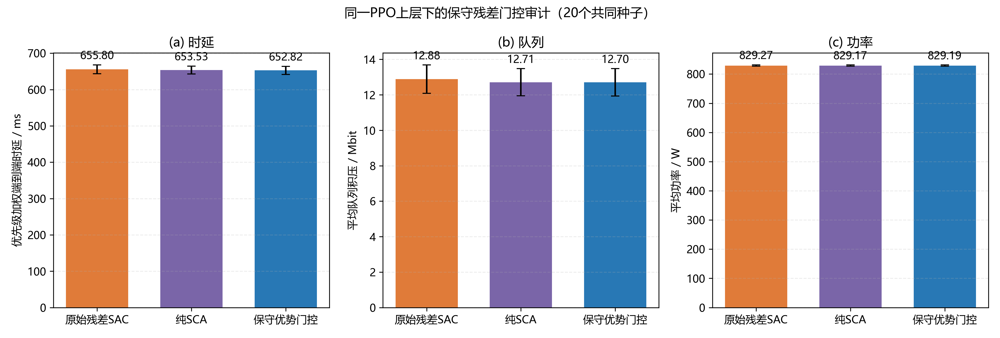

# v50 保守微观残差门控审计结果

## 1. 实验定位

v50 不是一次新的网络训练，而是对 v49 最终 `PPO-SAC` checkpoint 进行的**零训练、
共同随机种子反事实审计**。实验固定以下部分不变：

仓库中未发现 v50 对应的独立 FROZEN 预注册协议；本文档是根据已落盘脚本、CSV 和
`report.json` 补写的**事后结果归档**，不追溯声称实验前已经冻结 PASS/FAIL 门槛。

- 宏观控制器：v49 `joint_ppo_sac` 的最终 PPO checkpoint；
- 微观 SAC Actor 与双 Critic：同一 v49 最终 checkpoint；
- 场景、用户移动、任务到达和信道随机数；
- 评估种子：8000--8019，共 20 个共同随机种子（CRN）。

唯一改变的是微观动作的执行规则。三条评估臂为：

1. **原始残差 SAC**：直接执行 SAC 在 SCA 支撑集上生成的残差动作；
2. **纯 SCA**：将潜在残差置零，仅执行 SCA 基线动作；
3. **保守优势门控**：只有当 SAC 候选动作的悲观双 Critic 估值高于零残差动作的
   乐观双 Critic 估值时，才接受 SAC 残差，否则回退到纯 SCA。

门控判据为

\[
\min\{Q_1(s,a_{\rm SAC}),Q_2(s,a_{\rm SAC})\}
>
\max\{Q_1(s,a_0),Q_2(s,a_0)\},
\]

其中 \(a_0\) 为零残差动作，门限 margin 固定为 0。该规则只用于评估，未写回
checkpoint，也没有参与 v49 的训练过程。

## 2. Smoke 与正式审计

v50 先使用种子 8000--8002 做了 3 种子 smoke，以确认评估管线、模型加载和门控统计
能够正常运行。smoke 样本量过小，门控相对原始残差 SAC 的时延差为 +2.703 ms，
95% CI 跨 0，不能据此作性能判决。

正式审计随后按预定范围扩展到 20 个共同随机种子 8000--8019。本文档的全部结论均以
正式审计为准，不使用 smoke 结果挑选种子或调整门限。

## 3. 正式审计结果

| 微观控制器 | 加权端到端时延/ms | 平均队列/Mbit | 平均功率/W | 软目标 \(J\) |
|---|---:|---:|---:|---:|
| 原始残差 SAC | 655.801 | 12.884 | 829.267 | 0.753006 |
| 纯 SCA | 653.525 | 12.708 | 829.166 | 0.750557 |
| 保守优势门控 | **652.820** | **12.704** | 829.195 | **0.749845** |

保守门控的平均接受率为 **23.08%**，95% CI 为 [22.16%, 24.00%]。换言之，约
76.92% 的微观决策回退到纯 SCA，只有少量被双 Critic 同时认可的 SAC 残差被执行。

### 3.1 配对时延差

差值均按“左侧方法减右侧方法”定义，负值表示左侧方法更快。

| 配对 | 均值/ms | 95% CI/ms | 判读 |
|---|---:|---:|---|
| 保守门控 - 原始残差 SAC | **-2.981** | **[-5.252, -0.710]** | CI 排除 0，门控显著修复原始残差的部分损失 |
| 保守门控 - 纯 SCA | -0.705 | [-1.826, 0.415] | CI 跨 0，尚未证明门控优于纯 SCA |
| 原始残差 SAC - 纯 SCA | +2.275 | [-0.812, 5.363] | CI 跨 0，尚未证明原始残差与纯 SCA 有稳定差异 |

保守门控在 20 个评估种子中的 15 个种子上快于原始残差 SAC。该方向一致性与配对 CI
共同支持“门控能够过滤一部分有害残差”，但不支持“学习残差已经稳定超过 SCA”。

## 4. 结果分级

按现有证据可将 v50 事后分级为 **PARTIAL / 机制筛选通过，方法优越性未通过**。该分级
用于当前项目决策，不冒充预注册判决：

1. 保守门控相对原始残差 SAC 改善 2.981 ms，配对 CI 排除 0，说明 SAC 确实会产生
   一部分可被保守价值判据过滤的有害动作；
2. 保守门控相对纯 SCA 仅改善 0.705 ms，配对 CI 跨 0，因此不能宣称门控或残差 SAC
   已经优于传统 SCA；
3. 三臂的平均功率几乎一致，最大均值差不足 0.11 W；当前改善不是通过明显增加功率获得；
4. 队列与软目标的均值排序和时延一致，但报告没有为这些配对差单独预注册主判据，故只作
   描述性支持，不替代时延判决。

## 5. 统计与证据边界

- 20 个种子是**同一个 v49 训练 checkpoint 的环境评估种子**，不是 20 次独立训练；
- 因此，配对 CI 可用于判断该 checkpoint 下三种执行规则的差异，不能证明跨训练种子的
  算法稳定性；
- v50 不包含 Actor、Critic 或门控器训练，不能称为“v50 联合训练结果”；
- 门控使用训练得到的 Critic 作动作筛选，当前结果只能说明该筛选规则在固定 checkpoint
  上有风险抑制作用；若将门控接回训练闭环，必须作为新方法重新训练并做独立训练种子验证；
- 当前最严谨的论文表述是：**保守门控显著优于不加筛选的残差 SAC，但相对纯 SCA 的
  0.705 ms 优势不显著。**

## 6. 对当前算法路线的含义

v50 表明，微观 SAC 的问题不是“所有残差都无效”，而是候选残差质量不稳定。保守门控
保留约 23% 的动作后，能回收原始残差相对 SCA 的平均损失，但尚未创造可确认的学习增益。

如果继续发展该路线，下一步应将“SCA 安全基线 + SAC 候选残差 + 保守接受判据”作为
一个完整训练方法重新实现，而不是直接把本次零训练审计的 652.820 ms 当作新算法最终结果。
正式方法至少需要：

1. 明确门控在训练期还是仅部署期生效；
2. 避免 Critic 同时承担训练与选择而产生过度乐观的循环；
3. 使用不少于 5 个独立训练种子，与纯 SCA 和原始残差 SAC 做同预算比较；
4. 同时报告门控接受率、时延、分优先级队列和功率，判断门控究竟过滤了哪些状态下的动作。

## 7. 归档与复现

- 正式审计脚本：`scripts/audit_v50_conservative_micro_gate.py`
- 固定 checkpoint：`results/tcom_v49_support_residual_synchronous/formal/seed1/joint_ppo_sac/checkpoints/final.pt`
- 正式逐种子数据：`result_archive/v50_conservative_micro_gate_audit/per_seed_raw.csv`
- 正式机器可读报告：`result_archive/v50_conservative_micro_gate_audit/report.json`
- 正式结果图：`result_archive/v50_conservative_micro_gate_audit/01_保守残差门控对比.png`
- Smoke 归档：`result_archive/v50_conservative_micro_gate_smoke/`

