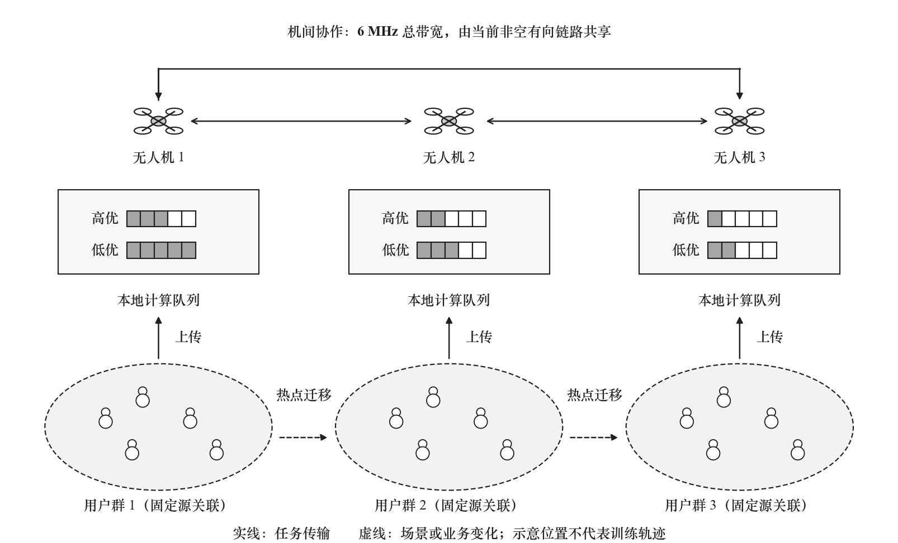
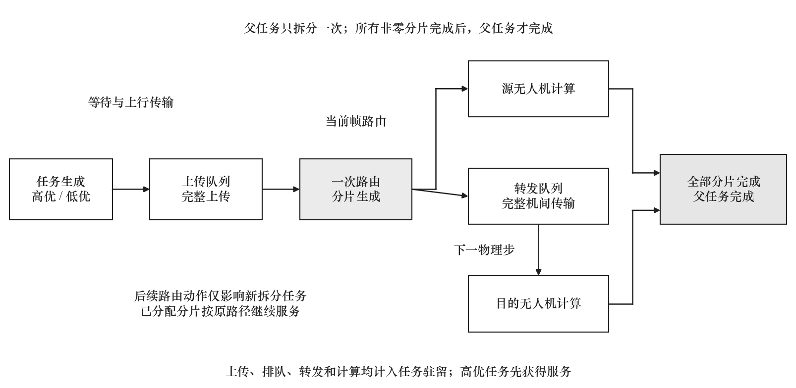
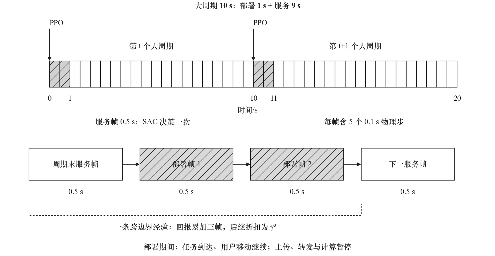
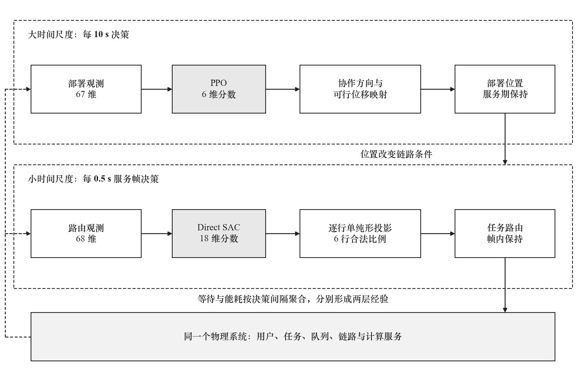
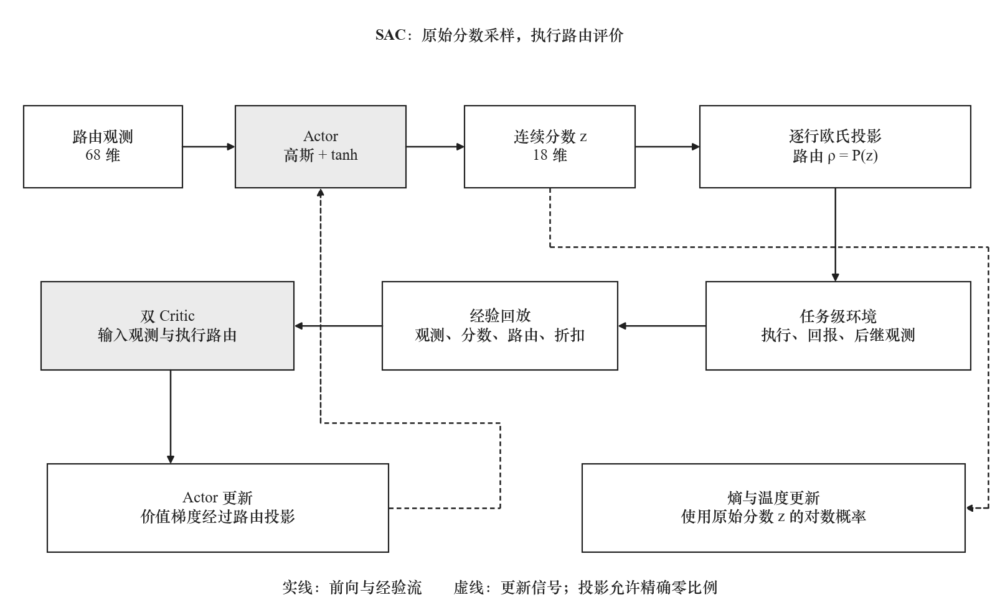
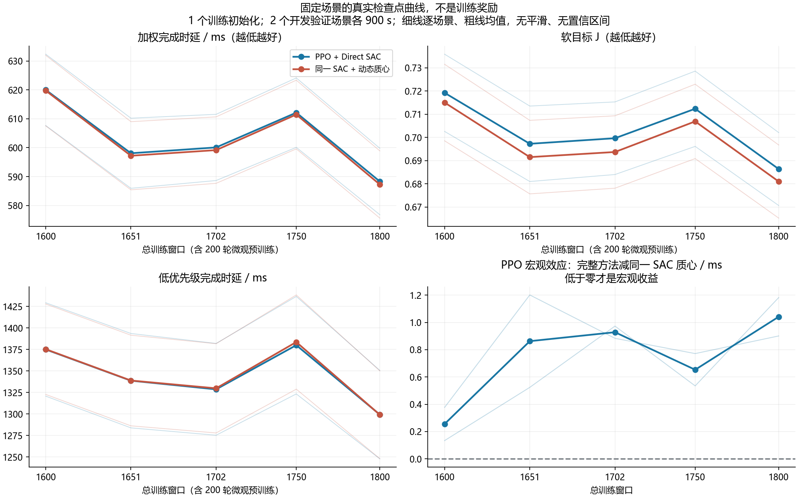
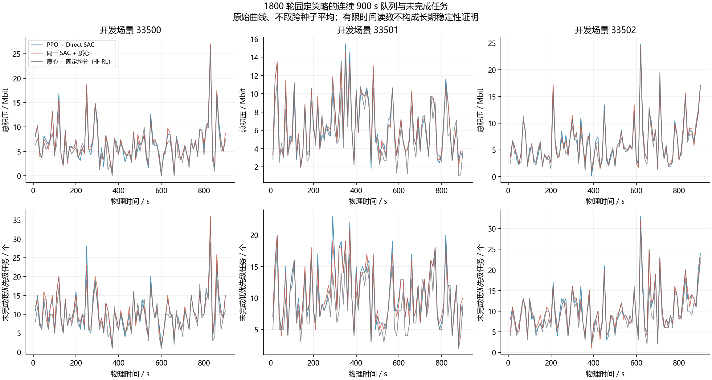

# 多无人机协同计算的双时间尺度调度

> 当前模型作者讨论稿；已补至1800窗口的联合训练开发结果和固定验证曲线，尚未证明稳定平台与宏观增益，正式独立对比仍待完成。

作者姓名待填写

（作者单位全称，省市 邮政编码待填写）

**摘要：** 针对动态热点下多无人机计算负载失衡及部署中断问题，建立了包含上传、转发、计算和分片同步完成的任务级模型。采用近端策略优化确定大时间尺度部署，采用软演员评论家确定小时间尺度路由，并通过单纯形映射满足分配约束。以未完成父任务的加权驻留量和能耗构造共同代价，按物理时间统一两层折扣，补全跨部署边界的经验。给出了动作可行性、价值表征及复杂度分析，为连续任务服务下的分层调度提供建模与求解方案。

**关键词：**无人机；移动边缘计算；双时间尺度；任务路由；深度强化学习

**中图分类号：**待作者确认 **文献标志码：**A **DOI：**待编辑部编定

**Two-Timescale Scheduling for Cooperative Multi-UAV Computing**

AUTHOR Names to Be Supplied

Full affiliation, City Postal Code, China

**Abstract:** Dynamic hotspots and deployment interruptions were considered in cooperative unmanned aerial vehicle (UAV) computing. A task-level model was formulated to describe uploading, forwarding, computation, and synchronized branch completion. Proximal policy optimization determined deployment at the large time scale, while soft actor-critic determined routing at the small time scale. A simplex mapping enforced allocation constraints. Weighted unfinished-task residence and energy formed a common cost. Discount factors were aligned with physical time, and transitions spanning deployment interruptions were completed using their actual successor observations. Action feasibility, value representation, and computational complexity were analyzed. The formulation provides a modeling and solution framework for hierarchical scheduling with continuous task service.

**Key words:** unmanned aerial vehicle; mobile edge computing; two time scales; task routing; deep reinforcement learning

## 1 引言

移动边缘计算（mobile edge computing，MEC）通过将计算服务部署在用户附近，减少任务处理对远端云平台的依赖。无人机（unmanned aerial vehicle，UAV）能够调整服务位置，为临时业务区域和移动用户群提供计算接入。然而，节点可移动并不意味着资源能够随负载即时重分配。当热点在不同区域间迁移时，部分无人机可能持续接收超过本地处理能力的任务，其他无人机则存在空闲算力。仅改善用户与无人机之间的距离，不能消除这种计算负载失衡。

机间协作允许源无人机将部分已上传任务转交其他无人机处理。Xu等研究了多无人机协同计算中的轨迹规划和资源分配问题，说明飞行位置与通信、计算资源之间需要联合考虑[1]。Hao等进一步研究了带任务优先级的协同边缘计算，联合处理任务卸载、资源分配和轨迹设计[2]。上述研究为协作计算提供了重要基础，但不同工作的到达过程、完成判据、资源共享方式和决策时序并不相同。评价一种调度策略时，需要明确这些假设，不能仅凭算法名称或平均时延数字进行比较。

本研究关注连续到达、允许跨帧排队的任务服务过程。任务完整上传后按比例拆分，远端分片须经过机间传输再进入计算队列；只有同一父任务的所有非零分片完成，才能判定该任务完成。在这种处理链中，较短的某一段传输时间不必然带来较低的端到端时延。例如，将一项任务分配给多台无人机可能缓解源节点积压，却也可能使其完成时间受较慢分片限制。与此同时，机间总带宽由当前非空链路共享，新增转发链路会改变其他链路的可用带宽。因此，路由不仅决定计算去向，还改变后续通信竞争。

部署与路由具有不同的调整频率。无人机重新部署需要真实飞行时间和推进能量，不宜随每次任务到达立即移动；任务路由则应及时响应队列和链路变化。多时间尺度协同能够按控制对象区分决策频率。夏玮玮等在无蜂窝无线接入网切片资源分配中采用了多时间尺度协同思路[3]。本研究针对无人机部署期间服务暂停、任务仍然到达的特点，建立共享物理环境下的两层决策过程，而不将两个控制器视为相互独立的环境。

本文采用近端策略优化（proximal policy optimization，PPO）学习大时间尺度部署策略[4]，采用软演员评论家（soft actor-critic，SAC）学习小时间尺度路由策略[5]。上层根据空间分布和任务压力选择部署方向，下层根据部署后的实际链路和队列选择任务去向。两层均使用由任务驻留量和能耗构成的物理代价，按各自决策间隔聚合反馈。对于周期末服务帧到下一服务决策之间的部署空档，保留真实的等待代价和时间折扣，避免将服务暂停等同于环境终止。

本文的研究内容包括三个方面。建立任务级多无人机协同计算模型，明确上传、一次拆分、机间转发、优先计算与父任务完成之间的关系。建立不同观测接口下的大、小时间尺度决策过程，给出共同目标、动作约束和跨部署边界转移。给出PPO与Direct SAC协同求解过程，区分策略产生的连续分数与实际执行路由，分析动作可行性、价值函数表征和计算复杂度。性能方面需要通过独立训练、配对场景和模块消融检验，不能由上述建模性质直接推出优于其他方法的结论。

## 2 系统模型

### 2.1 场景建模

考虑边长为$L$的正方形区域，部署$N$架具备通信与计算能力的无人机，为$K$个地面用户提供服务。无人机集合与用户集合分别记为$\mathcal N=\{1,\ldots,N\}$和$\mathcal K=\{1,\ldots,K\}$，下文用$n,i,j$索引无人机，用$k$索引用户。用户$k$的固定源无人机记为$a_k\in\mathcal N$，关联用户集合为$\mathcal K_n=\{k:a_k=n\}$。固定源关联表示用户移动后仍向同一源无人机上传，源节点可通过协作转移计算工作；它不等于用户始终停留在原区域，也不包含动态切换关联机制。

图1给出了网络组成。无人机具有相同高度$h$，用户$k$与无人机$n$在物理步$m$的水平位置分别为$\boldsymbol u_k[m]\in[0,L]^2$和$\boldsymbol q_n[m]\in[0,L]^2$，坐标单位均为m。用户采用参考点群组移动（reference point group mobility，RPGM）方式运动：同一群组共享缓慢移动的参考点，各用户叠加具有记忆性的局部速度，并通过回复项保持群组联系。参考点与局部运动均随时间更新，位置越界时执行边界修正。因此，空间热点既随用户群移动，也会因业务强度切换而改变，两者不是同一个随机过程。

图1　多无人机协同计算场景：固定源关联、分优先级计算及共享机间传输

系统包含大周期、资源帧与物理步三个时间单位，长度分别为$T_{\mathrm L}$、$\Delta$和$\delta$，均以s计。大周期编号为$t$，全局资源帧编号为$s$，全局物理步编号为$m$。一个资源帧包含$F=\Delta/\delta$个物理步，一个大周期包含$J=T_{\mathrm L}/\Delta$个资源帧，其中前$J_{\mathrm D}=T_{\mathrm D}/\Delta$帧用于部署，$T_{\mathrm D}$为部署时长。本文采用$T_{\mathrm L}=10$ s、$T_{\mathrm D}=1$ s、$\Delta=0.5$ s和$\delta=0.1$ s，即$F=5$、$J=20$、$J_{\mathrm D}=2$。

在大周期起点选择部署位置，完成移动后的位置在剩余服务期保持不变。路由仅在服务帧起点更新，并在帧内保持。令$\chi[m]\in\{0,1\}$表示服务开关，部署物理步取0，服务物理步取1。部署期间用户继续移动、任务继续产生，上传、机间传输与计算暂停。这样，部署收益与服务中断损失均进入同一任务演化过程，不通过额外的人工移动惩罚代替暂停时间。

任务优先级集合为$\mathcal P=\{\mathrm H,\mathrm L\}$，分别表示高、低优先级，用$p$索引。用户$k$在资源帧$s$产生的$p$类任务数为$A_{k,p}[s]$，采用条件泊松到达模型： 

$$
A_{k,p}[s]\sim\operatorname{Poisson}(\lambda_{k,p}[s]\Delta).\tag{1}
$$

 其中，$\lambda_{k,p}[s]$为当前到达强度，单位为task/s；给定当前业务阶段后，不同用户和类别分别采样。用户类型决定$p$类单任务数据量$b_{k,p}$，单位为Mbit。源节点$n$的期望输入负载为 

$$
\ell_n[s]=\sum_{k\in\mathcal K_n}\sum_{p\in\mathcal P}
 \lambda_{k,p}[s]b_{k,p}.\tag{2}
$$

 $\ell_n[s]$的单位为Mbit/s。每个业务阶段统一缩放同一源区域内的到达强度，使其满足设定负载，保留不同设备和优先级的相对业务差异。阶段切换只改变之后的到达，不清空已存在任务。控制器可获取当前负载配置和已观察的阶段年龄，不获取下一次切换的预先采样时刻。

任务记录用$\nu$索引，其出生时刻、数据量、优先级和源节点分别记为$\tau_\nu^{\mathrm b}$、$B_\nu$、$p_\nu$和$i_\nu$；出生时刻单位为s，数据量单位为Mbit。完整上传后的父任务才允许拆分，拆分之后不重新选择源节点，也不因下一帧路由变化而迁移已经分配的分片。回传结果的数据量、回传时间与控制信令开销暂不计入服务模型，故所定义的完成时刻为计算结果在计算节点可用的时刻。

### 2.2 通信模型

用户至无人机（user-to-UAV，U2G）与无人机间（UAV-to-UAV，U2U）传输采用正交资源，忽略不同正交链路间的干扰。设$\beta_0$为参考距离1 m处的功率增益参数，$\sigma^2$为接收机等效噪声功率，单位为W。用户上行发射功率为$P_{\mathrm G}$，全部用户共享的上行带宽为$B_{\mathrm G}$，分别以W和Hz计。上行带宽按全部$K$个用户等分，不随活跃用户数重新分配。于是 

$$
R_k^{\mathrm G}[m]=\frac{B_{\mathrm G}}{K}
 \log_2\!\left(1+
 \frac{P_{\mathrm G}\beta_0}
 {\sigma^2(\|\boldsymbol u_k[m]-\boldsymbol q_{a_k}[m]\|_2^2+h^2)}
 \right).\tag{3}
$$

 其中，$R_k^{\mathrm G}[m]$为用户$k$的上行速率，单位为bit/s。式(3)采用自由空间距离衰减和固定等效噪声参数；本文不额外引入未建模的随机遮挡、快衰落或随带宽变化的噪声谱密度模型。

令$Q_{ij,p}^{\mathrm T}[m]$表示从$i$转发至$j$的$p$类队列在物理步起点的剩余待传数据量，单位为Mbit。物理步内的新分片先加入对应队列，再判定活跃链路。以$\widetilde Q_{ij,p}^{\mathrm T}[m]$表示加入新分片后的待传量，活跃链路集合为 

$$
\mathcal A[m]=\left\{(i,j):i\ne j,\ 
 \sum_p\widetilde Q_{ij,p}^{\mathrm T}[m]>0\right\}.\tag{4}
$$

 令$B_{\mathrm U}$为全部有向机间链路共享的总带宽，单位为Hz。当$\mathcal A[m]$非空时，链路$(i,j)$获得带宽 

$$
B_{ij}[m]=
 \begin{cases}
 B_{\mathrm U}/|\mathcal A[m]|,&(i,j)\in\mathcal A[m],\\
 0,&\text{其他}.
 \end{cases}\tag{5}
$$

 当集合为空时，全部机间带宽分配为0。链路$(i,j)$和$(j,i)$分别计数，而高、低优先级共用同一有向链路，不因存在两个优先级而重复计数。

机间发射功率记为$P_{\mathrm U}$，机间谱效率$\eta_{ij}[m]$和速率$R_{ij}^{\mathrm U}[m]$为 

$$
\begin{aligned}
 \eta_{ij}[m]&=\log_2\!\left(1+
 \frac{P_{\mathrm U}\beta_0}
 {\sigma^2\|\boldsymbol q_i[m]-\boldsymbol q_j[m]\|_2^2}\right),\\
 R_{ij}^{\mathrm U}[m]&=B_{ij}[m]\eta_{ij}[m],\quad i\ne j.
 \end{aligned}\tag{6}
$$

 其中，$\eta_{ij}[m]$无量纲，$R_{ij}^{\mathrm U}[m]$以bit/s计；对角项均设为0。安全间距约束避免两架无人机重合。总带宽共享使链路服务能力与全部转发队列有关，不能将$B_{\mathrm U}$直接代入每一条链路并假定各链路同时独占总带宽。

令$U_{k,p}[m]$为用户端$p$类剩余上传量，单位为Mbit；$A^{\mathrm G}_{k,p}[m]$为本物理步新进入上传缓冲的数据量，仅在任务到达时非零；$S^{\mathrm G}_{k,p}[m]$为实际上传量。其更新为 

$$
U_{k,p}[m+1]=U_{k,p}[m]+A^{\mathrm G}_{k,p}[m]
 -S^{\mathrm G}_{k,p}[m].\tag{7}
$$

 用户上行服务满足 

$$
\sum_p S^{\mathrm G}_{k,p}[m]
 \le \chi[m]R_k^{\mathrm G}[m]\delta/10^6.\tag{8}
$$

 系数$10^6$用于bit到Mbit的换算；实际服务同时受剩余数据量限制，高优任务先获得服务。一个父任务的数据可跨多个物理步上传，完整上传只形成待路由任务，不等于已经完成计算。

令$S^{\mathrm T}_{ij,p}[m]$为物理步内实际机间传输量，同样以Mbit计，则 

$$
\sum_pS^{\mathrm T}_{ij,p}[m]\le
 \chi[m]R_{ij}^{\mathrm U}[m]\delta/10^6.\tag{9}
$$

 每条链路先服务高优队列，再将剩余传输容量用于低优队列，同类任务按队列顺序处理。此处的“高优先”是服务顺序，不构成高优任务必然满足某个确定时限的保证。

### 2.3 计算与任务完成模型

图2展示了父任务处理链。对源节点$i$的$p$类新待路由任务，资源帧$s$采用比例$\rho_{ij,p}[s]$分配给目的节点$j$，其中$\rho_{ij,p}[s]$为无量纲标量，满足 

$$
\rho_{ij,p}[s]\ge0,\qquad
 \sum_{j\in\mathcal N}\rho_{ij,p}[s]=1.\tag{10}
$$

 对角比例表示源节点本地计算，非对角比例表示一次机间转发后在目的节点计算。两类路由矩阵共同记为$\boldsymbol\rho[s]\in\mathbb{R}^{2N^2}$，按优先级、源、目的顺序展平。允许任意一个非负比例为0，不强制每项任务都经过多台无人机。

图2　父任务处理路径：完整上传后一次拆分，以所有非零分片完成作为父任务完成条件

令$\mathcal V_{i,p}[m]$为在物理步$m$实际进行拆分的父任务集合。这些任务在之前的物理步已经完整上传，尚未形成计算分片。设$s(m)$为包含物理步$m$的资源帧，则新加入$(i,j,p)$路径的数据量为 

$$
D_{ij,p}[m]=\sum_{\nu\in\mathcal V_{i,p}[m]}
 B_\nu\rho_{ij,p}[s(m)].\tag{11}
$$

 $D_{ij,p}[m]$以Mbit计。在物理步内，先处理已有待路由任务，再推进用户上行，因此本步刚完成上传的任务在下一物理步拆分。该一物理步的处理先后关系不能与“资源帧起点更新一次路由”混淆。

令$Q_{n,p}^{\mathrm C}[m]$为节点$n$在步起点已完整到达、尚未完成计算的$p$类工作量，单位为Mbit。新本地分片可在本步参与计算，可用计算工作量为$\widetilde Q_{n,p}^{\mathrm C}[m]=Q_{n,p}^{\mathrm C}[m]+D_{nn,p}[m]$。设$C$为中央处理器（central processing unit，CPU）处理1 bit所需的周期数，单位为cycle/bit；$F_n^{\max}$为节点最大CPU频率，单位为cycle/s。为在一个物理步内清空该类工作量，所需频率为 

$$
f_{n,p}^{\mathrm{need}}[m]=
 \frac{10^6 C\widetilde Q_{n,p}^{\mathrm C}[m]}{\delta}.\tag{12}
$$

 本研究采用确定性的按需优先分配规则： 

$$
\begin{aligned}
 f_{n,\mathrm H}[m]&=\chi[m]\min\{f_{n,\mathrm H}^{\mathrm{need}}[m],F_n^{\max}\},\\
 f_{n,\mathrm L}[m]&=\chi[m]\min\{f_{n,\mathrm L}^{\mathrm{need}}[m],
 F_n^{\max}-f_{n,\mathrm H}[m]\}.
 \end{aligned}\tag{13}
$$

 $f_{n,p}[m]$为类别分配频率。总频率$f_n[m]=\sum_p f_{n,p}[m]$不超过$F_n^{\max}$，队列较少时无需保持满频运行。CPU频率是队列状态的确定性函数，不作为PPO或SAC的第三类独立动作。

实际计算服务量$S^{\mathrm C}_{n,p}[m]$满足 

$$
S^{\mathrm C}_{n,p}[m]=
 \min\left\{\widetilde Q_{n,p}^{\mathrm C}[m],
 \frac{f_{n,p}[m]\delta}{10^6C}\right\}.\tag{14}
$$

 在一个物理步内先推进计算，再推进机间传输。因此，本步刚完成机间传输的远端分片于步末进入目的计算队列，最早在下一物理步计算。令$\mathcal F_{ij,p}[m]$表示本步完整传输结束的分片集合，$B_\xi^{\mathrm{seg}}$为分片$\xi$的完整数据量，单位为Mbit。完整入算量为 

$$
I_{ij,p}[m]=\sum_{\xi\in\mathcal F_{ij,p}[m]}B_\xi^{\mathrm{seg}}.\tag{15}
$$

 $I_{ij,p}[m]$与$S^{\mathrm T}_{ij,p}[m]$不同：前者按完整分片进入计算的时刻记账，后者按本步实际发送的剩余比特记账。分片在此前物理步已经传输的部分，不能在完整到达前被计算。

在上述顺序下，聚合队列递推为 

$$
\begin{aligned}
 Q_{ij,p}^{\mathrm T}[m+1]
 &=Q_{ij,p}^{\mathrm T}[m]+D_{ij,p}[m]
 -S_{ij,p}^{\mathrm T}[m],\quad i\ne j,\\
 Q_{n,p}^{\mathrm C}[m+1]
 &=Q_{n,p}^{\mathrm C}[m]+D_{nn,p}[m]
 -S_{n,p}^{\mathrm C}[m]+\sum_{i\ne n}I_{in,p}[m].
 \end{aligned}\tag{16}
$$

 这里的转发队列只记录尚未传输的比特。完整工作守恒还需要计入已接收但分片尚未完整的部分，以及已完整上传但尚未拆分的父任务。因此，上传、转发和计算三个剩余量之和是阶段积压指标，不能不加说明地等同于系统内全部尚待计算的原始数据量。父任务和分片记录保留这些阶段信息，以支持完整完成判定和守恒检查。

父任务$\nu$产生的非零分片集合记为$\mathcal B_\nu$，分片$\xi$计算完成的时刻为$\tau_\xi^{\mathrm f}$，均以s计。父任务端到端时延定义为 

$$
D_\nu=\max_{\xi\in\mathcal B_\nu}\tau_\xi^{\mathrm f}
 -\tau_\nu^{\mathrm b}.\tag{17}
$$

 该定义包含部署等待、用户上传、各阶段排队、远端转发与计算时间。它不是所有分片时延之和，也不是按路由比例加权的分片平均时延。任务只在全部分片完成后进入完成样本集合；未完成任务继续占用相应任务记录并贡献驻留代价。

服务能耗由计算、地面上行及机间发送组成。以$\kappa$表示CPU有效开关电容参数，使$\kappa f_n^3$的单位为W；以$\tau_k^{\mathrm G}[m]$和$\tau_{ij}^{\mathrm U}[m]$表示本步实际发送时长，单位为s。二者由实际发送比特除以相应bit/s速率得到，未发送时为0。物理步服务能耗为 

$$
\begin{aligned}
 E^{\mathrm S}[m]={}&
 \delta\sum_n\kappa f_n^3[m]
 P_{\mathrm G}\sum_k\tau_k^{\mathrm G}[m]\\
 &+P_{\mathrm U}\sum_{i\ne j}\tau_{ij}^{\mathrm U}[m].
 \end{aligned}\tag{18}
$$

 $E^{\mathrm S}[m]$以J计。CPU功耗取总频率的立方，而非两个类别频率立方分别相加；传输能耗按实际占用时长计，不将空队列链路视为持续满功率发送。

旋翼推进采用速度相关功率模型[6]。令$v$为水平飞行速度，单位为m/s，推进功率函数写为 

$$
\begin{aligned}
 P_{\mathrm f}(v)={}&U_1(1+3v^2/v_{\mathrm{tip}}^2)+U_4v^3+U_5\\
 &+U_2\sqrt{\sqrt{U_3+v^4/4}-v^2/2}.
 \end{aligned}\tag{19}
$$

 其中，$U_1,U_5$的单位为W，$U_2$的单位为W s/m，$U_3$的单位为$\mathrm{m^4/s^4}$，$U_4$的单位为$\mathrm{W\,s^3/m^3}$；$v_{\mathrm{tip}}$为旋翼叶尖速度，单位为m/s。悬停功率为$P_{\mathrm h}=P_{\mathrm f}(0)$。

令$\boldsymbol d_n[t]$为节点$n$在大周期$t$实际执行的二维位移，单位为m，$v_n[t]=\|\boldsymbol d_n[t]\|_2/T_{\mathrm D}$。一次部署采用平均速度近似，另以$\frac12M_{\mathrm U}v_n^2[t]$计入启动动能，其中$M_{\mathrm U}$为无人机质量，单位为kg。于是部署与服务期悬停能量为 

$$
\begin{aligned}
 E^{\mathrm D}[t]&=\sum_n\left[T_{\mathrm D}P_{\mathrm f}(v_n[t])
 +\tfrac12M_{\mathrm U}v_n^2[t]\right],\\
 E^{\mathrm H}[t]&=N(T_{\mathrm L}-T_{\mathrm D})P_{\mathrm h}.
 \end{aligned}\tag{20}
$$

 该启动项是忽略能量回收和额外机动损耗后的简化能量记账，不是完整飞行动力学模型。总推进能量为$E^{\mathrm P}[t]=E^{\mathrm D}[t]+E^{\mathrm H}[t]$。系统总能耗同时包括地面用户发送能量与全部无人机能量，因此后文的系统平均功率不应解释为单架无人机电池功率。

## 3 问题表述与双时间尺度决策建模

### 3.1 共同目标与可行决策

仅在任务完成时给予反馈，会使较长时间未完成的任务迟迟无法影响即时奖励。尤其当不同类别的完成率明显不同时，完成样本的平均时延还可能因样本选择而下降。为使所有仍在系统内的任务持续参与评价，令$\mathcal U_m$表示物理步$m$服务结束后尚未完成的父任务集合，$w_p$为$p$类任务的无量纲权重。一个物理步的加权驻留量为 

$$
H[m]=\delta\sum_{\nu\in\mathcal U_m}w_{p_\nu}.\tag{21}
$$

 $H[m]$以task s计，其中任务数视为计数单位，采用$w_{\mathrm H}=10$、$w_{\mathrm L}=1$。该集合同时包括上传、待拆分、转发和计算阶段的父任务。无论父任务生成多少分片，其驻留权重只计一次，避免“拆得越多、惩罚越大”的计数偏差。

驻留代价与完成时延存在联系，但二者不能在有限窗口中直接混同。设连续时间$u$处的加权未完成任务数为$N_w(u)$，观察终点为$T$，且初始系统为空，则理想连续记账满足 

$$
\begin{aligned}
 &\int_0^T N_w(u)\,\mathrm{d} u\\
 &\quad=\sum_{\nu:\tau_\nu^{\mathrm b}<T}
 w_{p_\nu}\big[\min\{\tau_\nu^{\mathrm f},T\}-\tau_\nu^{\mathrm b}\big].
 \end{aligned}\tag{22}
$$

 其中，$\tau_\nu^{\mathrm f}$为父任务完成时刻，未完成时取$+\infty$。右侧既包含已完成任务的完整驻留，也包含未完成任务截至$T$已经经历的等待。式(21)采用步末离散采样，是该思想的离散实现，不宣称与式(22)逐样本精确相等；跨日志窗口存在初始积压时，还需保留跨窗任务已进入系统的事实。

推进能量中包含与策略无关的全周期悬停基准。为使反馈主要反映部署带来的能量变化，定义周期推进增量 

$$
\begin{aligned}
 \Delta E^{\mathrm P}[t]&=E^{\mathrm P}[t]-NT_{\mathrm L}P_{\mathrm h}\\
 &=E^{\mathrm D}[t]-NT_{\mathrm D}P_{\mathrm h}.
 \end{aligned}\tag{23}
$$

 将该已由部署动作确定的增量均摊至周期内$JF$个物理步，定义能量评价项 

$$
\widetilde E[m]=E^{\mathrm S}[m]+
 \frac{\Delta E^{\mathrm P}[t(m)]}{JF},\tag{24}
$$

 其中，$t(m)$为物理步$m$所属大周期，$\widetilde E[m]$以J计。该均摊用于奖励记账，不表示推进能量在物理上均匀发生。它保持每周期未折扣能量总和，但与将全部飞行能量置于部署时刻的折扣目标存在时间分配差异；本文统一采用式(24)，不混用两种口径。

用$H_0$和$E_0$分别表示驻留量及能量的固定归一化尺度，取$H_0=10$ task s、$E_0=14$ J。物理步代价为 

$$
c[m]=\omega_{\mathrm D}\frac{H[m]}{H_0}
 \omega_{\mathrm E}\frac{\widetilde E[m]}{E_0},
 \quad(\omega_{\mathrm D},\omega_{\mathrm E})=(0.9,0.1).\tag{25}
$$

 $c[m]$为无量纲标量。两个权重作用于归一化后的不同指标，不能解释为原始时延降低1 s与能量降低1 J之间的直接交换比例。驻留项不作饱和截断，也不附加某个任意队列阈值之后才出现的溢出惩罚。若飞行功率曲线使个别部署的相对悬停增量为负，则能量评价项允许为负；报告实际能耗时仍使用完整能量账本。

设$\pi_{\mathrm L}$、$\pi_{\mathrm S}$分别为大、小时间尺度策略，$\gamma_\delta\in(0,1)$为每物理步折扣因子。本文求解的受限策略设计问题为 

$$
\begin{aligned}
 \mathcal P:\quad
 \min_{\pi_{\mathrm L},\pi_{\mathrm S}}\quad&
 \E_{\pi_{\mathrm L},\pi_{\mathrm S}}
 \left[\sum_{m=0}^{\infty}\gamma_\delta^m c[m]\right]\\
 \text{s.t.}\quad&
 \boldsymbol q_n[m]\in[0,L]^2,\\
 &\|\boldsymbol d_n[t]\|_2\le d_{\max},\\
 &\|\boldsymbol q_i[m]-\boldsymbol q_j[m]\|_2\ge d_{\min},\quad i\ne j,\\
 &\rho_{ij,p}[s]\ge0,\quad\sum_j\rho_{ij,p}[s]=1.
 \end{aligned}\tag{26}
$$

 可行决策还须满足式(7)–(16)规定的任务服务过程。其中，$d_{\max}$为单次部署最大位移，$d_{\min}$为最小安全间距，单位均为m；本场景分别为20 m和5 m。部署阶段的路径也须通过环境安全修正，不能仅检查移动终点。策略只根据当前与过去的信息决策；CPU频率由式(13)给定，并非$\mathcal P$中的自由优化变量。能量采用软目标，不另外声称存在未实施的系统硬功率上限。

问题$\mathcal P$涉及连续动作、随机到达和跨阶段任务记忆。共享带宽与任务同步完成使一步路由和最终时延之间存在非线性联系，难以只凭当前队列对未来全部代价作精确解析优化。另一方面，折扣代价较小不自动保证无限时域队列稳定。因此，后续算法针对$\mathcal P$给出可实现的学习方案，稳定运行需要通过长时间积压、完成率和低优服务检查另行验证，不作为未经证明的约束满足结论。

### 3.2 共同物理状态与分层观测

马尔可夫决策过程（Markov decision process，MDP）的状态需包含决定未来演化的必要信息。令$\boldsymbol x[m]$表示完整物理状态，包含用户与无人机位置、用户运动内部状态、各任务及分片的剩余工作、队列顺序、业务阶段内部状态和系统时钟。给定当前控制及外生随机量后，这些信息决定下一物理状态。直接将完整任务记录作为固定长度神经网络输入并不方便，因此采用两个不同的因果聚合映射： 

$$
\begin{aligned}
 \boldsymbol o_t^{\mathrm L}&=\Phi_{\mathrm L}(\boldsymbol x[tJF],\mathcal H_t),\\
 \boldsymbol o_s^{\mathrm S}&=\Phi_{\mathrm S}(\boldsymbol x[sF],\mathcal H_s).
 \end{aligned}\tag{27}
$$

 其中，$\boldsymbol o_t^{\mathrm L}$和$\boldsymbol o_s^{\mathrm S}$为两层观测，$\Phi_{\mathrm L}$、$\Phi_{\mathrm S}$为特征提取映射；$\mathcal H_t$、$\mathcal H_s$表示截至相应时刻已观察的历史摘要。服务帧观测在当前帧到达已产生之后提取，而部署观测在实际移动之前提取。

小时间尺度观测保留直接影响路由的阶段压力：按节点与优先级组织的计算队列、上传积压、未完成父任务数和最老任务年龄，每组为$2N$维；按优先级及有向源目的组织的转发队列为$2N^2$维；本帧实际到达量为$2N$维。当前期望负载、CPU服务能力和源节点平均上行速率各为$N$维，机间谱效率为$N^2$维。另外加入已观察的阶段年龄和周期内相对时刻两个标量。其维数为 

$$
d_{\mathrm S}=3N^2+13N+2=68\quad(N=3).\tag{28}
$$

 转发队列和谱效率包含置零的对角项，以保持固定矩阵布局。平均上行速率按固定源关联用户求均值，并非选择性保留当前较快用户。周期内相对时刻为已执行物理步数对$JF$取余后除以$JF$，取值位于$[0,1)$。这种时钟信息使下层能够区分普通服务帧与临近部署边界的服务帧。

大时间尺度观测强调部署几何与持续负载。计算队列、上传积压、未完成父任务数和最老任务年龄仍各为$2N$维。转发压力改为按目的节点汇总的$2N$维向量，其$n,p$分量为$\sum_{i\ne n}Q_{in,p}^{\mathrm T}$。当前负载、CPU能力和平均上行速率各为$N$维，机间谱效率为$N^2$维。几何部分包括无人机水平坐标、群组业务加权质心相对无人机的偏移和上一周期质心平均速度，每组为$2N$维。再加入一个阶段年龄标量，得到 

$$
d_{\mathrm L}=N^2+19N+1=67\quad(N=3).\tag{29}
$$

 令$\boldsymbol c_n[t]\in\mathbb{R}^2$表示源群$n$基于已观测业务与位置形成的平滑加权质心，单位为m。瞬时质心以各用户本帧高、低优实际到达总量为位置权重；本帧无到达时采用该源群用户位置的算术平均。每个资源帧按系数$0.99^5$保留此前平滑值，其余权重用于当前瞬时值。历史质心速度为$(\boldsymbol c_n[t]-\boldsymbol c_n[t-1])/T_{\mathrm L}$，单位为m/s，首周期取零向量。它是历史位移摘要，不是下一周期真实运动方向。大层不重复输入可以由无人机坐标与质心偏移还原的绝对质心，也不输入未来切换倒计时。

为压缩压力指标的数量级，对实值特征$x$采用 

$$
g(x;x_0)=\operatorname{sgn}(x)\ln(1+|x|/x_0),\tag{30}
$$

 其中，$x_0>0$为与$x$同量纲的固定尺度。队列采用10 Mbit，任务数采用10个，最老年龄采用10 s，本帧到达量采用1 Mbit，负载采用10 Mbit/s，上行速率采用1 Mbit/s，机间谱效率采用1。CPU服务能力以10 Mbit/s归一化，无人机坐标以1000 m归一化，质心偏移以60 m归一化，阶段年龄以10个大周期归一化；这些量使用规定的线性缩放。压力编码连续单调，不把大队列全部压成同一个上限值。目的端转发摘要先对原始Mbit数求和再作式(30)，不能对已经对数编码的源端数值求和。

两个观测均未包含完整任务年龄分布、每个分片的接收进度和全部运动内部状态，因而不能证明它们是完整物理状态的充分统计量。更准确地说，底层物理状态可作MDP建模，而控制器基于不同聚合观测作近似决策，存在部分可观测性。本文不将“维数固定且包含队列”当作马尔可夫性已经满足的证明，也不把特征选择本身作为性能提升的实验结论。

### 3.3 大、小时间尺度的动作、转移与奖励

大层在周期$t$接收$\boldsymbol o_t^{\mathrm L}$并产生$\boldsymbol a_t^{\mathrm L}\in\mathbb{R}^{2N}$，通过部署映射得到联合位移$\{\boldsymbol d_n[t]\}$。大层动作不直接指定每个用户的路由，而是改变随后服务期的几何、链路条件和部署代价。小层在服务帧$s$接收$\boldsymbol o_s^{\mathrm S}$并产生$\boldsymbol z_s\in[-1,1]^{2N^2}$，由确定性映射$\mathcal P_\Delta$形成执行路由$\boldsymbol\rho[s]=\mathcal P_\Delta(\boldsymbol z_s)$。这里$\boldsymbol z_s$是连续分数，不是直接可执行的非负比例，具体映射见第4节。

图3给出了实际时间轴。定义资源帧折扣$\gamma=0.99$，则统一物理时间视野要求 

$$
\gamma_\delta=\gamma^{1/F},\qquad
 \Gamma_{\mathrm L}=\gamma^J.\tag{31}
$$

 其中，$\Gamma_{\mathrm L}$为一个大周期的后继折扣。本设置中$\gamma_\delta=0.99^{1/5}$，$\Gamma_{\mathrm L}=0.99^{20}$。若两层都直接用0.99作为一步折扣，将对应不同的物理时间视野，不能再声称两层仅在采样频率上有区别。

图3　双时间尺度执行时序与跨部署边界经验；顶部时间轴按实际时长绘制

令$r_s$为第$s$个资源帧的物理回报，负号将代价最小化转为回报最大化： 

$$
r_s=-\sum_{f=0}^{F-1}\gamma_\delta^f c[sF+f].\tag{32}
$$

 此处$f$为帧内物理步索引，与带节点下标的CPU频率$f_{n,p}$按上下文区分。部署帧虽然不进行路由决策，仍然具有由未完成任务和能量账本产生的$r_s$。大层周期回报为 

$$
R_t^{\mathrm L}=\frac{1}{J}\sum_{j=0}^{J-1}\gamma^j r_{tJ+j}.\tag{33}
$$

 式中$j$仅在该求和内表示周期内资源帧索引，$1/J$为常数尺度调整。各周期长度固定时，此调整不改变大层纯回报目标的策略排序。两层没有分别引入“鼓励全部本地”和“鼓励尽量转发”等相互竞争的奖励。

普通服务帧结束后，下一服务帧紧接发生，经验后继折扣为$\gamma$。周期末服务帧结束后，需先经历下一周期的两个部署帧才能再次获得小层决策机会。令$s^\star$为周期末服务帧编号，其跨边界回报和后继折扣为 

$$
\widehat r_{s^\star}
 =r_{s^\star}+\gamma r_{s^\star+1}
 +\gamma^2r_{s^\star+2},
 \qquad
 \widehat\gamma_{s^\star}=\gamma^3.\tag{34}
$$

 后继观测取部署结束、下一服务帧当前到达已产生之后的真实观测。上层在边界的部署动作会参与这一转移，不允许把两个部署帧跳过，也不允许用重置后的空队列观测替代真实后继。这使小层转移具有1帧或3帧的不同持时，应按半马尔可夫的持时形式构造目标，而非对所有经验强行使用相同一步折扣。

将普通服务帧的$\widehat r_s$定义为$r_s$、$\widehat\gamma_s$定义为$\gamma$，两类经验可统一记为$(\boldsymbol o_s^{\mathrm S},\boldsymbol z_s,\boldsymbol\rho[s],\widehat r_s,\boldsymbol o_{s'}^{\mathrm S},\widehat\gamma_s)$。其中，$s'$是下一次真正的小层决策时刻，不必等于$s+1$。大层经验则使用周期起点及下一周期起点的观测、原始部署动作、周期回报和$\Gamma_{\mathrm L}$。两层观测不同，但读取同一个任务系统；小层处理后的积压自然进入下一次部署观测。

训练中300 s只是统计窗口，不是任务终止时刻。连续采样流覆盖三个窗口，300 s和600 s处均不清空队列。900 s处作为采样截断时，在环境重置之前执行真实下一次部署，并取得下一服务决策观测以补全最后一条小层经验；这些额外步骤不混入此前900 s的性能统计。大层保留真实后继价值，但停止跨重置边界递推优势。固定下层策略时，可研究其诱导的大层转移；联训时下层参数持续变化，大层转移亦随之变化，因此采用两层异频更新不等于获得了两个独立平稳MDP。

## 4 PPO与Direct SAC协同求解

### 4.1 大时间尺度部署策略

图4展示了整体结构。部署策略使用大层观测，路由策略使用小层观测；两层之间通过实际位置、链路和任务队列发生联系，不额外传递一个未经执行的理想路由或理想服务能力。Direct SAC中的“Direct”仅表示策略直接产生路由分数，没有优化器教师、路由先验或残差修正模块；它不是在SAC之外重新命名一种未经验证的优化算法。

图4　PPO与Direct SAC协同框架：不同观测、不同决策频率及共同物理系统

PPO策略参数记为$\theta$，其均值网络为$\boldsymbol\mu_\theta$。在部署观测$\boldsymbol o_t^{\mathrm L}$下，采样原始动作 

$$
\boldsymbol a_t^{\mathrm L}\sim
 \mathcal N\!\left(\boldsymbol\mu_\theta(\boldsymbol o_t^{\mathrm L}),
 \operatorname{diag}(\boldsymbol\sigma_{\mathrm L}^2)\right).\tag{35}
$$

 其中，$\boldsymbol\sigma_{\mathrm L}\in\R_{>0}^{2N}$为部署探索标准差，动作及标准差均为无量纲分数。将动作按节点分成$\boldsymbol a_{n,t}^{\mathrm L}\in\mathbb{R}^2$，先逐坐标限制至$[-1,1]$，再映射至单位圆盘： 

$$
\begin{aligned}
 \widetilde{\boldsymbol a}_{n,t}&=\operatorname{clip}(\boldsymbol a_{n,t}^{\mathrm L},-1,1),\\
 \boldsymbol b_{n,t}&=\frac{\widetilde{\boldsymbol a}_{n,t}}
 {\max\{1,\|\widetilde{\boldsymbol a}_{n,t}\|_2\}}.
 \end{aligned}\tag{36}
$$

 $\operatorname{clip}$表示逐元素区间限制，$\boldsymbol b_{n,t}$为单位圆盘内的二维向量。它属于算法动作解码，不是用户移动或无线传播模型的一部分。

为使部署分数与当前负载空间关系对应，构造正交基$\boldsymbol B_n[t]\in\mathbb{R}^{2\times2}$。其第一列从本源群的业务质心指向协作参考无人机的当前位置，第二列与第一列垂直。当前负载最重的节点选择最轻节点为参考，其他节点选择最重节点为参考；两点重合时使用水平正方向及其垂直方向。该基只旋转动作坐标，不强制无人机向参考节点飞行。令$r_{\mathrm w}$为候选目标相对业务质心的半径，单位为m，则 

$$
\boldsymbol y_n[t]=\Pi_{[0,L]^2}
 \big(\boldsymbol c_n[t]+r_{\mathrm w}\boldsymbol B_n[t]\boldsymbol b_{n,t}\big).\tag{37}
$$

 其中，$\boldsymbol y_n[t]\in\mathbb{R}^2$为候选目标，$\Pi_{[0,L]^2}$表示区域边界投影，$r_{\mathrm w}=60$ m。记$\boldsymbol q_n^{\mathrm b}[t]=\boldsymbol q_n[tJF]$为部署前位置，$\boldsymbol e_n[t]=\boldsymbol y_n[t]-\boldsymbol q_n^{\mathrm b}[t]$为候选目标偏移，$d_n^{\mathrm{tar}}[t]=\|\boldsymbol e_n[t]\|_2$为对应距离，二者单位为m。候选位移为 

$$
\widetilde{\boldsymbol d}_n[t]=
 \frac{\min\{d_{\max},d_n^{\mathrm{tar}}[t]\}}
 {\max\{d_n^{\mathrm{tar}}[t],\epsilon_d\}}\boldsymbol e_n[t].\tag{38}
$$

 $\epsilon_d>0$为仅防止零除的极小距离常数，单位为m。当候选距离不超过0.5 m时置零。随后，环境对全部候选位移执行联合路径安全修正，得到实际$\boldsymbol d_n[t]$。该修正可能进一步减少移动，不保证仍精确到达式(37)的候选位置。下层始终读取修正后实际位置形成的链路条件。

PPO的行为样本必须保留式(35)的原始高斯分数及其对数概率，不能用裁剪后的物理动作重新代入高斯密度。令$\theta_{\mathrm{old}}$表示收集当前样本时的策略参数，重要性比率为 

$$
\zeta_t(\theta)=
 \frac{\pi_\theta(\boldsymbol a_t^{\mathrm L}\mid\boldsymbol o_t^{\mathrm L})}
 {\pi_{\theta_{\mathrm{old}}}(\boldsymbol a_t^{\mathrm L}\mid\boldsymbol o_t^{\mathrm L})}.\tag{39}
$$

 分母在当前轮更新中固定。若在利用旧样本之前改变高斯标准差，会改变行为概率并破坏该比率的含义，因此探索标准差仅在当前采样缓冲清空之后调整。

大层价值网络记为$V_\psi$，参数为$\psi$。采用广义优势估计（generalized advantage estimation，GAE），定义 

$$
\begin{aligned}
 \delta_t^{\mathrm V}&=R_t^{\mathrm L}
 +\Gamma_{\mathrm L}V_\psi(\boldsymbol o_{t+1}^{\mathrm L})
 -V_\psi(\boldsymbol o_t^{\mathrm L}),\\
 \widehat A_t&=\delta_t^{\mathrm V}
 \Gamma_{\mathrm L}\lambda_{\mathrm{GAE}}\xi_t\widehat A_{t+1}.
 \end{aligned}\tag{40}
$$

 其中，$\delta_t^{\mathrm V}$为时序差分残差，$\widehat A_t$为优势估计，$\lambda_{\mathrm{GAE}}\in[0,1]$为优势衰减系数；$\xi_t$指示采样序列是否在下一项继续，遇到采样流重置时取0。采样截断只切断第二行的递推，不把第一行的真实后继价值删除。

以$\overline A_t$表示当前样本批内标准化后的优势，$\epsilon_{\mathrm P}>0$为PPO裁剪范围，最大化 

$$
\begin{aligned}
 \bar\zeta_t(\theta)&=\operatorname{clip}(\zeta_t(\theta),1-\epsilon_{\mathrm P},1+\epsilon_{\mathrm P}),\\
 L_{\mathrm P}(\theta)&=
 \E_t\!\left[\min\left\{\zeta_t(\theta)\overline A_t,\,
 \bar\zeta_t(\theta)\overline A_t\right\}\right].
 \end{aligned}\tag{41}
$$

 其中，$\bar\zeta_t(\theta)$为裁剪后的重要性比率。价值网络以$\widehat A_t+V_\psi(\boldsymbol o_t^{\mathrm L})$作为固定回归目标，更新时目标不参与梯度计算。训练还监测新旧策略的Kullback–Leibler（KL）散度近似，超过预设阈值时提前结束本轮策略迭代。裁剪和KL监测用于控制更新幅度，不能作为全局最优或单调性能改进的证明。

### 4.2 小时间尺度路由与执行价值表征

SAC策略参数记为$\phi$。演员网络输出均值$\boldsymbol\mu_\phi$和对数标准差，经重参数化得到 

$$
\begin{aligned}
 \boldsymbol \epsilon&\sim\mathcal N(\vct0,\boldsymbol I),\\
 \boldsymbol u_s&=\boldsymbol\mu_\phi(\boldsymbol o_s^{\mathrm S})
 +\boldsymbol\sigma_\phi(\boldsymbol o_s^{\mathrm S})\odot\boldsymbol\epsilon,\\
 \boldsymbol z_s&=\tanh(\boldsymbol u_s).
 \end{aligned}\tag{42}
$$

 其中，$\boldsymbol u_s,\boldsymbol z_s,\boldsymbol\epsilon\in\mathbb{R}^{2N^2}$，$\boldsymbol I$为相应维数单位矩阵，$\odot$表示逐元素乘积。$\boldsymbol u_s$是未压缩高斯变量，$\boldsymbol z_s$是环境接收的有界原始分数，两者都不是路由概率。对数概率$\log\pi_\phi(\boldsymbol z_s\mid\boldsymbol o_s^{\mathrm S})$包含$\tanh$变换的雅可比修正，不含随后单纯形投影的概率密度变换。

将$\boldsymbol z_s$重排为$2N$个长度为$N$的行向量$\boldsymbol z_{i,p}$。每行独立求解标准欧氏单纯形投影[7]： 

$$
\begin{aligned}
 \boldsymbol\rho_{i,p}&=
 \argmin_{\boldsymbol r\in\Delta_N}\tfrac12\|\boldsymbol r-\boldsymbol z_{i,p}\|_2^2,\\
 \Delta_N&=\{\boldsymbol r\in\mathbb{R}^N:r_j\ge0,\ \sum_jr_j=1\}.
 \end{aligned}\tag{43}
$$

 其中，$\boldsymbol r$为该局部投影问题的辅助变量，$\Delta_N$为概率单纯形。该操作只将策略分数转换为合法动作，不使用队列代价求解额外路由优化，也不构成逐次凸近似教师。

为计算投影，将本行分数降序排列为$z_{(1)}\ge\cdots\ge z_{(N)}$，定义 

$$
\begin{aligned}
 k^\star&=\max\left\{k:\
 z_{(k)}-\frac{\sum_{j=1}^{k}z_{(j)}-1}{k}>0\right\},\\
 \vartheta&=\frac{\sum_{j=1}^{k^\star}z_{(j)}-1}{k^\star},\qquad
 \rho_j=\max\{z_j-\vartheta,0\}.
 \end{aligned}\tag{44}
$$

 这里$k^\star$为正支撑项数，$\vartheta$为该行投影阈值，$\rho_j$为恢复原列顺序后的目的比例；求和内的$k,j$是本行排序位置，不表示用户与无人机物理编号。浮点运算后可按行再归一化以消除舍入误差。算法1列出了执行步骤。

算法1　Direct SAC路由动作解码

1.  输入：当前小层观测$\boldsymbol o^{\mathrm S}$，策略$\pi_\phi$，节点数$N$

2.  输出：原始分数$\boldsymbol z$、合法执行路由$\boldsymbol\rho$

3.  按式(42)采样$\boldsymbol z$并计算分数对数概率

4.  将$\boldsymbol z$重排为$2N$行、每行$N$列

5.  对每个优先级$p$与源节点$i$，执行以下循环：

6.  对行分数降序排序，计算各前缀和

7.  按式(44)确定$k^\star$与$\vartheta$

8.  按原列顺序求$\rho_{ij,p}=\max\{z_{ij,p}-\vartheta,0\}$

9.  用行和校正浮点误差，保留零比例

10. 结束该循环。

11. 在本服务帧内保持$\boldsymbol\rho$，仅作用于新待拆分任务

12. 同时保留$\boldsymbol z$与$\boldsymbol\rho$供回放及动作核验

对于$N=3$，演员输出18维分数，执行路由也是18个数，但6行各有一个和为1的约束，物理路由的自由度为$2N(N-1)=12$。因此，不能将“12个独立自由度”写成“演员实际输出12维动作”。欧氏投影允许精确零分配和全本地处理，同时存在多对一映射，多个不同分数可产生完全相同的执行路由。

图5区分了分数空间和执行空间。双评论家参数记为$\omega_1,\omega_2$，采用 

$$
Q_{\omega_\ell}(\boldsymbol o,\boldsymbol z)
 =q_{\omega_\ell}\big(\boldsymbol o,\mathcal P_\Delta(\boldsymbol z)\big),
 \qquad \ell\in\{1,2\}.\tag{45}
$$

 其中，$q_{\omega_\ell}$的动作输入为执行路由，$\ell$索引两个评论家，$\boldsymbol o$为小层观测的简写。在线网络与目标网络使用相同投影。若两个分数映射到相同路由，式(45)使其获得相同的当前价值输出，避免评论家仅因无物理差异的分数表示而给出不同估值。

图5　SAC采样与更新：评论家评价执行路由，熵项仍在原始分数空间计算

从回放缓冲$\mathcal D$采样经验，令$\boldsymbol o'$为真实后继观测，$\boldsymbol z'\sim\pi_\phi(\cdot\mid\boldsymbol o')$，$\bar\omega_1,\bar\omega_2$为目标评论家参数，$\alpha>0$为熵温度。时序差分目标为 

$$
\begin{aligned}
 y={}&\widehat r+\widehat\gamma\left[
 \min_{\ell=1,2}q_{\bar\omega_\ell}
 \big(\boldsymbol o',\mathcal P_\Delta(\boldsymbol z')\big)\right.\\
 &\left.\hspace{18mm}-\alpha\log\pi_\phi(\boldsymbol z'\mid\boldsymbol o')\right].
 \end{aligned}\tag{46}
$$

 $\widehat r$与$\widehat\gamma$逐条取自经验，按式(34)区分普通与跨部署样本。目标构造不传播梯度，评论家最小化 

$$
L_Q=\E_{\mathcal D}
 \sum_{\ell=1}^2
 \left[q_{\omega_\ell}(\boldsymbol o,\mathcal P_\Delta(\boldsymbol z))-y\right]^2.\tag{47}
$$

 演员使用当前观测重新采样分数，最小化 

$$
\begin{aligned}
 L_\pi=\E_{\boldsymbol o\sim\mathcal D,\boldsymbol z\sim\pi_\phi}
 \left[\vphantom{\min_{\ell=1,2}}\right.&\alpha\log\pi_\phi(\boldsymbol z\mid\boldsymbol o)\\
 &\left.-\min_{\ell=1,2}q_{\omega_\ell}
 (\boldsymbol o,\mathcal P_\Delta(\boldsymbol z))\right].
 \end{aligned}\tag{48}
$$

 更新演员时固定评论家参数，但允许价值梯度经过执行路由与可微投影返回演员。若只在环境执行时投影而在价值更新时仍输入不受约束的分数，将不再是式(45)所规定的执行路由表征。

温度按自动熵调节方式更新[8]。令$\beta=\ln\alpha$为待优化标量，$\mathcal H_{\mathrm{tar}}=-2N^2=-18$为分数空间目标熵，采用损失 

$$
L_\alpha=-\mathbb{E}\!\left[
 \beta\big(\log\pi_\phi(\boldsymbol z\mid\boldsymbol o)+\mathcal H_{\mathrm{tar}}\big)
 \right].\tag{49}
$$

 括号中的采样对数概率在温度更新时停止梯度。由于$\mathcal P_\Delta$多对一且可将连续分数映射至低维面或顶点，本文不将该熵解释为执行路由的微分熵，也不把执行自由度12代入声称已经优化12维路由密度。执行价值表征减少的是评论家对等价分数的区分，尚不能消除策略在冗余分数方向探索的可能性。

### 4.3 训练流程与边界处理

两层采用先小层预训练、后联合训练的流程。预训练阶段PPO不更新，其原始部署分数置零。由式(37)可知，此时无人机仍按业务质心形成候选目标并受实际位移与安全约束控制，所以这是动态质心部署，不是无人机位置完全固定。SAC在该部署规则下学习路由，为联合训练提供当前场景产生的初始参数与回放经验。联合阶段继续保留小层优化器和经验，开始采集、更新PPO，禁止把历史不同观测维数或不同奖励训练得到的权重直接作为当前结果。

演员、评论家均采用两层隐藏网络，每层256个单元。两层输入维数分别由式(28)、式(29)决定，而不通过补零伪装相同观测。SAC回放容量为$10^5$条，批大小为128，积累至少1000条经验后开始学习，每20个服务帧触发一次SAC更新事件。整个训练起始的前100次更新事件不更新演员，之后每两次事件更新一次演员和熵温度；开启PPO时不重新开始这段暖启动。当前两次拟合开发设置在每个事件内仅采样一个批次、构造一次固定目标，对双评论家连续执行两次梯度拟合；目标网络每个事件仍只软更新一次。实际梯度步数与更新事件数分别计数，不将两次拟合误写为演员、温度或目标网络的双倍更新。执行策略仍在每个服务帧产生动作。

SAC演员、评论家和温度学习率分别为$3\times10^{-5}$、$3\times10^{-4}$和$3\times10^{-5}$，预训练和联合阶段保持一致，切换阶段不重置优化器、经验回放或已完成的暖启动计数。目标网络使用系数0.01进行软更新。PPO每累计300个大周期样本执行一次更新，策略与价值学习率分别为$3\times10^{-4}$和$10^{-3}$，至多执行10轮策略更新，裁剪范围为0.2，KL阈值为0.03，GAE系数为0.95。各网络梯度范数上限设为1，以限制单次数值更新，而不修改物理奖励定义。

算法2给出完整采样逻辑。关键不是简单交替调用两种算法，而是使动作、回报和后继观测对应同一段真实时间。周期末的小层经验先暂存，待下一次部署结束后再补齐回报与后继；日志输出不触发环境重置。PPO原始动作与行为对数概率成对存储，标准差调度不修改已有样本的行为策略。

算法2　具有真实部署边界的双时间尺度训练

1.  输入：场景配置、两层观测映射、物理代价、预训练及联合预算

2.  输出：当前配置下的SAC与PPO参数，配套训练及评估记录

3.  初始化网络、目标网络、SAC回放$\mathcal D$与PPO采样缓冲；不载入旧场景权重

4.  对预训练阶段及随后获准开展的联合阶段，执行以下循环：

5.  对每条连续采样流，执行以下循环：

6.  重置场景一次；设置周期末待补经验为空

7.  对流内每个大周期$t$，执行以下循环：

8.  读取$\boldsymbol o_t^{\mathrm L}$；预训练取零分数，联合阶段按PPO采样原始动作及对数概率

9.  解码并安全修正部署位移；执行两个部署帧，记录真实回报

10. 生成首个服务帧的当前到达并提取小层观测

11. 若存在上一周期待补经验，按式(34)补齐并写入$\mathcal D$

12. 对当前周期的18个服务帧，执行以下循环：

13. 用算法1产生路由；执行5个物理步并累计式(32)的回报

14. 普通帧读取下一服务观测并存经验；末服务帧暂存，等待下一部署结束

15. 满足更新间隔及暖启动条件时，按式(46)–(49)更新SAC

16. 结束该循环。

17. 汇总式(33)的周期回报，推进业务阶段，读取真实大层后继观测

18. 联合阶段存PPO样本；样本充足时按式(40)–(41)更新

19. 到300 s统计边界时只输出日志，不清除任务与队列

20. 结束该循环。

21. 采样截断处在重置前执行下一部署，补全最后一条SAC经验

22. 大层保留真实后继价值，停止跨场景的GAE递推

23. 结束该循环。

24. 按预先声明的验证协议核验阶段质量，记录是否实际进入联合阶段

25. 结束该循环。

预训练预算与是否进入联合阶段必须随实验记录一同报告。配置中存在联合训练轮数，不等于PPO已经更新；同样，接口冒烟测试发生过一次PPO更新，也不能替代完整联合训练。预算调整应作为独立实验设置记录，不回写已完成结果。本文将训练机制与最终实验结论分开陈述，以便在新一轮训练完成后直接填入相应结果而不改变前述模型口径。

### 4.4 动作性质与复杂度分析

单纯形投影具有明确的可行性性质。式(43)的目标严格凸、可行域非空闭凸，因此每行投影存在唯一解。其最优性条件给出$\rho_j=\max\{z_j-\vartheta,0\}$，选择式(44)的阈值后行和为1，故任意有限分数均可转换为满足式(10)的路由。进一步，对任意$\boldsymbol r\in\Delta_N$，取$\boldsymbol z=\boldsymbol r-\frac12\vct1$，则所有分数位于$[-\frac12,\frac12]$，且$\mathcal P_\Delta(\boldsymbol z)=\boldsymbol r$。其中，$\vct1$为全1向量。因此，有界分数加投影不排除任何合法路由，包括单节点顶点动作。

当一行投影的正支撑集合$\mathcal S=\{j:\rho_j>0\}$在局部保持不变时，其雅可比元素为 

$$
\frac{\partial\rho_j}{\partial z_k}=
 \begin{cases}
 \mathbb{1}_{\{j=k\}}-1/|\mathcal S|,&j,k\in\mathcal S,\\
 0,&\text{其他}.
 \end{cases}\tag{50}
$$

 $\mathbb{1}_{\{j=k\}}$为指示函数，条件成立取1，否则取0。该表达式说明投影在固定支撑区域内可微，而在支撑改变的分界处仅分段可微。数值实现通过自动微分给出所采用分支的梯度，不能将其解释为所有边界上均存在唯一普通导数。尤其在顶点对应的局部区域，价值梯度可能对部分分数方向为零；动作可行性不保证探索一定充分。

执行价值表征的性质也应与收敛性质区分。给定相同完整物理状态，若$\mathcal P_\Delta(\boldsymbol z_1)=\mathcal P_\Delta(\boldsymbol z_2)$，则当前任务分配、即时物理代价和条件物理转移相同。式(45)显式满足这种分数等价性。然而，聚合观测可能对应多个完整状态，两层联训还带来策略变化；因此，满足分数等价性不意味着消除了部分可观测性、离策略误差或函数逼近误差。

下面分析控制计算量，不将通信传输时间混入CPU算法运行时间。设隐藏宽度为$W$，小层动作维数为$d_a=2N^2$。两层隐藏的全连接演员单次前向计算量为$\mathcal O(d_{\mathrm S}W+W^2+Wd_a)$。逐行排序投影处理$2N$行，每行排序复杂度为$\mathcal O(N\log N)$，因此小层单次决策为 

$$
\mathcal O\!\left(d_{\mathrm S}W+W^2+Wd_a+N^2\log N\right).\tag{51}
$$

 这里$\mathcal O(\cdot)$表示渐近运算量。$N=3$时排序规模很小，但不能据此将训练网络的代价忽略。大层演员的前向量为$\mathcal O(d_{\mathrm L}W+W^2+WN)$，动作坐标变换为$\mathcal O(N)$，两两距离与安全检查至少涉及$\mathcal O(N^2)$关系；若安全修正执行$K_{\mathrm{safe}}$轮两两检查，则该部分为$\mathcal O(K_{\mathrm{safe}}N^2)$。

设训练批大小为$B_{\mathrm{tr}}$，小层一次双评论家及演员更新的主导量为 

$$
\mathcal O\!\left(
 B_{\mathrm{tr}}\big[(d_{\mathrm S}+d_a)W+W^2+N^2\log N\big]
 \right).\tag{52}
$$

 双网络、目标网络与多次反向传播改变常数因子。若PPO批量含$B_{\mathrm P}$个周期、更新$K_{\mathrm P}$轮，则其主导量为$\mathcal O(K_{\mathrm P}B_{\mathrm P}[(d_{\mathrm L}+2N)W+W^2])$。设回放容量为$M_{\mathrm R}$，同时保存两端观测、原始分数、执行路由、回报和后继折扣，存储量为$\mathcal O(M_{\mathrm R}(2d_{\mathrm S}+2d_a+2))$。

仿真环境本身还需处理用户和任务。设物理步$m$保留的父任务记录数为$P_m$，该步扫描或完成处理的分片数为$C_m$，则任务统计与队列服务开销还包含$\mathcal O(K+N^2+P_m+C_m)$，不能把神经网络前向时间当作整个系统步进时间。正式报告应在指定硬件下分别测量控制器推理、动作映射和环境仿真耗时。上述性质只说明可行性、表征一致性和运算规模，不构成两层深度强化学习全局收敛证明。

## 5 仿真设置与验证方案

### 5.1 场景参数与统计指标

仿真区域为$1000$ m$\times1000$ m，配置3架无人机和39个用户，每个固定源群包含13个用户，无人机高度为50 m。各无人机CPU频率上限为10 GHz，每bit计算需求为1000 cycle，CPU能耗系数$\kappa=10^{-28}$。上行总带宽为20 MHz，机间总带宽为6 MHz；用户与机间发射功率分别为0.1 W和1 W，参考增益$\beta_0=10^{-6}$，等效噪声功率$\sigma^2=10^{-13}$ W。机间带宽按式(5)共享，不是6 MHz乘以活跃链路数。

三个业务阶段的基准负载依次为$[12.5,5.5,3.5]$、$[3.5,12.5,5.5]$和$[5.5,3.5,12.5]$ Mbit/s，统一乘以1.15后使用；各阶段驻留8至12个大周期，再按给定顺序轮换。总期望到达量为24.725 Mbit/s，而包含部署暂停后的计算侧理想平均服务上限为 

$$
\overline C_{\mathrm{ideal}}
 =\frac{T_{\mathrm L}-T_{\mathrm D}}{T_{\mathrm L}}
 \sum_n\frac{F_n^{\max}}{10^6C}
 =27\ \mathrm{Mbit/s}.\tag{53}
$$

 $\overline C_{\mathrm{ideal}}$只计计算容量。重载源输入14.375 Mbit/s，单机包含暂停后的理想能力为9 Mbit/s，若该负载长期持续，仅从计算侧看就至少有5.375 Mbit/s需转至其他节点。此算术关系说明协作的容量动机，但还没有计入上传与共享机间链路的限制，不能用总容量大于总到达量证明整个系统可稳定服务。

不同设备的任务数据量保持固定类型差异。传感类设备的高、低优任务分别为0.35、0.90 Mbit，控制类分别为0.55、0.35 Mbit，视觉类分别为1.20、1.40 Mbit。各源区域保持预设设备组成，并按式(2)缩放任务强度。RPGM群组参考速度均值为0.25 m/s，局部速度上限为0.6 m/s。推进参数取$U_1=78$ W、$U_2=22$ W s/m、$U_3=265$ $\mathrm{m^4/s^4}$、$U_4=0.0092$ $\mathrm{W\,s^3/m^3}$、$U_5=28$ W、$v_{\mathrm{tip}}=110$ m/s，质量$M_{\mathrm U}=20/9.81$ kg。

评价时同时报告完成任务时延、完成率、残留任务压力和系统功率。设在观察区间$[0,T]$内生成并完成的父任务集合为$\mathcal C_T$，生成任务集合为$\mathcal V_T$。加权完成时延与完成率定义为 

$$
\overline D_w(T)=
 \frac{\sum_{\nu\in\mathcal C_T}w_{p_\nu}D_\nu}
 {\sum_{\nu\in\mathcal C_T}w_{p_\nu}},
 \qquad
 \eta_{\mathrm{done}}(T)=\frac{|\mathcal C_T|}{|\mathcal V_T|}.\tag{54}
$$

 若分母为0，相应指标记为不可用，不把空样本均值记为0。$\overline D_w(T)$以s计，展示时转为ms；$\eta_{\mathrm{done}}(T)$为无量纲比例。同时分别统计高、低优完成时延，避免较高的高优权重掩盖低优长期等待。

任务未完成时，其最终时延尚不可观察，不能删除这些任务后仍把$\overline D_w(T)$称为全体到达任务的无偏平均时延。为此，还需记录观察末端未完成任务数、最老年龄、上传积压、剩余转发量、计算积压以及后半段积压斜率。计算与转发积压既报告时间平均值，也报告期末值，并明确区分。有限时间内积压没有明显增长只支持该评估范围内的运行观察，不等同于无限时域稳定性证明。

令$\mathcal M_T$为统计区间内物理步集合，$\mathcal T_T$为完整大周期集合。区间由完整周期组成时，平均物理代价与总功率为 

$$
\begin{aligned}
 \overline J(T)&=\frac{1}{|\mathcal M_T|}
 \sum_{m\in\mathcal M_T}c[m],\\
 \overline P(T)&=\frac{\sum_{m\in\mathcal M_T}E^{\mathrm S}[m]
 +\sum_{t\in\mathcal T_T}E^{\mathrm P}[t]}{T}.
 \end{aligned}\tag{55}
$$

 $\overline J(T)$无量纲，$\overline P(T)$以W计。前者是未折扣平均代价，训练目标则为折扣回报；二者应分别命名，不能混用。后者使用完整推进能量，不因奖励中扣除了悬停基准而把悬停能耗从报告结果中删除。

### 5.2 对比、消融与实验边界

正式对比需要区分固定规则、独立学习方法和模块诊断。固定均分路由用于观察基本通信与计算容量，随机可行路由用于检验策略是否学习到有意义的决策，两者不作为训练教师或性能不佳时的隐式回退策略。已有联合优化方法的复现应遵守同一固定源关联、共享机间总带宽、部署暂停和父任务完成判据；若必须改变原方法的任务假设，则应将其称为适配实现，并逐项说明差异，而不是直接宣称完全复现原论文。

检验大层作用时，需要在相同任务环境下比较完整两层方法与单独训练的质心部署加SAC。对同一权重临时关闭PPO得到的配对结果可用于解释即时部署作用，但不能替代从相同预算独立训练的基线。检验执行路由表征时，只改变评论家的动作编码，保持18维分数、环境投影、奖励和更新次数一致；否则无法将差异单独归因于价值表征。检验边界处理时，应同时观察周期边界附近的目标值、驻留量和长期积压，而不仅比较平均训练回报。

统计上应分别记录训练初始化种子和评估场景种子。多个场景用于衡量同一策略在不同到达与移动样本下的变化，不等于多个独立训练复现。开发阶段已经反复查看的场景应标记为开发评估，不能再次包装为未接触的最终测试。最终对比需预先冻结训练预算、模型选择规则与未用于调参的评估场景，并按配对场景汇总方法间差值；具备独立重复后再报告误差区间，不为单次运行添加虚构方差或显著性标记。

实验图优先采用两个互补形式。训练与热点响应使用共享时间轴的分面折线图，分别显示物理代价、完成时延和三类积压，在背景标出热点切换时刻；多次独立训练可显示均值及明确注明含义的误差带。方法对比使用带误差线的分组柱状图或横向条形图，同时呈现时延、完成率与功率，避免只选择最有利指标。图中使用黑白线型与点形区分方法，坐标写为“名称/单位”，不以颜色作为唯一区分方式。

截至2026年9月8日，已完成200个小层预训练窗口及后续1600个联合窗口。当前开发分支在总窗口1200之后采用每个SAC更新事件内同一批次、同一固定目标的两次Critic拟合设置；此前一次拟合阶段必须另行标注，不拼接成固定配置的收敛证据。以下为单初始化开发记录，不作为正式独立方法比较。

### 5.3 当前联合训练开发观察

在反复使用的开发场景33500、33501、33502中，各连续运行900 s。完整策略从1600窗口的607.30 ms降至1800窗口的572.96 ms，平均代价J从0.698219降至0.662776，两个指标在三个场景上方向均改善。表中质心控制是同一SAC权重的反事实重放，固定均分是非学习诊断，均不是独立训练的正式竞争方法。

| 1800窗口评估条件 | 加权完成时延/ms | 高优/ms | 低优/ms | J |
|---|---:|---:|---:|---:|
| PPO+Direct SAC | 572.96 | 432.02 | 1234.36 | 0.662776 |
| 同一SAC+动态质心 | 570.98 | 430.15 | 1231.87 | 0.656806 |
| 动态质心+固定均分 | 601.43 | 487.50 | 1135.97 | 0.686690 |

完整策略相对均分降低加权完成时延28.46 ms、降低J约0.023914，但低优完成时延增加98.39 ms，不能写成各分项均改善。完整策略完成率为99.9425%，总功率为829.32 W，均分对应为99.9475%和821.73 W。同一SAC配质心仍比完整策略快1.98 ms，且功率低约5.49 W，因此当前宏观PPO的增量收益尚未成立。

为观察检查点之间的变化，另固定采用原开发验证场景33000、33001，各运行900 s。在真实保存的总窗口1600、1651、1702、1750、1800上，完整策略加权时延依次为620.00、598.07、600.09、612.12、588.31 ms。图6给出未平滑的检查点曲线；图中两个验证场景的均值与上表三个终点评估场景的均值不同，不能互相拼接。最后三个检查点的时延范围仍为23.81 ms，最后50窗口又有明显改善，故本次尚未给出稳定平台证据。续训观察不等于独立复现实验，检查点也不能充当独立训练种子。

图6　1600至1800窗口固定验证：细线为逐场景，粗线为均值；右下角为完整策略减同一SAC质心的配对时延差，负值才代表宏观收益

1800窗口完整策略的平均计算、转发积压分别为10.45、0.51 Mbit，期末总积压均值为9.22 Mbit。三个场景末端未完成父任务分别为15、7、24个，末300 s的队列斜率分别为+0.01930、-0.00355、+0.00469 Mbit/s。图7保留每10 s周期末的样本，不显示所有0.1 s物理步的峰值。上述有限运行内未出现此前严重积压，但不能因此证明无限时域队列稳定，也不能忽略未完成任务后仅用完成任务均值宣称最优。

图7　相同外生场景下的总积压与未完成低优任务：各列分别对应三个开发场景，不跨场景平均，不用队列末端快照替代全过程评价

## 6 结束语

针对动态热点下的多无人机协同计算，建立了区分上传、转发和计算阶段的任务级服务模型，以全部分片完成定义父任务端到端时延，并用未完成父任务驻留量保留跨帧等待信息。在此基础上，将部署与任务路由组织为共享物理环境的大、小时间尺度决策，采用统一物理折扣处理两层反馈和部署空档，给出了PPO与Direct SAC的采样、执行及更新过程。单纯形映射保证路由比例可行，执行路由评论家满足相同执行动作的价值表征一致性；这些性质不直接推出学习策略收敛或队列稳定。后续性能验证需同时覆盖完成时延、未完成任务、积压与能量，并通过独立对比检验两层学习的实际增量价值。

## 参考文献

[1] XU W, ZHANG T, MU X, et al. Trajectory planning and resource allocation for multi-UAV cooperative computation[J]. IEEE Transactions on Communications, 2024, 72(7): 4305–4318. [DOI: 10.1109/TCOMM.2024.3361536](https://doi.org/10.1109/TCOMM.2024.3361536).

[2] HAO H, XU C, ZHANG W, et al. Joint task offloading, resource allocation, and trajectory design for multi-UAV cooperative edge computing with task priority[J]. IEEE Transactions on Mobile Computing, 2024, 23(9): 8649–8663. [DOI: 10.1109/TMC.2024.3350078](https://doi.org/10.1109/TMC.2024.3350078).

[3] 夏玮玮，王博业，夏雅星，等. 基于多时间尺度协同的无蜂窝RAN切片资源分配算法[J]. 通信学报, 2025, 46(7): 60–77. [DOI: 10.11959/j.issn.1000-436x.2025121](https://doi.org/10.11959/j.issn.1000-436x.2025121).

[4] SCHULMAN J, WOLSKI F, DHARIWAL P, et al. Proximal policy optimization algorithms[EB/OL]. (2017-07-20)[2026-09-07]. <https://arxiv.org/abs/1707.06347>.

[5] HAARNOJA T, ZHOU A, ABBEEL P, et al. Soft actor-critic: off-policy maximum entropy deep reinforcement learning with a stochastic actor[C]// Proceedings of the 35th International Conference on Machine Learning. Stockholm, Sweden, 2018-07-10–2018-07-15. PMLR, 2018, 80: 1861–1870. <https://proceedings.mlr.press/v80/haarnoja18b.html>.

[6] ZENG Y, XU J, ZHANG R. Energy minimization for wireless communication with rotary-wing UAV[EB/OL]. (2018-04-06)[2026-09-07]. <https://arxiv.org/abs/1804.02238>.

[7] DUCHI J, SHALEV-SHWARTZ S, SINGER Y, et al. Efficient projections onto the $\ell_1$-ball for learning in high dimensions[C]// Proceedings of the 25th International Conference on Machine Learning. Helsinki, Finland, 2008-07-05–2008-07-09. New York: ACM, 2008: 272–279. [DOI: 10.1145/1390156.1390191](https://doi.org/10.1145/1390156.1390191).

[8] HAARNOJA T, ZHOU A, HARTIKAINEN K, et al. Soft actor-critic algorithms and applications[EB/OL]. (2018-12-13)[2026-09-07]. <https://arxiv.org/abs/1812.05905>.
