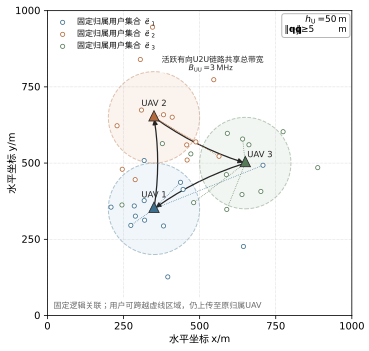
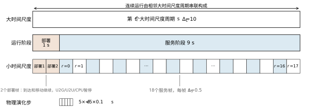
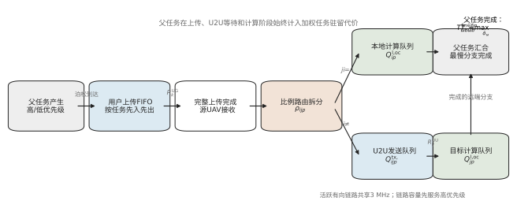
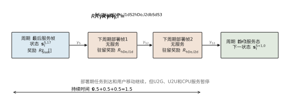
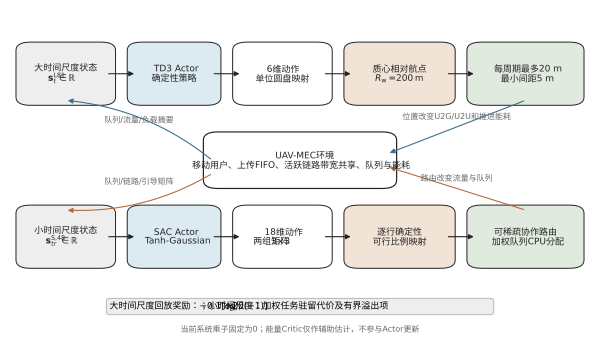
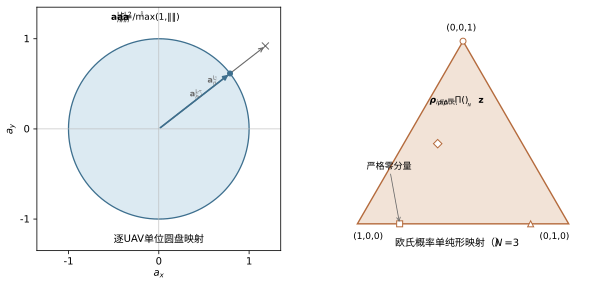

# 面向动态业务与共享机间带宽的多无人机MEC多时间尺度联合部署与可稀疏协作调度

> **稿件状态说明（投稿前删除）**  
> 本稿依据当前 `v23_target_noise` 代码执行路径重写，从系统模型开始，不含引言和相关工作。方法建模、算法和实验协议已经按代码事实展开；正式多随机种子实验尚未冻结，因此所有结果位置均明确标为“待正式实验填充”，没有虚构数据或优越性结论。本文暂将候选方法简称为 **TS-TD3-PSAC**（Two-timescale TD3 with Projected SAC）；算法名称可在最终结果确认后再定。

## 主要符号

| 符号 | 含义 | 单位/维数 |
|---|---|---|
| \(\mathcal N=\{1,\ldots,N\}\) | 无人机集合 | \(N=3\) |
| \(\mathcal K=\{1,\ldots,K\}\) | 地面用户集合 | \(K=39\) |
| \(\mathcal P=\{\mathrm H,\mathrm L\}\) | 高、低优先级集合 | \(w_{\mathrm H}=10,w_{\mathrm L}=1\) |
| \(t,r,m,\ell\) | 大时间尺度周期、周期内服务帧、全局物理步、帧内物理步 | — |
| \(\mathbf q_n,\mathbf u_k\) | 无人机 \(n\)、用户 \(k\) 的水平坐标 | m |
| \(a(k)\) | 用户 \(k\) 的固定源无人机 | \(\mathcal N\) |
| \(Q_{ij,p}^{\mathrm{tx}}\) | 从无人机 \(i\) 到 \(j\) 的 \(p\) 类传输队列 | Mbit |
| \(Q_{n,p}^{\mathrm{loc}}\) | 无人机 \(n\) 的 \(p\) 类计算队列 | Mbit |
| \(\rho_{ij,p}\) | 源无人机 \(i\) 的 \(p\) 类任务分配至 \(j\) 的比例 | \([0,1]\) |
| \(f_{n,p}\) | 无人机 \(n\) 分配给 \(p\) 类任务的CPU频率 | cycle/s |
| \(H[m]\) | 物理步 \(m\) 的加权任务驻留代价 | 加权任务·s |
| \(E^{\mathrm{sys}}[t]\) | 周期 \(t\) 的系统总能量 | J |
| \(\mathbf s_t^{\mathrm L},\mathbf s_{t,r}^{\mathrm S}\) | 大、小时间尺度压缩观测 | 81、48维 |
| \(\widetilde{\mathbf a}_t^{\mathrm L},\mathbf a_t^{\mathrm L},\mathbf z_{t,r}^{\mathrm S}\) | 大时间尺度Tanh输出、圆盘投影后回放动作、小时间尺度Tanh原始动作 | 6、6、18维 |

# 1 系统模型

## 1.1 网络架构与多时间尺度运行机制

考虑一个边长为 \(1000~\mathrm m\) 的正方形多无人机移动边缘计算系统。系统由无人机集合 \(\mathcal N=\{1,\ldots,N\}\) 与地面用户集合 \(\mathcal K=\{1,\ldots,K\}\) 构成。无人机以固定高度 \(h_{\mathrm U}=50~\mathrm m\) 飞行，第 \(n\) 架无人机和第 \(k\) 个用户在时刻 \(m\delta\) 的水平坐标分别表示为

\[
\mathbf q_n[m]=[x_n[m],y_n[m]]^{\mathrm T}\in\mathcal A,\qquad
\mathbf u_k[m]=[x_k[m],y_k[m]]^{\mathrm T}\in\mathcal A,
\quad
\mathcal A=[0,1000]^2 .
\tag{1}
\]

每个用户按照初始逻辑区域固定关联至一架源无人机。以 \(a(k)\in\mathcal N\) 表示用户 \(k\) 的源无人机，并定义

\[
\mathcal K_n=\{k\in\mathcal K:a(k)=n\},\qquad
\mathcal K_i\cap\mathcal K_j=\varnothing~(i\ne j),\qquad
\bigcup_{n\in\mathcal N}\mathcal K_n=\mathcal K .
\tag{2}
\]

逻辑区域只决定源无人机关联，不构成物理移动边界。用户即使移动到另一逻辑区域，仍向 \(a(k)\) 上传任务。这样可以把“部署决策改善固定接入链路”与“动态重关联”两个问题分离，避免把关联切换收益错误归因于无人机移动。



系统采用大时间尺度、小时间尺度和物理演化步三级时序：

\[
\Delta_{\mathrm L}=10~\mathrm s,\qquad
\Delta_{\mathrm D}=1~\mathrm s,\qquad
\Delta_{\mathrm S}=0.5~\mathrm s,\qquad
\delta=0.1~\mathrm s .
\tag{3}
\]

其中，每个大时间尺度周期开始时执行一次联合航点决策。无人机在前 \(\Delta_{\mathrm D}=1~\mathrm s\) 内完成部署，在后 \(9~\mathrm s\) 内悬停服务。一个周期由20个0.5 s时间段组成：前2个为部署帧，后18个为小时间尺度服务帧。每个服务帧执行一次任务路由动作，该动作在5个0.1 s物理演化步内保持不变。一个大时间尺度周期因此包含100个物理演化步。

部署阶段不是“时间跳过”。在这1 s内，外生任务到达和用户移动仍持续发生，但用户上行、无人机间传输与CPU计算暂停。部署导致的服务中断将通过任务积压和存活任务驻留代价反馈给策略。正式配置的一个训练回合包含30个大时间尺度周期，即300 s；该边界属于训练截断，而不是通信系统的吸收终止状态。



## 1.2 用户移动、异构任务到达与业务质心

1）**用户移动。** 用户的速度和航向角在每个0.5 s时间段边界按照Gauss–Markov过程更新。设第 \((t,r)\) 个时间段开始时用户 \(k\) 的速度和航向角分别为 \(v_k[t,r]\) 与 \(\varphi_k^{\mathrm u}[t,r]\)，则

\[
\begin{aligned}
v_k^{+}
&=\operatorname{clip}\!\left(
\alpha_v v_k+(1-\alpha_v)\bar v+
\sqrt{1-\alpha_v^2}\varepsilon_k^v,\,0,v_{\max}
\right),\\
\left(\varphi_k^{\mathrm u}\right)^{+}
&=\operatorname{wrap}\!\left(
\alpha_\varphi\varphi_k^{\mathrm u}+(1-\alpha_\varphi)\bar\varphi+
\sqrt{1-\alpha_\varphi^2}\varepsilon_k^\varphi
\right),
\end{aligned}
\tag{4}
\]

其中 \(\alpha_v=\alpha_\varphi=0.5\)、\(\bar v=0.5~\mathrm{m/s}\)、\(\bar\varphi=\pi/4\)、\(v_{\max}=3~\mathrm{m/s}\)，且
\(\varepsilon_k^v\sim\mathcal N(0,0.1^2)\)、
\(\varepsilon_k^\varphi\sim\mathcal N(0,0.1^2)\)。在一个0.5 s时间段内，速度向量保持不变，位置每个物理演化步更新为

\[
\mathbf u_k[m+1]
=
\Pi_{\mathcal A}^{\mathrm{ref}}
\left(
\mathbf u_k[m]+\delta v_k
\begin{bmatrix}\cos\varphi_k^{\mathrm u}\\ \sin\varphi_k^{\mathrm u}\end{bmatrix}
\right),
\tag{5}
\]

其中 \(\Pi_{\mathcal A}^{\mathrm{ref}}(\cdot)\) 表示在正方形边界进行镜面反射并保持坐标可行。当前配置 `user_zone_radius_m=0`，因此不存在额外的圆形用户活动区。

2）**异构任务到达。** 业务包含高、低两类优先级，权重分别为 \(w_{\mathrm H}=10\) 和 \(w_{\mathrm L}=1\)。终端分为传感器、控制器和视觉设备三类，设备类型决定高、低优先级任务的到达缩放及单任务大小。

| 设备类型 | 高优先级到达缩放 | 低优先级到达缩放 | 高优先级任务/Mbit | 低优先级任务/Mbit |
|---|---:|---:|---:|---:|
| 传感器 | 0.55 | 1.10 | 0.35 | 0.90 |
| 控制器 | 2.20 | 0.25 | 0.55 | 0.35 |
| 视觉终端 | 0.15 | 0.80 | 1.20 | 1.40 |

设用户 \(k\) 的 \(p\) 类任务到达率为 \(\lambda_{k,p}\)，单任务输入数据量为 \(L_{k,p}\)。每个0.5 s时间段仅采样一次任务数：

\[
N_{k,p}[t,r]\sim
\operatorname{Poisson}(\lambda_{k,p}\Delta_{\mathrm S}),\qquad
A_{k,p}[t,r]=N_{k,p}[t,r]L_{k,p}.
\tag{6}
\]

区域 \(n\) 的期望业务负载为

\[
\Lambda_n
=
\sum_{k\in\mathcal K_n}\sum_{p\in\mathcal P}
\lambda_{k,p}L_{k,p}.
\tag{7}
\]

基础区域负载 \([12.5,5.5,3.5]~\mathrm{Mbit/s}\) 乘以负载系数1.15后，正式场景为

\[
[\Lambda_1,\Lambda_2,\Lambda_3]
=[14.375,6.325,4.025]~\mathrm{Mbit/s}.
\tag{8}
\]

不同区域内各设备类型与优先级的相对到达结构保持不变，通过统一缩放满足式(8)。

3）**业务加权质心。** 大时间尺度航点采用业务加权质心作为参照，而不直接输出绝对坐标。令 \(A_k[t,r]=\sum_pA_{k,p}[t,r]\)，区域 \(n\) 的瞬时质心为

\[
\widetilde{\mathbf c}_n[t,r]
=
\frac{\sum_{k\in\mathcal K_n}A_k[t,r]\mathbf u_k[t,r]}
{\sum_{k\in\mathcal K_n}A_k[t,r]} .
\tag{9}
\]

若分母为0，则使用该区域全部用户坐标的算术平均值。为降低泊松采样引起的航点抖动，采用

\[
\mathbf c_n[t,r]
=
\beta_c\mathbf c_n^{-}+(1-\beta_c)\widetilde{\mathbf c}_n[t,r],
\qquad \beta_c=0.99^5 .
\tag{10}
\]

业务质心只参与观测编码和航点解码，不改变式(2)的固定关联。

## 1.3 通信模型与父任务流水

1）**用户—无人机上行。** 用户 \(k\) 到源无人机 \(a(k)\) 的三维距离和信道功率增益分别为

\[
d_k^{\mathrm{UG}}[m]
=
\sqrt{\|\mathbf u_k[m]-\mathbf q_{a(k)}[m]\|_2^2+h_{\mathrm U}^2},
\qquad
h_k^{\mathrm{UG}}[m]
=
\frac{\beta_0}{(d_k^{\mathrm{UG}}[m])^2},
\tag{11}
\]

其中 \(\beta_0=10^{-6}\)。总上行带宽 \(B_{\mathrm{UG}}=20~\mathrm{MHz}\) 永久、正交且等量地分给全部 \(K\) 个用户。空闲用户的频谱份额不被活跃用户借用。因此

\[
R_k^{\mathrm{UG}}[m]
=
\frac{B_{\mathrm{UG}}}{K}
\log_2\!\left(
1+
\frac{p_{\mathrm{UG}}\beta_0}
{\sigma_{\mathrm n}^2\big(\|\mathbf u_k[m]-\mathbf q_{a(k)}[m]\|_2^2+h_{\mathrm U}^2\big)}
\right),
\tag{12}
\]

其中 \(p_{\mathrm{UG}}=0.1~\mathrm W\)、\(\sigma_{\mathrm n}^2=10^{-13}~\mathrm W\)。每个用户维护任务级FIFO上传队列，高、低优先级任务在上传阶段不抢占。若物理步内实际占用上行的时间为 \(\tau_k^{\mathrm{UG}}[m]\le\delta\)，则

\[
E_k^{\mathrm{UG}}[m]=p_{\mathrm{UG}}\tau_k^{\mathrm{UG}}[m].
\tag{13}
\]

一个父任务只有在全部输入数据上传完成后才允许被拆分；不允许部分上传、部分提前计算。
代码在每个物理步开始时提取此前已经完成上传的父任务，再执行本步上行服务。因此，在当前物理步内刚完成上传的父任务从下一物理步开始才参与路由拆分。

2）**父任务拆分和同步完成。** 用 \(\omega\) 表示父任务，其源无人机、优先级、输入量和出生时刻分别为 \(s_\omega\)、\(p_\omega\)、\(L_\omega\) 和 \(T_\omega^{\mathrm{arr}}\)。小时间尺度控制器为源无人机 \(i\) 的 \(p\) 类业务生成路由行

\[
\boldsymbol\rho_{i,p}
=[\rho_{i1,p},\ldots,\rho_{iN,p}],\qquad
\rho_{ij,p}\ge0,\qquad
\sum_{j\in\mathcal N}\rho_{ij,p}=1.
\tag{14}
\]

父任务 \(\omega\) 完成上传后，发往无人机 \(j\) 的任务块大小为

\[
L_{\omega\rightarrow j}
=\rho_{s_\omega j,p_\omega}L_\omega.
\tag{15}
\]

零质量分支不创建；\(j=s_\omega\) 时任务块直接进入源无人机计算队列，\(j\ne s_\omega\) 时先进入有向无人机间传输队列。若 \(\mathcal B_\omega\) 表示实际创建的任务块集合，\(T_{\omega,b}^{\mathrm{fin}}\) 是任务块 \(b\) 的计算完成时刻，则

\[
T_\omega^{\mathrm{fin}}
=\max_{b\in\mathcal B_\omega}T_{\omega,b}^{\mathrm{fin}},
\qquad
D_\omega=T_\omega^{\mathrm{fin}}-T_\omega^{\mathrm{arr}}.
\tag{16}
\]

因此，路由到更多无人机不必然降低父任务时延；最慢的上传、转发或计算分支决定同步完成时刻。当前模型不包含计算结果回传、输出数据量和传播时延，式(16)表示“任务产生至所有计算分支完成”的单向端到端时延。



3）**无人机间传输与共享频谱。** 各无人机等高飞行，因此

\[
d_{ij}^{\mathrm{UU}}[m]=\|\mathbf q_i[m]-\mathbf q_j[m]\|_2,\qquad
h_{ij}^{\mathrm{UU}}[m]=\frac{\beta_0}{(d_{ij}^{\mathrm{UU}}[m])^2},
\quad i\ne j.
\tag{17}
\]

系统只配置一个总无人机间带宽池 \(B_{\mathrm{UU}}=3~\mathrm{MHz}\)。令 \(X_{ij,p}[m]\) 表示在物理步 \(m\) 开始前已经完成上传、并在本步按当前路由动作拆分至链路 \((i,j)\) 的任务量；本步上行刚完成的父任务不计入 \(X_{ij,p}[m]\)，而在下一物理步再被拆分。定义U2U服务前队列
\(\widetilde Q_{ij,p}^{\mathrm{tx}}[m]=Q_{ij,p}^{\mathrm{tx}}[m]+X_{ij,p}[m]\)。当前有数据待发送的活跃有向链路集合为

\[
\mathcal L[m]
=
\left\{(i,j):i\ne j,\,
\widetilde Q_{ij,\mathrm H}^{\mathrm{tx}}[m]+
\widetilde Q_{ij,\mathrm L}^{\mathrm{tx}}[m]>0
\right\}.
\tag{18}
\]

总带宽按活跃有向链路数等分：

\[
B_{ij}^{\mathrm{UU}}[m]
=
\begin{cases}
B_{\mathrm{UU}}/|\mathcal L[m]|,&(i,j)\in\mathcal L[m],\\
0,&\text{其他}.
\end{cases}
\tag{19}
\]

若 \(\mathcal L[m]=\varnothing\)，全部无人机间速率为0。对于 \(p_{\mathrm{UU}}=1~\mathrm W\)，链路速率为

\[
R_{ij}^{\mathrm{UU}}[m]
=
B_{ij}^{\mathrm{UU}}[m]
\log_2\!\left(
1+
\frac{p_{\mathrm{UU}}\beta_0}
{\sigma_{\mathrm n}^2\|\mathbf q_i[m]-\mathbf q_j[m]\|_2^2}
\right).
\tag{20}
\]

这一共享规则构成路由稀疏性的物理收益：减少非零跨无人机分支不仅减少待转发流量，还可能减少活跃链路数，从而增加其余链路的带宽。不得把每条链路固定写成独占3 MHz。

一个物理步内总链路容量为

\[
C_{ij}^{\mathrm{UU}}[m]
=\frac{R_{ij}^{\mathrm{UU}}[m]\delta}{10^6}\quad\mathrm{Mbit}.
\tag{21}
\]

高优先级首先使用容量，低优先级使用剩余量：

\[
\begin{aligned}
S_{ij,\mathrm H}^{\mathrm{UU}}[m]
&=\min\!\left\{
\widetilde Q_{ij,\mathrm H}^{\mathrm{tx}}[m],
C_{ij}^{\mathrm{UU}}[m]\right\},\\
S_{ij,\mathrm L}^{\mathrm{UU}}[m]
&=\min\!\left\{
\widetilde Q_{ij,\mathrm L}^{\mathrm{tx}}[m],
\left[C_{ij}^{\mathrm{UU}}[m]-S_{ij,\mathrm H}^{\mathrm{UU}}[m]\right]^+
\right\}.
\end{aligned}
\tag{22}
\]

传输队列的流体量递推为

\[
Q_{ij,p}^{\mathrm{tx}}[m+1]
=Q_{ij,p}^{\mathrm{tx}}[m]+X_{ij,p}[m]
-S_{ij,p}^{\mathrm{UU}}[m].
\tag{23}
\]

实际实现还保存任务块FIFO和剩余比特。只有一个任务块全部传输完毕后，其完整初始数据量才进入目标无人机计算队列。设 \(Z_{ij,p}[m]\) 表示物理步 \(m\) 内完整转发完成的任务块总量，\(X_{jj,p}[m]\) 表示本地分支到达，则CPU服务前的临时本地队列为

\[
\widetilde Q_{j,p}^{\mathrm{loc}}[m]
=Q_{j,p}^{\mathrm{loc}}[m]+X_{jj,p}[m].
\tag{24}
\]

若CPU频率为 \(f_{j,p}[m]\)，计算密度为 \(C_{\mathrm{cyc}}=1000~\mathrm{cycle/bit}\)，本步计算量为

\[
S_{j,p}^{\mathrm{cmp}}[m]
=
\min\!\left\{
\widetilde Q_{j,p}^{\mathrm{loc}}[m],
\frac{f_{j,p}[m]\delta}{C_{\mathrm{cyc}}10^6}
\right\}.
\tag{25}
\]

代码执行顺序为“本地分支入队—CPU服务—U2U服务—远端完整任务块入队”，故本步完成转发的任务块从下一物理步开始计算：

\[
Q_{j,p}^{\mathrm{loc}}[m+1]
=
\widetilde Q_{j,p}^{\mathrm{loc}}[m]
-S_{j,p}^{\mathrm{cmp}}[m]
+\sum_{i\ne j}Z_{ij,p}[m].
\tag{26}
\]

若链路 \((i,j)\) 的实际发送量为 \(S_{ij}^{\mathrm{UU}}[m]=\sum_pS_{ij,p}^{\mathrm{UU}}[m]\)，则源无人机承担的发送能量为

\[
E_{ij}^{\mathrm{UU}}[m]
=p_{\mathrm{UU}}\tau_{ij}^{\mathrm{UU}}[m],
\qquad
\tau_{ij}^{\mathrm{UU}}[m]
=
\begin{cases}
\dfrac{10^6S_{ij}^{\mathrm{UU}}[m]}
{R_{ij}^{\mathrm{UU}}[m]},&R_{ij}^{\mathrm{UU}}[m]>0,\\[2mm]
0,&R_{ij}^{\mathrm{UU}}[m]=0.
\end{cases}
\tag{27}
\]

当 \(R_{ij}^{\mathrm{UU}}[m]=0\) 时，链路服务量也为0，第二个分支避免数值上的 \(0/0\)。

4）**加权任务驻留代价。** 令 \(\mathcal W^{\mathrm{alive}}[m]\) 表示物理步 \(m\) 结束时尚未完成的父任务集合。该集合覆盖用户上传、无人机间等待和无人机计算三个阶段，但每个父任务每个物理步只计一次：

\[
H[m]
=
\delta\sum_{\omega\in\mathcal W^{\mathrm{alive}}[m]}w_{p_\omega}
=
\delta\left(
w_{\mathrm H}N_{\mathrm H}^{\mathrm{alive}}[m]
+w_{\mathrm L}N_{\mathrm L}^{\mathrm{alive}}[m]
\right).
\tag{28}
\]

代码在每个物理步的服务完成之后统计仍存活父任务，因此恰好在本步末完成的任务不再贡献该步驻留代价。对父任务 \(\omega\) 定义代码口径下的离散驻留时间

\[
\widehat D_\omega^{\mathrm{hold}}
=
\sum_m\delta\,
\mathbb I\!\left\{
T_\omega^{\mathrm{arr}}<(m+1)\delta<T_\omega^{\mathrm{fin}}
\right\}
,\qquad
0\le D_\omega-\widehat D_\omega^{\mathrm{hold}}\le\delta .
\tag{29}
\]

因此，累计式(28)是优先级加权任务驻留时间的右端点离散代理；对每个已完成父任务，它至多比式(16)的真实时延少计一个物理步 \(\delta=0.1~\mathrm s\)，不能宣称二者逐任务严格相等。窗口末仍未完成的父任务也贡献已经发生的等待时间，能够减轻“只统计已完成任务”产生的幸存者偏差。最终评价仍必须单独报告式(16)的真实完成时延、任务完成率和右删失任务。

## 1.4 无人机运动、CPU分配与系统能耗

1）**质心相对航点与安全运动。** 第 \(t\) 个大时间尺度动作经解码后得到无人机 \(n\) 的目标航点 \(\mathbf w_n[t]\)。请求位移为

\[
\Delta\mathbf q_n^{\mathrm{req}}[t]
=
\begin{cases}
\mathbf0,&\|\mathbf w_n[t]-\mathbf q_n[t]\|_2\le\epsilon_{\mathrm w},\\[1mm]
\dfrac{\mathbf w_n[t]-\mathbf q_n[t]}
{\|\mathbf w_n[t]-\mathbf q_n[t]\|_2}
\min\{\|\mathbf w_n[t]-\mathbf q_n[t]\|_2,D_{\max}\},
&\text{其他},
\end{cases}
\tag{30}
\]

其中 \(D_{\max}=20~\mathrm m\)、\(\epsilon_{\mathrm w}=0.5~\mathrm m\)。所有无人机的请求位移通过同一缩放系数 \(\alpha_t^{\mathrm{safe}}\in[0,1]\) 联合缩放，使

\[
\min_{\zeta\in[0,1]}
\left\|
\mathbf q_i[t]+\zeta\alpha_t^{\mathrm{safe}}\Delta\mathbf q_i^{\mathrm{req}}[t]
-\mathbf q_j[t]-\zeta\alpha_t^{\mathrm{safe}}\Delta\mathbf q_j^{\mathrm{req}}[t]
\right\|_2
\ge d_{\min},\quad i\ne j,
\tag{31}
\]

其中 \(d_{\min}=5~\mathrm m\)。实际位移为
\(\Delta\mathbf q_n[t]=\alpha_t^{\mathrm{safe}}\Delta\mathbf q_n^{\mathrm{req}}[t]\)。若数值校验仍不能保证整段航迹安全，则该周期联合位移退化为零。飞行速度为

\[
v_n[t]=\|\Delta\mathbf q_n[t]\|_2/\Delta_{\mathrm D}.
\tag{32}
\]

2）**确定性CPU分配。** 每架无人机的最大CPU频率为 \(F_n^{\max}=10~\mathrm{GHz}\)，且

\[
f_{n,p}[m]\ge0,\qquad
\sum_{p\in\mathcal P}f_{n,p}[m]\le F_n^{\max}.
\tag{33}
\]

CPU频率不是强化学习动作，而由加权MaxWeight内层问题求得。以

\[
Q_n^{\mathrm{ref}}
=
\frac{F_n^{\max}(\Delta_{\mathrm L}-\Delta_{\mathrm D})}
{C_{\mathrm{cyc}}10^6}
\tag{34}
\]

作为一个服务阶段的参考处理量，可将内层问题表示为

\[
\begin{aligned}
\max_{\{f_{n,p}\}}\quad&
\sum_{p\in\mathcal P}
w_p\frac{Q_{n,p}^{\mathrm{loc}}}{Q_n^{\mathrm{ref}}}
\frac{f_{n,p}}{F_n^{\max}}
-\varpi_n\kappa_{\mathrm c}\left(\sum_pf_{n,p}\right)^3\\
\mathrm{s.t.}\quad&
\text{式(33)},\qquad
f_{n,p}\le
\min\!\left\{
F_n^{\max},
\frac{Q_{n,p}^{\mathrm{loc}}C_{\mathrm{cyc}}10^6}{\delta}
\right\}.
\end{aligned}
\tag{35}
\]

当前配置的系统功率对偶变量始终为0，因此 \(\varpi_n=0\)。式(35)实际执行的是受需求和频率上限约束的加权队列服务分配，不能描述为已启用动态能价的节能DVFS。CPU物理步能量为

\[
E_n^{\mathrm{cmp}}[m]
=\kappa_{\mathrm c}\delta
\left(f_{n,\mathrm H}[m]+f_{n,\mathrm L}[m]\right)^3,
\qquad \kappa_{\mathrm c}=10^{-28}.
\tag{36}
\]

3）**推进能耗。** 旋翼无人机功率模型为

\[
\begin{aligned}
P_{\mathrm{fly}}(v)
= {}&
U_1\left(1+\frac{3v^2}{v_{\mathrm{tip}}^2}\right)
+U_2\sqrt{\sqrt{U_3+\frac{v^4}{4}}-\frac{v^2}{2}}
+U_4v^3+U_5 ,
\end{aligned}
\tag{37}
\]

其中 \(U_1=78\)、\(U_2=22\)、\(U_3=265\)、\(U_4=0.0092\)、\(U_5=28\)、\(v_{\mathrm{tip}}=110\)。当前仿真还计入从悬停状态达到飞行速度的动能下界 \(\tfrac12m_{\mathrm U}v_n^2\)，其中 \(m_{\mathrm U}=20/9.81~\mathrm{kg}\)。周期推进能量为

\[
\begin{aligned}
E_n^{\mathrm{prop}}[t]
={}&
P_{\mathrm{fly}}(v_n[t])\Delta_{\mathrm D}
+\frac12m_{\mathrm U}v_n^2[t]\\
&+P_{\mathrm{fly}}(0)(\Delta_{\mathrm L}-\Delta_{\mathrm D}).
\end{aligned}
\tag{38}
\]

即使实际位移为0，仍产生全周期悬停能耗。动能项只是启动瞬态的保守下界，不等价于完整的加减速和姿态动力学模型。

4）**系统能量范围。** 第 \(t\) 个周期的系统总能量定义为

\[
\begin{aligned}
E^{\mathrm{sys}}[t]
={}&
\sum_{n\in\mathcal N}E_n^{\mathrm{prop}}[t]\\
&+\sum_{m\in\mathcal I_t}
\left[
\sum_nE_n^{\mathrm{cmp}}[m]
+\sum_{i\ne j}E_{ij}^{\mathrm{UU}}[m]
+\sum_kE_k^{\mathrm{UG}}[m]
\right],
\end{aligned}
\tag{39}
\]

其中 \(\mathcal I_t\) 包含该周期的100个物理步。周期平均功率比为

\[
g^{\mathrm L}[t]
=
\frac{E^{\mathrm{sys}}[t]}{P_{\max}\Delta_{\mathrm L}},
\qquad P_{\max}=840~\mathrm W.
\tag{40}
\]

式(39)对应“系统级”功率范围，包含地面用户上行能量。它不是单架无人机电池约束；若论文改为研究无人机电池，必须修改代码的能量统计范围并为各无人机单独建模，不能只改文字。

# 2 联合优化问题与大小时间尺度决策建模

## 2.1 长期目标、约束与可行容量审计

以 \(T\) 个大时间尺度周期为统计窗口，长期平均加权任务驻留目标为

\[
J_{\mathrm D}
=
\limsup_{T\to\infty}
\frac{1}{T\Delta_{\mathrm L}}
\mathbb E
\left[
\sum_{t=0}^{T-1}\sum_{m\in\mathcal I_t}H[m]
\right].
\tag{41}
\]

令 \(Q_{k,p}^{\mathrm{UG}}[m]\) 表示用户上传FIFO中的 \(p\) 类未上传数据量。当前算法不把CPU频率作为强化学习动作，而将其限制为式(35)在零能量价格下给出的确定性映射
\(\mathbf f[m]=\mathcal F_{\mathrm{MW}}(\mathbf x[m];0)\)。因此，本文实际处理的是该CPU策略类内的受限问题：

\[
\begin{aligned}
Q^\Sigma[m]
&\triangleq
\sum_{k,p}Q_{k,p}^{\mathrm{UG}}[m]
+\sum_{i,j,p}Q_{ij,p}^{\mathrm{tx}}[m]
+\sum_{n,p}Q_{n,p}^{\mathrm{loc}}[m],\\
\mathbf P_{\mathrm{MW}}:\quad
\min_{\{\mathbf q,\boldsymbol\rho\}}\quad&
J_{\mathrm D}\\
\mathrm{s.t.}\quad
&\mathrm C1:\ \mathbf q_n[t]\in\mathcal A,\quad\forall n,t,\\
&\mathrm C2:\ \|\Delta\mathbf q_n[t]\|_2\le D_{\max},\quad\forall n,t,\\
&\mathrm C3:\ \text{连续航段安全约束式(31)},\\
&\mathrm C4:\ \rho_{ij,p}[t,r]\ge0,\quad\forall i,j,p,t,r,\\
&\mathrm C5:\ \sum_j\rho_{ij,p}[t,r]=1,\quad\forall i,p,t,r,\\
&\mathrm C6:\ \mathbf f[m]=\mathcal F_{\mathrm{MW}}(\mathbf x[m];0),\
f_{n,p}[m]\ge0,\ \sum_pf_{n,p}[m]\le F_n^{\max},\\
&\mathrm C7:\ 
\limsup_{T\to\infty}
\frac{\mathbb E[\sum_{t=0}^{T-1}E^{\mathrm{sys}}[t]]}
{T\Delta_{\mathrm L}}
\le P_{\max},\\
&\mathrm C8:\ 
\lim_{M\to\infty}\frac{\mathbb E[Q^\Sigma[M]]}{M}=0.
\end{aligned}
\tag{42}
\]

其中C8是全部显式上传、传输和计算队列总积压的均值率稳定条件。式(42)已经把CPU控制律限定为当前确定性MaxWeight映射，故后文只讨论在该受限策略类内学习航点和路由，不声称求得任意CPU控制下原问题的全局最优解。神经网络强化学习在当前非线性、部分可观测和跨层联合训练条件下没有提供全局最优性或队列稳定性的解析证明，因此论文必须通过容量审计、长时固定策略测试和终端队列增长率验证C8，而不能把经验稳定写成定理。

当前配置具有“局部过载、全局可行”的结构。每架无人机在9 s服务阶段的理论最大计算量为

\[
\frac{10\times10^9\times9}{1000\times10^6}
=90~\mathrm{Mbit}/\text{周期}.
\tag{43}
\]

三个逻辑区域每10 s的期望到达量为 \([143.75,63.25,40.25]~\mathrm{Mbit}\)。区域1单独本地处理时过载，而系统总计算量270 Mbit/周期大于总期望到达量247.25 Mbit/周期。这说明跨无人机协作有真实容量需求，但该必要条件尚未包含1 s服务暂停、U2G瓶颈、U2U共享频谱和随机波动，最终稳定性仍需实证。

问题 \(\mathbf P_{\mathrm{MW}}\) 是当前实现对应的系统设计目标，但候选算法对其中的长期功率约束采用固定罚函数近似，而不是动态原始—对偶求解。代码中能量乘子初值和更新步长均为0：

\[
\lambda_{\mathrm E}=0,\qquad
\mathcal P_{\mathrm E}[t]
=\eta_{\mathrm E}^{\mathrm{pen}}[g^{\mathrm L}[t]-1]^+,\qquad
\eta_{\mathrm E}^{\mathrm{pen}}=20.
\tag{44}
\]

固定罚函数能给超预算动作提供训练信号，却不能从算法结构上保证C7。正式结论只能在独立评估的功率均值、95%置信上界和违反率均通过后写为“经验满足预算”。

## 2.2 底层Markov状态与压缩观测

为避免把神经网络输入误写成完整物理状态，定义物理演化步 \(m\) 的底层状态

\[
\mathbf x[m]
=
\big(
\mathbf q,\mathbf u,\mathbf v,\boldsymbol\varphi^{\mathrm u},
\{\mathcal U_k\}_{k\in\mathcal K},
\mathbf Q^{\mathrm{tx}},\mathbf Q^{\mathrm{loc}},
\mathcal T,\mathbf c,\chi,
\mathbf a_{\mathrm{hold}}^{\mathrm L},
\boldsymbol\rho_{\mathrm{hold}},
\mathcal M^{\mathrm{int}}
\big)[m].
\tag{45}
\]

其中，\(\mathcal U_k\) 包含用户上传FIFO及各父任务剩余上传量，\(\mathcal T\) 包含父任务和任务块的阶段、剩余数据量与完成计数，\(\chi\) 包含当前部署/服务相位、剩余部署步数及帧内位置；\(\mathbf a_{\mathrm{hold}}^{\mathrm L}\) 和 \(\boldsymbol\rho_{\mathrm{hold}}\) 是当前保持执行的大小时间尺度动作；\(\mathcal M^{\mathrm{int}}\) 汇总会影响后续观测、奖励或转移的实现内部记忆，包括协作流EMA、业务质心EMA、周期能量/代价累加器和边界待定经验标志。把这些量纳入后，式(45)表示环境—封装器的增广状态；给定新控制动作和外生随机量，其下一状态分布只依赖当前增广状态，故该增广过程满足Markov性。若删去 \(\mathcal M^{\mathrm{int}}\) 或保持动作，则不能作此严格陈述。

两层策略实际使用压缩观测：

\[
\mathbf s_t^{\mathrm L}=\Phi_{\mathrm L}(\mathbf x[m_t]),\qquad
\mathbf s_{t,r}^{\mathrm S}=\Phi_{\mathrm S}(\mathbf x[m_{t,r}]).
\tag{46}
\]

当前81维和48维向量未显式包含全部上传FIFO、完整父任务阶段和所有用户速度，尚未证明为充分统计量。因此，严格意义上本文在底层Markov环境上采用基于压缩观测的集中式策略。后文为便于与强化学习算法对应，继续使用“状态、MDP、SMDP”的常用表述，但不额外声称式(46)本身严格完备。

## 2.3 大时间尺度航点部署SMDP

给定一个固定的小时间尺度调度策略 \(\pi_{\mathrm S}\)，将大时间尺度过程写为固定持续时间SMDP

\[
\mathcal M_{\mathrm L}
=
\langle
\mathcal S_{\mathrm L},\mathcal A_{\mathrm L},
\mathcal P_{\mathrm L}^{\pi_{\mathrm S}},
R_{\mathrm L},\gamma_{\mathrm L}
\rangle,\qquad
\gamma_{\mathrm L}=0.99.
\tag{47}
\]

每个动作持续10 s，因此它也可视为在大周期边界采样的嵌入式MDP。采用SMDP术语的目的只是显式保留内部持续时间和小时间尺度决策，而不是把固定持续时间本身作为创新点。

1）**大时间尺度观测。** 每架无人机的局部观测由2维质心相对位置、9维自身摘要以及每个队友8维特征构成：

\[
\mathbf o_{n,t}^{\mathrm L}
=
\operatorname{concat}
\left(
\frac{\mathbf c_n-\mathbf q_n}{1000},
\mathbf o_{n}^{\mathrm{own}},
\{\mathbf o_{nj}^{\mathrm{peer}}\}_{j\ne n}
\right).
\tag{48}
\]

| 特征组 | 内容 | 归一化/说明 |
|---|---|---|
| 质心偏移，2维 | \(\mathbf c_n-\mathbf q_n\) | 除以1000 m |
| 自身队列，2维 | 高、低优先级节点队列足迹 | 本地+转出+转入，除以80 Mbit并裁剪 |
| 当前到达，1维 | 当前高、低到达量之和 | 除以20 Mbit并裁剪 |
| 质心出界量，1维 | \([\|\mathbf q_n-\mathbf c_n\|-95]^+\) | 除以 \(200-95\) m并裁剪 |
| 名义U2U均值，1维 | 从 \(n\) 到队友的名义速率均值 | 除以60 Mbit/s并裁剪 |
| 流量摘要，2维 | 参考出流、参考入流 | 由历史协作流EMA和当前U2U队列构造 |
| 期望负载，1维 | 区域期望周期上传量 | 相对最大基础负载归一 |
| CPU能力，1维 | \(F_n^{\max}\) | 以16 GHz归一 |
| 每个队友，8维 | 相对坐标2、分优先级队列2、双向流2、期望负载1、CPU能力1 | 与对应自身量同尺度 |

节点队列足迹为

\[
Q_{n,p}^{\mathrm{node}}
=
Q_{n,p}^{\mathrm{loc}}
+\sum_jQ_{nj,p}^{\mathrm{tx}}
+\sum_iQ_{in,p}^{\mathrm{tx}}.
\tag{49}
\]

参考流量矩阵由历史协作流的指数滑动平均和当前传输队列混合得到；若某源无人机没有历史转发流，则先将该区域的期望上传量置于对角元素。该特征只作为观测，不强制未来路由。于是

\[
d_{\mathrm L}^{\mathrm{local}}
=2+9+8(N-1)=8N+3,\qquad
d_{\mathrm L}=N(8N+3)=81\quad(N=3).
\tag{50}
\]

2）**大时间尺度动作。** TD3 Actor 为每架无人机输出二维Tanh动作
\(\widetilde{\mathbf a}_{n,t}^{\mathrm L}\in[-1,1]^2\)。先投影至单位圆盘：

\[
\overline{\mathbf a}_{n,t}^{\mathrm L}
=
\frac{\widetilde{\mathbf a}_{n,t}^{\mathrm L}}
{\max\{1,\|\widetilde{\mathbf a}_{n,t}^{\mathrm L}\|_2\}},
\tag{51}
\]

实现中的TD3 Actor前向过程已经包含式(51)，经验池和Critic保存/接收的是圆盘投影后动作。下文在不引起歧义时将
\(\overline{\mathbf a}_t^{\mathrm L}\) 简记为 \(\mathbf a_t^{\mathrm L}\)，它仍不是最终物理位移。再以业务质心为中心解码成航点

\[
\mathbf w_n[t]
=
\Pi_{\mathcal A}
\left(
\mathbf c_n[t]+R_{\mathrm w}\overline{\mathbf a}_{n,t}^{\mathrm L}
\right),
\qquad R_{\mathrm w}=200~\mathrm m.
\tag{52}
\]

联合原始动作维数为 \(a_{\mathrm L}=2N=6\)。式(52)意味着零动作对应“将业务质心作为目标航点”，而非无条件悬停；只有无人机已在质心0.5 m容差内时才不移动。航点再经式(30)—式(31)映射为物理执行位移。

3）**转移与实际奖励。** 大时间尺度转移核由1 s安全飞行、部署期服务暂停、用户移动、任务到达、18次小时间尺度路由、共享U2U链路、CPU服务和父任务演化共同诱导。定义UAV侧总队列

\[
Q^{\mathrm{tot}}[m]
=
\sum_{n,p}Q_{n,p}^{\mathrm{loc}}[m]
+\sum_{i,j,p}Q_{ij,p}^{\mathrm{tx}}[m].
\tag{53}
\]

训练中的物理步代理代价为

\[
\begin{aligned}
c_{\mathrm D}[m]
&=0.7\,\operatorname{clip}\!\left(H[m]/10,0,5\right),\\
c_{\mathrm O}[m]
&=2\,\operatorname{clip}\!\left(
[Q^{\mathrm{tot}}[m]-500]^+/500,0,2\right),\\
c_{\mathrm P}[m]&=c_{\mathrm D}[m]+c_{\mathrm O}[m].
\end{aligned}
\tag{54}
\]

当前队列漂移权重为0。令
\(\overline c_{\mathrm P}[t]=100^{-1}\sum_{m\in\mathcal I_t}c_{\mathrm P}[m]\)，实际写入TD3经验池的奖励为

\[
R_{\mathrm L}[t]
=
-\eta_{\mathrm L}^{\mathrm r}
\left(
\overline c_{\mathrm P}[t]
+\eta_{\mathrm E}^{\mathrm{pen}}[g^{\mathrm L}[t]-1]^+
\right),
\quad
\eta_{\mathrm L}^{\mathrm r}=0.1,\quad
\eta_{\mathrm E}^{\mathrm{pen}}=20.
\tag{55}
\]

几何势函数、位移惩罚和额外推进能耗决胜项在当前候选配置中的有效权重均为0。故大时间尺度主Critic估计的是式(55)定义的综合回报，不是“纯时延价值”。

## 2.4 小时间尺度可稀疏协作调度MDP

在9 s服务阶段内，无人机位置固定，小时间尺度控制器每0.5 s输出一次高、低优先级路由。记

\[
\mathcal M_{\mathrm S}
=
\langle
\mathcal S_{\mathrm S},\mathcal A_{\mathrm S},
\mathcal P_{\mathrm S},R_{\mathrm S},\gamma_{\mathrm S}
\rangle,\qquad
\gamma_{\mathrm S}=0.99.
\tag{56}
\]

1）**小时间尺度观测。** 定义单物理步最大计算量和名义U2U服务量

\[
\mu_n^{\mathrm{cmp}}
=\frac{F_n^{\max}\delta}{C_{\mathrm{cyc}}10^6},\qquad
\mu_{ij}^{\mathrm{UU}}
=\max\{\overline R_{ij}^{\mathrm{UU}}\delta,10^{-6}\}.
\tag{57}
\]

其中 \(\overline R_{ij}^{\mathrm{UU}}\) 是用于状态编码的名义速率。小时间尺度状态拼接：

\[
\begin{aligned}
\mathbf s_{t,r}^{\mathrm S}
=\operatorname{concat}\big(
&\widehat{\mathbf Q}_{\mathrm H}^{\mathrm{loc}},
\widehat{\mathbf Q}_{\mathrm L}^{\mathrm{loc}},
\operatorname{vec}\widehat{\mathbf Q}_{\mathrm H}^{\mathrm{tx}},
\operatorname{vec}\widehat{\mathbf Q}_{\mathrm L}^{\mathrm{tx}},\\
&\widehat{\mathbf A}_{\mathrm H},
\widehat{\mathbf A}_{\mathrm L},
\operatorname{vec}\widehat{\mathbf R}^{\mathrm{UU}},
\operatorname{vec}\mathbf G
\big).
\end{aligned}
\tag{58}
\]

本地队列和到达量以 \(10\mu_n^{\mathrm{cmp}}\) 归一，传输队列以 \(10\mu_{ij}^{\mathrm{UU}}\) 归一，名义速率以60 Mbit/s归一，所有压力特征裁剪到 \([0,1]\)。建议路由矩阵 \(\mathbf G\) 由节点可用度和名义链路质量确定：

\[
\upsilon_j^{\mathrm{av}}
=
\frac{\mu_j^{\mathrm{cmp}}}
{\mu_j^{\mathrm{cmp}}+Q_{j,\mathrm H}^{\mathrm{loc}}
+Q_{j,\mathrm L}^{\mathrm{loc}}+\varepsilon},
\qquad
G_{ij}
=
\frac{\max\{\Xi_{ij},\varepsilon\}}
{\sum_\ell\max\{\Xi_{i\ell},\varepsilon\}},
\tag{59}
\]

其中 \(\Xi_{ii}=\upsilon_i^{\mathrm{av}}\)，\(\Xi_{ij}=\upsilon_j^{\mathrm{av}}\widehat R_{ij}^{\mathrm{UU}}\)（\(i\ne j\)）。\(\mathbf G\) 仅是状态上下文，不进入奖励，也不限制实际路由。状态维数为

\[
d_{\mathrm S}=4N+4N^2=48\quad(N=3).
\tag{60}
\]

2）**小时间尺度动作。** Actor 为高、低优先级分别输出一个 \(N\times N\) 原始矩阵 \(\mathbf Z_p=[z_{ij,p}]\)，联合原始动作维数为

\[
a_{\mathrm S}=2N^2=18.
\tag{61}
\]

每个源无人机、每个优先级的动作行执行概率单纯形欧氏投影：

\[
\boldsymbol\rho_{i,p}
=
\Pi_{\Delta_N}(\mathbf z_{i,p})
=
\arg\min_{\mathbf x\in\Delta_N}
\frac12\|\mathbf x-\mathbf z_{i,p}\|_2^2,
\quad
\Delta_N=\{\mathbf x:\mathbf x\ge0,\mathbf1^{\mathrm T}\mathbf x=1\}.
\tag{62}
\]

其分量满足

\[
\rho_{ij,p}=\max\{z_{ij,p}-\nu_{i,p},0\},\qquad
\sum_j\max\{z_{ij,p}-\nu_{i,p},0\}=1.
\tag{63}
\]

与Softmax不同，式(62)允许产生严格为0或1的边界分量，从而能够表达完全本地、单目标迁移和稀疏多目标协作。这里“可稀疏”仅表示动作解码器允许严格零分量，不表示训练后必然得到稀疏路由；本文没有施加显式 \(L_0/L_1\) 或活跃链路惩罚，实际稀疏程度必须由零分量比例、活跃U2U链路数及Softmax对照实验验证。当前动作缩放为1，对角偏置为0。

3）**转移和奖励。** 一个路由动作固定执行5个物理步。每个物理步先取出“上一物理步已经完成上传”的父任务，随后接纳本帧到达、执行用户上行并更新用户位置；再按当前路由动作拆分先前取出的父任务，依次执行CPU服务、活跃U2U链路带宽分配和分优先级传输，最后把本步完整转发完毕的任务块加入下一物理步可服务的计算队列并更新父任务完成统计。该顺序与式(23)—式(26)中的一步滞后约定一致。普通服务帧奖励为

\[
R_{\mathrm S}[t,r]
=
\sum_{\ell=0}^{4}r_{\mathrm S}[t,r,\ell],
\qquad
r_{\mathrm S}[m]=-c_{\mathrm P}[m].
\tag{64}
\]

由于 \(\lambda_{\mathrm E}=0\)，小时间尺度奖励目前不含有效的动态功率价格。因此，投影SAC直接学习驻留与溢出代价，不能描述为已启用功率约束的原始—对偶SAC。路由引起的U2U能量当前只进入周期功率统计，并通过式(55)的固定超限罚项向大时间尺度TD3提供反馈；它不向小时间尺度SAC提供能耗梯度或奖励信号。

## 2.5 大小时间尺度耦合与跨部署边界转移

大时间尺度动作通过无人机位置改变U2G距离、U2U距离和推进能耗；小时间尺度动作通过路由改变传输队列、计算队列、协作流、任务驻留和通信/计算能耗。双向闭环为

\[
\boxed{
\mathbf a^{\mathrm L}
\rightarrow\mathbf q
\rightarrow(R^{\mathrm{UG}},R^{\mathrm{UU}},E^{\mathrm{prop}})
\rightarrow\boldsymbol\rho
\rightarrow(\mathbf Q^{\mathrm{tx}},\mathbf Q^{\mathrm{loc}})
\rightarrow(H,E^{\mathrm{cmp}},E^{\mathrm{UU}})
\rightarrow\mathbf s_{\mathrm{next}}^{\mathrm L}
}.
\tag{65}
\]

在小时间尺度策略固定时，大时间尺度转移核可视为平稳；联合训练时小时间尺度策略持续更新，使大时间尺度环境缓慢变化。后文采用预训练、低学习率微调、目标网络和经验回放降低非平稳性，但不宣称完全消除。

每个周期最后一个服务动作之后，下一可决策的小时间尺度状态需跨越下一周期的两个部署帧。若将其误写成普通0.5 s一步转移，会漏计部署等待并错误设置折扣。设最后服务帧奖励为 \(R_{\mathrm S}^{\mathrm{last}}[t]\)，下一周期两个部署帧的驻留奖励为
\(R_{\mathrm{hold}}^{\mathrm D,1}[t+1]\) 和
\(R_{\mathrm{hold}}^{\mathrm D,2}[t+1]\)，实际边界经验使用

\[
\widetilde R_{\mathrm S}^{\mathrm{bd}}[t]
=
R_{\mathrm S}^{\mathrm{last}}[t]
+\gamma_{\mathrm S}R_{\mathrm{hold}}^{\mathrm D,1}[t+1]
+\gamma_{\mathrm S}^2R_{\mathrm{hold}}^{\mathrm D,2}[t+1],
\qquad
\Gamma_{\mathrm S}^{\mathrm{bd}}=\gamma_{\mathrm S}^3.
\tag{66}
\]

该经验持续1.5 s，而普通小时间尺度经验持续0.5 s。当前实现只把部署期驻留奖励并入式(66)，未把部署期溢出与功率代价并入该条小时间尺度经验；完整周期代价仍由式(55)的大时间尺度奖励统计。其因果含义是：上一服务动作留下的未完成父任务会在无小时间尺度动作可选的部署间隔继续等待，故将这部分等待后果追加到上一小时间尺度动作；下一大时间尺度部署动作的完整代价仍在其自身周期奖励中统计。该责任分配是一种明确的算法设计，并非唯一正确的信用分配，必须通过“去除边界SMDP”消融验证，不能解释为把下一部署阶段的全部系统代价转移给上一动作。



# 3 基于投影SAC–TD3的大小时间尺度协同算法

## 3.1 分层架构与训练协议

问题 \(\mathbf P_{\mathrm{MW}}\) 同时包含低频连续航点、高频路由单纯形、任务级离散完成事件和随机移动/到达。若由单个策略在同一频率下输出全部变量，既会形成高维混合动作，也会使航点的长期影响与路由的即时作用难以归因。本文据此构造大时间尺度TD3与小时间尺度投影SAC的集中式协同框架：

- 大时间尺度TD3每10 s输出全部无人机的质心相对航点偏移，控制U2G/U2U几何关系与推进能耗；
- 小时间尺度投影SAC每0.5 s输出全部源无人机、全部优先级的路由比例，控制本地处理与跨无人机迁移；
- CPU频率由式(35)的确定性内层问题在线分配；
- 环境以0.1 s物理步推进任务、队列、能量和移动状态。



两层均采用集中式观测和集中式动作：大时间尺度Actor联合输出 \(2N\) 维动作，小时间尺度Actor联合输出 \(2N^2\) 维动作。当前实现不是集中训练、分散执行结构，不能将每架无人机描述为拥有一个可独立执行的Actor。

训练分两阶段进行。

1）**小时间尺度预训练。** 大时间尺度原始动作固定为零。根据式(52)，这表示无人机以当前业务质心为目标，并在每周期20 m移动限制下动态跟踪质心，而不是固定悬停。在该部署策略下预训练投影SAC 300回合，使其先获得基本的跨无人机任务调度能力。

2）**大小时间尺度联合训练。** 加载预训练SAC的Actor、在线双Critic、目标双Critic和温度参数；不加载预训练经验池，也不恢复优化器状态。联合阶段重新建立空的小时间尺度经验池和优化器，大时间尺度TD3从头训练。TD3经验池预热期间暂停两层参数更新；预热后TD3和SAC按各自频率联合更新。

联合阶段把SAC Actor学习率降至 \(10^{-6}\)，并每50次Critic更新才更新一次Actor；其目的在于令小时间尺度策略相对缓慢变化，减弱TD3面对的跨层非平稳性。这是工程稳定化手段，不构成大时间尺度转移核在联合训练中严格平稳的证明。

当前候选协议的核心超参数如下。

| 参数 | 小时间尺度投影SAC | 大时间尺度TD3 |
|---|---:|---:|
| 输入维数 | 48 | 81 |
| 原始动作维数 | 18 | 6 |
| 隐藏层 | \(256,256\)，ReLU | \(256,256\)，ReLU |
| 折扣因子 | 0.99 | 0.99 |
| 目标软更新系数 | 0.01 | 0.005 |
| 批大小 | 256 | 128 |
| 经验池容量 | 500000 | 12000 |
| Actor学习率：预训练/联合 | \(3\times10^{-5}/10^{-6}\) | \(3\times10^{-5}\) |
| Critic学习率：预训练/联合 | \(3\times10^{-4}/10^{-4}\) | \(3\times10^{-4}\) |
| 温度学习率 | \(3\times10^{-5}\) | — |
| 初始温度 | 0.1 | — |
| Actor更新间隔 | 联合阶段50次Critic更新 | 2次Critic更新 |
| Actor更新预热 | 100次Critic更新 | 300次Critic更新 |
| 梯度范数上限 | 1 | 10 |
| TD3目标噪声/裁剪 | — | 0.05/0.1 |

`v23_target_noise` 仍是用于诊断TD3目标动作平滑的候选配置。表中训练1000回合、3个正式种子等设置是预定正式协议，只有在候选方案通过动态质心基线门槛后才能视为最终算法参数。

## 3.2 小时间尺度投影SAC

1）**Tanh-Gaussian原始策略。** 对观测 \(\mathbf s^{\mathrm S}\)，Actor \(f_{\phi_{\mathrm S}}\) 输出均值与对数标准差：

\[
\left(
\mathbf m_{\phi_{\mathrm S}}(\mathbf s^{\mathrm S}),
\log\boldsymbol\sigma_{\phi_{\mathrm S}}(\mathbf s^{\mathrm S})
\right)
=f_{\phi_{\mathrm S}}(\mathbf s^{\mathrm S}),\qquad
\log\boldsymbol\sigma_{\phi_{\mathrm S}}\in[-20,2].
\tag{67}
\]

通过重参数化采样

\[
\boldsymbol\epsilon\sim\mathcal N(\mathbf0,\mathbf I),\qquad
\mathbf y
=
\mathbf m_{\phi_{\mathrm S}}+\boldsymbol\sigma_{\phi_{\mathrm S}}\odot\boldsymbol\epsilon,\qquad
\mathbf z^{\mathrm S}=\tanh(\mathbf y)\in[-1,1]^{2N^2}.
\tag{68}
\]

投影前原始动作的对数概率包含Tanh变量替换修正：

\[
\log\pi_{\phi_{\mathrm S}}(\mathbf z^{\mathrm S}\mid\mathbf s^{\mathrm S})
=
\log\mathcal N(\mathbf y;\mathbf m_{\phi_{\mathrm S}},\boldsymbol\sigma_{\phi_{\mathrm S}})
-\sum_{d=1}^{2N^2}
\log\!\left(1-(z_d^{\mathrm S})^2+\varepsilon\right).
\tag{69}
\]

经验池和Critic使用的是式(68)的18维原始动作。环境将其重构为高、低优先级的两个 \(N\times N\) 矩阵，再通过式(62)解码为实际路由。这一设计使Critic学习“原始动作经确定性投影后产生的回报”。由于投影是多对一映射，不同原始动作可能对应同一路由比例，本文不声称该参数化消除了动作冗余。

2）**单纯形投影求解。** 对任一行 \(\mathbf z_{i,p}\)，将元素降序排列为
\(z_{(1)}\ge\cdots\ge z_{(N)}\)，定义

\[
\kappa_{i,p}^\star
=
\max\left\{
k\in\{1,\ldots,N\}:
z_{(k)}
-\frac{\sum_{\ell=1}^{k}z_{(\ell)}-1}{k}>0
\right\},
\tag{70}
\]

\[
\nu_{i,p}
=
\frac{\sum_{\ell=1}^{\kappa_{i,p}^\star}z_{(\ell)}-1}{\kappa_{i,p}^\star},\qquad
\rho_{ij,p}=\max\{z_{ij,p}-\nu_{i,p},0\}.
\tag{71}
\]

因此每个路由行自动满足非负和归一约束。排序阈值法单行复杂度为 \(O(N\log N)\)，高、低优先级共 \(2N\) 行，总投影复杂度为 \(O(N^2\log N)\)。



SAC的概率密度和熵正则项定义在18维Tanh原始动作空间，单纯形投影是确定性执行解码器。因此，“投影SAC”不等价于直接在概率单纯形上构造解析密度，式(69)也不是路由比例 \(\boldsymbol\rho\) 的微分熵。这一界限必须在算法说明中保留。

3）**双Critic和Actor更新。** 小时间尺度经验统一写为

\[
e_\varsigma^{\mathrm S}
=
(\mathbf s_\varsigma^{\mathrm S},\mathbf z_\varsigma^{\mathrm S},
R_\varsigma^{\mathrm S},c_\varsigma^{\mathrm{S,E}},\Gamma_\varsigma,
\mathbf s_{\varsigma+1}^{\mathrm S}),
\tag{72}
\]

其中 \(\varsigma\) 仅表示经验池样本序号；
\(c_\varsigma^{\mathrm{S,E}}\) 是代码为约束模式保留的服务能量辅助标量，普通经验取该服务帧的能量约束比之和，跨部署边界经验只保留边界前最后一个服务帧的对应量，不计下一周期部署能量。当前 \(\lambda_{\mathrm E}=0\)，该字段不会改变式(73)的目标值，但仍实际存入经验池。普通相邻服务帧
\(\Gamma_\varsigma=\gamma_{\mathrm S}\)，跨部署边界经验使用式(66)的
\(\Gamma_\varsigma=\gamma_{\mathrm S}^3\)。从目标策略采样下一原始动作
\(\mathbf z_{\varsigma+1}^{\mathrm S}\sim
\pi_{\phi_{\mathrm S}}(\cdot\mid\mathbf s_{\varsigma+1}^{\mathrm S})\)。
令 \(c\in\{1,2\}\) 表示双Critic编号，则目标为

\[
y_\varsigma^{\mathrm S}
=
R_\varsigma^{\mathrm S}
+\Gamma_\varsigma
\left[
\min_{c\in\{1,2\}}
Q_{\bar\theta_c}^{\mathrm S}
(\mathbf s_{\varsigma+1}^{\mathrm S},
\mathbf z_{\varsigma+1}^{\mathrm S})
-\alpha\log\pi_{\phi_{\mathrm S}}
(\mathbf z_{\varsigma+1}^{\mathrm S}
\mid\mathbf s_{\varsigma+1}^{\mathrm S})
\right].
\tag{73}
\]

Critic损失、Actor损失和温度损失分别为

\[
\mathcal L_Q^{\mathrm S}
=
\sum_{c=1}^{2}
\mathbb E_{\mathcal D_{\mathrm S}}
\left[
\left(
Q_{\theta_c}^{\mathrm S}
(\mathbf s_\varsigma^{\mathrm S},\mathbf z_\varsigma^{\mathrm S})
-y_\varsigma^{\mathrm S}
\right)^2
\right],
\tag{74}
\]

\[
\mathcal L_\pi^{\mathrm S}
=
\mathbb E_{\mathcal D_{\mathrm S}}
\left[
\alpha\log\pi_{\phi_{\mathrm S}}
(\mathbf z_\varsigma^{\mathrm S}\mid\mathbf s_\varsigma^{\mathrm S})
-\min_{c\in\{1,2\}}
Q_{\theta_c}^{\mathrm S}
(\mathbf s_\varsigma^{\mathrm S},\mathbf z_\varsigma^{\mathrm S})
\right],
\tag{75}
\]

\[
\mathcal L_\alpha
=
-\mathbb E
\left[
\log\alpha
\left(
\log\pi_{\phi_{\mathrm S}}
(\mathbf z_\varsigma^{\mathrm S}\mid\mathbf s_\varsigma^{\mathrm S})
+\mathcal H_{\mathrm{tar}}
\right)
\right],
\qquad
\mathcal H_{\mathrm{tar}}=-a_{\mathrm S}=-18.
\tag{76}
\]

目标Critic按

\[
\bar\theta_c
\leftarrow
(1-\tau_{\mathrm S})\bar\theta_c+\tau_{\mathrm S}\theta_c,
\qquad \tau_{\mathrm S}=0.01
\tag{77}
\]

软更新。式(73)把持续时间不同的普通经验和边界经验统一到每0.5 s一个折扣单位的SMDP目标中。

## 3.3 大时间尺度TD3

1）**目标动作平滑。** 大时间尺度Actor \(\pi_{\phi_{\mathrm L}}^{\mathrm L}\) 输出6维Tanh动作，经式(51)逐无人机投影到单位圆盘。对回放样本 \(\varsigma\) 的目标状态 \(\mathbf s_{\varsigma+1}^{\mathrm L}\)，TD3目标动作加入截断高斯噪声后再次投影：

\[
\begin{aligned}
\boldsymbol\varepsilon_\varsigma
&\sim\mathcal N(\mathbf0,\sigma_{\mathrm T}^2\mathbf I),\\
\widehat{\mathbf a}_{\varsigma+1}^{\mathrm L}
&=
\Pi_{\mathbb D^N}
\left[
\operatorname{clip}_{[-1,1]}
\left(
\pi_{\bar\phi_{\mathrm L}}^{\mathrm L}
(\mathbf s_{\varsigma+1}^{\mathrm L})
+\operatorname{clip}
(\boldsymbol\varepsilon_\varsigma,-c_{\mathrm T},c_{\mathrm T})
\right)
\right],
\end{aligned}
\tag{78}
\]

其中 \(\sigma_{\mathrm T}=0.05\)、\(c_{\mathrm T}=0.1\)，
\(\mathbb D=\{\mathbf x\in\mathbb R^2:\|\mathbf x\|_2\le1\}\)。再次投影可避免目标噪声把动作推到不可行圆盘外。

2）**主Critic与辅助能量Critic。** 大时间尺度经验为

\[
e_\varsigma^{\mathrm L}
=
(\mathbf s_\varsigma^{\mathrm L},\mathbf a_\varsigma^{\mathrm L},
R_\varsigma^{\mathrm L},g_\varsigma^{\mathrm L},
\mathbf s_{\varsigma+1}^{\mathrm L},\iota_\varsigma^{\mathrm{end}}),
\tag{79}
\]

其中 \(R_\varsigma^{\mathrm L}\) 为式(55)的实际回放奖励，
\(g_\varsigma^{\mathrm L}\) 为式(40)的系统周期功率比，
\(\iota_\varsigma^{\mathrm{end}}\in\{0,1\}\) 是环境物理终止标志。当前30个周期的回合边界是继续型排队过程的rollout截断，通常不令 \(\iota_\varsigma^{\mathrm{end}}=1\)；这与回合末小时间尺度待定经验显式取 \(\Gamma_\varsigma=0\) 的实现约定不同。主双Critic目标为

\[
y_\varsigma^{\mathrm P}
=
R_\varsigma^{\mathrm L}
+(1-\iota_\varsigma^{\mathrm{end}})\gamma_{\mathrm L}
\min_{c\in\{1,2\}}
Q_{\bar\psi_{\mathrm P,c}}
(\mathbf s_{\varsigma+1}^{\mathrm L},
\widehat{\mathbf a}_{\varsigma+1}^{\mathrm L}).
\tag{80}
\]

系统级约束模式还维护输出维数为1的能量双Critic。定义周期能量残差

\[
C_\varsigma^{\mathrm E}
=\kappa_{\mathrm E}(g_\varsigma^{\mathrm L}-1),
\qquad \kappa_{\mathrm E}=1,
\tag{81}
\]

能量目标采用较大的双估计形成保守成本值：

\[
y_\varsigma^{\mathrm E}
=
C_\varsigma^{\mathrm E}
+(1-\iota_\varsigma^{\mathrm{end}})\gamma_{\mathrm L}
\max_{c\in\{1,2\}}
Q_{\bar\psi_{\mathrm E,c}}
(\mathbf s_{\varsigma+1}^{\mathrm L},
\widehat{\mathbf a}_{\varsigma+1}^{\mathrm L}).
\tag{82}
\]

相应Critic损失为

\[
\begin{aligned}
\mathcal L_Q^{\mathrm L}
&=
\sum_{c=1}^{2}
\mathbb E_{\mathcal D_{\mathrm L}}
\left[
\left(Q_{\psi_{\mathrm P,c}}-y_\varsigma^{\mathrm P}\right)^2
\right],\\
\mathcal L_E^{\mathrm L}
&=
\sum_{c=1}^{2}
\mathbb E_{\mathcal D_{\mathrm L}}
\left[
\left(Q_{\psi_{\mathrm E,c}}-y_\varsigma^{\mathrm E}\right)^2
\right].
\end{aligned}
\tag{83}
\]

一般形式的Actor损失可写为

\[
\mathcal L_\pi^{\mathrm L}
=
\mathbb E_{\mathcal D_{\mathrm L}}
\left[
-Q_{\psi_{\mathrm P,1}}
(\mathbf s^{\mathrm L},\pi_{\phi_{\mathrm L}}^{\mathrm L}(\mathbf s^{\mathrm L}))
+\lambda_{\mathrm E}
\max_{c\in\{1,2\}}Q_{\psi_{\mathrm E,c}}
(\mathbf s^{\mathrm L},\pi_{\phi_{\mathrm L}}^{\mathrm L}(\mathbf s^{\mathrm L}))
\right].
\tag{84}
\]

但当前配置 \(\lambda_{\mathrm E}(0)=0\)、能量对偶学习率为0，故训练全过程
\(\lambda_{\mathrm E}=0\)。能量Critic不会通过式(84)影响Actor，只能作为诊断量；Actor对功率的响应来自已写入式(55)主奖励的固定超限罚项。当前算法应称为“固定功率罚函数下的TD3”，不能称为动态原始—对偶TD3。

3）**探索与延迟更新。** 前1500个大时间尺度交互步在每架无人机单位圆盘内均匀采样预热动作。预热后采用

\[
\mathbf a_t^{\mathrm L}
=
\Pi_{\mathbb D^N}
\left[
\pi_{\phi_{\mathrm L}}^{\mathrm L}(\mathbf s_t^{\mathrm L})+\boldsymbol\xi_e
\right],
\tag{85}
\]

其中 \(\boldsymbol\xi_e\) 每个训练回合采样一次，并在该回合30个大时间尺度周期内保持不变。其物理标准差由60 m在前300回合线性衰减至5 m，相应归一化标准差由0.3衰减至0.025。回合级持久探索让一条轨迹内的航点偏移具有一致方向，减少每10 s随机反向造成的无效折返。

主Critic和能量Critic每次满足更新条件时训练；Actor每2次Critic更新一次，且在前300次TD3更新中保持冻结。Actor更新后，目标Actor及所有目标Critic按 \(\tau_{\mathrm L}=0.005\) 软更新。

## 3.4 训练算法

算法1描述小时间尺度预训练与跨部署边界经验构造。伪代码中的“原始动作”始终指式(68)的18维Tanh动作，“投影路由”指式(71)的 \(2N\) 个单纯形行。

```text
算法1  小时间尺度投影SAC预训练与跨部署边界经验构造

输入：环境 E；预训练回合数 E_pre=300；折扣 γ_S；
      小时间尺度经验池 D_S；功率乘子 λ_E=0
输出：SAC Actor、在线双Critic、目标双Critic与温度参数

1  初始化 Actor φ_S、Critic θ_1,θ_2、目标Critic θ̄_1,θ̄_2、温度 α 和 D_S
2  初始化边界待定经验变量 pending
3  for e = 1,...,E_pre do
4      重置用户、队列、父任务、无人机位置和随机状态；pending ← 空
5      for t = 0,...,29 do
6          令大时间尺度原始动作为0，按式(52)将业务质心设为目标航点
7          执行1 s部署；到达与移动继续，U2G/U2U/CPU暂停
8          记录两个部署帧的驻留奖励 R_dep,1^H、R_dep,2^H
9          if pending 非空 then
10             R_bd ← pending.R_last + γ_S R_dep,1^H + γ_S^2 R_dep,2^H
11             Γ_bd ← γ_S^3
12             构造本周期首个服务观测 s_next^S
13             将(pending.s^S,pending.z^S,R_bd,pending.c^{S,E},Γ_bd,s_next^S)写入D_S
14             pending ← 空
15         end if
16         for r = 0,...,17 do
17             在服务帧边界更新移动和泊松到达，构造 s^S
18             按式(68)采样18维原始动作 z^S
19             按式(70)—式(71)投影2N个动作行，得到 ρ_H、ρ_L
20             固定路由执行5个物理演化步，累计帧奖励 R_S
21             if r < 17 then
22                 构造下一服务观测 s_next^S
23                 将(s^S,z^S,R_S,c^{S,E},γ_S,s_next^S)写入D_S
24             else
25                 pending ← (s^S,z^S,R_S,c^{S,E})
26             end if
27             若D_S和更新间隔满足条件，按式(73)—式(77)更新SAC
28         end for
29     end for
30     若回合结束时pending仍非空，以Γ=0写入最后经验；pending ← 空
31 end for
32 保存SAC网络、目标网络和温度参数
```

算法2给出联合训练流程。当前实现只恢复算法1的网络和温度状态，不恢复经验池、优化器或其动量项。

```text
算法2  大时间尺度TD3—小时间尺度投影SAC联合训练

输入：算法1所得SAC网络；训练回合数E；大、小经验池D_L、D_S；
      系统功率预算P_max=840 W
输出：大时间尺度TD3、小时间尺度SAC及评估检查点

1  加载SAC Actor、在线/目标Critic和温度；重建优化器与空经验池D_S
2  初始化TD3 Actor/目标Actor、主双Critic、能量双Critic及目标网络
3  初始化容量12000的大时间尺度经验池D_L
4  total_L_steps ← 0，λ_E ← 0
5  for e = 1,...,E do
6      重置环境并构造大时间尺度观测 s_L；pending ← 空
7      warmup ← (total_L_steps < 1500)
8      若非warmup，为本回合采样一次持久探索噪声 ξ_e
9      for t = 0,...,29 do
10         if warmup then
11             在每架无人机单位圆盘内均匀采样大时间尺度动作 a_L
12         else
13             a_L ← Π_D^N[π_{φ_L}^L(s_L)+ξ_e]
14         end if
15         按质心相对航点、20 m位移上限和5 m安全映射得到物理位移
16         执行1 s部署并记录两个部署帧驻留奖励
17         若pending非空，按算法1第9—14行补齐跨边界SAC经验
18         for r = 0,...,17 do
19             SAC生成18维原始动作并逐行投影为可行路由
20             固定路由执行一个0.5 s服务帧
21             写入普通SAC经验；最后一个服务帧暂存为pending
22             if 非warmup且D_S与更新频率满足条件 then
23                 更新SAC Critic
24                 Critic更新数>100且为50的整数倍时，更新SAC Actor和温度
25                 软更新SAC目标Critic
26             end if
27         end for
28         汇总100个物理步的 c̄_P、系统能量和功率比 g_L
29         按式(55)计算实际TD3奖励 R_L
30         构造下一大时间尺度观测 s_L'
31         令d等于环境物理终止标志（30周期rollout截断不置1），
           将(s_L,a_L,R_L,g_L,s_L',d)写入D_L
32         total_L_steps ← total_L_steps+1
33         if D_L已预热且批量条件满足 then
34             目标动作加入截断噪声并重新投影到单位圆盘
35             按式(80)更新主双Critic，按式(82)更新能量双Critic
36             每2次Critic更新且更新数>300时按式(84)更新Actor
37             软更新TD3所有目标网络；λ_E保持0
38         end if
39         s_L ← s_L'
40     end for
41     若回合末pending仍非空，以Γ=0写入最后SAC经验；pending ← 空
42     按固定验证种子评估并保存预定检查点
43 end for
```

## 3.5 可行性、收敛边界与复杂度

1）**逐步可行性。** 小时间尺度每个路由行经式(71)后严格属于概率单纯形，故C4—C5在数值容差内逐动作满足。CPU内层问题显式裁剪任务需求并限制总频率，故C6逐物理步满足。大时间尺度航点先裁剪至区域，再限制位移并做连续航段安全缩放，故C1—C3由确定性动作解码器保障，而不依赖Actor自行学习。

2）**不提供的理论保证。** 上述确定性映射保证的是瞬时几何、路由和CPU可行性；它不自动保证长期功率C7、队列稳定C8或全局最优。固定罚函数、部分可观测、函数逼近、经验回放和两层同时更新使现有SAC/TD3收敛理论的标准假设不成立。因此，正式论文应把贡献表述为“可行动作映射、跨边界责任归因和多时间尺度学习框架”，而不是宣称收敛至 \(\mathbf P_{\mathrm{MW}}\) 的全局最优解。

3）**在线推理复杂度。** 设两层隐藏宽度均为 \(h\)。小时间尺度Actor输出均值和方差两个头，在线复杂度为

\[
C_{\mathrm S}^{\mathrm{act}}
=
O\!\left(
d_{\mathrm S}h+h^2+2ha_{\mathrm S}
+N^2\log N
\right).
\tag{86}
\]

最后一项来自 \(2N\) 个长度 \(N\) 的排序投影。大时间尺度Actor及单位圆盘/安全映射复杂度为

\[
C_{\mathrm L}^{\mathrm{act}}
=
O\!\left(
d_{\mathrm L}h+h^2+ha_{\mathrm L}+N^2
\right).
\tag{87}
\]

其中 \(O(N^2)\) 来自无人机对的连续航段距离校验。业务质心更新另需 \(O(K)\)，但其发生频率远低于任务级环境事件。

当 \(N=3\)、\(h=256\) 时，投影与安全映射的规模很小，在线开销主要由两层全连接网络决定。小时间尺度Actor约含 \(8.76\times10^4\) 个参数，大时间尺度Actor约含 \(8.83\times10^4\) 个参数，不包含Critic和优化器状态。

4）**训练复杂度。** 对批大小 \(B_{\mathrm S}\)，一次SAC双Critic更新、Actor更新和目标计算的主导复杂度可概括为

\[
C_{\mathrm S}^{\mathrm{train}}
=
O\!\left(
B_{\mathrm S}
\left[
(d_{\mathrm S}+a_{\mathrm S})h+h^2
\right]
\right),
\tag{88}
\]

常数因子来自双Critic、目标双Critic和Actor的多次前向/反向传播。一次TD3更新还包含主双Critic和能量双Critic：

\[
C_{\mathrm L}^{\mathrm{train}}
=
O\!\left(
B_{\mathrm L}
\left[
(d_{\mathrm L}+a_{\mathrm L})h+h^2
\right]
\right),
\tag{89}
\]

其常数因子高于标准仅有两Critic的TD3。由于当前 \(\lambda_{\mathrm E}=0\)，能量Critic不影响Actor，却仍消耗训练计算；后续若维持固定罚函数，可在最终代码中评估是否保留该诊断分支。

5）**环境仿真复杂度。** 一个大时间尺度周期包含100个物理步。设当前存活父任务/任务块对象数为 \(M_t\)，则任务到达、用户上传、U2U链路、CPU和父任务完成追踪的粗略复杂度为

\[
C_{\mathrm{env}}^{\mathrm{period}}
=
O\!\left(
100(K+N^2+M_t)
\right).
\tag{90}
\]

由于实现保留任务级FIFO和完整分支同步，严重拥塞时 \(M_t\) 增长会使离散事件处理成为主要耗时；单纯以 \(N\) 和 \(K\) 估计环境开销会低估训练成本。

6）**经验池存储。** 小时间尺度经验实际保存 `state、action、reward、service-energy auxiliary、discount、next_state`，每条经验含

\[
2d_{\mathrm S}+a_{\mathrm S}+3=117
\tag{91}
\]

个标量；容量500000时约为5850万float32，即223.2 MiB，不含数组对象和索引开销。大时间尺度经验实际保存 `state、action、reward、system-energy ratio、next_state、done`，每条经验含

\[
2d_{\mathrm L}+a_{\mathrm L}+3=171
\tag{92}
\]

个标量；容量12000时约为205.2万float32，即7.8 MiB。实际内存还包括网络、目标网络、Adam一阶/二阶矩、临时张量和环境任务对象。

# 4 仿真设置与性能评价

## 4.1 场景、参数与复现边界

仿真场景由当前候选配置
`configs/tcom_dynamic_u2u_sparse_v23_target_noise.json`
和实际训练入口共同确定。调用 `scripts/run_experiment.py` 时必须显式传入该配置，因为脚本默认配置仍是 `configs/main_experiment.json`。不带 `--config` 的运行不能作为本文结果。

主要物理参数汇总如下。

| 参数 | 取值 | 参数 | 取值 |
|---|---:|---|---:|
| 无人机数 \(N\) | 3 | 用户数 \(K\) | 39 |
| 区域面积 | \(1000\times1000~\mathrm m^2\) | 飞行高度 \(h_{\mathrm U}\) | 50 m |
| 初始UAV 1 | \((350,350)\) m | 初始UAV 2 | \((350,650)\) m |
| 初始UAV 3 | \((650,500)\) m | 最小安全距离 | 5 m |
| 大时间尺度周期 | 10 s | 部署/服务 | 1 s/9 s |
| 小时间尺度帧 | 0.5 s | 物理演化步 | 0.1 s |
| 单周期最大移动 | 20 m | 航点参考半径 | 200 m |
| U2G总带宽 | 20 MHz | 每用户份额 | \(20/K\) MHz |
| U2U总带宽 | 3 MHz | 分配方式 | 活跃有向链路等分 |
| U2G/U2U功率 | 0.1 W/1 W | 噪声功率 | \(10^{-13}\) W |
| 参考信道增益 | \(10^{-6}\) | CPU最大频率 | 10 GHz/UAV |
| 计算密度 | 1000 cycle/bit | 开关电容系数 | \(10^{-28}\) |
| 区域负载 | 14.375/6.325/4.025 Mbit/s | 优先级权重 | 10/1 |
| 系统功率预算 | 840 W | 功率统计范围 | U2G+U2U+CPU+推进 |
| 每回合周期数 | 30 | 每回合物理时长 | 300 s |
| 正式训练种子 | 1、42、123 | 预定训练回合 | 1000 |

用户移动参数为 \(\bar v=0.5~\mathrm{m/s}\)、\(\bar\varphi=\pi/4\)、\(\alpha_v=\alpha_\varphi=0.5\)、速度/航向噪声标准差均为0.1。用户仅在正方形系统边界反射。任务到达、用户移动、网络初始化和策略探索分别由可记录的随机数状态控制。

正式复现实验应保存：

1. 完整配置快照和Git提交标识；
2. Python、PyTorch、CUDA、GPU/CPU型号；
3. 每个训练种子的初始随机数状态；
4. 小时间尺度预训练检查点来源；
5. Actor、Critic、目标网络、温度和优化器是否恢复；
6. 检查点选择规则及验证种子；
7. 每条测试轨迹的外生到达/移动哈希；
8. 原始逐回合CSV，而不仅是最终绘图数据。

正式运行命令必须显式指定配置。例如：

```powershell
python scripts/run_experiment.py `
  --config configs/tcom_dynamic_u2u_sparse_v23_target_noise.json `
  --stage formal `
  --seeds 1,42,123 `
  --device cuda
```

在候选算法冻结前，应先使用 `--dry-run` 核对命令展开，但要注意该入口即使dry-run也会生成协议快照目录，不能把其输出误作训练结果。

## 4.2 对比方法、消融与公平协议

1）**主要对比方法。** 为同时检验大时间尺度部署和小时间尺度协作的贡献，正式实验至少包含下列方法。

| 方法 | 大时间尺度策略 | 小时间尺度策略 | 比较目的 |
|---|---|---|---|
| TS-TD3-PSAC（本文） | 质心相对TD3 | 欧氏投影SAC | 完整候选方法 |
| Dynamic-Centroid-PSAC | 确定性动态质心跟踪，即 \(\mathbf a^{\mathrm L}=\mathbf0\) | 与本文同构、同训练预算的投影SAC | 必须通过的强部署基线 |
| PPO-PSAC | 质心相对PPO | 投影SAC | 检验大时间尺度离策略/在策略差异 |
| PPO-SCA | 质心相对PPO | 每帧SCA，最多3次迭代 | 学习式与优化式小时间尺度比较 |
| TD3-Local | 质心相对TD3 | 强制 \(\rho_{ii,p}=1\) | 检验无人机间协作收益 |
| Fixed-PSAC | 固定初始部署 | 投影SAC | 检验无人机移动收益 |
| Heuristic-Sparse | 动态质心或固定部署 | 最小归一化压力的单目标路由 | 检验稀疏路由是否超越简单规则 |

现有实验入口中的 `cppo_sca` 实际是“大时间尺度PPO + 小时间尺度SCA”，因此正文和图例必须写为PPO-SCA，不能改写为TD3-SCA。

Dynamic-Centroid-PSAC是当前系统最关键的强基线。应设置两类互补实验：

- **冻结小时间尺度策略的部署对照：** 对同一“按训练种子独立获得”的投影SAC检查点，分别运行TD3航点和确定性动态质心，隔离大时间尺度部署的净作用；
- **端到端对照：** 两种方法均采用相同的小时间尺度联合微调学习率、更新间隔和交互预算，比较完整系统表现。

若本文方法不能稳定优于动态质心，不能通过删除该基线或只展示个别检查点来建立结论。

2）**公平性冻结条件。** 所有方法必须共享：

- 同一物理环境和任务流水；
- 同一训练回合数、物理交互量和评估频率；
- 相同的用户移动与任务到达公共随机数；
- 相同的系统功率定义与840 W预算；
- 相同的检查点选择规则；
- 相同的评估轨迹和完成/未完成任务统计方式；
- 学习方法相当的网络宽度和超参数搜索预算。

> **内部阻断项（投稿前删除）：** 当前 `scripts/run_experiment.py` 只在TD3公共参数中显式传递固定功率超限罚权重20，PPO/SCA路径没有通过同一公共参数列表传入该项。若训练入口确实因此使用不同目标，现有四方法结果不构成公平的功率约束比较。正式实验前必须统一各方法的约束处理，或把比较明确拆成“同一无约束目标”和“同一固定罚目标”两组。

3）**消融实验。** 消融时一次只改变一个机制：

| 消融 | 唯一变化 | 要回答的问题 |
|---|---|---|
| w/o Projection | 欧氏投影替换为Softmax | 严格零路由与稀疏链路是否有价值 |
| w/o Boundary-SMDP | 边界经验错误地按普通一步处理 | 部署等待责任归因是否影响学习 |
| w/o Pretraining | 两层从随机网络同时训练 | 预训练是否缓解跨层非平稳 |
| Frozen-SAC | 联合阶段冻结SAC | 小时间尺度微调是否必要 |
| Independent Noise | 大时间尺度探索每周期重采样 | 回合级持久探索是否改善航点连贯性 |
| High Target Noise | TD3目标噪声0.20、裁剪0.50 | v23目标平滑缩小是否修正价值过估计 |
| No Overflow Term | 令 \(c_{\mathrm O}=0\) | 有界拥塞信号是否防止严重积压 |
| No Goal Context | 从小时间尺度观测移除 \(\mathbf G\) | 跨层上下文是否提供增益 |

Softmax消融改变了可达动作集合，结果应解释为“动作参数化比较”，不能把差异全部归因于优化器。边界消融属于有意构造的错误基线，只用于量化时间跨度建模的重要性，不应作为合理算法推荐。

4）**敏感性实验。** 至少考察：

- 总负载缩放 \(0.8,1.0,1.15,1.25,1.35\)；
- U2U总带宽 \(1,2,3,5,8~\mathrm{MHz}\)；
- 系统功率预算 \(760,800,840,880,920~\mathrm W\)；
- 单周期最大移动 \(0,10,20,30~\mathrm m\)；
- 用户平均速度 \(0,0.5,1,2~\mathrm{m/s}\)；
- 高低优先级权重比 \(1{:}1,5{:}1,10{:}1,20{:}1\)；
- 航点参考半径 \(100,150,200,250~\mathrm m\)；
- 无人机数和负载映射的可扩展场景（若代码支持）。

敏感性参数只使用验证集选一次，不得针对每个测试场景单独挑最优检查点。

## 4.3 指标、统计检验与结果写作模板

1）**必报指标。** 训练奖励不能替代物理指标。正式结果至少报告：

- 高、低优先级完成任务的平均、中位数、95分位端到端时延及CDF；
- 加权任务驻留代价 \(J_{\mathrm D}\)；
- 父任务完成率、回合末未完成任务数和右删失比例；
- 上传、U2U、计算队列的均值、95分位和终端增长斜率；
- 系统平均功率、95%置信上界、超840 W的回合比例；
- 推进、CPU、U2U、U2G分项能量；
- 路由零元素比例、平均支持集大小、行熵、本地处理比例；
- 平均活跃有向U2U链路数及每链路实际带宽；
- UAV到业务质心距离、周期移动距离、安全缩放触发率；
- Actor在线推理时间、训练墙钟时间和峰值显存/内存。

只统计已完成任务会系统性偏好拥塞策略。建议同时采用两种处理：

- 主表报告完成率、真实完成时延和窗口末未完成任务数；
- 附图使用Kaplan–Meier生存曲线或限制平均生存时间处理右删失任务。

2）**公共随机数与统计单位。** 每个冻结策略至少在20条独立测试轨迹上评估；同一轨迹的任务到达和用户移动对所有方法保持一致。比较方法 \(A\) 与 \(B\) 时，先在相同评估轨迹上计算配对差

\[
\Delta_{e,s_{\mathrm{seed}}}
=Y_{e,s_{\mathrm{seed}}}^{A}
-Y_{e,s_{\mathrm{seed}}}^{B},
\tag{93}
\]

其中 \(s_{\mathrm{seed}}\) 表示训练种子，\(e\) 表示该种子下的评估轨迹。训练种子而非单个物理步、任务或反事实分支是最高层独立统计单位。建议使用两级bootstrap：先重采样训练种子，再在种子内重采样公共评估轨迹，报告配对均值差及95%置信区间。若仅有3个训练种子，应将显著性结论视为探索性；计算预算允许时使用5个或更多训练种子。

关键指标可补充配对置换检验和效应量，并对同一结论族使用Holm校正。不能将一个训练种子内成千上万个任务当作彼此独立样本来夸大显著性。

3）**检查点选择。** 训练、验证和测试必须分离。建议预注册以下选择规则：

1. 每隔固定回合在验证种子集上进行确定性评估；
2. 先筛选系统功率95%置信上界不超过840 W的检查点；
3. 在可行检查点中选择加权驻留代价最低者；
4. 若无检查点满足预算，则先最小化功率违反，再比较驻留代价；
5. 冻结后仅在从未用于调参的测试种子上评价一次。

不允许在测试曲线上回看并挑选表现最好的回合。训练末检查点、验证最优检查点和轨迹中偶然最优点必须区分。

4）**主结果表模板。**

| 方法 | 加权驻留代价↓ | 高优先级均值时延/s↓ | 高优先级P95/s↓ | 低优先级均值时延/s↓ | 完成率/%↑ | 终端队列斜率↓ |
|---|---:|---:|---:|---:|---:|---:|
| TS-TD3-PSAC | 【待正式实验填充】 | 【待填】 | 【待填】 | 【待填】 | 【待填】 | 【待填】 |
| Dynamic-Centroid-PSAC | 【待填】 | 【待填】 | 【待填】 | 【待填】 | 【待填】 | 【待填】 |
| PPO-PSAC | 【待填】 | 【待填】 | 【待填】 | 【待填】 | 【待填】 | 【待填】 |
| PPO-SCA | 【待填】 | 【待填】 | 【待填】 | 【待填】 | 【待填】 | 【待填】 |
| TD3-Local | 【待填】 | 【待填】 | 【待填】 | 【待填】 | 【待填】 | 【待填】 |
| Fixed-PSAC | 【待填】 | 【待填】 | 【待填】 | 【待填】 | 【待填】 | 【待填】 |

| 方法 | 系统功率/W↓ | 功率95%上界/W↓ | 预算违反率/%↓ | 推进占比/% | U2U占比/% | 平均活跃链路数↓ |
|---|---:|---:|---:|---:|---:|---:|
| TS-TD3-PSAC | 【待填】 | 【待填】 | 【待填】 | 【待填】 | 【待填】 | 【待填】 |
| Dynamic-Centroid-PSAC | 【待填】 | 【待填】 | 【待填】 | 【待填】 | 【待填】 | 【待填】 |
| PPO-PSAC | 【待填】 | 【待填】 | 【待填】 | 【待填】 | 【待填】 | 【待填】 |
| PPO-SCA | 【待填】 | 【待填】 | 【待填】 | 【待填】 | 【待填】 | 【待填】 |
| TD3-Local | 【待填】 | 【待填】 | 【待填】 | 【待填】 | 【待填】 | 0 |

5）**结果段落模板。** 正式实验后按“数据—机制—边界”三层书写，不使用无证据的形容词：

> 与Dynamic-Centroid-PSAC相比，TS-TD3-PSAC在相同公共测试轨迹上的加权驻留代价配对差为【均值及95%CI】，高优先级P95时延变化为【数值】，系统平均功率95%上界为【数值】W。差异主要伴随【活跃链路数/本地比例/UAV位置】的变化，说明【有证据支持的机制解释】。当负载升至【数值】或U2U带宽降至【数值】时，该优势【保持/消失】，表明方法的适用边界为【边界】。

若配对置信区间跨0，应写“未观察到稳定差异”，不能写“略优”。若平均功率低于840 W但置信上界超过预算，应写“均值可行但统计上尚不能确认满足预算”。

6）**图形安排。** 正式结果建议采用下列紧凑组合，避免一项指标一张图造成版面碎片化：

- 图7：训练与验证驻留代价、系统功率的多种子均值及95%置信带；
- 图8：高、低优先级时延CDF或生存曲线并列；
- 图9：队列时间序列、终端队列斜率与功率分解的多面板图；
- 图10：UAV轨迹、业务质心轨迹和主要路由流的联合空间图；
- 图11：消融结果森林图，直接显示相对完整方法的配对差；
- 图12：负载和U2U带宽二维敏感性图，标出稳定/功率可行区域。

实验图必须显示多随机种子不确定性，不得只展示经过平滑的单seed训练曲线。

> **当前证据状态（投稿前删除）：** 截至2026-07-30，已有诊断表明小时间尺度SAC在动态质心部署下能够工作；旧v22大时间尺度TD3在公共随机数评估中劣于动态质心，且Critic对Actor动作和质心动作出现与真实回报相反的排序。v23只把TD3目标噪声从0.20/0.50缩小到0.05/0.10，尚属于单机制诊断。只有候选方案在动态质心基线上取得稳定、配对、跨种子的改进，才进入最终主表。

# 5 结束语

> **以下为方法完成、结果未填时的占位版本；正式投稿必须依据第4节真实数据改写。**

本文面向具有动态异构任务、固定用户逻辑归属和共享无人机间带宽的多无人机MEC系统，建立了从用户上传、父任务拆分、无人机间转发、目标计算到最慢分支同步完成的任务级模型。在时间维度上，将10 s无人机部署与0.5 s任务路由联合描述为大、小时间尺度决策过程，并对跨1 s部署中断的小时间尺度经验进行持续时间修正。在动作维度上，大时间尺度策略以业务质心为参照输出安全航点，小时间尺度策略通过欧氏概率单纯形投影产生可包含严格零元素的可稀疏路由，从而把瞬时运动、路由和CPU可行性从学习目标中分离出来。

当前候选实现采用固定系统功率超限罚项，而非动态原始—对偶更新，因此其长期功率和队列稳定性需要由独立长时实验验证。待正式多随机种子实验完成后，本节应补充：相对动态质心和其他基线的配对性能差、功率预算置信上界、路由稀疏性机制、负载/带宽适用边界以及仍未解决的部分可观测与结果回传建模问题。

# 附录A 变量与实现映射

| 论文对象 | 数学符号 | 当前实现位置/键 | 审校要点 |
|---|---|---|---|
| 无人机数 | \(N\) | 配置 `num_uavs`；`env.N` | 当前为3 |
| 用户数 | \(K\) | 配置 `num_users`；环境内部用户维数 | 当前为39 |
| 无人机位置 | \(\mathbf q_n\) | `raw_state["uav_coords"]` | 仅水平坐标，高度固定 |
| 用户位置 | \(\mathbf u_k\) | `raw_state["user_coords"]` | 可跨逻辑区域 |
| 固定关联 | \(a(k)\) | `env.user_allocations` | 回合内不重关联 |
| 业务质心 | \(\mathbf c_n\) | `raw_state["weighted_centroids"]` | 当前到达加权，EMA平滑 |
| 大周期 | \(\Delta_{\mathrm L}\) | `macro_period_s`、`env.macro_dt` | 10 s |
| 部署时长 | \(\Delta_{\mathrm D}\) | `deployment_s` | 1 s，服务暂停 |
| 小帧 | \(\Delta_{\mathrm S}\) | `resource_frame_s`、`resource_frame_dt` | 0.5 s |
| 物理步 | \(\delta\) | `integration_step_s`、`env.micro_dt` | 0.1 s |
| 本地队列 | \(Q_{n,p}^{\mathrm{loc}}\) | `Q_loc_high/low` | Mbit汇总量+任务FIFO |
| U2U队列 | \(Q_{ij,p}^{\mathrm{tx}}\) | `Q_tx_high/low` | 有向 \(N\times N\) |
| 任务对象 | \(\omega,\mathcal B_\omega\) | 父任务/任务块队列对象 | 用于完整上传和同步完成 |
| 加权驻留 | \(H[m]\) | `task_holding_cost_weighted` | 每个存活父任务计一次 |
| 小时间尺度原始动作 | \(\mathbf z^{\mathrm S}\) | SAC Tanh动作 | 18维，存入回放 |
| 路由投影 | \(\boldsymbol\rho\) | `routing.project_rows_to_simplex` | 不是Softmax |
| 大时间尺度Tanh/回放动作 | \(\widetilde{\mathbf a}^{\mathrm L}/\mathbf a^{\mathrm L}\) | `actor.net`/`MacroActor.forward` | 6维；后者已逐UAV圆盘投影并写入回放 |
| 质心相对航点 | \(\mathbf w_n\) | `macro_action_mode="centroid_waypoint"` | 零动作追踪质心 |
| 小时间尺度观测 | \(\mathbf s^{\mathrm S}\) | `get_sac_state` | 48维压缩观测 |
| 大时间尺度观测 | \(\mathbf s^{\mathrm L}\) | `get_macro_state` | 81维全局拼接 |
| 小层帧奖励 | \(R_{\mathrm S}\) | `primal_reward_sum` | 驻留+溢出，当前无动态功率价 |
| 部署驻留奖励 | \(R_{\mathrm{hold}}^{\mathrm D}\) | `holding_reward_sum` | 仅边界责任归因 |
| 大层回放奖励 | \(R_{\mathrm L}\) | TD3训练脚本宏奖励 | 含固定功率超限罚20 |
| 系统功率比 | \(g^{\mathrm L}\) | 周期系统能量/预算 | 统计含地面上行 |
| 能量乘子 | \(\lambda_{\mathrm E}\) | `energy_lagrange_multiplier(s)` | 当前初值0、学习率0 |
| CPU分配 | \(f_{n,p}\) | `priced_maxweight` | 当前价格为0 |
| U2U活跃集合 | \(\mathcal L[m]\) | 由传输需求/队列确定 | 3 MHz按有向链路等分 |
| 边界折扣 | \(\gamma_{\mathrm S}^3\) | SMDP pending经验 | 跨1.5 s |

# 附录B 当前建模边界与投稿前决策

1. **结果回传。** 当前模型止于所有计算分支完成，没有计算结果下行。若输出数据量不可忽略，需要新增回传队列、下行速率、能量和父任务完成判定。
2. **固定关联。** 当前不研究用户动态重关联。论文若增加关联优化，状态、动作、频谱分配和切换开销均需重建。
3. **部分可观测。** 81维/48维输入不是完整底层状态。可以维持当前诚实表述，或修改代码增加上传FIFO、父任务阶段和用户速度；不能只把“观测”改称“完备状态”。
4. **功率约束。** 当前是固定罚函数，不是动态对偶。若功率约束被提升为核心理论贡献，应按独立协议启用非零乘子、在两层观测中加入归一化能价、统一所有基线目标并重新训练。
5. **CPU能价。** \(\lambda_{\mathrm E}=0\) 时，`priced_maxweight`不具有能价权衡。正文已经按加权MaxWeight写法处理。
6. **边界奖励范围。** 小时间尺度边界经验只加入部署驻留，不加入部署溢出和功率。若认为这一责任划分不合理，应先统一代码再改公式。
7. **回合截断。** 当前大时间尺度把30周期视为rollout截断且通常继续自举，小时间尺度最后pending经验却令自举折扣为0；正文已如实披露该不对称。最终算法若改变其中任一约定，式(72)、式(79)和两段伪代码必须同步修改。
8. **PPO/TD3公平性。** 固定功率罚项是否在所有训练路径一致生效必须通过命令快照和回放奖励日志证明。
9. **动态质心门槛。** 大时间尺度TD3若不能超过 \(\mathbf a^{\mathrm L}=0\) 的动态质心策略，不应作为主要算法贡献提交。
10. **v23定位。** 当前版本只检验TD3目标噪声缩小；正式方法名称、训练时长和结果结论均应在诊断胜出后冻结。

# 附录C 投稿前一致性检查清单

- [ ] 正文只使用“大时间尺度”“小时间尺度”“物理演化步”；
- [ ] 所有下标 \(n,i,j,k,p,t,r,m,\ell,\omega,b\) 含义唯一；
- [ ] 全文统一使用UG/U2G和UU/U2U中的同一套缩写；
- [ ] \(d_{\mathrm L}=81,a_{\mathrm L}=6,d_{\mathrm S}=48,a_{\mathrm S}=18\)；
- [ ] U2G按全部用户固定均分，U2U按活跃有向链路均分；
- [ ] 用户固定关联、完整上传后拆分、完整U2U后入计算队列；
- [ ] 父任务按最慢分支完成，驻留代价每父任务每步只计一次；
- [ ] 真实完成时延、训练驻留代理和回放奖励三者不混写；
- [ ] 步末存活统计相对真实完成时延的至多0.1 s离散误差已说明；
- [ ] 底层Markov状态和网络压缩观测不混写；
- [ ] 增广状态包含保持动作、相位计数和影响后续过程的内部记忆；
- [ ] 优化问题用 \(\mathbf P_{\mathrm{MW}}\) 限定确定性CPU映射，未把CPU误写成学习动作；
- [ ] SAC熵明确属于投影前18维动作；
- [ ] 欧氏单纯形投影未被写成Softmax；
- [ ] 大时间尺度零动作明确是动态质心跟踪；
- [ ] 圆盘投影、20 m位移和5 m连续航段安全映射顺序一致；
- [ ] 普通小层折扣 \(\gamma_{\mathrm S}\) 与边界折扣 \(\gamma_{\mathrm S}^3\) 一致；
- [ ] 小经验包含服务能量辅助量，大经验包含系统功率比，字段宽度与复杂度一致；
- [ ] 大时间尺度rollout截断和小时间尺度末条零自举分别说明；
- [ ] 部署期到达和移动继续、通信与计算暂停；
- [ ] 功率乘子为0，固定超限罚权重为20；
- [ ] 当前方法未被写成动态原始—对偶算法；
- [ ] 能量Critic未被写成当前Actor的有效约束项；
- [ ] CPU内层未被写成当前有效能价驱动DVFS；
- [ ] 系统840 W范围明确包含地面用户上行；
- [ ] 所有基线使用相同物理模型、功率目标和评估随机数；
- [ ] Dynamic-Centroid-PSAC进入正式主表；
- [ ] 未完成任务未被静默丢弃；
- [ ] 至少3个训练种子，关键结论采用配对两级统计；
- [ ] 所有结果表中不存在示例数值或手工填造数据；
- [ ] SVG图中文字、符号、单位和正文完全一致；
- [ ] 配置、提交、命令、检查点选择和原始CSV可追溯。
