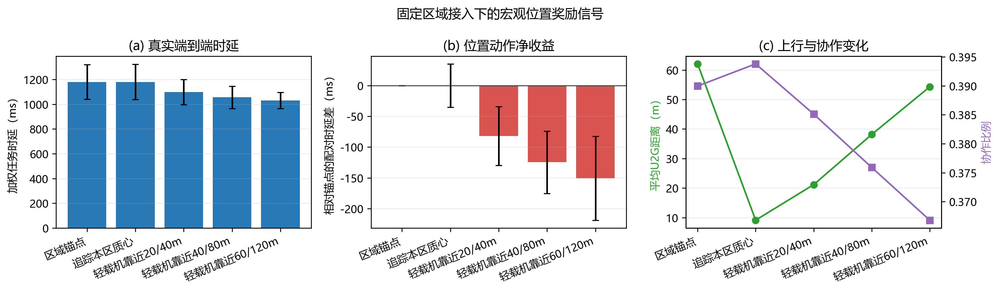

# diagnostics

- **实验族**：跨版本诊断
- **状态**：诊断数据
- **说明**：宏观奖励、反事实分叉、动作覆盖和动态质心位置扫描。
- **归档内容**：25 个文件，0.55 MB
- **未归档大文件**：0 个检查点、0 个数组，共 0.00 MB

> 不同版本的场景、奖励、时隙或通信模型可能不同。除非总 README 明确说明，否则不要直接比较不同版本的绝对数值。

## 预览

## 图片

- [macro_reward_signal.png](macro_reward_signal_v14_ep40/macro_reward_signal.png)
- [macro_reward_signal.png](macro_reward_signal_v15_ep40_corrected/macro_reward_signal.png)

## 指标数据

- [macro_reward_signal_raw.csv](macro_reward_signal_v14_ep40/macro_reward_signal_raw.csv)
- [macro_reward_signal_summary.json](macro_reward_signal_v14_ep40/macro_reward_signal_summary.json)
- [macro_reward_signal_raw.csv](macro_reward_signal_v15_ep40_corrected/macro_reward_signal_raw.csv)
- [macro_reward_signal_summary.json](macro_reward_signal_v15_ep40_corrected/macro_reward_signal_summary.json)
- [branch_raw.csv](v23_counterfactual_centroid_smoke/branch_raw.csv)
- [episode_summary.csv](v23_counterfactual_centroid_smoke/episode_summary.csv)
- [summary.json](v23_counterfactual_centroid_smoke/summary.json)
- [branch_raw.csv](v23_counterfactual_smoke/branch_raw.csv)
- [episode_summary.csv](v23_counterfactual_smoke/episode_summary.csv)
- [summary.json](v23_counterfactual_smoke/summary.json)
- [branch_raw.csv](v23_counterfactual_v22_final_5ep/branch_raw.csv)
- [episode_summary.csv](v23_counterfactual_v22_final_5ep/episode_summary.csv)
- [summary.json](v23_counterfactual_v22_final_5ep/summary.json)
- [scan_progress.json](v23_dynamic_centroid_scan_full/scan_progress.json)
- [dynamic_centroid_scan.json](v23_dynamic_scan_smoke/dynamic_centroid_scan.json)
- [scan_progress.json](v23_dynamic_scan_smoke/scan_progress.json)
- [branch_raw.csv](v23_target_noise_counterfactual_3ep/branch_raw.csv)
- [episode_summary.csv](v23_target_noise_counterfactual_3ep/episode_summary.csv)
- [summary.json](v23_target_noise_counterfactual_3ep/summary.json)

## 日志

- [stderr.log](cross_layer_v14/stderr.log)
- [stdout.log](cross_layer_v14/stdout.log)
- [launcher.stderr.log](v23_dynamic_centroid_scan_full/launcher.stderr.log)
- [launcher.stdout.log](v23_dynamic_centroid_scan_full/launcher.stdout.log)
