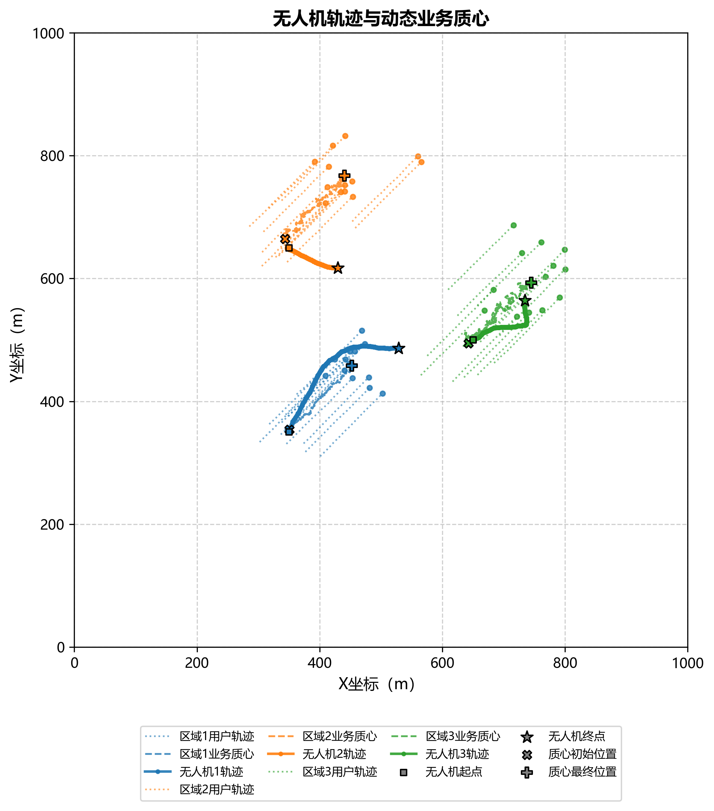

# joint_hrl_30step

- **实验族**：早期动态用户 HRL
- **状态**：历史实验
- **说明**：早期联合 TD3-SAC 训练与宏观周期设置迭代。
- **归档内容**：33 个文件，5.16 MB
- **未归档大文件**：36 个检查点、16 个数组，共 489.48 MB

> 不同版本的场景、奖励、时隙或通信模型可能不同。除非总 README 明确说明，否则不要直接比较不同版本的绝对数值。

## 预览

## 图片

- [training_convergence.pdf](formal/seed1/figures/training_convergence.pdf)
- [training_convergence.png](formal/seed1/figures/training_convergence.png)
- [trajectory_best.png](formal/seed1/joint_td3_sac/trajectory_snapshots/trajectory_best.png)
- [trajectory_ep_0100.png](formal/seed1/joint_td3_sac/trajectory_snapshots/trajectory_ep_0100.png)
- [trajectory_ep_0200.png](formal/seed1/joint_td3_sac/trajectory_snapshots/trajectory_ep_0200.png)
- [trajectory_ep_0300.png](formal/seed1/joint_td3_sac/trajectory_snapshots/trajectory_ep_0300.png)
- [trajectory_ep_0400.png](formal/seed1/joint_td3_sac/trajectory_snapshots/trajectory_ep_0400.png)
- [trajectory_ep_0500.png](formal/seed1/joint_td3_sac/trajectory_snapshots/trajectory_ep_0500.png)
- [trajectory_ep_0600.png](formal/seed1/joint_td3_sac/trajectory_snapshots/trajectory_ep_0600.png)
- [trajectory_final.png](formal/seed1/joint_td3_sac/trajectory_snapshots/trajectory_final.png)
- [trajectory_ep_0100.png](formal/seed1/micro_pretrain/trajectory_snapshots/trajectory_ep_0100.png)
- [trajectory_ep_0200.png](formal/seed1/micro_pretrain/trajectory_snapshots/trajectory_ep_0200.png)
- [trajectory_final.png](formal/seed1/micro_pretrain/trajectory_snapshots/trajectory_final.png)
- [trajectory_best.png](smoke/seed1/joint_td3_sac/trajectory_snapshots/trajectory_best.png)

## 指标数据

- [protocol_snapshot.json](formal/protocol_snapshot.json)
- [eval_central_td3.csv](formal/seed1/joint_td3_sac/eval_central_td3.csv)
- [scenario.json](formal/seed1/joint_td3_sac/meta/scenario.json)
- [train_td3.csv](formal/seed1/joint_td3_sac/train_td3.csv)
- [eval_central_macro.csv](formal/seed1/micro_pretrain/eval_central_macro.csv)
- [scenario.json](formal/seed1/micro_pretrain/meta/scenario.json)
- [train_centralized.csv](formal/seed1/micro_pretrain/train_centralized.csv)
- [protocol_snapshot.json](pilot/protocol_snapshot.json)
- [protocol_snapshot.json](smoke/protocol_snapshot.json)
- [eval_central_td3.csv](smoke/seed1/joint_td3_sac/eval_central_td3.csv)
- [scenario.json](smoke/seed1/joint_td3_sac/meta/scenario.json)
- [train_td3.csv](smoke/seed1/joint_td3_sac/train_td3.csv)
- [eval_central_macro.csv](smoke/seed1/micro_pretrain/eval_central_macro.csv)
- [scenario.json](smoke/seed1/micro_pretrain/meta/scenario.json)
- [train_centralized.csv](smoke/seed1/micro_pretrain/train_centralized.csv)

## 日志

- [joint_td3_sac_s1.log](_logs/formal/joint_td3_sac_s1.log)
- [micro_pretrain_s1.log](_logs/formal/micro_pretrain_s1.log)
- [joint_td3_sac_s1.log](_logs/smoke/joint_td3_sac_s1.log)
- [micro_pretrain_s1.log](_logs/smoke/micro_pretrain_s1.log)
