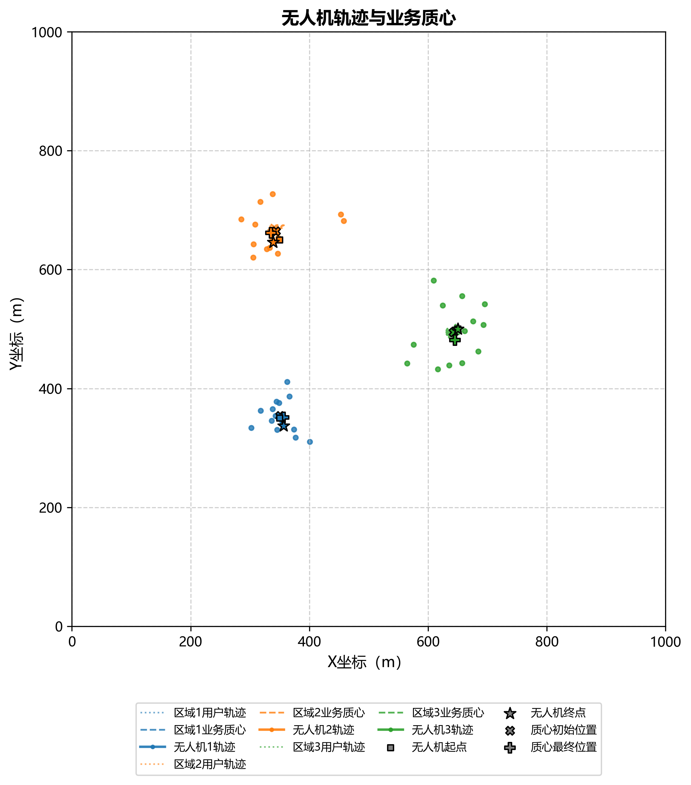

# joint_hrl_static_v7

- **实验族**：静态用户 HRL
- **状态**：历史诊断
- **说明**：静态用户条件下的 waypoint、动作参数化与宏观学习稳定性诊断。
- **归档内容**：16 个文件，1.37 MB
- **未归档大文件**：19 个检查点、7 个数组，共 88.63 MB

> 不同版本的场景、奖励、时隙或通信模型可能不同。除非总 README 明确说明，否则不要直接比较不同版本的绝对数值。

## 预览

## 图片

- [trajectory_ep_0100.png](pilot/seed1/joint_ppo_sac/trajectory_snapshots/trajectory_ep_0100.png)
- [trajectory_final.png](pilot/seed1/joint_ppo_sac/trajectory_snapshots/trajectory_final.png)
- [trajectory_ep_0100.png](pilot/seed1/micro_pretrain/trajectory_snapshots/trajectory_ep_0100.png)
- [trajectory_ep_0200.png](pilot/seed1/micro_pretrain/trajectory_snapshots/trajectory_ep_0200.png)
- [trajectory_final.png](pilot/seed1/micro_pretrain/trajectory_snapshots/trajectory_final.png)

## 指标数据

- [protocol_snapshot.json](pilot/protocol_snapshot.json)
- [eval_central_macro.csv](pilot/seed1/joint_ppo_sac/eval_central_macro.csv)
- [scenario.json](pilot/seed1/joint_ppo_sac/meta/scenario.json)
- [train_centralized.csv](pilot/seed1/joint_ppo_sac/train_centralized.csv)
- [eval_central_macro.csv](pilot/seed1/micro_pretrain/eval_central_macro.csv)
- [scenario.json](pilot/seed1/micro_pretrain/meta/scenario.json)
- [train_centralized.csv](pilot/seed1/micro_pretrain/train_centralized.csv)

## 日志

- [joint_ppo_sac_s1.log](_logs/pilot/joint_ppo_sac_s1.log)
- [micro_pretrain_s1.log](_logs/pilot/micro_pretrain_s1.log)
- [pilot_stderr.log](pilot_stderr.log)
- [pilot_stdout.log](pilot_stdout.log)
