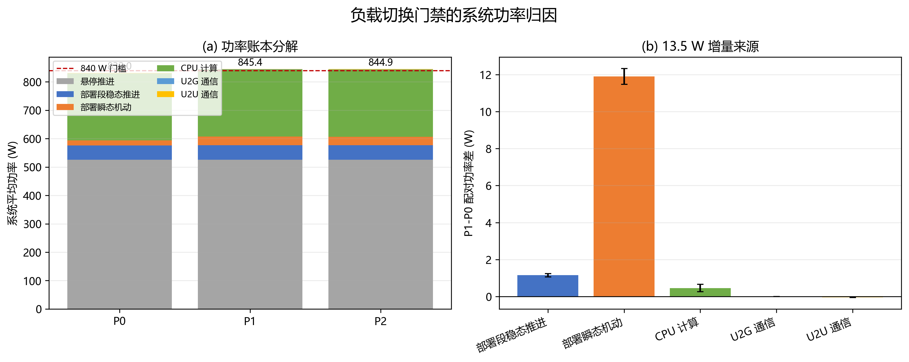

# load_switch_gate_power_audit

- **实验族**：负载切换功率归因
- **状态**：只读重放审计
- **说明**：20 个共同随机种子的逐机推进、CPU、U2G/U2U 功率与速度分解；原门禁策略和物理模型均未修改。
- **归档内容**：89 个文件，2.81 MB
- **未归档大文件**：0 个检查点、60 个数组，共 0.20 MB

> 不同版本的场景、奖励、时隙或通信模型可能不同。除非总 README 明确说明，否则不要直接比较不同版本的绝对数值。

## 预览

## 图片

- [mean_flow_heatmaps.pdf](flow_matrices/mean_flow_heatmaps.pdf)
- [mean_flow_heatmaps.png](flow_matrices/mean_flow_heatmaps.png)
- [gate_summary.pdf](gate_summary.pdf)
- [gate_summary.png](gate_summary.png)
- [power_decomposition.pdf](power_decomposition.pdf)
- [power_decomposition.png](power_decomposition.png)
- [load_switch_trajectories.pdf](trajectories/load_switch_trajectories.pdf)
- [load_switch_trajectories.png](trajectories/load_switch_trajectories.png)

## 指标数据

- [mean_F_mn_long.csv](flow_matrices/mean_F_mn_long.csv)
- [P0_phase1_mean_F_mn.csv](flow_matrices/P0_phase1_mean_F_mn.csv)
- [P0_phase2_mean_F_mn.csv](flow_matrices/P0_phase2_mean_F_mn.csv)
- [P0_phase3_mean_F_mn.csv](flow_matrices/P0_phase3_mean_F_mn.csv)
- [P1_phase1_mean_F_mn.csv](flow_matrices/P1_phase1_mean_F_mn.csv)
- [P1_phase2_mean_F_mn.csv](flow_matrices/P1_phase2_mean_F_mn.csv)
- [P1_phase3_mean_F_mn.csv](flow_matrices/P1_phase3_mean_F_mn.csv)
- [P2_phase1_mean_F_mn.csv](flow_matrices/P2_phase1_mean_F_mn.csv)
- [P2_phase2_mean_F_mn.csv](flow_matrices/P2_phase2_mean_F_mn.csv)
- [P2_phase3_mean_F_mn.csv](flow_matrices/P2_phase3_mean_F_mn.csv)
- [gate_configuration.json](gate_configuration.json)
- [gate_verdict.json](gate_verdict.json)
- [P0_seed65000.csv](macro_traces/P0_seed65000.csv)
- [P0_seed65001.csv](macro_traces/P0_seed65001.csv)
- [P0_seed65002.csv](macro_traces/P0_seed65002.csv)
- [P0_seed65003.csv](macro_traces/P0_seed65003.csv)
- [P0_seed65004.csv](macro_traces/P0_seed65004.csv)
- [P0_seed65005.csv](macro_traces/P0_seed65005.csv)
- [P0_seed65006.csv](macro_traces/P0_seed65006.csv)
- [P0_seed65007.csv](macro_traces/P0_seed65007.csv)
- [P0_seed65008.csv](macro_traces/P0_seed65008.csv)
- [P0_seed65009.csv](macro_traces/P0_seed65009.csv)
- [P0_seed65010.csv](macro_traces/P0_seed65010.csv)
- [P0_seed65011.csv](macro_traces/P0_seed65011.csv)
- [P0_seed65012.csv](macro_traces/P0_seed65012.csv)
- [P0_seed65013.csv](macro_traces/P0_seed65013.csv)
- [P0_seed65014.csv](macro_traces/P0_seed65014.csv)
- [P0_seed65015.csv](macro_traces/P0_seed65015.csv)
- [P0_seed65016.csv](macro_traces/P0_seed65016.csv)
- [P0_seed65017.csv](macro_traces/P0_seed65017.csv)
- [P0_seed65018.csv](macro_traces/P0_seed65018.csv)
- [P0_seed65019.csv](macro_traces/P0_seed65019.csv)
- [P1_seed65000.csv](macro_traces/P1_seed65000.csv)
- [P1_seed65001.csv](macro_traces/P1_seed65001.csv)
- [P1_seed65002.csv](macro_traces/P1_seed65002.csv)
- [P1_seed65003.csv](macro_traces/P1_seed65003.csv)
- [P1_seed65004.csv](macro_traces/P1_seed65004.csv)
- [P1_seed65005.csv](macro_traces/P1_seed65005.csv)
- [P1_seed65006.csv](macro_traces/P1_seed65006.csv)
- [P1_seed65007.csv](macro_traces/P1_seed65007.csv)
- [P1_seed65008.csv](macro_traces/P1_seed65008.csv)
- [P1_seed65009.csv](macro_traces/P1_seed65009.csv)
- [P1_seed65010.csv](macro_traces/P1_seed65010.csv)
- [P1_seed65011.csv](macro_traces/P1_seed65011.csv)
- [P1_seed65012.csv](macro_traces/P1_seed65012.csv)
- [P1_seed65013.csv](macro_traces/P1_seed65013.csv)
- [P1_seed65014.csv](macro_traces/P1_seed65014.csv)
- [P1_seed65015.csv](macro_traces/P1_seed65015.csv)
- [P1_seed65016.csv](macro_traces/P1_seed65016.csv)
- [P1_seed65017.csv](macro_traces/P1_seed65017.csv)
- [P1_seed65018.csv](macro_traces/P1_seed65018.csv)
- [P1_seed65019.csv](macro_traces/P1_seed65019.csv)
- [P2_seed65000.csv](macro_traces/P2_seed65000.csv)
- [P2_seed65001.csv](macro_traces/P2_seed65001.csv)
- [P2_seed65002.csv](macro_traces/P2_seed65002.csv)
- [P2_seed65003.csv](macro_traces/P2_seed65003.csv)
- [P2_seed65004.csv](macro_traces/P2_seed65004.csv)
- [P2_seed65005.csv](macro_traces/P2_seed65005.csv)
- [P2_seed65006.csv](macro_traces/P2_seed65006.csv)
- [P2_seed65007.csv](macro_traces/P2_seed65007.csv)
- [P2_seed65008.csv](macro_traces/P2_seed65008.csv)
- [P2_seed65009.csv](macro_traces/P2_seed65009.csv)
- [P2_seed65010.csv](macro_traces/P2_seed65010.csv)
- [P2_seed65011.csv](macro_traces/P2_seed65011.csv)
- [P2_seed65012.csv](macro_traces/P2_seed65012.csv)
- [P2_seed65013.csv](macro_traces/P2_seed65013.csv)
- [P2_seed65014.csv](macro_traces/P2_seed65014.csv)
- [P2_seed65015.csv](macro_traces/P2_seed65015.csv)
- [P2_seed65016.csv](macro_traces/P2_seed65016.csv)
- [P2_seed65017.csv](macro_traces/P2_seed65017.csv)
- [P2_seed65018.csv](macro_traces/P2_seed65018.csv)
- [P2_seed65019.csv](macro_traces/P2_seed65019.csv)
- [paired_deltas.csv](paired_deltas.csv)
- [per_seed_raw.csv](per_seed_raw.csv)
- [power_audit.json](power_audit.json)
- [power_component_paired_deltas.csv](power_component_paired_deltas.csv)
- [power_components_by_policy.csv](power_components_by_policy.csv)
- [power_per_uav.csv](power_per_uav.csv)
- [role_conditioned_power_deltas.csv](role_conditioned_power_deltas.csv)

## 日志

- [gate_verdict.md](gate_verdict.md)
- [power_audit.md](power_audit.md)
