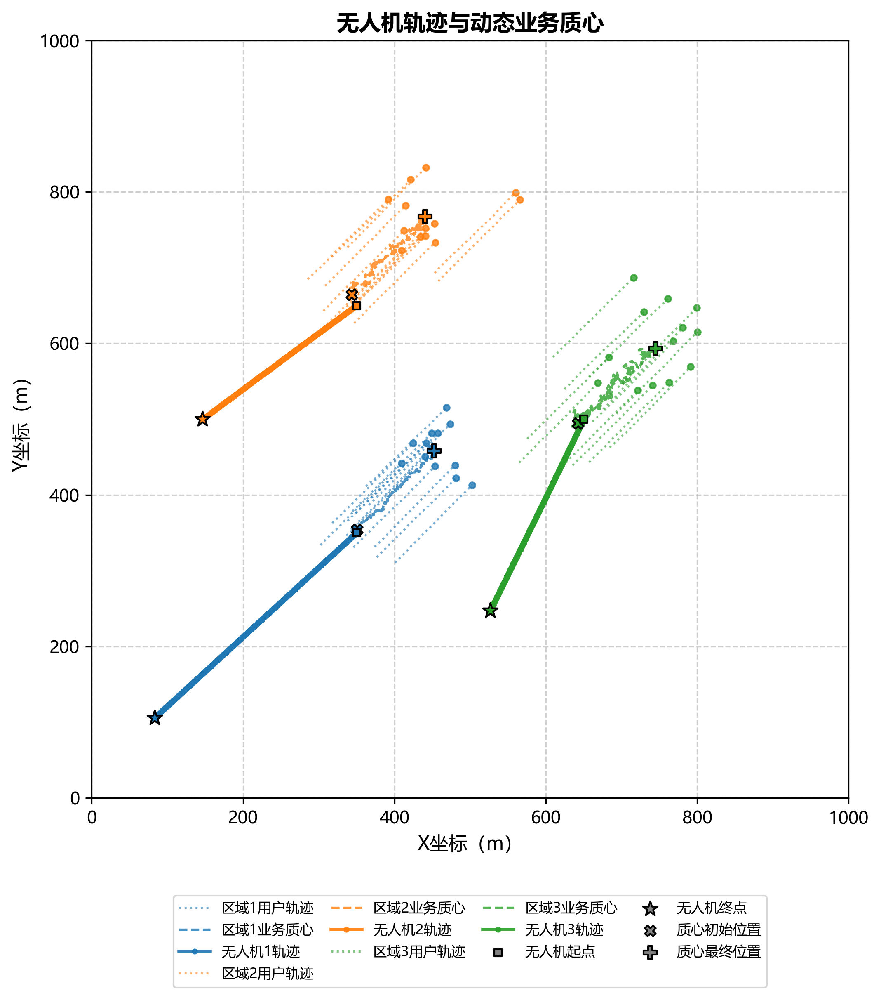

# tcom_communication_convergence_v1

- **实验族**：通信模型收敛验证
- **状态**：历史验证
- **说明**：切换到参考论文风格 U2U 动态带宽后的通信模型与收敛测试。
- **归档内容**：34 个文件，3.32 MB
- **未归档大文件**：20 个检查点、10 个数组，共 114.78 MB

> 不同版本的场景、奖励、时隙或通信模型可能不同。除非总 README 明确说明，否则不要直接比较不同版本的绝对数值。

## 预览

## 图片

- [reward_feedback.pdf](diagnostic/seed1/figures/reward_feedback.pdf)
- [reward_feedback.png](diagnostic/seed1/figures/reward_feedback.png)
- [training_convergence.pdf](diagnostic/seed1/figures/training_convergence.pdf)
- [training_convergence.png](diagnostic/seed1/figures/training_convergence.png)
- [trajectory_best.png](diagnostic/seed1/joint_td3_sac/trajectory_snapshots/trajectory_best.png)
- [trajectory_ep_0020.png](diagnostic/seed1/joint_td3_sac/trajectory_snapshots/trajectory_ep_0020.png)
- [trajectory_final.png](diagnostic/seed1/joint_td3_sac/trajectory_snapshots/trajectory_final.png)
- [trajectory_ep_0020.png](diagnostic/seed1/micro_pretrain/trajectory_snapshots/trajectory_ep_0020.png)
- [trajectory_final.png](diagnostic/seed1/micro_pretrain/trajectory_snapshots/trajectory_final.png)
- [trajectory_best.png](smoke/seed1/joint_td3_sac/trajectory_snapshots/trajectory_best.png)

## 指标数据

- [protocol_snapshot.json](diagnostic/protocol_snapshot.json)
- [reward_feedback_correlations.csv](diagnostic/seed1/figures/reward_feedback_correlations.csv)
- [reward_feedback_summary.json](diagnostic/seed1/figures/reward_feedback_summary.json)
- [eval_central_td3.csv](diagnostic/seed1/joint_td3_sac/eval_central_td3.csv)
- [scenario.json](diagnostic/seed1/joint_td3_sac/meta/scenario.json)
- [train_td3.csv](diagnostic/seed1/joint_td3_sac/train_td3.csv)
- [eval_central_macro.csv](diagnostic/seed1/micro_pretrain/eval_central_macro.csv)
- [scenario.json](diagnostic/seed1/micro_pretrain/meta/scenario.json)
- [train_centralized.csv](diagnostic/seed1/micro_pretrain/train_centralized.csv)
- [verification_seed1.json](diagnostic/summaries/verification_seed1.json)
- [protocol_snapshot.json](smoke/protocol_snapshot.json)
- [eval_central_td3.csv](smoke/seed1/joint_td3_sac/eval_central_td3.csv)
- [scenario.json](smoke/seed1/joint_td3_sac/meta/scenario.json)
- [train_td3.csv](smoke/seed1/joint_td3_sac/train_td3.csv)
- [eval_central_macro.csv](smoke/seed1/micro_pretrain/eval_central_macro.csv)
- [scenario.json](smoke/seed1/micro_pretrain/meta/scenario.json)
- [train_centralized.csv](smoke/seed1/micro_pretrain/train_centralized.csv)
- [verification_seed1.json](smoke/summaries/verification_seed1.json)

## 日志

- [joint_td3_sac_s1.log](_logs/diagnostic/joint_td3_sac_s1.log)
- [micro_pretrain_s1.log](_logs/diagnostic/micro_pretrain_s1.log)
- [joint_td3_sac_s1.log](_logs/smoke/joint_td3_sac_s1.log)
- [micro_pretrain_s1.log](_logs/smoke/micro_pretrain_s1.log)
- [diagnostic_runner.stderr.log](diagnostic_runner.stderr.log)
- [diagnostic_runner.stdout.log](diagnostic_runner.stdout.log)
