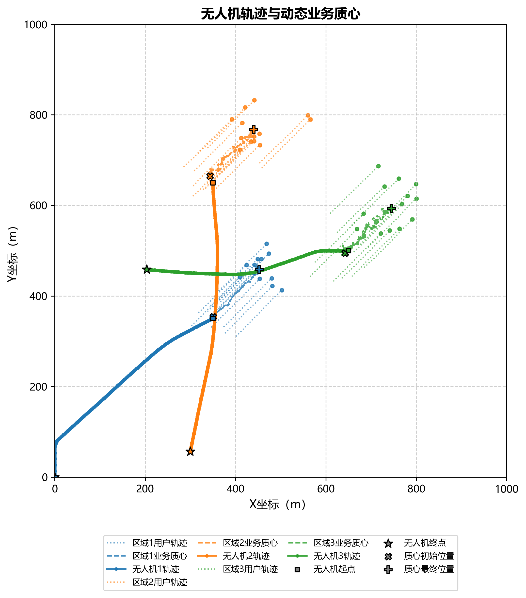

# tcom_communication_convergence_v2

- **实验族**：通信模型收敛验证
- **状态**：历史验证
- **说明**：切换到参考论文风格 U2U 动态带宽后的通信模型与收敛测试。
- **归档内容**：22 个文件，4.11 MB
- **未归档大文件**：21 个检查点、8 个数组，共 226.72 MB

> 不同版本的场景、奖励、时隙或通信模型可能不同。除非总 README 明确说明，否则不要直接比较不同版本的绝对数值。

## 预览

## 图片

- [reward_feedback.pdf](pilot/seed1/figures/reward_feedback.pdf)
- [reward_feedback.png](pilot/seed1/figures/reward_feedback.png)
- [training_convergence.pdf](pilot/seed1/figures/training_convergence.pdf)
- [training_convergence.png](pilot/seed1/figures/training_convergence.png)
- [trajectory_best.png](pilot/seed1/joint_td3_sac/trajectory_snapshots/trajectory_best.png)
- [trajectory_ep_0100.png](pilot/seed1/joint_td3_sac/trajectory_snapshots/trajectory_ep_0100.png)
- [trajectory_final.png](pilot/seed1/joint_td3_sac/trajectory_snapshots/trajectory_final.png)
- [trajectory_ep_0100.png](pilot/seed1/micro_pretrain/trajectory_snapshots/trajectory_ep_0100.png)
- [trajectory_ep_0200.png](pilot/seed1/micro_pretrain/trajectory_snapshots/trajectory_ep_0200.png)
- [trajectory_final.png](pilot/seed1/micro_pretrain/trajectory_snapshots/trajectory_final.png)

## 指标数据

- [protocol_snapshot.json](pilot/protocol_snapshot.json)
- [reward_feedback_correlations.csv](pilot/seed1/figures/reward_feedback_correlations.csv)
- [reward_feedback_summary.json](pilot/seed1/figures/reward_feedback_summary.json)
- [eval_central_td3.csv](pilot/seed1/joint_td3_sac/eval_central_td3.csv)
- [scenario.json](pilot/seed1/joint_td3_sac/meta/scenario.json)
- [train_td3.csv](pilot/seed1/joint_td3_sac/train_td3.csv)
- [eval_central_macro.csv](pilot/seed1/micro_pretrain/eval_central_macro.csv)
- [scenario.json](pilot/seed1/micro_pretrain/meta/scenario.json)
- [train_centralized.csv](pilot/seed1/micro_pretrain/train_centralized.csv)
- [verification_seed1.json](pilot/summaries/verification_seed1.json)

## 日志

- [joint_td3_sac_s1.log](_logs/pilot/joint_td3_sac_s1.log)
- [micro_pretrain_s1.log](_logs/pilot/micro_pretrain_s1.log)
