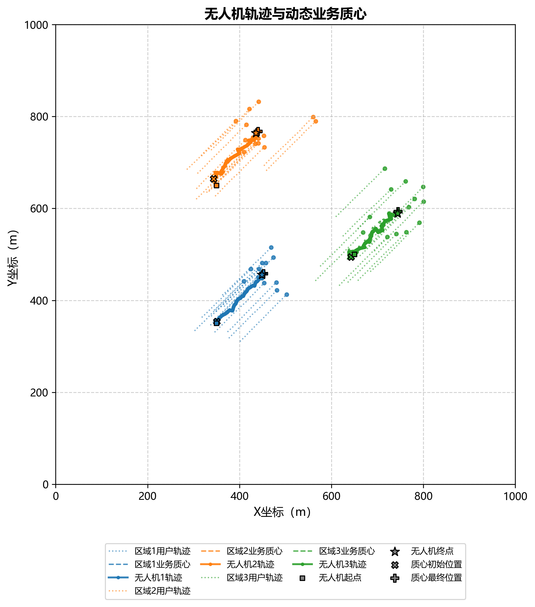

# tcom_dynamic_u2u_sparse_v21_long600

- **实验族**：动态用户与 U2U 协作
- **状态**：历史基线
- **说明**：v21：稀疏 U2U 动态场景基线及微观预训练来源。
- **归档内容**：25 个文件，2.88 MB
- **未归档大文件**：38 个检查点、10 个数组，共 301.13 MB

> 不同版本的场景、奖励、时隙或通信模型可能不同。除非总 README 明确说明，否则不要直接比较不同版本的绝对数值。

## 预览

## 图片

- [trajectory_ep_0100.png](pilot/seed1/joint_td3_sac/trajectory_snapshots/trajectory_ep_0100.png)
- [trajectory_ep_0200.png](pilot/seed1/joint_td3_sac/trajectory_snapshots/trajectory_ep_0200.png)
- [trajectory_ep_0100.png](pilot/seed1/micro_pretrain/trajectory_snapshots/trajectory_ep_0100.png)
- [trajectory_ep_0200.png](pilot/seed1/micro_pretrain/trajectory_snapshots/trajectory_ep_0200.png)
- [trajectory_ep_0300.png](pilot/seed1/micro_pretrain/trajectory_snapshots/trajectory_ep_0300.png)
- [trajectory_final.png](pilot/seed1/micro_pretrain/trajectory_snapshots/trajectory_final.png)
- [trajectory_best.png](smoke/seed1/joint_td3_sac/trajectory_snapshots/trajectory_best.png)

## 指标数据

- [protocol_snapshot.json](pilot/protocol_snapshot.json)
- [eval_central_td3.csv](pilot/seed1/joint_td3_sac/eval_central_td3.csv)
- [scenario.json](pilot/seed1/joint_td3_sac/meta/scenario.json)
- [train_td3.csv](pilot/seed1/joint_td3_sac/train_td3.csv)
- [eval_central_macro.csv](pilot/seed1/micro_pretrain/eval_central_macro.csv)
- [scenario.json](pilot/seed1/micro_pretrain/meta/scenario.json)
- [train_centralized.csv](pilot/seed1/micro_pretrain/train_centralized.csv)
- [protocol_snapshot.json](smoke/protocol_snapshot.json)
- [eval_central_td3.csv](smoke/seed1/joint_td3_sac/eval_central_td3.csv)
- [scenario.json](smoke/seed1/joint_td3_sac/meta/scenario.json)
- [train_td3.csv](smoke/seed1/joint_td3_sac/train_td3.csv)
- [eval_central_macro.csv](smoke/seed1/micro_pretrain/eval_central_macro.csv)
- [scenario.json](smoke/seed1/micro_pretrain/meta/scenario.json)
- [train_centralized.csv](smoke/seed1/micro_pretrain/train_centralized.csv)

## 日志

- [joint_td3_sac_s1.log](_logs/pilot/joint_td3_sac_s1.log)
- [micro_pretrain_s1.log](_logs/pilot/micro_pretrain_s1.log)
- [joint_td3_sac_s1.log](_logs/smoke/joint_td3_sac_s1.log)
- [micro_pretrain_s1.log](_logs/smoke/micro_pretrain_s1.log)
