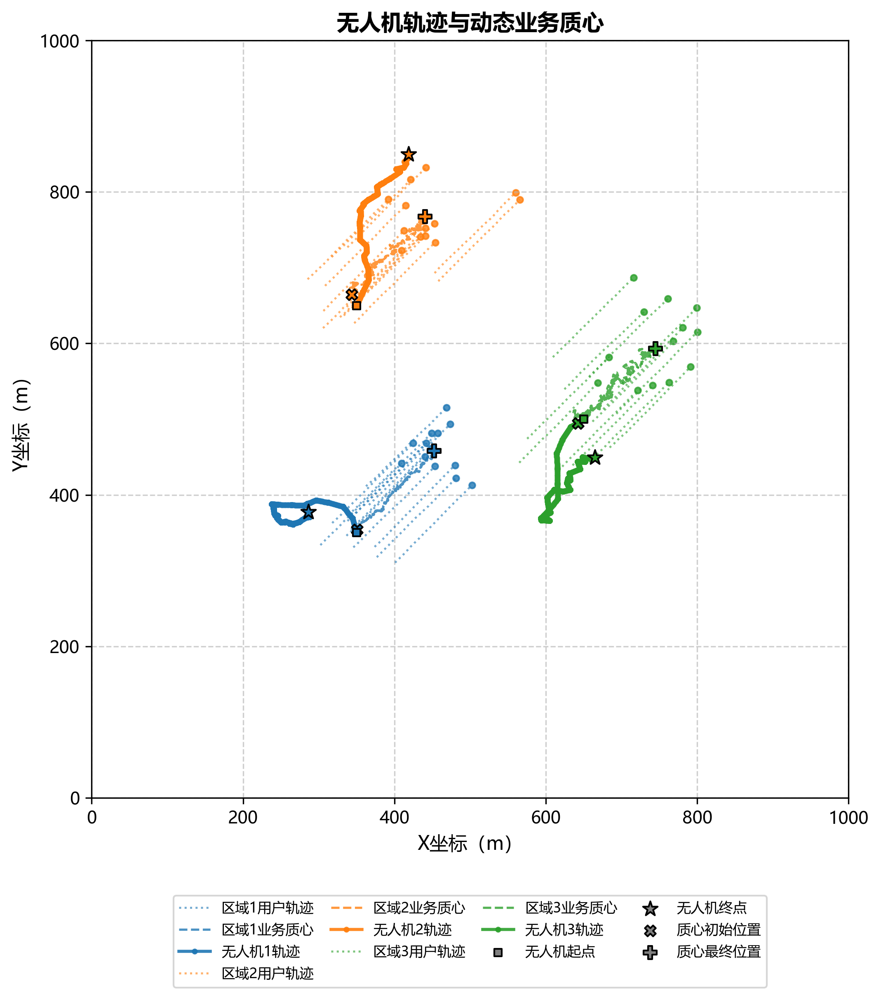

# tcom_dynamic_u2u_sparse_v22_long1000

- **实验族**：动态用户与 U2U 协作
- **状态**：历史长训练
- **说明**：v22：1000 轮动态 U2U 训练，用于确认长期漂移并非训练轮数不足。
- **归档内容**：22 个文件，6.04 MB
- **未归档大文件**：53 个检查点、13 个数组，共 809.90 MB

> 不同版本的场景、奖励、时隙或通信模型可能不同。除非总 README 明确说明，否则不要直接比较不同版本的绝对数值。

## 预览

## 图片

- [macro_reward_signal.png](pilot/seed1/analysis/macro_reward_final/macro_reward_signal.png)
- [training_convergence.pdf](pilot/seed1/figures/training_convergence.pdf)
- [training_convergence.png](pilot/seed1/figures/training_convergence.png)
- [trajectory_best.png](pilot/seed1/joint_td3_sac/trajectory_snapshots/trajectory_best.png)
- [trajectory_ep_0100.png](pilot/seed1/joint_td3_sac/trajectory_snapshots/trajectory_ep_0100.png)
- [trajectory_ep_0200.png](pilot/seed1/joint_td3_sac/trajectory_snapshots/trajectory_ep_0200.png)
- [trajectory_ep_0300.png](pilot/seed1/joint_td3_sac/trajectory_snapshots/trajectory_ep_0300.png)
- [trajectory_ep_0400.png](pilot/seed1/joint_td3_sac/trajectory_snapshots/trajectory_ep_0400.png)
- [trajectory_ep_0500.png](pilot/seed1/joint_td3_sac/trajectory_snapshots/trajectory_ep_0500.png)
- [trajectory_ep_0600.png](pilot/seed1/joint_td3_sac/trajectory_snapshots/trajectory_ep_0600.png)
- [trajectory_ep_0700.png](pilot/seed1/joint_td3_sac/trajectory_snapshots/trajectory_ep_0700.png)
- [trajectory_ep_0800.png](pilot/seed1/joint_td3_sac/trajectory_snapshots/trajectory_ep_0800.png)
- [trajectory_ep_0900.png](pilot/seed1/joint_td3_sac/trajectory_snapshots/trajectory_ep_0900.png)
- [trajectory_ep_1000.png](pilot/seed1/joint_td3_sac/trajectory_snapshots/trajectory_ep_1000.png)
- [trajectory_final.png](pilot/seed1/joint_td3_sac/trajectory_snapshots/trajectory_final.png)

## 指标数据

- [protocol_snapshot.json](pilot/protocol_snapshot.json)
- [macro_reward_signal_raw.csv](pilot/seed1/analysis/macro_reward_final/macro_reward_signal_raw.csv)
- [macro_reward_signal_summary.json](pilot/seed1/analysis/macro_reward_final/macro_reward_signal_summary.json)
- [eval_central_td3.csv](pilot/seed1/joint_td3_sac/eval_central_td3.csv)
- [scenario.json](pilot/seed1/joint_td3_sac/meta/scenario.json)
- [train_td3.csv](pilot/seed1/joint_td3_sac/train_td3.csv)

## 日志

- [joint_td3_sac_s1.log](_logs/pilot/joint_td3_sac_s1.log)
