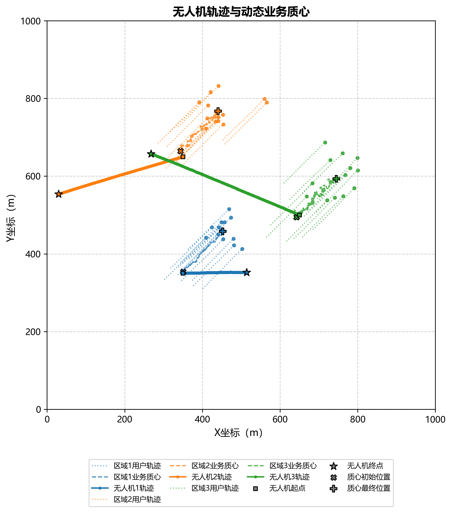

# tcom_fixed_region_reward_ablation

- **实验族**：宏观奖励诊断
- **状态**：诊断/消融
- **说明**：固定区域下的宏观奖励信号、惩罚与冻结策略消融。
- **归档内容**：28 个文件，4.20 MB
- **未归档大文件**：26 个检查点、14 个数组，共 343.49 MB

> 不同版本的场景、奖励、时隙或通信模型可能不同。除非总 README 明确说明，否则不要直接比较不同版本的绝对数值。

## 预览

## 图片

- [trajectory_best.png](ep140_macro_step_noise/trajectory_snapshots/trajectory_best.png)
- [trajectory_ep_0060.png](ep140_macro_step_noise/trajectory_snapshots/trajectory_ep_0060.png)
- [trajectory_final.png](ep140_macro_step_noise/trajectory_snapshots/trajectory_final.png)
- [trajectory_best.png](ep140_replay_macro_step/trajectory_snapshots/trajectory_best.png)
- [trajectory_ep_0060.png](ep140_replay_macro_step/trajectory_snapshots/trajectory_ep_0060.png)
- [trajectory_final.png](ep140_replay_macro_step/trajectory_snapshots/trajectory_final.png)
- [trajectory_best.png](frozen_ep140_pure_reward_180/trajectory_snapshots/trajectory_best.png)
- [trajectory_ep_0060.png](frozen_ep140_pure_reward_180/trajectory_snapshots/trajectory_ep_0060.png)
- [trajectory_ep_0120.png](frozen_ep140_pure_reward_180/trajectory_snapshots/trajectory_ep_0120.png)
- [trajectory_ep_0180.png](frozen_ep140_pure_reward_180/trajectory_snapshots/trajectory_ep_0180.png)
- [trajectory_final.png](frozen_ep140_pure_reward_180/trajectory_snapshots/trajectory_final.png)

## 指标数据

- [eval_central_td3.csv](ep140_macro_step_noise/eval_central_td3.csv)
- [scenario.json](ep140_macro_step_noise/meta/scenario.json)
- [train_td3.csv](ep140_macro_step_noise/train_td3.csv)
- [eval_central_td3.csv](ep140_replay_macro_step/eval_central_td3.csv)
- [scenario.json](ep140_replay_macro_step/meta/scenario.json)
- [train_td3.csv](ep140_replay_macro_step/train_td3.csv)
- [eval_central_td3.csv](frozen_ep140_pure_reward_180/eval_central_td3.csv)
- [scenario.json](frozen_ep140_pure_reward_180/meta/scenario.json)
- [train_td3.csv](frozen_ep140_pure_reward_180/train_td3.csv)
- [scenario.json](system_frozen_ep140_pure_180/meta/scenario.json)

## 日志

- [ep140_macro_step_noise.log](_logs/ep140_macro_step_noise.log)
- [ep140_replay_macro_step.log](_logs/ep140_replay_macro_step.log)
- [ep140_step_noise.err.log](_logs/ep140_step_noise.err.log)
- [ep140_step_noise.out.log](_logs/ep140_step_noise.out.log)
- [ep140_step_noise_v2.log](_logs/ep140_step_noise_v2.log)
- [frozen_ep140_pure_reward_180.log](_logs/frozen_ep140_pure_reward_180.log)
- [system_frozen_ep140_pure_180.log](_logs/system_frozen_ep140_pure_180.log)
