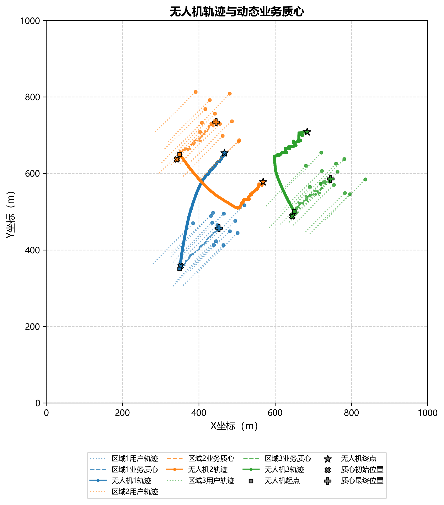

# tcom_fixed_region_soft_power_v10_long_term_credit

- **实验族**：固定区域与软功率机制
- **状态**：迭代诊断
- **说明**：加强部署间隙与长期队列的跨周期信用传递。 各版本配置不同，只用于追踪设计演化。
- **归档内容**：7 个文件，1.00 MB
- **未归档大文件**：11 个检查点、2 个数组，共 104.62 MB

> 不同版本的场景、奖励、时隙或通信模型可能不同。除非总 README 明确说明，否则不要直接比较不同版本的绝对数值。

## 预览

## 图片

- [trajectory_ep_0100.png](pilot/seed1/joint_td3_sac/trajectory_snapshots/trajectory_ep_0100.png)
- [trajectory_ep_0200.png](pilot/seed1/joint_td3_sac/trajectory_snapshots/trajectory_ep_0200.png)

## 指标数据

- [protocol_snapshot.json](pilot/protocol_snapshot.json)
- [eval_central_td3.csv](pilot/seed1/joint_td3_sac/eval_central_td3.csv)
- [scenario.json](pilot/seed1/joint_td3_sac/meta/scenario.json)
- [train_td3.csv](pilot/seed1/joint_td3_sac/train_td3.csv)

## 日志

- [joint_td3_sac_s1.log](_logs/pilot/joint_td3_sac_s1.log)
