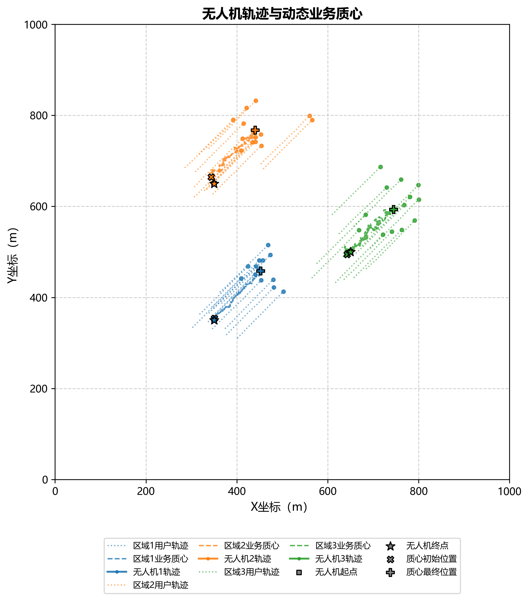

# tcom_fixed_region_soft_power_v2

- **实验族**：固定区域与软功率机制
- **状态**：迭代诊断
- **说明**：软功率固定区域基线。 各版本配置不同，只用于追踪设计演化。
- **归档内容**：38 个文件，2.20 MB
- **未归档大文件**：32 个检查点、11 个数组，共 304.38 MB

> 不同版本的场景、奖励、时隙或通信模型可能不同。除非总 README 明确说明，否则不要直接比较不同版本的绝对数值。

## 预览

## 图片

- [trajectory_ep_0100.png](pilot/seed1/micro_pretrain/trajectory_snapshots/trajectory_ep_0100.png)
- [trajectory_ep_0200.png](pilot/seed1/micro_pretrain/trajectory_snapshots/trajectory_ep_0200.png)
- [trajectory_final.png](pilot/seed1/micro_pretrain/trajectory_snapshots/trajectory_final.png)
- [trajectory_ep_0020.png](pilot/seed1/micro_refine_reset_optimizer/trajectory_snapshots/trajectory_ep_0020.png)
- [trajectory_final.png](pilot/seed1/micro_refine_reset_optimizer/trajectory_snapshots/trajectory_final.png)
- [trajectory_best.png](smoke/seed1/joint_td3_sac/trajectory_snapshots/trajectory_best.png)

## 指标数据

- [protocol_snapshot.json](pilot/protocol_snapshot.json)
- [eval_central_macro.csv](pilot/seed1/micro_pretrain/eval_central_macro.csv)
- [scenario.json](pilot/seed1/micro_pretrain/meta/scenario.json)
- [train_centralized.csv](pilot/seed1/micro_pretrain/train_centralized.csv)
- [eval_central_macro.csv](pilot/seed1/micro_refine/eval_central_macro.csv)
- [scenario.json](pilot/seed1/micro_refine/meta/scenario.json)
- [train_centralized.csv](pilot/seed1/micro_refine/train_centralized.csv)
- [eval_central_macro.csv](pilot/seed1/micro_refine_fresh_replay/eval_central_macro.csv)
- [scenario.json](pilot/seed1/micro_refine_fresh_replay/meta/scenario.json)
- [train_centralized.csv](pilot/seed1/micro_refine_fresh_replay/train_centralized.csv)
- [eval_central_macro.csv](pilot/seed1/micro_refine_reset_optimizer/eval_central_macro.csv)
- [scenario.json](pilot/seed1/micro_refine_reset_optimizer/meta/scenario.json)
- [train_centralized.csv](pilot/seed1/micro_refine_reset_optimizer/train_centralized.csv)
- [protocol_snapshot.json](smoke/protocol_snapshot.json)
- [eval_central_td3.csv](smoke/seed1/joint_td3_sac/eval_central_td3.csv)
- [scenario.json](smoke/seed1/joint_td3_sac/meta/scenario.json)
- [train_td3.csv](smoke/seed1/joint_td3_sac/train_td3.csv)
- [eval_central_macro.csv](smoke/seed1/micro_pretrain/eval_central_macro.csv)
- [scenario.json](smoke/seed1/micro_pretrain/meta/scenario.json)
- [train_centralized.csv](smoke/seed1/micro_pretrain/train_centralized.csv)
- [eval_central_macro.csv](smoke/seed1/micro_refine_debug/eval_central_macro.csv)
- [scenario.json](smoke/seed1/micro_refine_debug/meta/scenario.json)
- [train_centralized.csv](smoke/seed1/micro_refine_debug/train_centralized.csv)

## 日志

- [micro_pretrain_s1.log](_logs/pilot/micro_pretrain_s1.log)
- [micro_refine_fresh_replay_s1.err.log](_logs/pilot/micro_refine_fresh_replay_s1.err.log)
- [micro_refine_fresh_replay_s1.log](_logs/pilot/micro_refine_fresh_replay_s1.log)
- [micro_refine_reset_optimizer_s1.err.log](_logs/pilot/micro_refine_reset_optimizer_s1.err.log)
- [micro_refine_reset_optimizer_s1.log](_logs/pilot/micro_refine_reset_optimizer_s1.log)
- [micro_refine_s1.err.log](_logs/pilot/micro_refine_s1.err.log)
- [micro_refine_s1.log](_logs/pilot/micro_refine_s1.log)
- [joint_td3_sac_s1.log](_logs/smoke/joint_td3_sac_s1.log)
- [micro_pretrain_s1.log](_logs/smoke/micro_pretrain_s1.log)
